<p>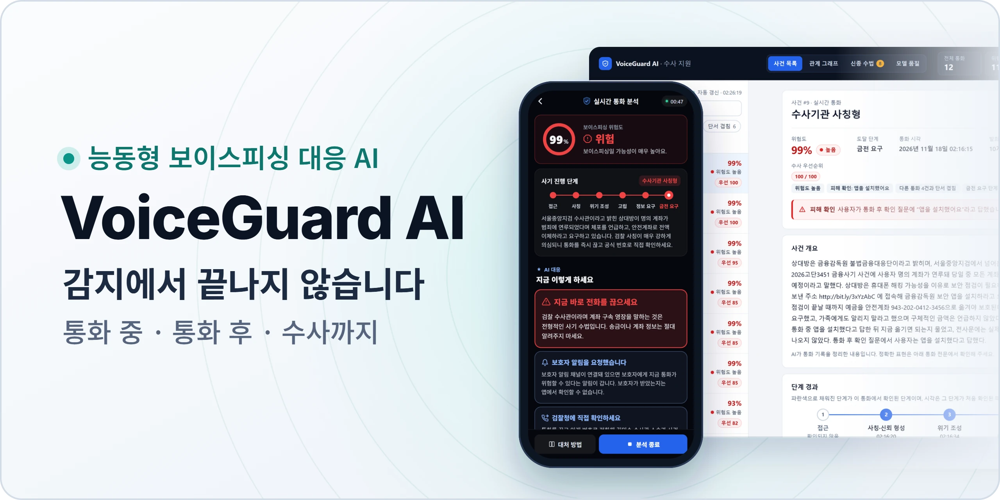</p>

통화를 들으며 사기가 어디까지 진행됐는지 추적하고, 상황에 맞는 행동을 AI가 먼저 안내합니다. 통화가 끝난 뒤에도 피해가 없는지 다시 확인하고, 위험 통화에서 나온 단서는 수사 지원 대시보드로 모읍니다.

[작동 방식](#작동-방식) · [사용자 기능](#사용자-기능) · [수사 지원](#수사-지원) · [탐지 성능](#탐지-성능) · [실행](#실행)

<sub>KNU AI BOOT 7조 자율 프로젝트 → 2026 해커톤 고도화 버전 (v2)</sub>

<table>
<tr>
<td width="50%" valign="top"><a href="docs/one-call.md"><b>전화 한 통 따라가기</b></a><br><sub>사기 전화 한 통의 처음부터 끝까지, 사용자 화면으로</sub></td>
<td width="50%" valign="top"><a href="docs/investigator.md"><b>수사관 곁의 AI 에이전트</b></a><br><sub>단서 수집부터 신고 요약까지 AI가 먼저, 결정은 사람이</sub></td>
</tr>
<tr>
<td width="50%" valign="top"><a href="docs/tech/detection.md"><b>보이스피싱 탐지 정확도</b></a><br><sub>데이터, 학습, 평가 방법, 결과와 한계</sub></td>
<td width="50%" valign="top"><a href="docs/tech/transcription.md"><b>전사 모델 정확도</b></a><br><sub>Whisper 추가 학습, 외부 API 비교, 화자 분리</sub></td>
</tr>
</table>

## 한눈에 보기

<!-- 숫자가 바뀌면 docs/design/numbers.svg, 아래 설명과 대체 문구를 함께 고치고 다시 굽는다 (docs/design/README.md) -->
<p></p>

<sub>통화 분류기 v3 단독 결과이고, 이전은 v2입니다. 왼쪽부터 평가 통화 837건에서 사기 통화를 통화 전체로 판정한 탐지율(통화 중 한 번이라도 경보를 받은 비율은 100%), AI Hub 상담 정상 통화 5,041건(학습에 안 쓴 Validation)의 오경보, 녹음된 정상 상담 32통(Whisper 전사)의 오경보입니다. 전체 표는 <a href="#탐지-성능">탐지 성능</a>에 있습니다. 2026-11-16부터는 가린 개인정보 자리를 채워 다시 학습한 v5를 씁니다. v5는 사기 통화 탐지 99.7%이고, 실제 녹음 전사 정상 상담 1,400건의 오경보를 2.0%에서 1.1%로 줄였습니다(<a href="docs/tech/detection.md#v3--v5-가린-개인정보-자리-채우기">비교</a>).</sub>

**기존 탐지 앱은 "위험합니다"라고 알리고 끝납니다. VoiceGuard는 그다음을 맡습니다.**

<table>
<tr><td nowrap valign="top"><sub>통화 중</sub></td><td><b>할 일을 먼저 안내합니다</b><br>"지금 끊으세요", 공식 대표번호, 상대에게 되물어 볼 질문, 피해 차단 순서까지 띄웁니다.</td></tr>
<tr><td nowrap valign="top"><sub>통화가 끝난 뒤</sub></td><td><b>피해가 없는지 다시 묻습니다</b><br>"통화 이후 괜찮으신가요?"에 고른 답(돈을 보냈어요·앱을 설치했어요 등)에 맞춰 지급정지·신고 순서를 안내합니다.</td></tr>
<tr><td nowrap valign="top"><sub>수사관에게</sub></td><td><b>단서를 사건으로 엮습니다</b><br>AI 에이전트가 겹치는 계좌·번호로 통화를 묶고, 먼저 볼 사건을 골라 대시보드에 정리합니다.</td></tr>
</table>

<details>
<summary><b>기존 탐지 앱과 무엇이 다른가요</b> · 문제와 답 6가지</summary>

| 문제 | VoiceGuard의 답 |
| --- | --- |
| 기존 탐지 앱은 "위험합니다"라고 알리고 끝난다 | 사기 진행 단계(접근 → 사칭 → 위기 조성 → 고립 → 정보 요구 → 금전 요구)를 추적하고, 단계에 맞는 행동을 고른다 |
| 경고를 본 뒤에도 피해자는 무엇을 해야 할지 모른다 | "지금 끊으세요", "검찰청 1301로 직접 확인", "되물어 볼 질문", 지급정지 순서까지 화면에서 바로 안내 |
| 통화가 끝나면 끝 | 통화 중·통화 후에 다시 묻고("통화를 끊으셨나요?", "통화 이후 괜찮으신가요?"), 답에 맞춰 피해 차단 절차를 안내 |
| 피해 신고 내용이 수사로 이어지기 어렵다 | 계좌·전화번호·URL 같은 단서를 자동으로 뽑고, 다른 통화와 겹치는 단서를 찾아 **수사 우선순위·관계 그래프·SHA-256 증거 해시**와 함께 대시보드와 신고용 요약으로 정리 |
| 은행·보험 상담 같은 정상 통화에도 경고가 뜬다 | AI Hub 금융·민원 상담 데이터로 재학습해 정상 상담 오경보를 **30.2% → 0.7%** 로 줄임 (v3 분류기 단독, 아래 성능 참고) |
| 새 수법이 계속 나오는데 탐지는 그대로다 | 금감원·경찰청 새 글을 모으면(대시보드 '지금 수집' 또는 n8n 매일 일정) Claude가 **수법 카드**로 정리하고, 사람이 승인한 카드만 상태 추적기에 반영한 뒤 회귀 평가를 자동으로 돌린다 |

</details>

## 작동 방식

**감지에서 개선까지, 다섯 단계가 이어집니다.** 발화가 들어올 때마다 감지·판단·개입이 몇 초 안에 돌고, 후속 확인은 통화 중 45초 뒤와 통화가 끝난 뒤에 이어집니다. 통화 결과는 개선 단계로 모여 다음 통화의 탐지를 고칩니다.

<p></p>

1. **감지** — 통화를 들으며 받아 적고 바로 사기 확률을 냅니다.<br><sub>faster-whisper large-v3 · KLUE-RoBERTa 분류기</sub>
2. **판단** — 대화 흐름으로 사기 단계·유형·사용자가 따르는 정도·수사 단서를 추적합니다.<br><sub>Claude 상태 추적기 (구조화 출력)</sub>
3. **개입** — 위험도·단계·유형에 맞는 대응을 골라 문구를 만듭니다.<br><sub>대응 에이전트 (규칙 선택 + Claude 작성) · 보호자 알림은 n8n</sub>
4. **후속 확인** — 통화 중 45초 뒤, 통화 후에 다시 묻고 답에 맞춰 안내합니다.<br><sub>후속 질문 → 지급정지·신고 안내 · 답은 사용자 확인으로 저장</sub>
5. **개선** — 사용자 확인을 판정과 맞대 오경보·놓친 사기를 모으고, 새 수법을 배워 반영한 뒤 다시 잽니다.<br><sub>품질 루프(사용자 확인 → 평가 대본·재학습 후보) · 신종 수법 카드(공식 게시판 → Claude → 사람 승인 → 추적기) · 회귀 평가 12개 대본 · AI Hub 상담 데이터·실제 녹음 평가</sub>

화면에 보이는 위험도는 `0.3 × 분류기 + 0.7 × 상태 추적기`입니다. 분류기는 추적기가 따라오기 전 몇 초의 조기 신호를, 추적기는 통화 전체의 의도를 맡습니다. 주의 0.70, 강한 경고 0.85 ([docs/API_SPEC_V2.md](docs/API_SPEC_V2.md) 4.2절).

<p align="center">
   
  <br><sub>발표용 넓은 화면. 통화 중에는 앱 옆에 'AI 분석 과정' 패널(위험도 추이, 판단, 단계, 발화별 분석, 단서, AI 대응)이, 통화가 끝나면 분석 결과가 보입니다.</sub>
</p>

<details>
<summary><b>단계별 예시가 들어간 워크플로 그림</b></summary>
<br>
<p></p>
</details>

## 사용자 기능

**통화 중에는 할 일을 먼저 띄우고, 통화가 끝나면 피해가 없는지 다시 묻습니다.** 받은 문자·문서·녹음도 직접 올려 확인합니다. 실시간 분석이 움직이는 모습은 [시연 GIF](docs/images/v2/demo_realtime.gif)로, 사기 전화 한 통의 처음부터 끝까지는 [전화 한 통 따라가기](docs/one-call.md)로 볼 수 있습니다.

### 통화 중

- **실시간 통화 분석** — 마이크 음성을 조각으로 보내 실시간 전사, 위험도, 사기 진행 단계, AI 대응 카드를 띄웁니다. 위험도 40~69%는 '분석 중'으로 표시합니다.
- **AI 대응** — 지금 할 일, 공식 대표번호(탭하면 전화), 상대에게 되물어 볼 질문, 피해 차단 순서를 보여 줍니다.
- **강한 경고** — 위험 단계에 들어가면 전체 화면 경고와 진동으로 알립니다.
- **통화 중 단서 대조** — 상대가 부른 계좌·휴대전화·주소·사건번호가 다른 통화에도 나왔거나 주소 모양이 위험하면 그 자리에서 알립니다. 같은 단서는 수사 화면에서 사건 간 연결로 남습니다([단서 연결](docs/investigator.md#단서-연결)).

<p align="center">
  
  
  
  <br><sub>실시간 분석 &nbsp;·&nbsp; 단계 추적과 AI 대응 &nbsp;·&nbsp; 강한 경고</sub>
</p>

### 통화가 끝난 뒤

- **후속 확인** — 통화 중에는 "통화를 끊으셨나요?", 통화 후에는 "통화 이후 괜찮으신가요?"(돈을 보냈어요·앱을 설치했어요 등)를 묻고, 답에 맞는 지급정지·신고 순서를 안내합니다.
- **통화 결과** — 결과 요약, 대화 내용(발화별 수법 태그), 탐지 근거를 보고 판정이 맞았는지 알려 줄 수 있습니다.

<p align="center">
  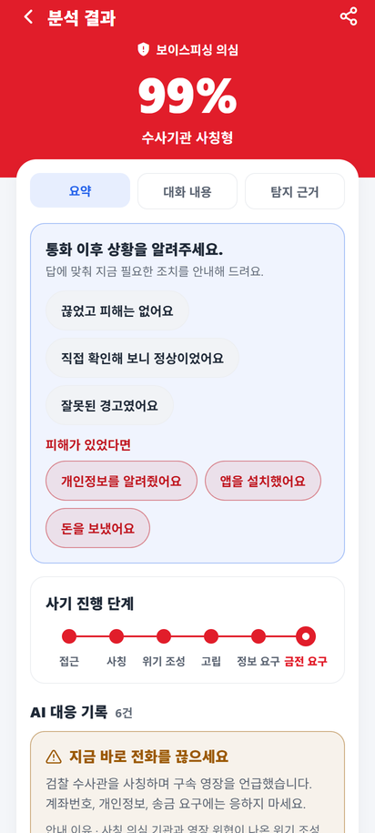
  
  
  <br><sub>결과와 후속 확인 &nbsp;·&nbsp; AI 대응 기록과 근거 &nbsp;·&nbsp; 대화 내용과 수법 태그</sub>
</p>

### 받은 것을 직접 확인

- **문자 검사** — 받은 문자·메신저를 붙여 넣거나 캡처를 올리면 스미싱 여부와 링크 위험을 판단합니다.
- **문서 점검** — 검찰·법원·금감원 공문, 영장 사진을 올리면 위조 문서의 특징을 점검합니다.
- **녹음 파일 분석** — 지난 통화 녹음을 올리면 실시간과 같은 흐름(분류기 → Claude 상태 추적 → AI 대응)으로 분석하고, 원본 파일 해시를 증거로 남깁니다.

<p align="center">
  
  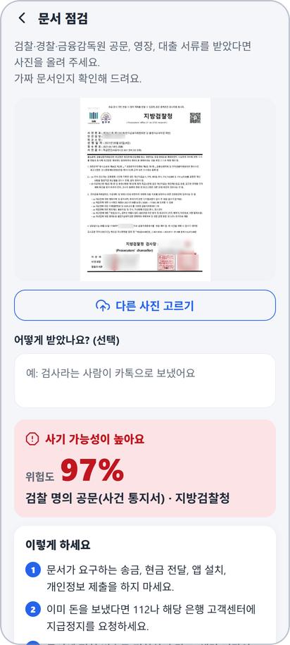
  
  <br><sub>문자 검사 &nbsp;·&nbsp; 문서 점검 &nbsp;·&nbsp; 녹음 파일 분석</sub>
</p>

### 홈 · 통화 기록 · 정보

앱은 홈 · 통화 기록 · 정보 세 탭으로 되어 있습니다. 같은 주소(QR)로 여러 명이 써도 각자 기기의 기록만 보입니다.

<p align="center">
  
  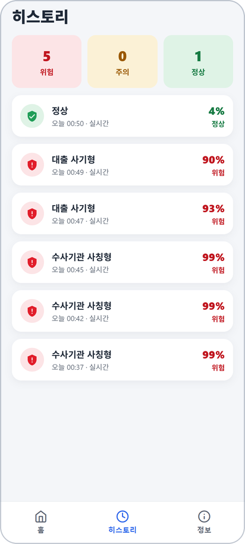
  
  <br><sub>홈 &nbsp;·&nbsp; 통화 기록 &nbsp;·&nbsp; 대응 정보</sub>
</p>

## 수사 지원

**수사관 곁에서 AI 에이전트가 먼저 움직입니다.** 위험 통화가 들어오면 단서를 뽑아 다른 통화와 잇고, 먼저 볼 사건을 고르고, 증거를 봉인해 신고용 요약으로 정리합니다. 새 수법을 모으고 자기 판정을 사용자 확인과 맞대 보지만, 탐지를 바꾸는 결정은 사람이 합니다. 결과는 수사관 대시보드(`/dashboard`) 한 곳에서 봅니다.

<sub>에이전트가 일하는 방식과 사람이 정하는 것은 <a href="docs/investigator.md">수사관 곁의 AI 에이전트</a>에 단계별로 정리했습니다.</sub>

### 수사관 대시보드

<p>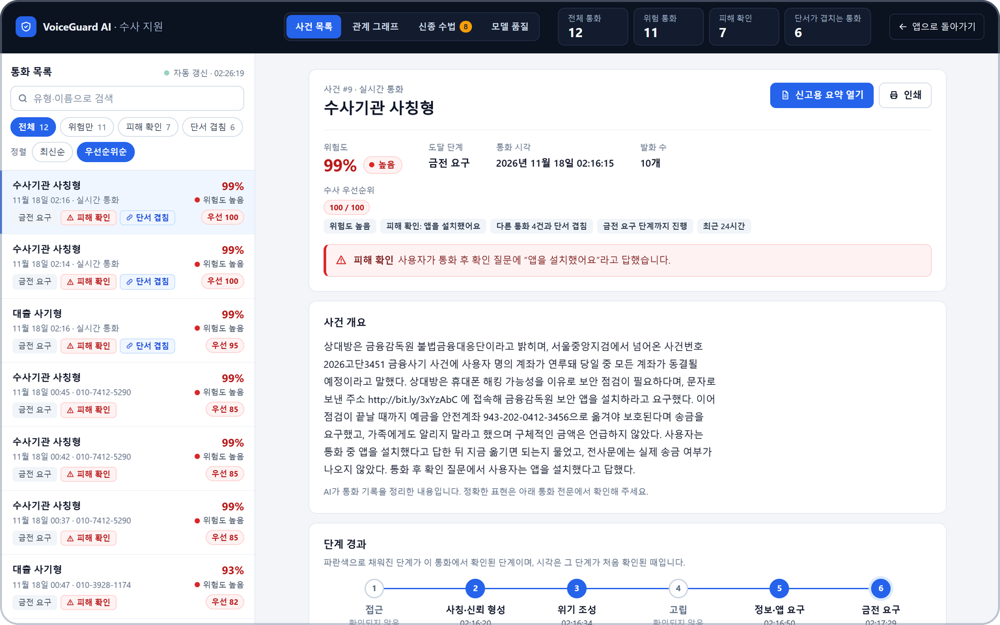</p>

사건 목록과 통계에서 사건을 골라 그 통화에서 일어난 일을 처음부터 끝까지 봅니다. 사건 상세에는 단계 경과와 위험 발화, AI 대응과 사용자 확인 내용, 전체 대화가 있습니다.

### 단서 수집 · 단서 연결

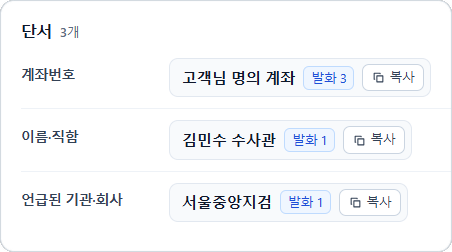

통화 중 상태 추적기가 대화에서 계좌번호, 전화번호, URL, 사칭 기관, 이름·직함, 요구 금액, 설치 요구 앱, 사건번호를 뽑고, 단서마다 어느 발화에서 나왔는지 남깁니다.

같은 계좌·번호·URL·사건번호가 나온 다른 통화를 찾아 연결하고, 사건 상세에 겹치는 단서와 유사 공식 사례를 함께 보여 줍니다. 통화 중에도 같은 단서를 바로 대조해 사용자에게 알립니다.

<sub>수사관 곁의 AI 에이전트 ›</sub> [단서 수집](docs/investigator.md#단서-수집) · [단서 연결](docs/investigator.md#단서-연결)

<br clear="all">

### 사건 선별

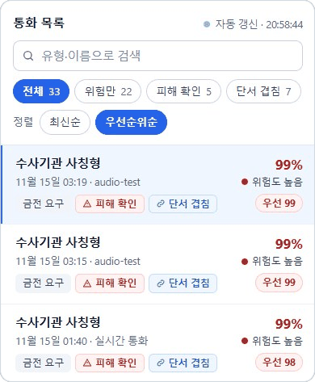

수사 우선순위 점수(100점)로 사건을 정렬하고, 몇 점을 왜 받았는지 근거를 함께 표시합니다.

| 근거 | 배점 |
| --- | ---: |
| 위험도 | 40 |
| 피해 확인 | 25 |
| 겹치는 단서 | 15 |
| 사기 단계 | 10 |
| 최근성 | 10 |

<sub>수사관 곁의 AI 에이전트 ›</sub> [사건 선별](docs/investigator.md#사건-선별)

<br clear="all">

### 관계 그래프

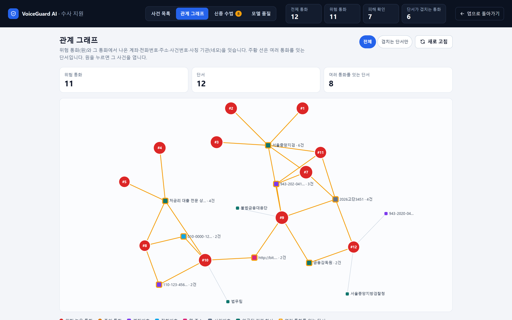

같은 계좌·번호·사건번호·사칭 기관으로 이어진 사건들을 한 화면에 모아 봅니다. 계좌·번호·사건번호처럼 여러 통화를 잇는 단서는 수사 우선순위 점수에도 쓰입니다(사칭 기관은 점수에 넣지 않습니다).

<sub>수사관 곁의 AI 에이전트 ›</sub> [단서 연결](docs/investigator.md#단서-연결)

<br clear="all">

### 증거 봉인 · 신고 요약

**사건 하나를 신고용 문서 한 장으로 정리합니다.** 음성 조각과 녹음 파일은 받는 즉시 SHA-256 해시 체인으로 묶고, 통화가 끝나면 전사문을 봉인합니다.

<table>
<tr><th align="left" nowrap>사건 개요</th><td>Claude가 쓴 3~5문장</td></tr>
<tr><th align="left" nowrap>단서 · 발화 근거</th><td>통화에서 뽑은 단서와 그 근거가 된 발화</td></tr>
<tr><th align="left" nowrap>유사 공식 사례</th><td>금감원·경찰청 121건에서 찾은 사례와 출처 링크</td></tr>
<tr><th align="left" nowrap>증거 해시</th><td>음성 조각·녹음 파일마다 SHA-256 해시 체인, 통화가 끝나면 봉인한 전사문, 검증 결과</td></tr>
</table>

검증 결과는 사건 상세와 신고용 요약에 함께 표시됩니다.

<details>
<summary><b>실제 화면</b> · 사건 상세, 신고용 요약, 증거 무결성 절</summary>
<br>
<p>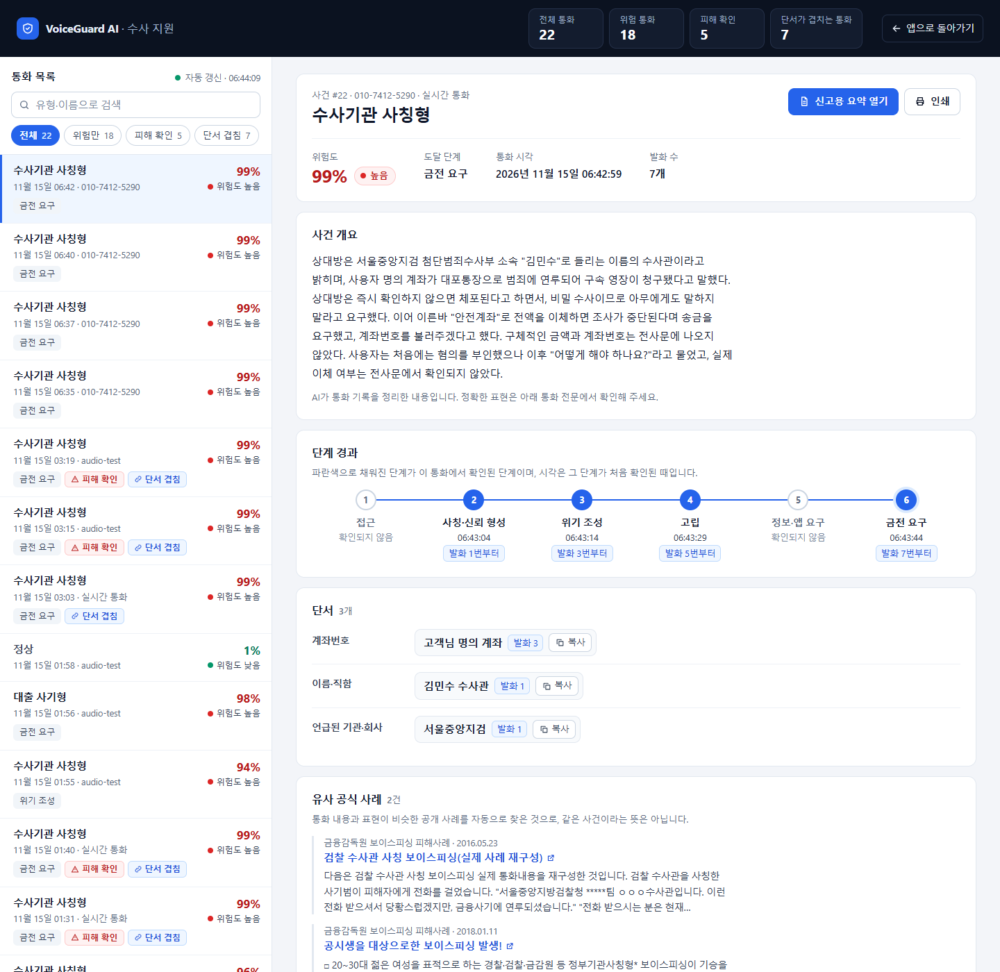<br><sub>사건 상세 · 겹치는 단서 · 유사 공식 사례</sub></p>
<p><br><sub>신고용 요약 문서</sub></p>
<p>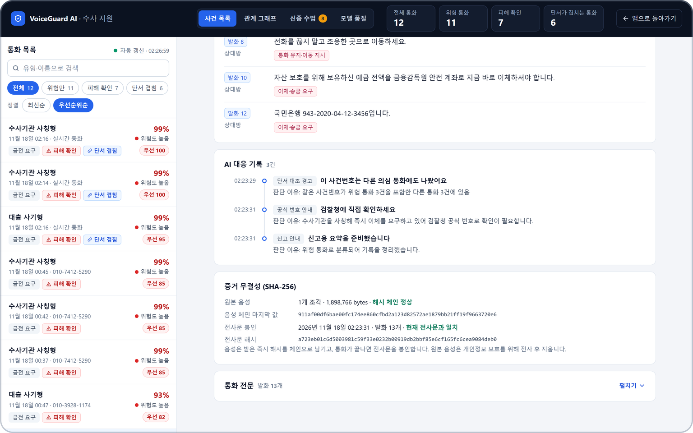<br><sub>신고용 요약의 증거 무결성 절 (SHA-256 해시 체인 · 전사문 봉인)</sub></p>
</details>

<sub>수사관 곁의 AI 에이전트 ›</sub> [증거 봉인](docs/investigator.md#증거-봉인) · [신고 요약](docs/investigator.md#신고-요약)

### 신종 수법 학습

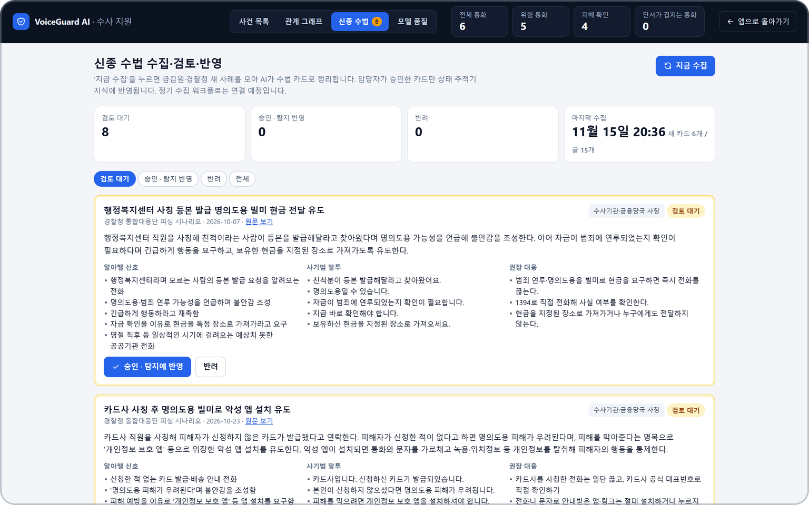

금감원·경찰청 게시판의 새 글을 모으면(대시보드 '지금 수집' 또는 n8n 매일 일정) Claude가 수법 카드(대표 문구·위험 신호·권장 행동)로 정리합니다. 수사관이 승인한 카드만 실시간 상태 추적기에 반영되고, 승인할 때마다 회귀 평가가 자동으로 돕니다.

<sub>수사관 곁의 AI 에이전트 ›</sub> [신종 수법 학습](docs/investigator.md#신종-수법-학습)

<br clear="all">

### 품질 점검

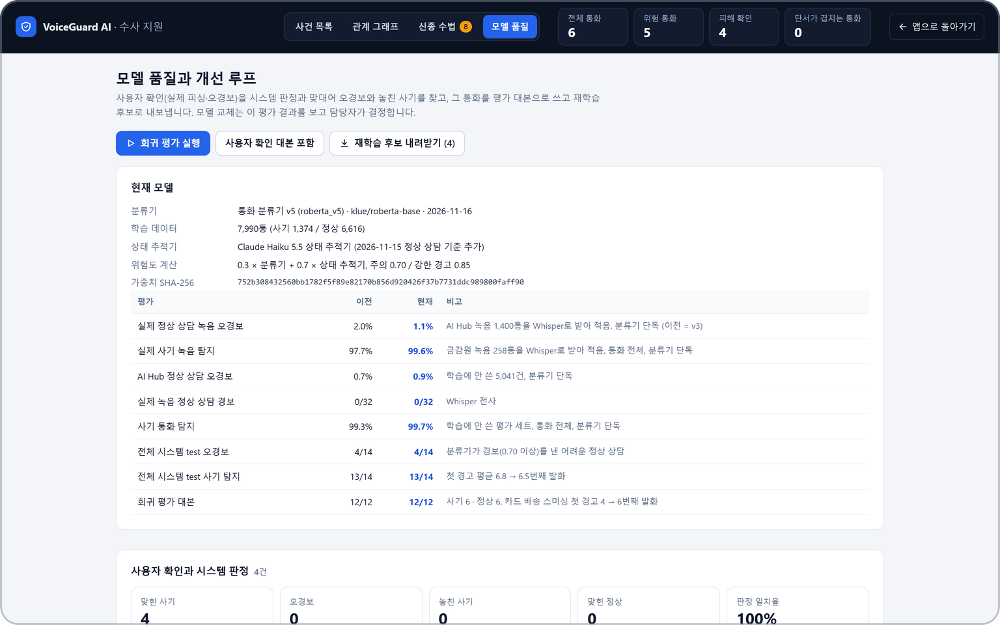

사용자 확인("실제 피싱이었어요 / 잘못된 경고였어요")을 시스템 판정과 맞대 오경보와 놓친 사기를 모읍니다. 이 통화들을 평가 대본·재학습 데이터로 내보내 회귀 평가를 돌립니다.

<sub>수사관 곁의 AI 에이전트 ›</sub> [품질 점검](docs/investigator.md#품질-점검)

<br clear="all">

### 사람이 정하는 것

**에이전트는 모으고, 엮고, 정리해 제안합니다. 탐지와 신고를 바꾸는 결정은 사람이 합니다.**

- **수법 카드 반영** — 수사관이 승인한 카드만 실시간 상태 추적기에 들어갑니다.
- **모델 교체** — 재학습은 사람이 돌리고, 평가를 통과한 모델만 바꿔 넣습니다.
- **신고와 수사** — 사건 개요는 AI가 통화 기록을 정리한 초안입니다. 정확한 표현은 통화 전문에서 확인하고, 신고와 수사 판단은 사람이 합니다.

<sub>수사관 곁의 AI 에이전트 ›</sub> [사람이 정하는 것](docs/investigator.md#사람이-정하는-것)

## 시스템 구조

**발화 하나가 들어오면 이렇게 흐릅니다.** 빠른 경로(분류기)와 Claude 상태 추적기가 함께 돌고, 두 점수를 합친 위험도로 대응 에이전트가 움직입니다.

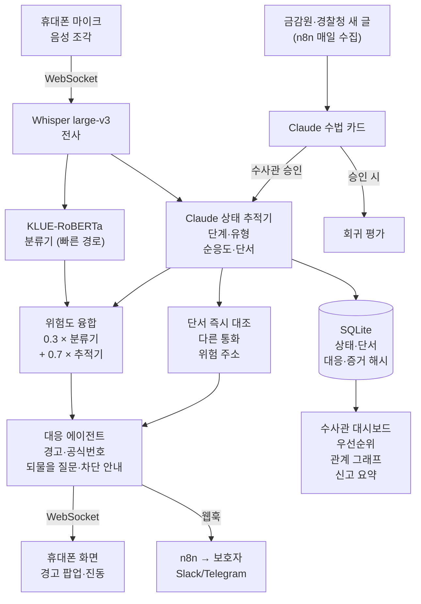

<details>
<summary><b>전체 구조도</b> · 사용자 화면, 연결, FastAPI 백엔드, 저장·연동</summary>
<br>
<p></p>
</details>

## 탐지 성능

**분류기 단독과 전체 시스템을 따로 잽니다.** 자세한 데이터·방법·한계는 [보이스피싱 탐지 정확도](docs/tech/detection.md)와 [docs/MODEL_TRAINING_LOG.md](docs/MODEL_TRAINING_LOG.md)에 있습니다. "경보"는 점수가 주의 기준 0.70 이상인 경우입니다. 분류기는 v1이 KoELECTRA, v2부터 v5(현재)까지 KLUE-RoBERTa입니다.

### 통화 분류기 (빠른 경로)

| 평가 | v1 | v2 | v3 | v5<br><sub>현재</sub> |
| --- | ---: | ---: | ---: | ---: |
| 사기 통화 탐지<br><sub>통화 전체 · 평가 통화 837건</sub> | 49.5% | 99.7% | 99.3% | **99.7%** |
| 사기 통화 경보<br><sub>통화 중 한 번이라도</sub> | - | 99.7% | 100% | **100%** |
| 정상 통화 경보<br><sub>통화 중 한 번이라도 · 837건 중 정상 530</sub> | 31.9% | 8.1% | **5.1%** | 5.5% |
| KISA 118 오경보<br><sub>피해 상담 통화</sub> | 59.8% | 4.2% | 2.9% | **2.5%** |
| AI Hub 오경보<br><sub>정상 상담 통화 5,041건 · 학습에 안 쓴 Validation · 개인정보를 지운 글</sub> | - | 30.2% | **0.7%** | 0.9% |
| └ 은행 상담 | - | 69.2% | **1.4%** | 3.0% |
| └ 증권 상담 | - | 55.4% | 2.1% | **1.6%** |
| 녹음 전사 오경보<br><sub>AI Hub 정상 녹음 1,400건 · Whisper 전사</sub> | - | - | 2.0% | **1.1%** |
| 녹음 오경보<br><sub>실제 녹음된 정상 상담 32통 · Whisper 전사</sub> | - | 4통 | 0통 | **0통** |
| 별도로 쓴 대본<br><sub>12종 · 사기 6 · 정상 6</sub> | 9/12<br><sub>사기 3/6 탐지</sub> | 12/12 | **12/12** | 11/12<br><sub>카드 배송 사칭 놓침</sub> |

v5는 공개 데이터가 가린 개인정보 자리를 그럴듯한 값으로 채워 다시 학습한 모델입니다. 실제 이름·번호가 나오는 녹음 전사에서 오경보가 줄었고, 개인정보를 지운 평가 글에서는 조금 늘었습니다([비교](docs/tech/detection.md#v3--v5-가린-개인정보-자리-채우기)).

### 전체 시스템

<sub>분류기 + Claude 상태 추적기 + 대응 에이전트</sub>

| 평가 | v2 + 이전 프롬프트 | v3 | v5<br><sub>현재</sub> |
| --- | ---: | ---: | ---: |
| 회귀 평가 대본<br><sub>12개 · 사기 6 · 정상 6</sub> | 12/12 | **12/12** | **12/12**<br><sub>카드 배송 첫 경고 4 → 6번째 발화</sub> |
| 어려운 정상 상담 경고<br><sub>분류기가 1.00을 준 정상 상담 14건 · 프롬프트 조정용 dev</sub> | 9건 | **3건** | 4건 |
| test 정상 경고<br><sub>처음 보는 test 28건 중 정상 상담 14</sub> | 9/14 | **4/14** | **4/14** |
| test 사기 탐지<br><sub>처음 보는 test 28건 중 사기 14 · 첫 경고 평균 7.1 → 6.8 → 6.5번째 발화</sub> | 13/14 | **13/14** | **13/14** |

### 문자 · 문서

| 평가 | 결과 |
| --- | ---: |
| 문자 검사<br><sub>학습에 안 쓴 문자 3,600건 · 분류기 단독</sub> | 정확도 99.4%<br><sub>F1 99.2%</sub> |
| 문자 검사<br><sub>따로 쓴 최신 수법 문자 16건 · 분류기 40% + Claude 60%</sub> | 16/16 |
| 문서 점검<br><sub>경찰청·금감원·검찰이 공개한 위조 문서 + 실제 공문 · test 23장</sub> | 정확도 95.7%<br><sub>위조 14/15 탐지 · 오경보 0/8</sub> |

<!-- STT:START -->
### 전사 · 화자 분리

**통화 음성은 직접 운영하는 Whisper로 받아 적는 것이 기본입니다.** 개인·금융 정보가 담긴 음성이라 외부 API(리턴제로)는 켜야만 쓰는 선택지로 두고, 같은 시험 녹음으로 비교했습니다. 숫자는 글자 오류율(CER)이라 낮을수록 좋습니다.

| 모델 | 파일 전체 | 실시간 |
| --- | ---: | ---: |
| large-v3<br><sub>원래 모델 · 직접 운영 · 서비스 기본</sub> | 5.81% | 9.24% |
| large-v3 추가 학습<br><sub>콜센터 음성 · LoRA</sub> | 2.45% | 10.34% |
| 리턴제로<br><sub>외부 API</sub> | 6.28% | 8.11% |

<sub>AI Hub 민원(콜센터) 녹음. 파일 전체는 100개(3.43시간), 실시간은 앱과 같은 무음 기준 조각으로 40개(1.24시간)를 받아 적었습니다.</sub>

**추가 학습한 모델은 서비스에 쓰지 않습니다.** 파일 전체 점수는 크게 좋아졌지만, 학습 대본이 전화번호 같은 개인정보를 'ㅇㅇㅇ'으로 가린 탓에 소리 내 읽은 숫자를 지우는 법까지 배웠습니다. 실제 사기 통화에서 학습한 large-v3는 `직통번호는 02-61xx-60xx이고요`를 `직통번호는 에 네. 에 에이고요`로 적었고, 실시간 조각에서는 끝이 잘린 문장에 없는 말을 지어 붙여 오히려 나빠졌습니다. 계좌·전화번호로 통화를 잇는 서비스라 기본 모델은 원래 large-v3로 둡니다.

**통화 중에도 화자를 나눕니다.** 최근 20초는 바로 받아 적고, 그보다 오래된 구간은 15초마다 리턴제로에 다시 보내 화자별 말풍선으로 바꿉니다. 시험 녹음 8개에서 글자 오류율이 8.55%에서 4.06%로 줄고 화자가 90% 맞았습니다(화면 반영은 약 23초 늦습니다). 로컬 화자 분리(3D-Speaker)도 통화 후 98.5%, 실시간 97.7%로 쟀지만 앱에는 연결하지 않았습니다.

<sub>데이터, 대본 맞추기, 추가 학습 설정, 묶음별 결과, 노트북 CPU 측정은</sub> [전사 모델 정확도](docs/tech/transcription.md)

<!-- STT:END -->

## 데이터

| 데이터 | 쓰임 · 출처 |
| --- | --- |
| 보이스피싱 녹취 전사<br><sub>기관 사칭 575 · 대출 사기 131</sub> | 사기 통화<br><sub>금융감독원 「그놈 목소리」 (KorCCVi 전사)</sub> |
| 공식 사례 기반 생성 통화<br><sub>사기 668 · 같은 주제의 정상 363</sub> | 새 유형(지인 사칭·카드배송·납치 등) 보강<br><sub>금감원 피해사례·소비자경보, 경찰청 예·경보 121건 → Claude 생성</sub> |
| KISA 118 전화상담 합성데이터<br><sub>1,283통</sub> | 피싱이 주제지만 정상인 상담<br><sub>공공데이터포털 (15156113 등)</sub> |
| 금융분야 고객상담 데이터<br><sub>은행 · 보험 · 증권</sub> | 정상 상담 통화 (어려운 정상 사례 + 평가)<br><sub>AI Hub</sub> |
| 민원(콜센터) 질의-응답 데이터<br><sub>금융·보험, 다산콜센터, 질병관리청, 홈쇼핑</sub> | 정상 통화 + 실제 녹음 평가, 전사 모델 추가 학습·평가 (음성 383시간)<br><sub>AI Hub</sub> |
| 한국어 스미싱 문자 | 문자 검사 분류기<br><sub>Hugging Face <code>jmjmjm3/kor-smishing-message</code> (CC BY-NC-SA 4.0)</sub> |
| 위조 공문 평가 세트<br><sub>61장</sub> | 문서 점검 평가<br><sub>경찰청·금감원·검찰·언론 공개 이미지, 법제처 서식 등</sub> |

위조 공문 평가 세트의 목록은 `backend/eval/documents_manifest.json`에 있습니다. 데이터 원본과 학습된 모델은 이용 조건(AI Hub 재배포 금지, 비상업 라이선스 등) 때문에 저장소에 올리지 않습니다 (`data/`, `models/`는 git 제외).

## 기술 스택

| 영역 | 기술 |
| --- | --- |
| Frontend | React Native · Expo · TypeScript · Zustand · PWA |
| Backend · Infra | Python · FastAPI · WebSocket · SQLite · n8n · Cloudflare Tunnel · RunPod GPU 서버 (학습은 H100) |
| AI | Claude API · PyTorch · Hugging Face · faster-whisper |

| 역할 | 모델 |
| --- | --- |
| 음성 인식 | faster-whisper large-v3 (직접 운영하는 GPU 서버) |
| 통화 분류기 | KLUE-RoBERTa (`klue/roberta-base`) 미세조정 |
| 문자 분류기 | KLUE-RoBERTa 미세조정 |
| 실시간 상태 추적기 · 대응 에이전트 · 문자 판단 | Claude Haiku 5.5 |
| 사건 개요 · 문서 점검 | Claude Opus 5.5 |
| 전사 모델 추가 학습<br><sub>학습·평가 중</sub> | Whisper large-v3 · large-v3-turbo (LoRA), small (전체 미세조정) |
| 화자 분리<br><sub>리턴제로 연결 · 로컬은 시험만</sub> | 리턴제로 화자 분리(녹음·통화 후, 통화 중 다시 받아 적기) · 로컬 3D-Speaker ERes2Net 임베딩 (sherpa-onnx) + 두 사람으로 묶기 |

## 프로젝트 구조

```text
frontend/                     # Expo (iOS · Android · Web PWA)
  app/
    (tabs)/                   #   홈 · 통화 기록 · 정보
    realtime.tsx              #   실시간 통화 분석 (단계 추적 · AI 대응)
    warning.tsx               #   강한 경고 팝업
    result.tsx                #   결과 (요약 · 대화 내용 · 탐지 근거 · 후속 확인)
    message.tsx / document.tsx#   문자 검사 / 문서 점검
    upload.tsx                #   녹음 파일 분석
  src/components/             #   ScoreGauge, StageStepper, ActionCard, DemoPanel ...
  src/hooks/useCallSession.ts #   WebSocket 세션 (음성 조각 전송 · 상태 반영)

backend/app/
  api/
    websocket.py              # 실시간 통화 WebSocket
    routes.py                 # 통화 · 녹음 파일 REST
    agent_routes.py           # 상태 · 타임라인 · 대응 응답 · 피드백 · 신고 패키지
    analyze_routes.py         # 문자 검사 · 문서 점검
    investigation_routes.py   # 수사 지원 API · 대시보드
    quality_routes.py         # 모델 품질 · 회귀 평가 실행 · 신종 수법 카드 · 증거 검증
  services/
    state_tracker.py          # Claude 상태 추적기 (승인된 수법 카드를 프롬프트에 덧붙임)
    response_agent.py         # 대응 에이전트 (행동 선택 · 문구 · 후속 확인 · 단서 대조 알림)
    call_analyzer.py          # 빠른 경로 + 위험도 융합
    agent_loop.py             # 감지 → 판단 → 개입 한 사이클, 녹음 파일 전체 분석
    case_linking.py           # 통화 중 단서 즉시 대조 (다른 통화 · 위험 주소)
    evidence.py               # 증거 해시 체인 · 전사문 봉인 · 검증
    message_analyzer.py       # 문자 검사
    document_analyzer.py      # 문서 점검
    investigation.py          # 단서 연관 · 수사 우선순위 · 관계 그래프 · 사건 개요
    report_builder.py         # 신고용 요약
    official_cases.py         # 유사 공식 사례 검색
    official_sources.py       # 금감원 · 경찰청 게시판 새 글 수집
    scam_knowledge.py         # 신종 수법 카드 (Claude 정리 → 사람 승인 → 추적기 반영)
    quality.py                # 품질 루프 (사용자 확인 ↔ 판정, 회귀 평가 실행 기록)
    webhook_emitter.py        # n8n 이벤트
  web/dashboard.html          # 수사관 대시보드 (사건 · 관계 그래프 · 신종 수법 · 모델 품질)
  train_transformer.py        # 분류기 학습
  build_dataset_v3.py         # 학습 데이터 v3 (AI Hub 상담 추가)
  eval_*.py                   # 평가 (회귀 · 앞부분 탐지 · 외부 데이터 · 실제 음성 · 문자 · 문서)
stt_lab/                      # 전사 모델 추가 학습 · 평가 (Whisper, 리턴제로 비교, 화자 분리)
n8n/                          # 보호자 알림 · 신종 수법 매일 수집 워크플로 템플릿
docs/                         # API 명세 · 학습 기록 · 구조도
  one-call.md                 #   전화 한 통 따라가기
  investigator.md             #   수사관 곁의 AI 에이전트
  tech/                       #   탐지 정확도 · 전사 정확도
  design/                     #   README 그림 원본 (SVG) · 다시 굽는 방법
```

## 실행

### 백엔드

```bash
python3 -m venv .venv && source .venv/bin/activate
pip install -r requirements.txt
uvicorn backend.app.main:app --host 0.0.0.0 --port 8000
```

프로젝트 루트 `.env` (값은 예시, 키는 저장소에 올리지 않습니다):

```env
ANTHROPIC_API_KEY=sk-ant-...
TRACKER_MODEL=claude-haiku-5-5      # 실시간 상태 추적기
AGENT_MODEL=claude-haiku-5-5        # 대응 에이전트 · 문자 판단
REPORT_MODEL=claude-opus-5-5        # 사건 개요 · 문서 점검
WHISPER_MODEL=large-v3
ACCESS_CODE=...                     # 설정하면 접속 코드가 있어야 들어온다 (QR 링크에 포함)
ADMIN_CODE=...                      # 설정하면 대시보드·수사·평가 화면은 관리 코드가 따로 있어야 열린다
N8N_WEBHOOK_URL=...                 # 보호자 알림 (선택)
PUBLIC_BASE_URL=...                 # 알림 메시지 속 대시보드 링크 (선택)
```

### 프론트엔드

```bash
cd frontend && npm install
npm run web                                         # 개발
EXPO_PUBLIC_API_BASE=same-origin npm run build:web  # 배포용 웹 빌드 (백엔드가 같은 주소로 제공)
```

### 배포 구조

휴대폰 → Cloudflare 터널(HTTPS) → RunPod에서 빌려 직접 운영하는 GPU 서버의 FastAPI(웹 앱 + API + WebSocket). Whisper large-v3 전사, 통화·문자 분류기, 백엔드가 모두 이 서버에서 돕니다. 받아 적은 통화 내용은 Claude API로 보내 판단하고, 화자 구분과 다시 받아 적기에 리턴제로를 켜면 음성이 리턴제로로도 갑니다(시연 서버는 켜 둡니다). 모델 학습과 대부분의 평가는 H100 서버에서 했습니다. 참가자는 QR 링크로 접속해 홈 화면에 추가합니다(PWA). 넓은 화면에서 열면 앱 옆에 'AI 분석 과정' 패널이 함께 보이고, 수사관 화면은 `/dashboard`입니다.

### 평가

```bash
python -m backend.app.eval_loop                       # 전체 시스템 회귀 평가 (Claude API 비용 발생)
SPLIT=hash TRAINING_DATA=data/PhishCatch-Data-v2.json python -m backend.app.eval_prefix   # 통화 앞부분 탐지율
EVAL_DATA=data/aihub/finance_consult.json,data/aihub/minwon.json python -m backend.app.eval_external  # 실제 상담 오경보
AUDIO_DIR=data/aihub/audio_valid python -m backend.app.eval_audio                       # 실제 음성(Whisper) 오경보
python -m backend.app.eval_messages                   # 문자 검사
SPLIT=test python -m backend.app.eval_documents       # 문서 점검
```

전사 모델 추가 학습과 평가는 GPU 서버에서 `stt_lab/`의 스크립트를 순서대로 돌립니다. 순서와 각 스크립트가 하는 일은 [stt_lab/README.md](stt_lab/README.md)에 있습니다.

## 문서

**안내 페이지**

- [전화 한 통 따라가기](docs/one-call.md) — 사기 전화 한 통을 사용자 쪽에서 처음부터 끝까지
- [수사관 곁의 AI 에이전트](docs/investigator.md) — 수사 지원 기능을 에이전트가 하는 일과 사람이 정하는 일로 나눠 설명
- [보이스피싱 탐지 정확도](docs/tech/detection.md) — 데이터, 전처리, 학습, 평가 방법, 결과, 한계
- [전사 모델 정확도](docs/tech/transcription.md) — Whisper 추가 학습, 리턴제로 비교, 화자 분리, 로컬 운영
- [모델 구성](docs/tech/models.md) — 쓰는 모델과 보관만 하는 모델, 각각의 성능과 이유, 어디서 도는지

**명세 · 기록**

- [docs/API_SPEC_V2.md](docs/API_SPEC_V2.md) — v2 API 명세 (WebSocket 이벤트, 상태·대응·수사 API, 문자·문서 분석)
- [docs/MODEL_TRAINING_LOG.md](docs/MODEL_TRAINING_LOG.md) — 모델 학습·평가 기록 (데이터, 설정·가중치, 결과, 한계, 실시간 전사 비교)
- [stt_lab/README.md](stt_lab/README.md) — 전사 모델 추가 학습·평가 스크립트
- [docs/DEPLOY_RUNPOD.md](docs/DEPLOY_RUNPOD.md) — 시연 서버를 RunPod GPU pod로 옮기는 순서와 운영 메모
- [docs/BACKLOG.md](docs/BACKLOG.md) — 추후 구현 사항
- [docs/API_SPEC.md](docs/API_SPEC.md) — v1 API 명세
- `docs/diagrams/` — 구조도 원본 (HTML)
- `docs/design/` — README 그림 원본 (SVG)과 다시 굽는 방법

## 팀

| 이름 | 역할 |
| --- | --- |
| **이재현** | 자료 조사 및 발표 |
| **장지훈** | 디자인 및 프론트엔드 개발 |
| **박준영** | RAG + 규칙 기반 탐지, API 개발 |
| **최세민** | AI 모델 학습 및 전처리, API 개발 |
