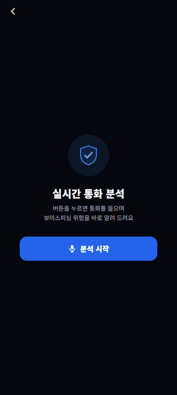
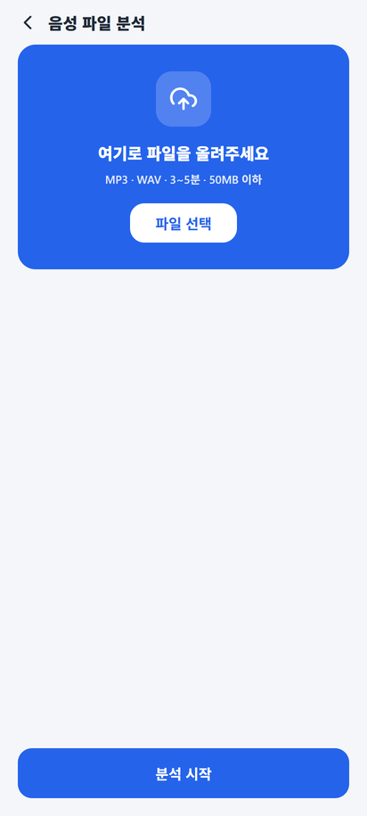
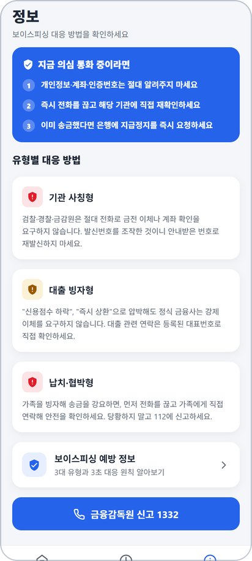
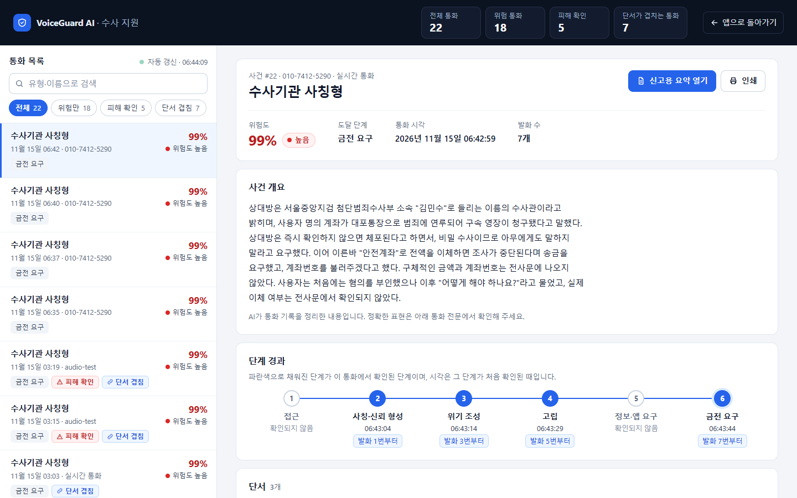
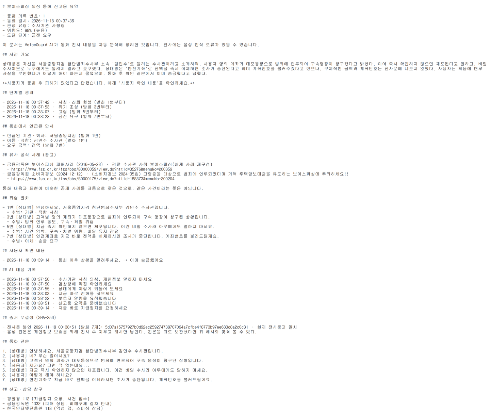
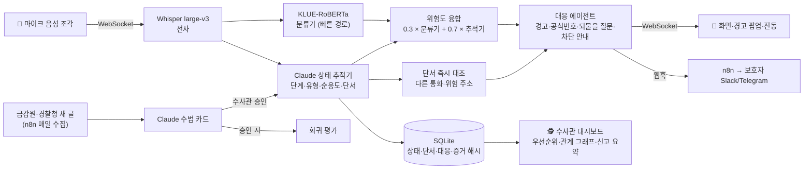

<div align="center">

# 🛡️ VoiceGuard AI

### 감지에서 끝나지 않는 능동형 보이스피싱 대응 AI

통화를 들으며 **사기가 어디까지 진행됐는지 추적**하고, 상황에 맞는 행동을 **AI가 먼저 안내**하며,
통화가 끝난 뒤에도 **피해가 없는지 다시 확인**합니다. 위험 통화에서 나온 단서는 **수사 지원 대시보드**로 모입니다.



<sub>KNU AI BOOT 7조 자율 프로젝트 → 2026 해커톤 고도화 버전 (v2)</sub>

</div>

* * *

## 📌 한눈에 보기

| 문제 | VoiceGuard의 답 |
| --- | --- |
| 기존 탐지 앱은 "위험합니다"라고 알리고 끝난다 | 사기 진행 단계(접근 → 사칭 → 위기 조성 → 고립 → 정보 요구 → 금전 요구)를 추적하고, 단계에 맞는 행동을 고른다 |
| 경고를 본 뒤에도 피해자는 무엇을 해야 할지 모른다 | "지금 끊으세요", "검찰청 1301로 직접 확인", "되물어 볼 질문", 지급정지 순서까지 화면에서 바로 안내 |
| 통화가 끝나면 끝 | 통화 중·통화 후에 다시 묻고("돈을 보냈나요?"), 답에 맞춰 피해 차단 절차를 안내 |
| 피해 신고 내용이 수사로 이어지기 어렵다 | 계좌·전화번호·URL 같은 단서를 자동으로 뽑고, 다른 통화와 겹치는 단서를 찾아 **수사 우선순위·관계 그래프·SHA-256 증거 해시**와 함께 대시보드와 신고용 요약으로 정리 |
| 은행·보험 상담 같은 정상 통화에도 경고가 뜬다 | AI Hub 금융·민원 상담 데이터로 재학습해 정상 상담 오경보를 **30.2% → 0.7%** 로 줄임 (분류기 단독, 아래 성능 참고) |
| 새 수법이 계속 나오는데 탐지는 그대로다 | n8n이 매일 금감원·경찰청 새 글을 모으면 Claude가 **수법 카드**로 정리하고, 사람이 승인한 카드만 상태 추적기에 반영한 뒤 회귀 평가를 자동으로 돌린다 |

* * *

## 🔄 AI 워크플로


| 단계 | 하는 일 | 쓰는 것 |
| --- | --- | --- |
| ① 감지 | 통화를 들으며 받아 적고 바로 사기 확률을 낸다 | faster-whisper large-v3, KLUE-RoBERTa 분류기 |
| ② 판단 | 대화 흐름으로 사기 단계·유형·사용자가 따르는 정도·수사 단서를 추적한다 | Claude 상태 추적기 (구조화 출력) |
| ③ 개입 | 위험도·단계·유형에 맞는 대응을 골라 문구를 만든다 | 대응 에이전트 (규칙 선택 + Claude 작성), 보호자 알림은 n8n |
| ④ 후속 확인 | 통화 중 45초 뒤, 통화 후에 다시 묻고 답에 맞춰 안내한다 | 후속 질문 → 지급정지·신고 안내, 답은 사용자 확인으로 저장 |
| ⑤ 개선 | 사용자 확인을 판정과 맞대 오경보·놓친 사기를 모으고, 새 수법을 배워 반영한 뒤 다시 잰다 | 품질 루프(사용자 확인 → 평가 대본·재학습 후보), 신종 수법 카드(공식 게시판 → Claude → 사람 승인 → 추적기), 회귀 평가 12개 대본, AI Hub 상담 데이터·실제 녹음 평가 |

화면에 보이는 위험도는 `0.3 × 분류기 + 0.7 × 상태 추적기`입니다. 분류기는 추적기가 따라오기 전 몇 초의 조기 신호를,
추적기는 통화 전체의 의도를 맡습니다. 주의 0.70, 강한 경고 0.85 (`docs/API_SPEC_V2.md` 4.2절).

* * *

## 📱 일반 사용자 기능

- 🎧 **실시간 통화 분석** — 마이크 음성을 조각으로 보내 실시간 전사, 위험도, 사기 진행 단계, AI 대응 카드 표시 (위험도 40~69%는 '분석 중'으로 표시)
- 🚨 **강한 경고** — 위험 단계에 들어가면 전체 화면 경고와 진동
- 🧭 **AI 대응** — 지금 할 일, 공식 대표번호(탭하면 전화), 상대에게 되물어 볼 질문, 피해 차단 순서
- 🔗 **통화 중 단서 대조** — 상대가 부른 계좌·휴대전화·주소·사건번호가 다른 위험 통화에도 나왔거나 주소 모양이 위험하면 그 자리에서 알림
- 🔁 **후속 확인** — "아직 통화 중인가요?", "돈을 보냈나요 / 앱을 설치했나요?" → 답에 맞는 지급정지·신고 안내
- 💬 **문자 검사** — 받은 문자·메신저를 붙여 넣거나 캡처를 올리면 스미싱 여부와 링크 위험 판단
- 📄 **문서 점검** — 검찰·법원·금감원 공문, 영장 사진을 올리면 위조 문서의 특징을 점검
- 📁 **녹음 파일 분석** — 지난 통화 녹음을 올리면 실시간과 같은 흐름(분류기 → Claude 상태 추적 → AI 대응)으로 분석하고, 원본 파일 해시를 증거로 남김
- 🗂️ **통화 기록·결과** — 결과 요약, 대화 내용(발화별 수법 태그), 탐지 근거, 판정 피드백. 같은 주소(QR)로 여러 명이 써도 각자 기기의 기록만 보임

<table>
  <tr>
    <td align="center"><br/><b>홈</b></td>
    <td align="center"><br/><b>실시간 분석</b></td>
    <td align="center"><br/><b>강한 경고</b></td>
    <td align="center"><br/><b>단계 추적 · AI 대응</b></td>
  </tr>
  <tr>
    <td align="center"><br/><b>결과 · 후속 확인</b></td>
    <td align="center"><br/><b>AI 대응 기록 · 근거</b></td>
    <td align="center"><br/><b>문자 검사</b></td>
    <td align="center"><br/><b>문서 점검</b></td>
  </tr>
  <tr>
    <td align="center"><br/><b>대화 내용 · 수법 태그</b></td>
    <td align="center"><br/><b>통화 기록</b></td>
    <td align="center"><br/><b>녹음 파일 분석</b></td>
    <td align="center"><br/><b>대응 정보</b></td>
  </tr>
</table>

* * *

## 🕵️ 수사 지원 기능

- 🔎 **단서 자동 추출** — 계좌번호, 전화번호, URL, 사칭 기관, 이름·직함, 요구 금액, 설치 요구 앱, 사건번호
- 🔗 **통화 간 연관** — 같은 계좌·번호·URL·사건번호가 나온 다른 통화를 찾아 연결
- 📊 **수사관 대시보드** (`/dashboard`) — 사건 목록·통계, 단계 경과, 위험 발화, AI 대응, 사용자 확인 내용, 전체 대화
- 🧮 **수사 우선순위** — 위험도 40 · 피해 확인 25 · 겹치는 단서 15 · 사기 단계 10 · 최근성 10점으로 사건을 정렬하고 근거를 함께 표시
- 🕸️ **관계 그래프** — 같은 계좌·번호·사건번호·사칭 기관으로 이어진 사건들을 한 화면에
- 🔐 **증거 무결성** — 음성 조각·녹음 파일마다 SHA-256 해시 체인, 통화가 끝나면 전사문 봉인, 검증 결과를 사건 상세와 신고용 요약에 표시
- 📝 **신고용 요약** — Claude가 쓴 3~5문장 사건 개요 + 단서 + 발화 근거 + 유사 공식 사례(금감원·경찰청 121건, 출처 링크) + 증거 해시
- 🆕 **신종 수법 자동 수집** — n8n이 매일 금감원·경찰청 게시판의 새 글을 모으고 Claude가 수법 카드(대표 문구·위험 신호·권장 행동)로 정리. 수사관이 승인한 카드만 실시간 상태 추적기에 반영되고, 승인할 때마다 회귀 평가가 자동으로 돈다
- 📉 **모델 품질** — 사용자 확인("실제 피싱이었어요 / 잘못된 경고였어요")을 시스템 판정과 맞대 오경보·놓친 사기를 모으고, 평가 대본·재학습 데이터로 내보내 회귀 평가를 돌림

<table>
  <tr>
    <td align="center" colspan="2"><br/><b>발표용 넓은 화면 — 앱 옆 'AI 분석 과정' 패널 (위험도 추이, 판단, 단계, 발화별 분석, 단서, AI 대응)</b></td>
  </tr>
  <tr>
    <td align="center"><br/><b>수사관 대시보드</b></td>
    <td align="center"><br/><b>사건 상세 · 겹치는 단서 · 유사 공식 사례</b></td>
  </tr>
  <tr>
    <td align="center"><br/><b>신고용 요약 문서</b></td>
    <td align="center"><br/><b>발표 화면 · 분석 결과</b></td>
  </tr>
  <tr>
    <td align="center"><br/><b>수사 우선순위 · 근거</b></td>
    <td align="center"><br/><b>관계 그래프 (계좌 · 번호 · 사건번호 · 사칭 기관)</b></td>
  </tr>
  <tr>
    <td align="center"><br/><b>신종 수법 카드 검토 (승인하면 탐지에 반영)</b></td>
    <td align="center"><br/><b>모델 품질 · 개선 루프</b></td>
  </tr>
  <tr>
    <td align="center" colspan="2"><br/><b>신고용 요약의 증거 무결성 절 (SHA-256 해시 체인 · 전사문 봉인)</b></td>
  </tr>
</table>

* * *

## 🧱 시스템 구조


발화 하나가 들어왔을 때의 흐름:



* * *

## 📈 탐지 성능

자세한 데이터·방법·한계는 [docs/MODEL_TRAINING_LOG.md](docs/MODEL_TRAINING_LOG.md)에 있습니다. "경보"는 점수가 주의 기준 0.70 이상인 경우입니다.

### 통화 분류기 (빠른 경로)

| 평가 | v1 (KoELECTRA) | v2 (KLUE-RoBERTa) | **v3 (현재)** |
| --- | --- | --- | --- |
| 사기 통화 탐지, 통화 전체 (평가 통화 837건) | 49.5% | 99.7% | **99.3%** |
| 사기 통화가 통화 중 한 번이라도 경보 | - | 99.7% | **100%** |
| 정상 통화가 통화 중 한 번이라도 경보 (837건 중 정상 530) | 31.9% | 8.1% | **5.1%** |
| KISA 118 피해 상담 통화 오경보 | 59.8% | 4.2% | **2.9%** |
| AI Hub 상담 데이터 정상 통화 5,041건 (학습에 안 쓴 Validation) 오경보 | - | 30.2% | **0.7%** |
| └ 은행 상담 / 증권 상담 | - | 69.2% / 55.4% | **1.4% / 2.1%** |
| 실제 녹음된 정상 상담 32통 (Whisper 전사) 오경보 | - | 4통 | **0통** |
| 별도로 쓴 대본 12종 (사기 6 · 정상 6) | 9/12 (사기 3/6 탐지) | 12/12 | **12/12** |

### 전체 시스템 (분류기 + Claude 상태 추적기 + 대응 에이전트)

| 평가 | 이전 | **현재** |
| --- | --- | --- |
| 회귀 평가 대본 12개 (사기 6 · 정상 6) | 12/12 | **12/12** (경고 시점은 같거나 빨라짐) |
| 분류기가 1.00을 준 정상 상담 14건 (프롬프트 조정용 dev) | 경고 9건 | **경고 3건** |
| 처음 보는 test 28건 (정상 상담 14 · 사기 14) | 정상 경고 9/14, 사기 탐지 13/14 | **정상 경고 4/14, 사기 탐지 13/14** (첫 경고 평균 7.1 → 6.8번째 발화) |

### 문자 · 문서

| 기능 | 평가 | 결과 |
| --- | --- | --- |
| 문자 검사 | 학습에 안 쓴 문자 3,600건 (분류기 단독) | 정확도 99.4%, F1 99.2% |
| 문자 검사 | 따로 쓴 최신 수법 문자 16건 (분류기 40% + Claude 60%) | 16/16 |
| 문서 점검 | 경찰청·금감원·검찰이 공개한 위조 문서 + 실제 공문 (test 23장) | 정확도 95.7%, 위조 14/15 탐지, 오경보 0/8 |

* * *

## 🗃️ 데이터

| 데이터 | 출처 | 쓰임 |
| --- | --- | --- |
| 보이스피싱 녹취 전사 (기관 사칭 575 · 대출 사기 131) | 금융감독원 「그놈 목소리」 (KorCCVi 전사) | 사기 통화 |
| 공식 사례 기반 생성 통화 (사기 668 · 같은 주제의 정상 363) | 금감원 피해사례·소비자경보, 경찰청 예·경보 121건 → Claude 생성 | 새 유형(지인 사칭·카드배송·납치 등) 보강 |
| KISA 118 전화상담 합성데이터 1,283통 | 공공데이터포털 (15156113 등) | 피싱이 주제지만 정상인 상담 |
| 금융분야 고객상담 데이터 (은행·보험·증권) | AI Hub | 정상 상담 통화 (어려운 정상 사례 + 평가) |
| 민원(콜센터) 질의-응답 데이터 (금융·보험, 다산콜센터, 질병관리청, 홈쇼핑) | AI Hub | 정상 통화 + 실제 녹음 평가 |
| 한국어 스미싱 문자 | Hugging Face `jmjmjm3/kor-smishing-message` (CC BY-NC-SA 4.0) | 문자 검사 분류기 |
| 위조 공문 평가 세트 61장 | 경찰청·금감원·검찰·언론 공개 이미지, 법제처 서식 등 | 문서 점검 평가 (목록: `backend/eval/documents_manifest.json`) |

데이터 원본과 학습된 모델은 이용 조건(AI Hub 재배포 금지, 비상업 라이선스 등) 때문에 저장소에 올리지 않습니다 (`data/`, `models/`는 git 제외).

* * *

## 🧰 기술 스택

**Frontend**


**Backend · Infra**


**AI**


| 역할 | 모델 |
| --- | --- |
| 음성 인식 | faster-whisper large-v3 (GPU 서버) |
| 통화 분류기 | KLUE-RoBERTa (`klue/roberta-base`) 미세조정 |
| 문자 분류기 | KLUE-RoBERTa 미세조정 |
| 실시간 상태 추적기 · 대응 에이전트 · 문자 판단 | Claude Haiku 5.5 |
| 사건 개요 · 문서 점검 | Claude Opus 5.5 |

* * *

## 🗂️ 프로젝트 구조

```text
frontend/                     # Expo (iOS · Android · Web PWA)
  app/
    (tabs)/                   #   홈 · 통화 기록 · 정보
    realtime.tsx              #   실시간 통화 분석 (단계 추적 · AI 대응)
    warning.tsx               #   강한 경고 팝업
    result.tsx                #   결과 (요약 · 대화 내용 · 탐지 근거 · 후속 확인)
    message.tsx / document.tsx#   문자 검사 / 문서 점검
    upload.tsx                #   녹음 파일 분석
  src/components/             #   ScoreGauge, StageStepper, ActionCard, DemoPanel ...
  src/hooks/useCallSession.ts #   WebSocket 세션 (음성 조각 전송 · 상태 반영)

backend/app/
  api/
    websocket.py              # 실시간 통화 WebSocket
    routes.py                 # 통화 · 녹음 파일 REST
    agent_routes.py           # 상태 · 타임라인 · 대응 응답 · 피드백 · 신고 패키지
    analyze_routes.py         # 문자 검사 · 문서 점검
    investigation_routes.py   # 수사 지원 API · 대시보드
    quality_routes.py         # 모델 품질 · 회귀 평가 실행 · 신종 수법 카드 · 증거 검증
  services/
    state_tracker.py          # Claude 상태 추적기 (승인된 수법 카드를 프롬프트에 덧붙임)
    response_agent.py         # 대응 에이전트 (행동 선택 · 문구 · 후속 확인 · 단서 대조 알림)
    call_analyzer.py          # 빠른 경로 + 위험도 융합
    agent_loop.py             # 감지 → 판단 → 개입 한 사이클, 녹음 파일 전체 분석
    case_linking.py           # 통화 중 단서 즉시 대조 (다른 통화 · 위험 주소)
    evidence.py               # 증거 해시 체인 · 전사문 봉인 · 검증
    message_analyzer.py       # 문자 검사
    document_analyzer.py      # 문서 점검
    investigation.py          # 단서 연관 · 수사 우선순위 · 관계 그래프 · 사건 개요
    report_builder.py         # 신고용 요약
    official_cases.py         # 유사 공식 사례 검색
    official_sources.py       # 금감원 · 경찰청 게시판 새 글 수집
    scam_knowledge.py         # 신종 수법 카드 (Claude 정리 → 사람 승인 → 추적기 반영)
    quality.py                # 품질 루프 (사용자 확인 ↔ 판정, 회귀 평가 실행 기록)
    webhook_emitter.py        # n8n 이벤트
  web/dashboard.html          # 수사관 대시보드 (사건 · 관계 그래프 · 신종 수법 · 모델 품질)
  train_transformer.py        # 분류기 학습
  build_dataset_v3.py         # 학습 데이터 v3 (AI Hub 상담 추가)
  eval_*.py                   # 평가 (회귀 · 앞부분 탐지 · 외부 데이터 · 실제 음성 · 문자 · 문서)
n8n/                          # 보호자 알림 · 신종 수법 매일 수집 워크플로 템플릿
docs/                         # API 명세 · 학습 기록 · 구조도
```

* * *

## ▶️ 실행

### 백엔드

```bash
python3 -m venv .venv && source .venv/bin/activate
pip install -r requirements.txt
uvicorn backend.app.main:app --host 0.0.0.0 --port 8000
```

프로젝트 루트 `.env` (값은 예시, 키는 저장소에 올리지 않습니다):

```env
ANTHROPIC_API_KEY=sk-ant-...
TRACKER_MODEL=claude-haiku-5-5      # 실시간 상태 추적기
AGENT_MODEL=claude-haiku-5-5        # 대응 에이전트 · 문자 판단
REPORT_MODEL=claude-opus-5-5        # 사건 개요 · 문서 점검
WHISPER_MODEL=large-v3
ACCESS_CODE=...                     # 설정하면 접속 코드가 있어야 들어온다 (QR 링크에 포함)
N8N_WEBHOOK_URL=...                 # 보호자 알림 (선택)
PUBLIC_BASE_URL=...                 # 알림 메시지 속 대시보드 링크 (선택)
```

### 프론트엔드

```bash
cd frontend && npm install
npm run web                                         # 개발
EXPO_PUBLIC_API_BASE=same-origin npm run build:web  # 배포용 웹 빌드 (백엔드가 같은 주소로 제공)
```

### 배포 구조

휴대폰 → Cloudflare 터널(HTTPS) → GPU 서버의 FastAPI(웹 앱 + API + WebSocket). 참가자는 QR 링크로 접속해 홈 화면에
추가합니다(PWA). 넓은 화면에서 열면 앱 옆에 'AI 분석 과정' 패널이 함께 보이고, 수사관 화면은 `/dashboard`입니다.

### 평가

```bash
python -m backend.app.eval_loop                       # 전체 시스템 회귀 평가 (Claude API 비용 발생)
SPLIT=hash TRAINING_DATA=data/PhishCatch-Data-v2.json python -m backend.app.eval_prefix   # 통화 앞부분 탐지율
EVAL_DATA=data/aihub/finance_consult.json,data/aihub/minwon.json python -m backend.app.eval_external  # 실제 상담 오경보
AUDIO_DIR=data/aihub/audio_valid python -m backend.app.eval_audio                       # 실제 음성(Whisper) 오경보
python -m backend.app.eval_messages                   # 문자 검사
SPLIT=test python -m backend.app.eval_documents       # 문서 점검
```

* * *

## 📚 문서

- [docs/API_SPEC_V2.md](docs/API_SPEC_V2.md) — v2 API 명세 (WebSocket 이벤트, 상태·대응·수사 API, 문자·문서 분석)
- [docs/MODEL_TRAINING_LOG.md](docs/MODEL_TRAINING_LOG.md) — 모델 학습·평가 기록 (데이터, 설정·가중치, 결과, 한계, 실시간 전사 비교)
- [docs/BACKLOG.md](docs/BACKLOG.md) — 추후 구현 사항
- [docs/API_SPEC.md](docs/API_SPEC.md) — v1 API 명세
- `docs/diagrams/` — 구조도 원본 (HTML)

* * *

## 👨‍👩‍👧‍👦 팀 멤버

| 이름 | 역할 |
| --- | --- |
| **이재현** | 자료 조사 및 발표 |
| **장지훈** | 디자인 및 프론트엔드 개발 |
| **박준영** | RAG + 규칙 기반 탐지, API 개발 |
| **최세민** | AI 모델 학습 및 전처리, API 개발 |
