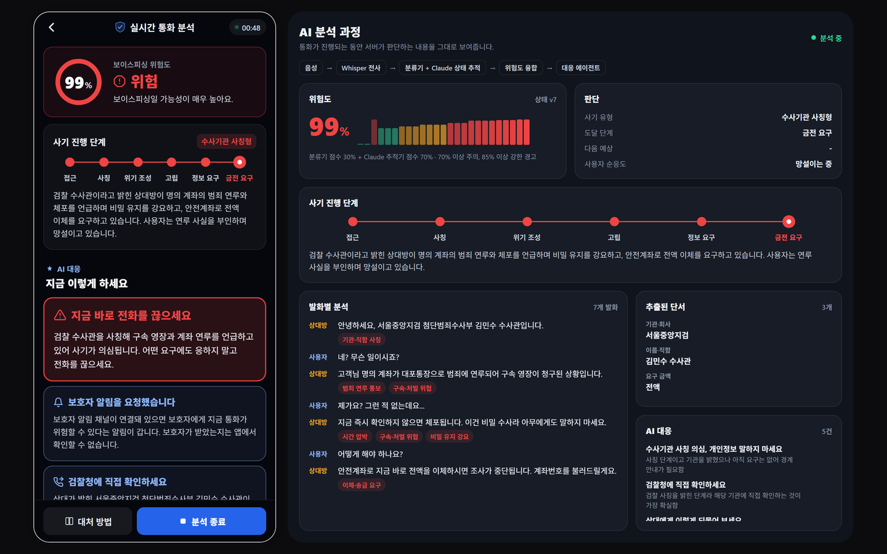
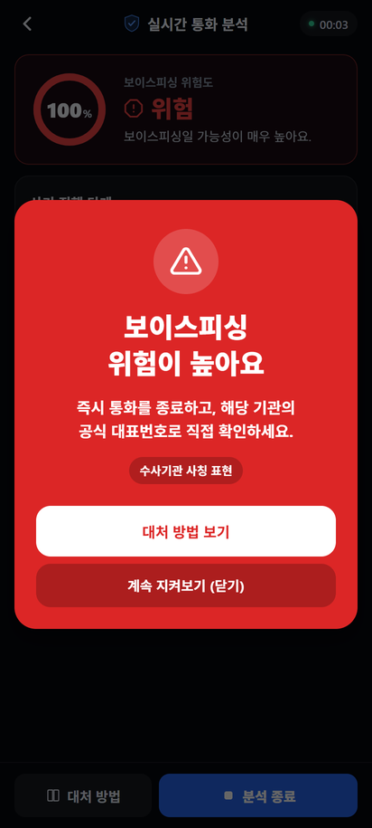
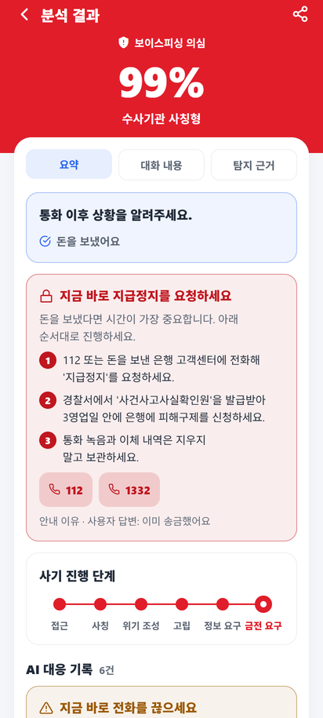
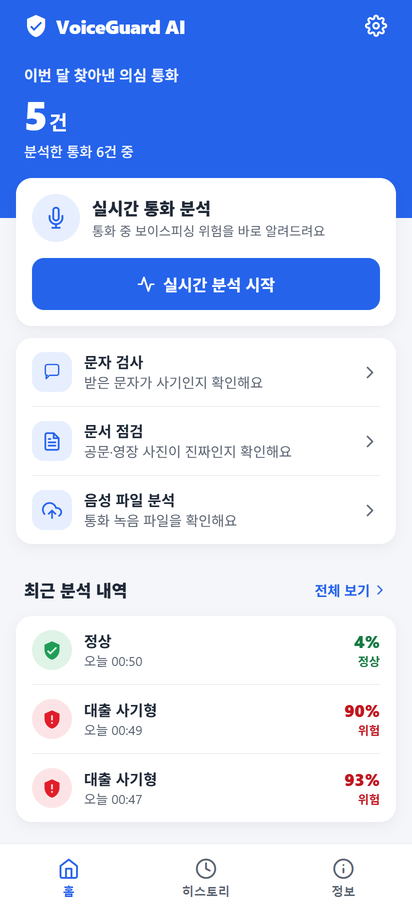
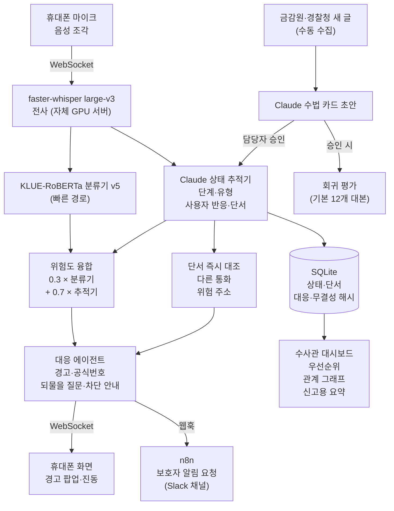

<p></p>

VoiceGuard AI는 통화 내용을 분석해 보이스피싱 진행 단계를 파악하고, 위험 상황에 맞는 대응 방법을 먼저 안내하는 웹 앱입니다. **위험 탐지부터 대응 안내, 통화 후 피해 확인, 수사 지원까지 연결합니다.**

<table>
<tr><td nowrap valign="top"><sub>통화 중</sub></td><td><b>위험 상황별 대응 방법을 안내합니다</b><br>전화를 끊으라는 경고, 공식 대표번호, 상대에게 되물어 볼 질문, 피해 차단 순서를 화면에 표시합니다.</td></tr>
<tr><td nowrap valign="top"><sub>통화가 끝난 뒤</sub></td><td><b>피해가 없는지 다시 묻습니다</b><br>"통화 이후 상황을 알려주세요"에 고른 답(돈을 보냈어요·앱을 설치했어요 등)에 맞춰 지급정지·신고 순서를 안내합니다.</td></tr>
<tr><td nowrap valign="top"><sub>수사관에게</sub></td><td><b>공통 단서를 바탕으로 관련 의심 통화를 연결합니다</b><br>AI 에이전트가 계좌·전화번호 같은 공통 단서가 있는 통화를 찾아 연결하고, 우선 검토할 의심 통화와 선정 근거를 대시보드에 정리합니다.</td></tr>
</table>

<!-- 핵심 숫자 카드: 99.7%는 통화 분류기 v5, 30.2% → 0.7%와 4 → 0통은 v2 → v3 결과입니다. 숫자가 바뀌면 docs/design/numbers.svg, 아래 설명·각주와 대체 문구를 함께 고치고 numbers.png를 다시 굽습니다 (docs/design/README.md) -->
<p></p>

2026-11-16부터 데이터를 추가로 전처리하여 성능을 높인 v5 모델을 사용합니다. v5는 사기 통화 탐지 99.7%이고, 실제 녹음 전사 정상 상담 1,400건의 오경보를 2.0%에서 1.1%로 줄였습니다([비교](docs/tech/detection.md#v3--v5-비식별-처리-구간을-가상-정보로-보완)).

<sub>카드는 통화 분류기 단독 결과입니다(경보 기준 0.70). 99.7%: v5, v2 평가 세트 사기 통화 307통 · 30.2% → 0.7%: v2 → v3, AI Hub 정상 상담 5,041건(v5 0.9%) · 4 → 0통: v2 → v3, 정상 상담 녹음 32통(v5 0통)</sub>

<table>
<tr>
<td width="50%" valign="top"><a href="docs/one-call.md"><b>전화 흐름으로 기능 보기</b></a><br><sub>검찰 사칭 시연 통화로 보는 통화 시작부터 종료 후 대응까지</sub></td>
<td width="50%" valign="top"><a href="docs/investigator.md"><b>수사관 지원용 능동 AI 에이전트 기능</b></a><br><sub>AI가 처리하는 범위, 담당자 검토, 수사 지원 결과</sub></td>
</tr>
<tr>
<td width="50%" valign="top"><a href="docs/tech/detection.md"><b>보이스피싱 탐지 성능</b></a><br><sub>모델별 평가 방법, 결과, 적용 범위와 한계</sub></td>
<td width="50%" valign="top"><a href="docs/tech/transcription.md"><b>음성 인식·화자 분리 성능</b></a><br><sub>전사와 화자 분리 비교, 현재 구성과 채택 이유</sub></td>
</tr>
</table>

[핵심 성과](#핵심-성과) · [통화 대응 흐름](#통화-대응-흐름) · [사용자 기능](#사용자-기능) · [수사 지원](#수사-지원) · [시스템 구조](#시스템-구조) · [체험과 실행](#체험과-실행) · [문서](#문서)

## 핵심 성과

현재 구성(통화 분류기 v5, 2026-11-16 적용)의 결과입니다. 점수 0.70 이상을 경보로 보며, 분류기 단독 결과와 전체 시스템(분류기 + Claude 상태 추적기 + 대응 에이전트) 결과를 나누어 적습니다.

<table>
<tr><th align="left" nowrap>구분</th><th align="left" nowrap>지표</th><th align="left">평가 데이터 · 판정 기준</th><th align="right" nowrap>v5 결과</th></tr>
<tr><td nowrap valign="top" rowspan="4">분류기 단독</td><td nowrap valign="top">사기 통화 탐지율</td><td valign="top">v2 평가 세트의 사기 통화 307통 · 통화 끝 판정</td><td nowrap valign="top" align="right"><b>99.7%</b></td></tr>
<tr><td nowrap valign="top">정상 상담 오경보율</td><td valign="top">AI Hub 정상 상담 5,041건(개인정보 자리를 지운 글) · 통화 중 한 번이라도 경보</td><td nowrap valign="top" align="right">0.9%</td></tr>
<tr><td nowrap valign="top">녹음 전사 오경보율</td><td valign="top">AI Hub 정상 상담 녹음 1,400건의 Whisper 전사 · 통화 중 한 번이라도 경보</td><td nowrap valign="top" align="right"><b>1.1%</b></td></tr>
<tr><td nowrap valign="top">녹음 전사 탐지율</td><td valign="top">금감원 공개 사기 녹취 258건의 Whisper 전사 · 통화 끝 판정</td><td nowrap valign="top" align="right"><b>99.6%</b></td></tr>
<tr><td nowrap valign="top" rowspan="3">전체 시스템</td><td nowrap valign="top">회귀 평가 대본 통과</td><td valign="top">대본 12개(사기 6 · 정상 6)</td><td nowrap valign="top" align="right"><b>12/12</b></td></tr>
<tr><td nowrap valign="top">사기 통화 탐지</td><td valign="top">조정에 쓰지 않은 test 사기 통화 14통</td><td nowrap valign="top" align="right">13/14<br><sub>첫 경고 평균 6.5번째 발화</sub></td></tr>
<tr><td nowrap valign="top">정상 상담 경보</td><td valign="top">조정에 쓰지 않은 test 정상 상담 14통 · 분류기가 경보(0.70 이상)를 낸 어려운 상담</td><td nowrap valign="top" align="right">4/14</td></tr>
</table>

- 상담 녹음은 실제 고객 통화가 아니라 상담사와 고객 역할로 대본을 읽어 녹음한 AI Hub 데이터입니다. 금감원 녹취는 공개된 실제 사기 통화이지만, 258건 중 212건은 같은 녹취를 다른 엔진으로 전사한 글이 학습 데이터에 있습니다. 따라서 99.6%는 처음 보는 사기 통화의 탐지율이 아니라, 서비스와 같은 Whisper 전사에서도 사기를 탐지하는지 확인한 값입니다.
- 분류기 단독으로는 같은 회귀 평가 대본 12개 중 카드 배송 사칭 1개를 놓칩니다(11/12). 전체 시스템에서는 상태 추적기가 이 대본을 탐지했지만, 첫 경고가 v3의 4번째 발화에서 6번째 발화로 늦어졌습니다.
- 앞 3턴 탐지율은 금감원 녹취의 수사기관 사칭·대출 사기와 생성한 기관 사칭 통화에서 v3보다 낮습니다([유형별 초반 탐지](docs/tech/detection.md#유형별-초반-탐지)).

평가 방법과 재현 명령, 버전별 비교(v1 → v5), 한계는 [보이스피싱 탐지 성능](docs/tech/detection.md)과 [학습 기록](docs/MODEL_TRAINING_LOG.md)에 있습니다.

- **문자 검사 · 문서 점검** — 문자 분류기 단독은 학습에 쓰지 않은 문자 3,600건에서 정확도 99.4%(F1 99.2%)였고, 분류기 40%와 Claude 60%를 합친 문자 검사는 별도로 작성한 문자 16건(스미싱 8 · 정상 8)을 모두 맞혔습니다. 문서 점검은 경찰청·금감원·검찰이 공개한 위조 문서와 실제 공문으로 구성한 test 23장에서 정확도 95.7%(위조 14/15 탐지, 오경보 0/8)였습니다. → [보이스피싱 탐지 성능](docs/tech/detection.md)
- **전사 · 화자 분리** — 통화 음성을 텍스트로 바꾸는 전사는 자체 운영 GPU 서버의 Whisper large-v3가 기본 모델입니다. 문자 오류율(CER)은 AI Hub 민원(콜센터) 녹음에서 파일 전체 5.81%(녹음 100개), 실시간 조각 9.24%(녹음 40개)입니다. 콜센터 음성으로 추가 학습한 모델은 파일 전체 CER이 2.45%로 낮아졌지만, 실제 통화의 전화번호를 지워 서비스에 쓰지 않습니다. → [음성 인식·화자 분리 성능](docs/tech/transcription.md)
- **데이터와 이용 조건** — 금감원 공개 사기 녹취 전사, 공식 사례를 근거로 생성한 통화, KISA 118 상담 합성데이터, AI Hub 상담 데이터, 공개 스미싱 문자 데이터 등으로 학습하고 평가했습니다. 데이터 원본과 학습된 모델은 이용 조건(AI Hub 재배포 금지, 스미싱 문자 데이터 CC BY-NC-SA 4.0 등) 때문에 저장소에 올리지 않습니다(`data/`, `models/`는 git 제외). → [데이터와 전처리](docs/tech/detection.md#데이터와-전처리)

## 통화 대응 흐름

**감지에서 개선까지 다섯 단계가 이어집니다.** 발화가 들어올 때마다 감지·판단·개입이 몇 초 안에 이루어지고, 후속 확인은 통화 중 강한 경고 45초 뒤와 통화가 끝난 뒤에 이어집니다. 통화 결과와 확인 응답은 개선 단계에 모이고, 담당자가 검토한 내용이 다음 통화의 탐지에 반영됩니다.

<p></p>

1. **감지** — 통화 음성을 전사하고 발화마다 바로 사기 확률을 계산합니다.<br><sub>faster-whisper large-v3 (자체 운영 GPU 서버) · KLUE-RoBERTa 통화 분류기 v5</sub>
2. **판단** — 대화 흐름을 읽어 사기 단계와 유형, 사용자가 상대방 요구를 따르는 정도, 수사 단서를 파악합니다.<br><sub>Claude 상태 추적기 (구조화 출력)</sub>
3. **개입** — 위험도·단계·유형에 맞는 대응을 골라 안내합니다.<br><sub>대응 에이전트 (대응은 규칙으로 선택, 문구는 Claude가 작성) · 보호자 알림은 n8n에 전송을 요청</sub>
4. **후속 확인** — 통화 중과 통화가 끝난 뒤에 상황을 다시 묻고, 답에 맞춰 안내합니다.<br><sub>통화 중 "통화를 끊으셨나요?" · 통화 후 "통화 이후 상황을 알려주세요" → 지급정지·신고 순서 안내 · 답은 확인 응답으로 저장</sub>
5. **개선** — 확인 응답과 AI 판정을 비교해 오경보·미탐지 의심 사례를 모으고, 담당자가 승인한 신종 수법 정보를 상태 추적기 프롬프트에 반영합니다.<br><sub>품질 점검(확인 응답 → 평가 대본·재학습 후보) · 신종 수법 카드(공식 게시판 → Claude 초안 → 담당자 승인) · 회귀 평가 대본 12개 · 모델 재학습과 교체는 담당자가 결정</sub>

화면 위험도는 `0.3 × 분류기 + 0.7 × 상태 추적기`로 계산하며([API 명세](docs/API_SPEC_V2.md) 4.2절), 0.70 이상이면 주의, 0.85 이상이면 강한 경고입니다. 추적기의 첫 판단이 도착하기 전에는 분류기 점수를 그대로 씁니다. 2026-11-18 검찰 사칭 [대본 시연](#입력-방식)(분류기 v5, 1회 실행)에서는 첫 문장의 분류기 점수가 0.9997이어서 추적기의 첫 판단보다 먼저, 분석 시작 약 3초 뒤에 전체 화면 경고가 표시됐습니다. 추적기 판단이 도착하자 위험도는 65%로 재평가됐고, 단계가 진행되면서 72%, 79%, 86%로 다시 올랐습니다([전화 흐름으로 기능 보기](docs/one-call.md)).

<p><br>
<sub>발표용 넓은 화면(위 시연의 금전 요구 단계). 앱 옆의 'AI 분석 과정' 패널에 위험도 추이, 판단, 사기 진행 단계, 발화별 분석, 추출된 단서, AI 대응이 표시됩니다. 통화가 끝나면 <a href="docs/images/v2/web_result.png">분석 결과 화면</a>으로 바뀝니다.</sub></p>

<details>
<summary><b>단계별 기술과 예시를 담은 워크플로 그림</b></summary>

<br>
<p></p>

</details>

## 사용자 기능

**통화 중에는 위험 상황별 대응 방법을 안내하고, 통화가 끝나면 피해가 없는지 다시 확인합니다.** 받은 문자·문서와 지난 통화 녹음 파일도 분석할 수 있습니다. 실시간 분석이 진행되는 모습은 [시연 GIF](docs/images/v2/demo_realtime.gif)에서, 시연 통화 한 건의 전체 흐름은 [전화 흐름으로 기능 보기](docs/one-call.md)에서 볼 수 있습니다.

<sub>화면은 2026-11-18에 현재 빌드(통화 분류기 v5)에서 촬영했습니다. 통화 화면은 [대본 시연](#입력-방식)으로 기록해 마이크 입력과 전사를 거치지 않았고, 화면의 이름과 번호는 가상 정보입니다.</sub>

### 통화 중

<p align="center">
  
  
  
  <br><sub>실시간 통화 분석 &nbsp;·&nbsp; AI 대응 &nbsp;·&nbsp; 강한 경고</sub>
</p>

- **실시간 통화 분석** — 마이크 음성을 조각으로 보내 전사, 위험도, 사기 진행 단계를 실시간으로 표시합니다. 위험도 40\~69%는 '분석 중'으로 표시합니다.
- **AI 대응** — 지금 할 일, 공식 대표번호(누르면 전화 연결), 상대에게 되물어 볼 질문, 피해 차단 순서를 카드로 안내합니다.
- **강한 경고** — 위험도가 강한 경고 기준을 넘으면 전체 화면 경고를 통화당 한 번 띄우고, 진동을 지원하는 기기에서는 진동도 울립니다.
- **통화 중 단서 대조** — 상대가 말한 계좌·휴대전화·웹 주소·사건번호가 다른 통화에도 나왔거나 웹 주소 형태가 위험하면 바로 알립니다([단서 연결](docs/investigator.md#단서-연결)).

### 통화가 끝난 뒤

<p align="center">
  
  
  
  <br><sub>통화 후 확인 질문 &nbsp;·&nbsp; 답에 맞춘 피해 차단 안내 &nbsp;·&nbsp; 대화 내용과 수법 태그</sub>
</p>

- **후속 확인** — 통화 중에는 "통화를 끊으셨나요?", 위험 통화가 끝난 뒤에는 "통화 이후 상황을 알려주세요"라고 묻고, 고른 답(돈을 보냈어요·앱을 설치했어요 등)에 맞는 지급정지·신고 순서를 안내합니다.
- **통화 결과** — 요약, 대화 내용(발화별 수법 태그), 탐지 근거를 확인하고, 판정이 맞았는지 확인 응답을 남길 수 있습니다.

### 문자·문서·녹음 파일 분석

<p align="center">
  
  
  
  <br><sub>문자 검사 &nbsp;·&nbsp; 문서 점검 &nbsp;·&nbsp; 녹음 파일 분석</sub>
</p>

- **문자 검사** — 받은 문자·메신저 내용을 붙여 넣거나 캡처를 올리면 스미싱 여부와 링크 위험을 판단합니다.
- **문서 점검** — 검찰·법원·금감원 공문이나 영장 사진을 올리면 위조 문서의 특징을 점검합니다.
- **녹음 파일 분석** — 지난 통화 녹음(mp3·wav·m4a)을 올리면 실시간 분석과 같은 분류기·상태 추적기·대응 에이전트로 분석하고, 원본 파일의 SHA-256 해시를 남깁니다.

<details>
<summary><b>홈 · 통화 기록 · 정보 화면</b></summary>

<br>
<p align="center">
  
  
  
  <br><sub>홈 &nbsp;·&nbsp; 히스토리(통화 기록) &nbsp;·&nbsp; 정보. 같은 주소(QR)로 여러 명이 접속해도 각자 기기의 기록만 보입니다.</sub>
</p>

</details>

## 수사 지원

**AI가 통화 단서를 정리하고 관련 의심 통화를 연결해 수사 검토를 지원합니다.** 위험 통화가 들어오면 AI 에이전트가 단서를 추출해 다른 통화와 대조하고, 우선 검토할 의심 통화와 선정 근거, 신고용 요약을 준비합니다. 결과는 수사관 대시보드(`/dashboard`)에서 확인합니다.

<p><br>
<sub>수사관 대시보드. 왼쪽은 우선순위순으로 정렬한 통화 목록이고, 오른쪽은 선택한 사건의 위험도, 우선순위 근거, 사건 개요, 단계 경과입니다. 화면의 통화는 실제 사건이 아니며, 이름과 번호는 가상 정보입니다.</sub></p>

<table>
<tr><th align="left" nowrap>기능</th><th align="left">AI가 처리하는 일</th></tr>
<tr><td nowrap valign="top"><a href="docs/investigator.md#단서-수집">단서 수집 · 연결</a></td><td valign="top">통화에서 계좌번호·전화번호·웹 주소·사건번호 등 단서 8종을 발화 번호와 함께 저장하고, 공통 단서가 있는 통화를 찾아 연결합니다. 관계 그래프는 같은 계좌·번호·사건번호·사칭 기관으로 이어진 통화를 한 화면에 모읍니다.</td></tr>
<tr><td nowrap valign="top"><a href="docs/investigator.md#수사-검토-우선순위-제안">수사 검토<br>우선순위 제안</a></td><td valign="top">위험도·피해 확인·공통 단서·사기 단계·최근성으로 100점 만점 점수를 매기고 선정 근거를 함께 표시합니다.</td></tr>
<tr><td nowrap valign="top"><a href="docs/investigator.md#음성전사-기록의-무결성-확인">음성·전사 기록의<br>무결성 확인</a></td><td valign="top">음성 조각과 녹음 파일의 SHA-256 해시를 체인으로 잇고, 통화가 끝나면 전사문 해시를 고정해 이후 변경 여부를 확인합니다.</td></tr>
<tr><td nowrap valign="top"><a href="docs/investigator.md#신고용-요약">신고용 요약</a></td><td valign="top">통화 기록을 바탕으로 신고용 요약을 생성합니다. 사건 개요 3~5문장만 Claude가 쓰고, 나머지는 저장된 기록으로 조립합니다.</td></tr>
<tr><td nowrap valign="top"><a href="docs/investigator.md#신종-수법-수집검토반영">신종 수법<br>수집·검토·반영</a></td><td valign="top">담당자가 수집을 실행하면 금감원·경찰청 게시판의 새 글을 Claude가 수법 카드 초안으로 정리하고, 담당자가 승인한 카드만 상태 추적기 프롬프트에 추가합니다.</td></tr>
<tr><td nowrap valign="top"><a href="docs/investigator.md#품질-점검">품질 점검</a></td><td valign="top">사용자가 남긴 확인 응답과 AI 판정을 비교해 오경보·미탐지 의심 사례를 모으고, 평가 대본과 재학습 후보로 내보냅니다.</td></tr>
<tr><td nowrap valign="top"><a href="docs/investigator.md#자연어로-묻기-n8n-채팅">자연어로 묻기<br>(n8n 채팅)</a></td><td valign="top">수사관이 채팅으로 물으면 Claude가 읽기 전용 도구 일곱 개로 수사 데이터를 찾아 통화 번호와 함께 답합니다. 요청하면 수동 수집을 시작하며, 이때도 검토 대기 카드만 만듭니다.</td></tr>
</table>

자연어 질의는 n8n 채팅 워크플로에서 실행합니다. 2026-11-18에 시연 서버에 연결해 질문 한 건에 약 9초 만에 답하는 것을 확인했으며, 답의 정확도는 평가하지 않았습니다. n8n에 로그인한 사용자만 쓸 수 있고, 관리 코드는 n8n 자격 증명에 저장합니다.

수법 카드 반영, 모델 재학습과 교체, 신고와 수사 판단은 담당자가 결정합니다([자동 처리와 담당자 결정](docs/investigator.md#자동-처리와-담당자-결정)). 검증 상태와 한계는 다음과 같습니다.

- AI가 쓴 사건 개요는 초안이므로 통화 전문과 대조해야 합니다.
- 우선순위 배점은 팀이 정한 값이며, 실제 수사관과 검증하지 않았습니다.
- 같은 계좌·번호가 나왔다는 사실만으로 같은 범죄 조직이라고 확정할 수 없습니다.
- 음성 원본은 전사 후 지우고 해시만 남깁니다. 해시 저장은 원본 음성 보관과 다릅니다.
- 신종 수법은 수동 수집을 지원합니다. 정기 수집 워크플로는 템플릿만 제공합니다. 승인한 카드의 반영 효과는 검증하지 않았습니다. 승인 뒤 실행하는 회귀 평가에 승인한 카드가 들어가지 않기 때문입니다.

## 시스템 구조

**발화 하나가 들어오면 분류기(빠른 경로)와 Claude 상태 추적기가 함께 판단합니다.** 두 점수를 합친 위험도에 따라 대응 에이전트가 안내하고, 단서와 기록은 수사관 대시보드로 이어집니다.



실시간 음성 인식은 자체 운영 GPU 서버에서 처리하며, 리턴제로 기능을 활성화하면 해당 음성이 외부 API로 전송됩니다. 전사한 통화 내용과 문자 캡처·문서 사진은 Claude API로 보내 판단합니다([실행 위치와 외부 전송](docs/tech/models.md#실행-위치와-외부-전송)).

### 기능 상태

<table>
<tr><th align="left">기능</th><th align="left" nowrap>상태</th><th align="left">설명</th></tr>
<tr><td nowrap valign="top">실시간 통화 분석<br>후속 확인 · 신고용 요약</td><td nowrap valign="top">사용 중</td><td valign="top">자체 운영 GPU 서버의 Whisper large-v3가 전사하고, 통화 분류기 v5(2026-11-16부터)와 Claude 상태 추적기가 판단하며, 대응 에이전트가 안내합니다. 위험 통화에는 후속 확인 질문과 신고용 요약을 준비합니다.</td></tr>
<tr><td nowrap valign="top">문자 검사 · 문서 점검<br>녹음 파일 분석</td><td nowrap valign="top">사용 중</td><td valign="top">앱 홈에서 바로 사용합니다.</td></tr>
<tr><td nowrap valign="top">수사관 대시보드</td><td nowrap valign="top">사용 중</td><td valign="top">단서 연결, 우선순위 제안, 관계 그래프, 무결성 확인, 품질 점검을 한 화면에서 확인합니다.</td></tr>
<tr><td nowrap valign="top">신종 수법<br>수집·검토·반영</td><td nowrap valign="top">사용 중<br><sub>수동 수집</sub></td><td valign="top">대시보드의 '지금 수집' 버튼이나 API로 수집을 실행합니다. 승인한 카드는 상태 추적기 프롬프트에 추가하며, 모델을 다시 학습하지 않습니다.</td></tr>
<tr><td nowrap valign="top">수법 카드 승인 후<br>회귀 평가</td><td nowrap valign="top">사용 중</td><td valign="top">기본 12개 대본을 별도 평가 DB에서 다시 실행합니다. 이 DB가 비어 있어 승인한 카드는 평가 입력에 들어가지 않습니다.</td></tr>
<tr><td nowrap valign="top">리턴제로<br>전사 · 화자 구분</td><td nowrap valign="top">선택 설정</td><td valign="top">코드 기본값에서는 꺼져 있습니다. 시연 서버는 녹음 파일 분석·통화 후 재전사·통화 중 전사 보정에 켜 두었고, 이때 해당 음성이 리턴제로 API로 전송됩니다. 무료 사용량이 소진되면 서버가 즉시 자체 Whisper로 전환하며, 백엔드를 다시 시작할 때까지 리턴제로를 호출하지 않고 통화 중 보정도 끕니다.</td></tr>
<tr><td nowrap valign="top">보호자 알림 요청<br>(n8n)</td><td nowrap valign="top">선택 설정</td><td valign="top"><code>N8N_WEBHOOK_URL</code>을 설정하면 위험 통화 이벤트를 n8n으로 보냅니다. 시연 서버의 n8n은 2026-11-17부터 이 알림을 Slack 채널에 올립니다. 앱은 전송을 요청하는 데까지만 하며, 보호자 등록과 수신 확인 기능은 없습니다.</td></tr>
<tr><td nowrap valign="top">수사관 자연어 질의<br>(n8n 채팅)</td><td nowrap valign="top">선택 설정</td><td valign="top">n8n에 채팅 워크플로를 가져와 서버에 연결하면 사용할 수 있습니다(<code>POST /investigation/assistant</code>, 관리 코드 필요). 시연 서버에는 2026-11-18에 연결해 동작을 확인했습니다.</td></tr>
<tr><td nowrap valign="top">신종 수법 정기 수집<br>(n8n)</td><td nowrap valign="top">템플릿 제공</td><td valign="top">정기 수집 워크플로는 템플릿만 제공합니다. 수집은 수동으로 실행합니다.</td></tr>
<tr><td nowrap valign="top">로컬 화자 분리 (3D-Speaker)<br>Whisper 추가 학습 모델</td><td nowrap valign="top">실험 완료</td><td valign="top">로컬 화자 분리는 앱 코드로 옮겨 시험만 했고 앱 흐름에는 연결하지 않았습니다. 추가 학습한 Whisper는 실제 통화의 전화번호를 지우는 문제가 있어 서비스에 쓰지 않습니다.</td></tr>
</table>

### 기술 스택

| 영역 | 기술 |
| --- | --- |
| Frontend | React Native · Expo · TypeScript · Zustand · PWA |
| Backend · Infra | Python · FastAPI · WebSocket · SQLite · n8n · Cloudflare Tunnel · RunPod GPU 서버 (학습은 H100) |
| 음성 인식(전사) | faster-whisper large-v3 (자체 운영 GPU 서버) · 리턴제로 (선택 설정) |
| 통화 · 문자 분류기 | KLUE-RoBERTa (`klue/roberta-base`) 미세조정 (PyTorch · Hugging Face) · 통화 분류기는 v5 |
| Claude API | Claude Haiku 5.5: 상태 추적기 · 대응 에이전트 · 문자 판단<br>Claude Opus 5.5: 사건 개요 · 문서 점검 · 수법 카드 초안 |

모델별 성능과 실행 위치, 보관만 하는 실험 모델은 [모델 구성](docs/tech/models.md)에 있습니다.

<details>
<summary><b>전체 구조도</b> · 사용자 화면, 연결, FastAPI 백엔드, 저장·연동</summary>

<br>
<p></p>

</details>

## 체험과 실행

시연 주소와 접속 코드는 행사 현장에서 QR 코드로 안내합니다. 휴대폰으로 QR 코드를 열고 홈 화면에 추가하면 앱처럼 쓸 수 있습니다(PWA). 넓은 화면에서 열면 앱 옆에 'AI 분석 과정' 패널이 함께 보이며, 수사관 화면은 PC 브라우저에서 `/dashboard`로 엽니다.

### 입력 방식

<table>
<tr><th align="left" nowrap>방식</th><th align="left">입력</th><th align="left">처리</th><th align="left" nowrap>시작하는 곳</th></tr>
<tr><td nowrap valign="top">마이크 입력</td><td valign="top">기기 마이크로 들어온 소리를 무음 기준으로 자른 음성 조각</td><td valign="top">실시간 전사 → 분류기 + 상태 추적기 → 대응 카드. 통화가 끝나면 전체 녹음을 다시 전사하고 상태를 다시 추적합니다.</td><td nowrap valign="top">홈의<br>'실시간 분석 시작'</td></tr>
<tr><td nowrap valign="top">녹음 업로드</td><td valign="top">지난 통화 녹음 파일 (mp3 · wav · m4a)</td><td valign="top">파일 전체 전사 → 상태 추적기가 통화 전체를 한 번에 분석 → 지난 통화에 맞는 대응 안내</td><td nowrap valign="top">홈의<br>'음성 파일 분석'</td></tr>
<tr><td nowrap valign="top">대본 시연</td><td valign="top">미리 적어 둔 대본 문장</td><td valign="top">마이크와 전사를 거치지 않고 문장을 정해진 간격으로 서버에 보냅니다. 그 뒤의 분류기·상태 추적기·대응 에이전트는 실제 서비스와 같은 코드입니다.</td><td nowrap valign="top">시연 모드 주소<br><code>/realtime?scenario=prosecutor</code><br><sub>대본: prosecutor · loan · normal</sub></td></tr>
</table>

### 지원 환경

- **사용자 앱** — 휴대폰·PC 브라우저에서 여는 웹 앱(PWA)입니다. Expo 프로젝트라 iOS·Android 빌드 설정도 있지만, 서버의 Whisper로 전사하는 실시간 분석은 웹 앱에만 연결했습니다.
- **마이크와 통화 음성** — 실시간 분석에는 브라우저의 마이크 권한이 필요하며, 브라우저는 HTTPS 주소(개발 중에는 localhost)에서만 마이크를 허용합니다. 웹 앱은 휴대폰 통화 음성을 직접 가져오지 않고, 기기 마이크로 들어오는 소리를 전사합니다.
- **화면 꺼짐 방지** — 실시간 분석 중에는 휴대폰 화면이 꺼지지 않게 합니다. Screen Wake Lock API를 지원하는 브라우저에서만 동작하며, 지원하지 않는 브라우저에서는 화면이 꺼지면 마이크 입력이 멈출 수 있습니다.
- **서버** — 운영 서버는 Python 3.11과 CUDA GPU 환경에서 실행했습니다. Whisper large-v3에는 GPU가 필요합니다. GPU가 없으면 CPU에서 small(int8) 모델로 전사하지만, 측정한 노트북 환경에서는 실시간 처리에 필요한 속도를 충족하지 못했습니다.

<details>
<summary><b>실행 방법</b> · 백엔드, 환경 변수, 프론트엔드, 배포 구조, 코드 위치</summary>

**백엔드**

```bash
python3 -m venv .venv && source .venv/bin/activate
pip install -r requirements.txt
uvicorn backend.app.main:app --host 0.0.0.0 --port 8000
```

학습된 모델은 저장소에 없습니다([데이터와 이용 조건](#핵심-성과)). 통화 분류기는 `models/koelectra`(또는 `KOELECTRA_MODEL_DIR`)에서 가중치를 읽습니다. 아래는 프로젝트 루트의 `.env`입니다. 값은 예시이며, 키는 저장소에 올리지 않습니다.

```env
ANTHROPIC_API_KEY=sk-ant-...
TRACKER_MODEL=claude-haiku-5-5      # 실시간 상태 추적기
AGENT_MODEL=claude-haiku-5-5        # 대응 에이전트 · 문자 판단
REPORT_MODEL=claude-opus-5-5        # 사건 개요 · 문서 점검
WHISPER_MODEL=large-v3
STT_LIVE_ENGINE=local               # 통화 중 실시간 조각 전사 (local | rtzr)
STT_FILE_ENGINE=local               # 녹음 파일 분석 · 통화 후 재전사 (local | rtzr), 시연 서버는 rtzr
STT_REFINE=off                      # 통화 중 전사 보정 · 화자 구분 (off | rtzr), 시연 서버는 rtzr
RTZR_CLIENT_ID=...                  # 리턴제로를 켤 때만 (켜면 해당 음성이 리턴제로 API로 전송)
RTZR_CLIENT_SECRET=...
ACCESS_CODE=...                     # 설정하면 접속 코드 필요 (QR 링크에 포함)
ADMIN_CODE=...                      # 설정하면 대시보드·수사·평가 화면에 관리 코드 따로 필요
N8N_WEBHOOK_URL=...                 # 보호자 알림 요청 (선택)
PUBLIC_BASE_URL=...                 # 알림 메시지 속 대시보드 링크 (선택)
```

**프론트엔드**

```bash
cd frontend && npm install
npm run web                                         # 개발
EXPO_PUBLIC_API_BASE=same-origin npm run build:web  # 배포용 웹 빌드 (백엔드가 같은 주소로 제공)
```

**배포 구조**

휴대폰 → Cloudflare 터널(HTTPS) → RunPod에서 빌려 직접 운영하는 GPU 서버의 FastAPI(웹 앱 + API + WebSocket) 순서로 연결합니다. Whisper large-v3 전사, 통화·문자 분류기, 백엔드를 모두 이 서버에서 실행합니다. 모델 학습과 대부분의 평가는 H100 서버에서 했습니다. 서버를 옮기는 순서는 [docs/DEPLOY_RUNPOD.md](docs/DEPLOY_RUNPOD.md)에 있습니다.

**코드 위치**

웹 앱은 `frontend/`(화면 `app/`, WebSocket 세션 `src/hooks/useCallSession.ts`), 백엔드는 `backend/app/`(API `api/`, 판단·대응·수사 지원 `services/`, 수사관 대시보드 `web/dashboard.html`, 학습·평가 스크립트 `train_transformer.py`·`build_dataset_v*.py`·`eval_*.py`)에 있습니다. 전사 모델 추가 학습·평가는 `stt_lab/`, n8n 워크플로 템플릿(위험 통화 알림, 수사관 자연어 질의, 신종 수법 정기 수집)은 `n8n/`에 있습니다. 파일별 역할은 [전화 흐름으로 기능 보기](docs/one-call.md#관련-구현-코드)와 [수사관 지원용 능동 AI 에이전트 기능](docs/investigator.md#관련-구현-코드)의 '관련 구현 코드'에 정리했습니다.

</details>

## 문서

- **안내 페이지** — [전화 흐름으로 기능 보기](docs/one-call.md) · [수사관 지원용 능동 AI 에이전트 기능](docs/investigator.md) · [보이스피싱 탐지 성능](docs/tech/detection.md) · [음성 인식·화자 분리 성능](docs/tech/transcription.md) · [모델 구성](docs/tech/models.md)
- [docs/API_SPEC_V2.md](docs/API_SPEC_V2.md) — v2 API 명세 (WebSocket 이벤트, 상태·대응·수사 API, 문자·문서 분석)
- [docs/MODEL_TRAINING_LOG.md](docs/MODEL_TRAINING_LOG.md) — 모델 학습·평가 기록 (데이터, 설정·가중치, 결과, 한계, 실시간 전사 비교)
- [stt_lab/README.md](stt_lab/README.md) — 전사 모델 추가 학습·평가 스크립트
- [docs/DEPLOY_RUNPOD.md](docs/DEPLOY_RUNPOD.md) — 시연 서버를 RunPod GPU pod로 옮기는 순서와 운영 메모
- [docs/BACKLOG.md](docs/BACKLOG.md) — 추후 구현 사항 · [docs/API_SPEC.md](docs/API_SPEC.md) — v1 API 명세
- `docs/diagrams/` — 구조도 원본 (HTML) · `docs/design/` — README 그림 원본 (SVG)과 다시 굽는 방법

## 팀

| 이름 | 역할 |
| --- | --- |
| **이재현** | 자료 조사 및 발표 |
| **장지훈** | 디자인 및 프론트엔드 개발 |
| **박준영** | RAG + 규칙 기반 탐지, API 개발 |
| **최세민** | AI 모델 학습 및 전처리, API 개발 |
