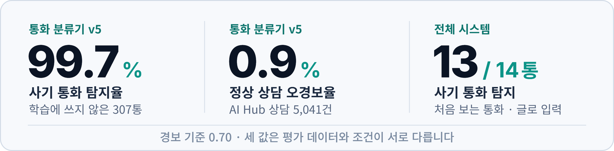
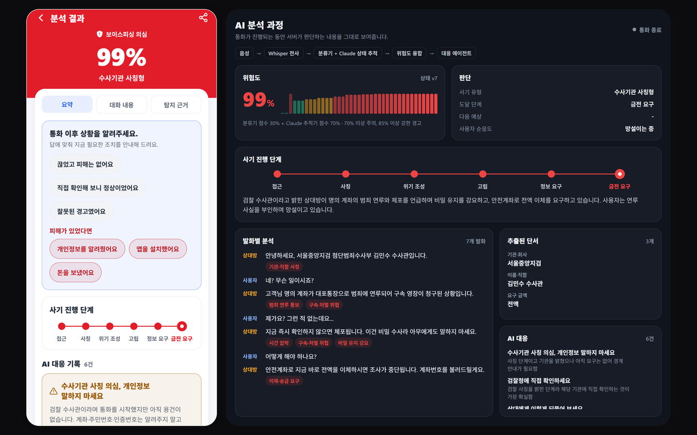
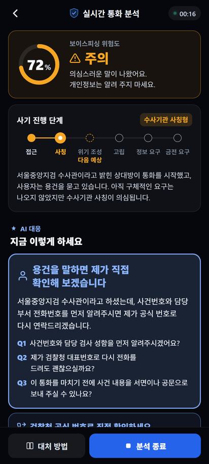
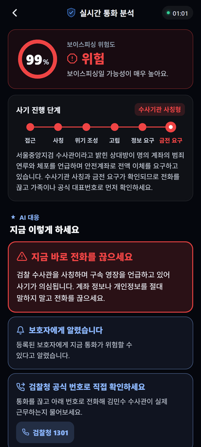
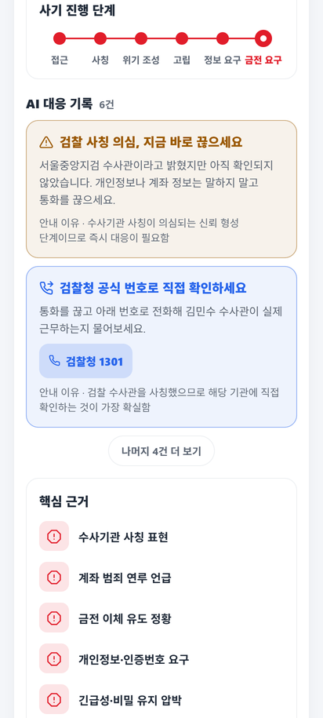
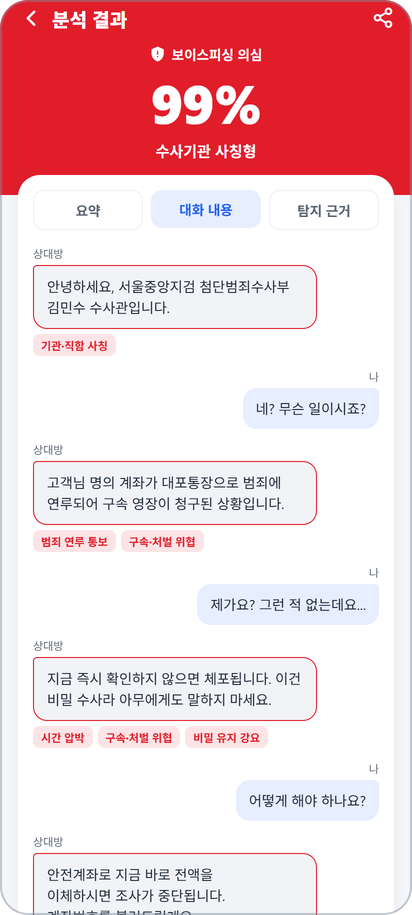
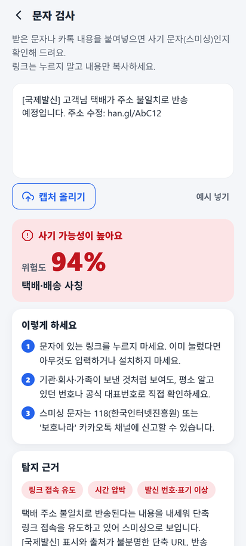
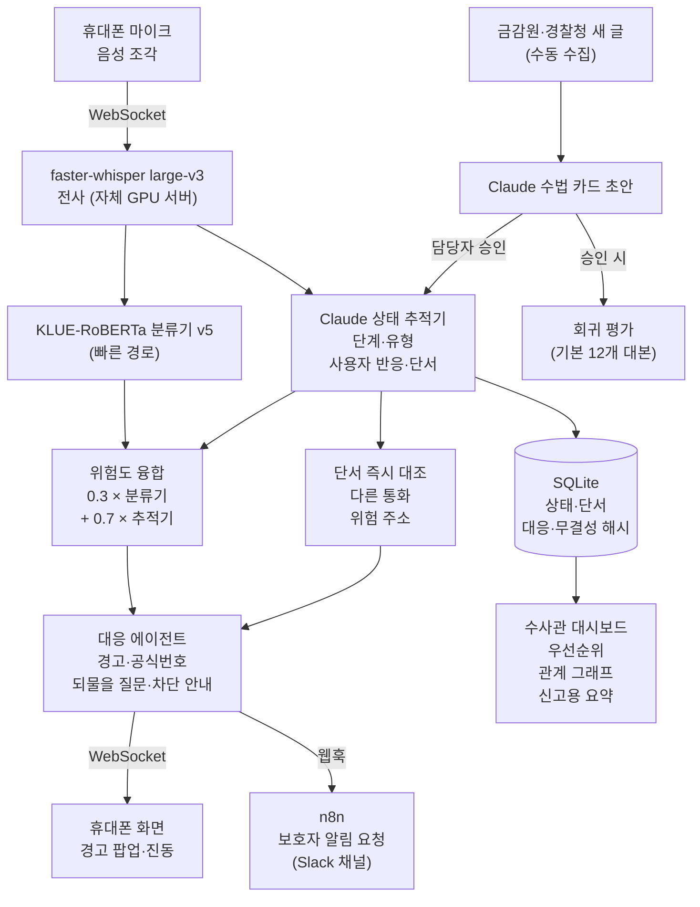

<p><br>
<sub>2026-11-15 개발 중 시험 통화로 찍은 화면이고, 이름·계좌번호는 시험 데이터입니다. 휴대폰 화면의 보호자 알림 카드는 지금 '보호자 알림을 요청했습니다'로 표시되며, 보호자 등록과 수신 확인 기능은 없습니다.</sub></p>

통화 내용을 분석해 보이스피싱 진행 단계를 파악하고, 위험 상황에 맞는 대응 방법을 AI가 먼저 안내합니다. 통화가 끝난 뒤에도 피해가 없는지 다시 확인하고, 위험 통화에서 나온 단서는 수사 지원 대시보드로 모읍니다.

[핵심 성과](#핵심-성과) · [통화 대응 흐름](#통화-대응-흐름) · [사용자 기능](#사용자-기능) · [수사 지원](#수사-지원) · [시스템 구조](#시스템-구조) · [체험과 실행](#체험과-실행) · [문서](#문서)

<table>
<tr>
<td width="50%" valign="top"><a href="docs/one-call.md"><b>전화 흐름으로 기능 보기</b></a><br><sub>검찰 사칭 시연 통화로 보는 통화 시작부터 종료 후 대응까지</sub></td>
<td width="50%" valign="top"><a href="docs/investigator.md"><b>수사관 지원용 능동 AI 에이전트 기능</b></a><br><sub>AI가 처리하는 범위, 담당자 검토, 수사 지원 결과</sub></td>
</tr>
<tr>
<td width="50%" valign="top"><a href="docs/tech/detection.md"><b>보이스피싱 탐지 성능</b></a><br><sub>모델별 평가 방법, 결과, 적용 범위와 한계</sub></td>
<td width="50%" valign="top"><a href="docs/tech/transcription.md"><b>음성 인식·화자 분리 성능</b></a><br><sub>전사와 화자 분리 비교, 현재 구성과 채택 이유</sub></td>
</tr>
</table>

**VoiceGuard는 위험 탐지부터 대응 안내, 통화 후 피해 확인, 수사 지원까지 연결합니다.**

<table>
<tr><td nowrap valign="top"><sub>통화 중</sub></td><td><b>위험 상황별 대응 방법을 안내합니다</b><br>"지금 끊으세요", 공식 대표번호, 상대에게 되물어 볼 질문, 피해 차단 순서를 화면에 띄웁니다.</td></tr>
<tr><td nowrap valign="top"><sub>통화가 끝난 뒤</sub></td><td><b>피해가 없는지 다시 묻습니다</b><br>"통화 이후 괜찮으신가요?"에 고른 답(돈을 보냈어요·앱을 설치했어요 등)에 맞춰 지급정지·신고 순서를 안내합니다.</td></tr>
<tr><td nowrap valign="top"><sub>수사관에게</sub></td><td><b>공통 단서를 바탕으로 관련 의심 통화를 연결합니다</b><br>AI 에이전트가 계좌·전화번호 같은 공통 단서가 있는 통화를 찾아 연결하고, 우선 검토할 의심 통화와 선정 근거를 대시보드에 정리합니다.</td></tr>
</table>

## 핵심 성과

<!-- 핵심 숫자 카드: 99.7%는 통화 분류기 v5, 30.2% → 0.7%와 4 → 0통은 v2 → v3 결과입니다. 숫자가 바뀌면 docs/design/numbers.svg, 아래 설명·각주와 대체 문구를 함께 고치고 numbers.png를 다시 굽습니다 (docs/design/README.md) -->
<p></p>

2026-11-16부터 데이터를 추가로 전처리하여 성능을 높인 v5 모델을 사용합니다. v5는 사기 통화 탐지 99.7%이고, 실제 녹음 전사 정상 상담 1,400건의 오경보를 2.0%에서 1.1%로 줄였습니다([비교](docs/tech/detection.md#v3--v5-비식별-처리-구간을-가상-정보로-보완)).

<sub>카드는 통화 분류기 단독 결과입니다(경보 기준 0.70). 99.7%: v5, v2 평가 세트 사기 통화 307통 · 30.2% → 0.7%: v2 → v3, AI Hub 정상 상담 5,041건(v5 0.9%) · 4 → 0통: v2 → v3, 정상 상담 녹음 32통(v5 0통)</sub>

### 통화 탐지 성능

지금 쓰는 구성(통화 분류기 v5, 2026-11-16 적용)의 결과입니다. 분류기 단독 결과와 전체 시스템(분류기 + Claude 상태 추적기 + 대응 에이전트) 결과를 나눠 적고, 점수 0.70 이상을 경보로 봅니다. 평가 방법과 한계는 [보이스피싱 탐지 성능](docs/tech/detection.md)과 [학습 기록](docs/MODEL_TRAINING_LOG.md)에 있습니다.

| 평가 | 평가 데이터 · 판정 기준 | v5 결과 |
| --- | --- | ---: |
| 사기 통화 탐지율<br><sub>분류기 단독</sub> | v2 평가 세트의 사기 통화 307통 · 통화 끝 판정 | **99.7%** |
| 정상 상담 오경보율<br><sub>분류기 단독</sub> | AI Hub 정상 상담 5,041건 · 개인정보 자리를 지운 글 · 통화 중 한 번이라도 | 0.9% |
| 녹음 전사 오경보율<br><sub>분류기 단독</sub> | AI Hub 정상 상담 녹음 1,400건 · Whisper 전사 · 통화 중 한 번이라도 | **1.1%**<br><sub>v3 2.0%</sub> |
| 녹음 전사 탐지율<br><sub>분류기 단독</sub> | 금감원 공개 사기 녹취 258건 · Whisper 전사 · 통화 끝 판정<br><sub>212건은 같은 녹취의 다른 전사가 학습 데이터에 있음</sub> | **99.6%**<br><sub>v3 97.7%</sub> |
| 정상 상담 녹음 오경보<br><sub>분류기 단독</sub> | AI Hub 정상 상담 녹음 32통 · Whisper 전사 | 0통 |
| 회귀 평가 대본<br><sub>전체 시스템</sub> | 대본 12개 (사기 6 · 정상 6) | **12/12** |
| test 사기 탐지<br><sub>전체 시스템</sub> | 조정에 쓰지 않은 사기 통화 14통 | 13/14<br><sub>첫 경고 평균 6.5번째 발화</sub> |
| test 정상 상담 경보<br><sub>전체 시스템</sub> | 조정에 쓰지 않은, 분류기가 경보(0.70 이상)를 낸 어려운 정상 상담 14통 | 4/14 |

<sub>AI Hub 상담 녹음은 상담사와 고객이 대본을 읽고 녹음한 것이고, 금감원 녹취는 공개된 실제 사기 통화입니다. 금감원 녹취 258건 중 212건은 같은 녹취를 다른 엔진으로 전사한 글이 학습 데이터에 있어, 99.6%는 처음 보는 사기 통화의 탐지율이 아니라 서비스와 같은 Whisper 전사에서도 사기를 잡는지 확인한 값입니다. 분류기 단독으로는 별도로 작성한 평가 시나리오 12종 중 카드 배송 사칭을 놓칩니다(11/12). 전체 시스템에서는 상태 추적기가 이 시나리오를 잡았지만 첫 경고가 4번째에서 6번째 발화로 늦어졌습니다. 앞 3턴 탐지율은 금감원 녹취의 수사기관 사칭·대출 사기와 생성한 기관 사칭 통화에서 v3보다 낮습니다([유형별 초반 탐지](docs/tech/detection.md#유형별-초반-탐지)).</sub>

<details>
<summary><b>버전별 비교</b> · v1 → v5 통화 분류기, v2 → v5 전체 시스템</summary>
<br>

분류기는 v1이 KoELECTRA, v2부터 v5(현재)까지 KLUE-RoBERTa입니다. 정상 평가 글은 개인정보 자리를 지운 원래 글이고, 실제 이름·번호가 든 조건의 비교는 [v3 → v5](docs/tech/detection.md#v3--v5-비식별-처리-구간을-가상-정보로-보완)에 따로 있습니다.

| 평가 (분류기 단독) | v1 | v2 | v3 | v5<br><sub>현재</sub> |
| --- | ---: | ---: | ---: | ---: |
| 사기 통화 탐지율<br><sub>통화 끝 판정 · v2 평가 세트 837통 중 사기 307</sub> | 49.5% | 99.7% | 99.3% | **99.7%** |
| 사기 통화 경보<br><sub>통화 중 한 번이라도</sub> | - | 99.7% | 100% | **100%** |
| 정상 통화 경보<br><sub>통화 중 한 번이라도 · 837통 중 정상 530</sub> | 31.9% | 8.1% | **5.1%** | 5.5% |
| KISA 118 오경보<br><sub>피해 상담 통화</sub> | 59.8% | 4.2% | 2.9% | **2.5%** |
| AI Hub 정상 상담 오경보<br><sub>5,041건 · 학습에 쓰지 않은 Validation · 개인정보 자리를 지운 글</sub> | - | 30.2% | **0.7%** | 0.9% |
| └ 은행 상담 | - | 69.2% | **1.4%** | 3.0% |
| └ 증권 상담 | - | 55.4% | 2.1% | **1.6%** |
| 녹음 전사 오경보<br><sub>AI Hub 정상 상담 녹음 1,400건 · Whisper 전사</sub> | - | - | 2.0% | **1.1%** |
| 정상 상담 녹음 오경보<br><sub>AI Hub 정상 상담 녹음 32통 · Whisper 전사</sub> | - | 4통 | 0통 | **0통** |
| 별도로 작성한 평가 시나리오<br><sub>12종 · 사기 6 · 정상 6</sub> | 9/12<br><sub>사기 3/6 탐지</sub> | 12/12 | **12/12** | 11/12<br><sub>카드 배송 사칭 미탐지</sub> |

| 평가 (전체 시스템) | v2 + 이전 프롬프트 | v3 | v5<br><sub>현재</sub> |
| --- | ---: | ---: | ---: |
| 회귀 평가 대본<br><sub>12개 · 사기 6 · 정상 6</sub> | 12/12 | **12/12** | **12/12**<br><sub>카드 배송 첫 경고 4 → 6번째 발화</sub> |
| 어려운 정상 상담 경고<br><sub>분류기가 1.00을 준 정상 상담 14통 · 프롬프트 조정용 dev</sub> | 9통 | **3통** | 4통 |
| test 정상 상담 경고<br><sub>조정에 쓰지 않은 test 28통 중 정상 상담 14</sub> | 9/14 | **4/14** | **4/14** |
| test 사기 탐지<br><sub>test 28통 중 사기 14 · 첫 경고 평균 7.1 → 6.8 → 6.5번째 발화</sub> | 13/14 | **13/14** | **13/14** |

</details>

### 문자 검사 · 문서 점검 성능

| 평가 | 결과 |
| --- | ---: |
| 문자 검사<br><sub>학습에 쓰지 않은 문자 3,600건 · 분류기 단독</sub> | 정확도 99.4%<br><sub>F1 99.2%</sub> |
| 문자 검사<br><sub>별도로 작성한 최신 수법 문자 16건 · 분류기 40% + Claude 60%</sub> | 16/16 |
| 문서 점검<br><sub>경찰청·금감원·검찰이 공개한 위조 문서 + 실제 공문 · test 23장</sub> | 정확도 95.7%<br><sub>위조 14/15 탐지 · 오경보 0/8</sub> |

<!-- STT:START -->
### 전사 · 화자 분리 성능

**실시간 음성 인식은 자체 운영 GPU 서버에서 처리하며, 리턴제로 기능을 활성화하면 해당 음성이 외부 API로 전송됩니다.** 전사는 통화 음성을 텍스트로 바꾸는 과정입니다. 코드 기본값은 모든 전사를 자체 서버의 Whisper large-v3로 처리합니다. 시연 서버는 녹음 파일 분석·통화 후 재전사·통화 중 전사 보정에 리턴제로를 켜 두었고, 실시간 조각은 자체 서버에서 전사합니다. 리턴제로 무료 사용량이 소진되면 서버가 바로 자체 서버의 Whisper로 바꿔 전사하고, 백엔드를 다시 켤 때까지 리턴제로를 부르지 않습니다. 아래 숫자는 문자 오류율(CER)이라 낮을수록 좋습니다.

| 모델 | 파일 전체 | 실시간 조각 |
| --- | ---: | ---: |
| large-v3<br><sub>기본 사전학습 모델 · 자체 운영 · 서비스 기본</sub> | 5.81% | 9.24% |
| large-v3 추가 학습<br><sub>콜센터 음성 · LoRA · 서비스에 쓰지 않음</sub> | 2.45% | 10.34% |
| 리턴제로<br><sub>외부 API · 선택 설정</sub> | 6.28% | 8.11% |

<sub>AI Hub 민원(콜센터) 녹음. 파일 전체는 100개(3.43시간), 실시간은 앱과 같은 무음 기준 조각으로 40개(1.24시간)를 전사했습니다.</sub>

**통화 중 전사 보정 및 화자 구분.** 리턴제로를 켜면 최근 20초는 실시간 조각을 그대로 보여 주고, 그보다 오래된 구간은 15초마다 리턴제로로 다시 전사해 화자별 말풍선으로 바꿉니다. 녹음 8개에서 CER은 실시간 조각 8.55%에서 보정 후 4.06%로 감소했습니다. 화자 재배정 최종 설정은 그중 녹음 4개를 따로 잰 결과 화자 정확도 90.4%였습니다. 화면 반영은 약 23초 늦습니다. 로컬 화자 분리(3D-Speaker)는 실험만 했고 앱에는 연결하지 않았습니다.

<details>
<summary><b>추가 학습한 전사 모델을 쓰지 않는 이유</b></summary>
<br>

파일 전체 점수는 크게 좋아졌지만, 학습 대본이 전화번호 같은 개인정보를 'ㅇㅇㅇ'으로 가린 탓에 소리 내 읽은 숫자를 지우는 규칙까지 익혔습니다. 금감원 공개 사기 녹취에서 추가 학습한 large-v3는 `직통번호는 02-61xx-60xx이고요`를 `직통번호는 에 네. 에 에이고요`로 적었습니다. 실시간 조각에서는 끝이 잘린 문장에 없는 말을 덧붙여 오히려 나빠졌습니다. 계좌·전화번호로 통화를 연결하는 서비스라 기본 사전학습 모델 large-v3를 그대로 씁니다([자세히](docs/tech/transcription.md#추가-학습-모델을-기본으로-쓰지-않는-이유)).

</details>

<sub>데이터, 음성과 정답 대본 정렬, 추가 학습 설정, 묶음별 결과, 노트북 CPU 측정은</sub> [음성 인식·화자 분리 성능](docs/tech/transcription.md)

<!-- STT:END -->

<details>
<summary><b>학습·평가 데이터</b></summary>
<br>

| 데이터 | 쓰임 · 출처 |
| --- | --- |
| 보이스피싱 녹취 전사<br><sub>기관 사칭 575 · 대출 사기 131</sub> | 사기 통화, Whisper 전사 평가<br><sub>금융감독원 「그놈 목소리」 (KorCCVi 전사)</sub> |
| 공식 사례 기반 생성 통화<br><sub>사기 668 · 같은 주제의 정상 363</sub> | 새 유형(지인 사칭·카드배송·납치 등) 보강<br><sub>금감원 피해사례·소비자경보, 경찰청 예·경보 121건 → Claude 생성</sub> |
| KISA 118 전화상담 합성데이터<br><sub>1,283통</sub> | 피싱이 주제지만 정상인 상담<br><sub>공공데이터포털 (15156113 등)</sub> |
| 금융분야 고객상담 데이터<br><sub>은행 · 보험 · 증권</sub> | 정상 상담 통화 (어려운 정상 사례 + 평가)<br><sub>AI Hub</sub> |
| 민원(콜센터) 질의-응답 데이터<br><sub>금융·보험, 다산콜센터, 질병관리청, 홈쇼핑</sub> | 정상 통화, 녹음 평가(대본을 읽고 녹음한 상담), 전사 모델 추가 학습·평가 (음성 383시간)<br><sub>AI Hub</sub> |
| 한국어 스미싱 문자 | 문자 검사 분류기<br><sub>Hugging Face <code>jmjmjm3/kor-smishing-message</code> (CC BY-NC-SA 4.0)</sub> |
| 위조 공문 평가 세트<br><sub>61장</sub> | 문서 점검 평가<br><sub>경찰청·금감원·검찰·언론 공개 이미지, 법제처 서식 등</sub> |

위조 공문 평가 세트의 목록은 `backend/eval/documents_manifest.json`에 있습니다. 데이터 원본과 학습된 모델은 이용 조건(AI Hub 재배포 금지, 비상업 라이선스 등) 때문에 저장소에 올리지 않습니다 (`data/`, `models/`는 git 제외).

</details>

## 통화 대응 흐름

**감지에서 개선까지, 다섯 단계가 이어집니다.** 발화가 들어올 때마다 감지·판단·개입이 몇 초 안에 돌고, 후속 확인은 통화 중 45초 뒤와 통화가 끝난 뒤에 이어집니다. 통화 결과와 확인 응답은 개선 단계로 모이고, 담당자가 검토한 내용이 다음 통화의 탐지에 반영됩니다.

<p><br>
<sub>그림의 단계 설명은 이전 문구입니다. '할 일 안내'는 위험 상황별 대응 방법 안내, '다시 묻기'는 통화 후 피해 여부 확인, '배우고 다시 측정'은 담당자가 검토한 수법 정보를 반영하고 탐지 성능을 재평가하는 단계입니다. 수법 정보는 상태 추적기 프롬프트에 추가하며, 모델 재학습은 담당자가 따로 실행합니다.</sub></p>

1. **감지** — 통화 음성을 전사하고 바로 사기 확률을 냅니다.<br><sub>faster-whisper large-v3 (자체 운영 GPU 서버) · KLUE-RoBERTa 통화 분류기 v5</sub>
2. **판단** — 대화 흐름으로 사기 단계·유형, 상대방 요구에 대한 사용자의 반응, 수사 단서를 파악합니다.<br><sub>Claude 상태 추적기 (구조화 출력)</sub>
3. **개입** — 위험도·단계·유형에 맞는 대응을 골라 안내 문구를 만듭니다.<br><sub>대응 에이전트 (규칙 선택 + Claude 작성) · 보호자 알림은 n8n으로 전송을 요청 (수신 확인 없음)</sub>
4. **후속 확인** — 통화 중 45초 뒤와 통화 후에 다시 묻고, 답에 맞춰 안내합니다.<br><sub>후속 질문 → 지급정지·신고 안내 · 답은 확인 응답으로 저장</sub>
5. **개선** — 사용자 응답과 AI 판정을 비교해 오경보·미탐지 의심 사례를 모으고, 새 수법 정보를 반영하고 탐지 성능을 재평가합니다.<br><sub>품질 점검(확인 응답 → 평가 대본·재학습 후보) · 신종 수법 카드(공식 게시판 → Claude 초안 → 담당자 승인 → 상태 추적기 프롬프트) · 회귀 평가 12개 대본 · AI Hub 상담 데이터·녹음 평가</sub>

화면에 보이는 위험도는 `0.3 × 분류기 + 0.7 × 상태 추적기`입니다. 분류기는 추적기가 따라오기 전 몇 초의 조기 신호를, 추적기는 통화 전체의 의도를 맡습니다. 주의 기준은 0.70, 강한 경고 기준은 0.85입니다([docs/API_SPEC_V2.md](docs/API_SPEC_V2.md) 4.2절).

<p align="center">
   
  <br><sub>발표용 넓은 화면(2026-11-15, v5 적용 전 촬영). 통화 중에는 앱 옆에 'AI 분석 과정' 패널(위험도 추이, 판단, 단계, 발화별 분석, 단서, AI 대응)이, 통화가 끝나면 분석 결과가 보입니다.</sub>
</p>

<details>
<summary><b>단계별 예시가 들어간 워크플로 그림</b></summary>
<br>
<p></p>
<sub>분류기 v5 적용 전(2026-11-15)에 만든 그림이라 문구와 예시 수치(v2 → v3 결과)가 그때 기준입니다. 그림의 보호자 알림은 n8n에 전송을 요청하는 기능이고 수신 확인은 없습니다. '재학습 후 평가를 통과해야 교체'와 달리, 모델 교체는 평가 결과를 보고 담당자가 정합니다.</sub>
</details>

## 사용자 기능

**통화 중에는 위험 상황별 대응 방법을 안내하고, 통화가 끝나면 피해가 없는지 다시 확인합니다.** 받은 문자·문서와 지난 통화 녹음 파일도 올려 분석할 수 있습니다. 실시간 분석이 움직이는 모습은 [시연 GIF](docs/images/v2/demo_realtime.gif)로, 시연 통화 한 건의 흐름은 [전화 흐름으로 기능 보기](docs/one-call.md)로 볼 수 있습니다.

<sub>이 절의 화면은 2026-11-15(분류기 v5 적용 전)에 찍었습니다. 지금 버전과 점수·문구가 조금 다를 수 있습니다.</sub>

### 통화 중

- **실시간 통화 분석** — 마이크 음성을 조각으로 보내 실시간 전사, 위험도, 사기 진행 단계, AI 대응 카드를 띄웁니다. 위험도 40~69%는 '분석 중'으로 표시합니다.
- **AI 대응** — 지금 할 일, 공식 대표번호(탭하면 전화), 상대에게 되물어 볼 질문, 피해 차단 순서를 보여 줍니다.
- **강한 경고** — 위험 단계에 들어가면 전체 화면 경고로 알리고, 진동을 지원하는 기기에서는 진동도 울립니다.
- **통화 중 단서 대조** — 상대가 부른 계좌·휴대전화·웹 주소·사건번호가 다른 통화에도 나왔거나 웹 주소 형태가 위험하면 그 자리에서 알립니다. 같은 단서는 수사 화면에서 공통 단서가 있는 통화로 연결됩니다([단서 연결](docs/investigator.md#단서-연결)).

<p align="center">
  
  
  
  <br><sub>실시간 분석 &nbsp;·&nbsp; 단계 추적과 AI 대응 &nbsp;·&nbsp; 강한 경고</sub>
  <br><sub>가운데 화면의 '보호자에게 알렸습니다'는 촬영 당시 문구이고, 지금은 '보호자 알림을 요청했습니다'로 표시합니다. 앱에는 보호자 등록과 수신 확인 기능이 없습니다.</sub>
</p>

### 통화가 끝난 뒤

- **후속 확인** — 통화 중에는 "통화를 끊으셨나요?", 통화 후에는 "통화 이후 괜찮으신가요?"(돈을 보냈어요·앱을 설치했어요 등)를 묻고, 답에 맞는 지급정지·신고 순서를 안내합니다.
- **통화 결과** — 결과 요약, 대화 내용(발화별 수법 태그), 탐지 근거를 보고, 판정이 맞았는지 확인 응답을 남길 수 있습니다.

<p align="center">
  
  
  
  <br><sub>결과와 후속 확인 &nbsp;·&nbsp; AI 대응 기록과 근거 &nbsp;·&nbsp; 대화 내용과 수법 태그</sub>
</p>

### 문자·문서·녹음 파일 분석

- **문자 검사** — 받은 문자·메신저를 붙여 넣거나 캡처를 올리면 스미싱 여부와 링크 위험을 판단합니다.
- **문서 점검** — 검찰·법원·금감원 공문, 영장 사진을 올리면 위조 문서의 특징을 점검합니다.
- **녹음 파일 분석** — 지난 통화 녹음(mp3·wav·m4a)을 올리면 실시간 분석과 같은 분류기·Claude 상태 추적기·대응 에이전트로 분석하고, 원본 파일의 SHA-256 해시를 남깁니다.

<p align="center">
  
  
  
  <br><sub>문자 검사 &nbsp;·&nbsp; 문서 점검 &nbsp;·&nbsp; 녹음 파일 분석</sub>
</p>

<details>
<summary><b>홈 · 통화 기록 · 정보 화면</b></summary>
<br>

앱은 홈 · 통화 기록 · 정보 세 탭으로 되어 있습니다. 같은 주소(QR)로 여러 명이 써도 각자 기기의 기록만 보입니다.

<p align="center">
  
  
  
  <br><sub>홈 &nbsp;·&nbsp; 통화 기록 &nbsp;·&nbsp; 대응 정보</sub>
</p>

</details>

## 수사 지원

**AI가 통화 단서를 정리하고 관련 의심 통화를 연결해 수사 검토를 지원합니다.** 위험 통화가 들어오면 AI 에이전트가 단서를 추출해 다른 통화와 대조하고, 우선 검토할 의심 통화와 선정 근거, 신고용 요약을 준비합니다. 결과는 수사관 대시보드(`/dashboard`) 한 곳에서 봅니다.

<p><br>
<sub>2026-11-15(분류기 v5 적용 전) 개발 중 시험 통화로 찍은 화면입니다. 화면의 이름·계좌번호는 시험 데이터입니다.</sub></p>

| 기능 | AI가 처리하는 일 |
| --- | --- |
| [단서 수집 · 연결](docs/investigator.md#단서-수집) | 통화에서 계좌번호·전화번호·URL·사건번호 등 단서 8종을 발화 번호와 함께 저장하고, 공통 단서가 있는 통화를 찾아 연결합니다. |
| [수사 검토 우선순위 제안](docs/investigator.md#수사-검토-우선순위-제안) | 위험도·피해 확인·공통 단서·사기 단계·최근성으로 100점 만점 점수를 매기고 선정 근거를 함께 표시합니다. |
| 관계 그래프 | 같은 계좌·번호·사건번호·사칭 기관으로 이어진 통화를 한 화면에 모읍니다. |
| [음성·전사 기록의 무결성 확인](docs/investigator.md#음성전사-기록의-무결성-확인) | 음성 조각과 녹음 파일의 SHA-256 해시를 체인으로 잇고, 통화가 끝나면 전사문 해시를 고정해 이후 변경 여부를 확인합니다. |
| [신고용 요약](docs/investigator.md#신고용-요약) | 통화 기록을 바탕으로 신고용 요약을 생성합니다. 사건 개요 3~5문장만 Claude가 쓰고, 나머지는 저장된 기록으로 조립합니다. |
| [신종 수법 수집·검토·반영](docs/investigator.md#신종-수법-수집검토반영) | 금감원·경찰청 게시판의 새 글을 Claude가 수법 카드 초안으로 정리하고, 담당자가 승인한 카드만 상태 추적기 프롬프트에 추가합니다. |
| [품질 점검](docs/investigator.md#품질-점검) | 사용자가 제공한 확인 응답과 AI 판정을 비교해 오경보·미탐지 의심 사례를 모으고, 평가 대본과 재학습 후보로 내보냅니다. |
| [자연어로 묻기 (n8n 채팅)](docs/investigator.md#자연어로-묻기-n8n-채팅) | 수사관이 채팅으로 물으면 Claude가 수사 데이터를 도구로 찾아 통화 번호와 함께 답하고, 요청하면 수동 수집을 시작합니다. 워크플로 템플릿만 있고 n8n에는 아직 연결하지 않았습니다. |

<sub>우선순위 배점은 팀이 정한 값이고 실제 수사관과 검증하지 않았습니다. 같은 계좌·번호가 나와도 같은 범죄 조직이라고 확정할 수 없습니다. 음성 원본은 전사 후 지우고 해시만 남기므로, 해시 저장은 원본 음성 보관과 다릅니다. 신종 수법은 수동 수집을 지원하며 정기 수집 워크플로는 연결 예정입니다. 카드를 승인하면 기본 12개 대본으로 회귀 평가를 돌리지만, 평가는 빈 평가 DB에서 돌아 승인한 카드가 입력에 들어가지 않으므로 반영 효과는 아직 검증하지 않았습니다.</sub>

### 담당자가 검토·결정하는 항목

**AI 에이전트는 단서를 모으고 연결해 정리한 결과를 제안합니다. 탐지와 신고에 영향을 주는 결정은 담당자가 합니다.**

- **수법 카드 반영** — 담당자가 승인한 카드만 실시간 상태 추적기에 들어갑니다. 모델을 다시 학습하는 것이 아니라 프롬프트에 수법 정보를 추가합니다.
- **모델 교체** — 재학습은 담당자가 직접 실행하고, 평가 결과를 보고 교체를 결정합니다. v5는 분류기 단독으로 카드 배송 사칭 시나리오를 놓쳤지만, 전체 시스템 평가를 확인한 뒤 담당자가 교체를 결정했습니다.
- **신고와 수사** — 사건 개요는 AI가 통화 기록을 정리한 초안입니다. 정확한 표현은 통화 전문에서 확인하고, 신고와 수사 판단은 담당자가 합니다.

<sub>기능별 화면(단서, 관계 그래프, 신고용 요약, 무결성 확인, 신종 수법, 모델 품질)과 처리 규칙, 배점, 해시 계산, 승인 과정은 [수사관 지원용 능동 AI 에이전트 기능](docs/investigator.md)에 있고, AI가 처리하는 일과 담당자 결정의 구분은 [자동 처리와 담당자 결정](docs/investigator.md#자동-처리와-담당자-결정)에 정리했습니다.</sub>

## 시스템 구조

**발화 하나가 들어오면 이렇게 흐릅니다.** 빠른 경로(분류기)와 Claude 상태 추적기가 함께 돌고, 두 점수를 합친 위험도로 대응 에이전트가 움직입니다.



### 기능 상태

<table>
<tr><th align="left">기능</th><th align="left" nowrap>상태</th><th align="left">설명</th></tr>
<tr><td nowrap valign="top">실시간 통화 분석</td><td nowrap valign="top">사용 중</td><td valign="top">자체 운영 GPU 서버의 Whisper large-v3가 전사하고, 통화 분류기 v5(2026-11-16부터)와 Claude 상태 추적기가 판단하며, 대응 에이전트가 안내합니다.</td></tr>
<tr><td nowrap valign="top">후속 확인<br>신고용 요약</td><td nowrap valign="top">사용 중</td><td valign="top">통화 중 45초 뒤와 통화 후에 다시 묻고, 위험 통화에는 신고용 요약을 준비합니다.</td></tr>
<tr><td nowrap valign="top">문자 검사<br>문서 점검<br>녹음 파일 분석</td><td nowrap valign="top">사용 중</td><td valign="top">앱 홈에서 바로 씁니다.</td></tr>
<tr><td nowrap valign="top">수사관 대시보드</td><td nowrap valign="top">사용 중</td><td valign="top">단서 연결, 우선순위 제안, 관계 그래프, 무결성 확인, 품질 점검을 한 화면에서 봅니다.</td></tr>
<tr><td nowrap valign="top">신종 수법<br>수집·검토·반영</td><td nowrap valign="top">사용 중</td><td valign="top">대시보드의 '지금 수집' 버튼이나 API로 수동 수집합니다. 승인한 카드는 상태 추적기 프롬프트에 추가하며, 모델을 다시 학습하지 않습니다.</td></tr>
<tr><td nowrap valign="top">수법 카드 승인 후<br>회귀 평가</td><td nowrap valign="top">사용 중</td><td valign="top">기본 12개 대본을 별도 평가 DB에서 다시 돌립니다. 이 DB가 비어 있어 승인한 카드는 평가 입력에 들어가지 않으므로, 반영 효과의 검증은 다음 개선 과제입니다.</td></tr>
<tr><td nowrap valign="top">리턴제로<br>전사 · 화자 구분</td><td nowrap valign="top">선택 설정</td><td valign="top">코드 기본값은 꺼져 있습니다. 시연 서버는 녹음 파일 분석·통화 후 재전사·통화 중 전사 보정에 켜 두었고, 이때 해당 음성이 리턴제로 API로 전송됩니다. 무료 사용량이 소진되면 백엔드를 다시 켤 때까지 자체 서버의 Whisper로 전사하고 통화 중 보정은 끕니다.</td></tr>
<tr><td nowrap valign="top">보호자 알림 요청<br>(n8n)</td><td nowrap valign="top">선택 설정</td><td valign="top"><code>N8N_WEBHOOK_URL</code>을 설정하면 위험 통화 이벤트를 n8n으로 보냅니다. 시연 서버의 n8n은 2026-11-17부터 Slack 채널에 알립니다. 앱은 전송을 요청하는 데까지만 하며 수신 확인은 없습니다.</td></tr>
<tr><td nowrap valign="top">로컬 화자 분리<br>(3D-Speaker)</td><td nowrap valign="top">실험 완료</td><td valign="top">앱 코드로 옮겨 시험만 했고 앱 흐름에는 연결하지 않았습니다.</td></tr>
<tr><td nowrap valign="top">Whisper<br>추가 학습 모델</td><td nowrap valign="top">실험 완료</td><td valign="top">실제 통화의 전화번호를 지우는 문제가 있어 서비스에 쓰지 않습니다.</td></tr>
<tr><td nowrap valign="top">신종 수법 정기 수집<br>(n8n)</td><td nowrap valign="top">미연결</td><td valign="top">워크플로 템플릿만 있고, 정기 수집 워크플로는 연결 예정입니다.</td></tr>
<tr><td nowrap valign="top">수사관 자연어 질의<br>(n8n 채팅)</td><td nowrap valign="top">템플릿 제공</td><td valign="top">n8n 채팅 창에 질문하면 Claude가 수사 데이터를 찾아 통화 번호와 함께 답합니다(<code>POST /investigation/assistant</code>, 관리 코드 필요). 워크플로 템플릿만 있어 n8n에 연결해야 씁니다.</td></tr>
</table>

### 기술 스택

| 영역 | 기술 |
| --- | --- |
| Frontend | React Native · Expo · TypeScript · Zustand · PWA |
| Backend · Infra | Python · FastAPI · WebSocket · SQLite · n8n · Cloudflare Tunnel · RunPod GPU 서버 (학습은 H100) |
| AI | Claude API · PyTorch · Hugging Face · faster-whisper |

| 역할 | 모델 |
| --- | --- |
| 음성 인식(전사) | faster-whisper large-v3 (자체 운영 GPU 서버) · 리턴제로 (선택 설정) |
| 통화 분류기 | KLUE-RoBERTa (`klue/roberta-base`) 미세조정 v5 (2026-11-16부터) |
| 문자 분류기 | KLUE-RoBERTa 미세조정 |
| 실시간 상태 추적기 · 대응 에이전트 · 문자 판단 | Claude Haiku 5.5 |
| 사건 개요 · 문서 점검 · 수법 카드 초안 | Claude Opus 5.5 |
| 전사 모델 추가 학습<br><sub>실험 완료 · 서비스에 쓰지 않음</sub> | Whisper large-v3 · large-v3-turbo (LoRA), small (전체 미세조정) |
| 화자 분리<br><sub>리턴제로는 선택 설정 · 로컬은 실험 완료</sub> | 리턴제로 화자 분리(녹음 파일 분석 · 통화 후 재전사 · 통화 중 전사 보정) · 로컬 3D-Speaker ERes2Net 임베딩 (sherpa-onnx) + 두 화자 묶기 (앱 미연결) |

모델별 성능과 실행 위치는 [모델 구성](docs/tech/models.md)에 있습니다.

<details>
<summary><b>전체 구조도</b> · 사용자 화면, 연결, FastAPI 백엔드, 저장·연동</summary>
<br>
<p></p>
<sub>그림의 보호자 알림은 n8n에 전송을 요청하는 기능이며 수신 확인은 없습니다.</sub>
</details>

## 체험과 실행

### 체험 방법

시연 주소와 접속 코드는 행사 현장에서 QR 코드로 안내합니다. 휴대폰으로 QR을 열고 홈 화면에 추가하면 앱처럼 쓸 수 있습니다(PWA). 넓은 화면에서 열면 앱 옆에 'AI 분석 과정' 패널이 함께 보이고, 수사관 화면은 `/dashboard`입니다.

### 입력 방식

<table>
<tr><th align="left" nowrap>방식</th><th align="left">들어가는 것</th><th align="left">처리</th><th align="left" nowrap>시작하는 곳</th></tr>
<tr><td nowrap valign="top">마이크 입력</td><td valign="top">기기 마이크로 들어온 소리를 무음 기준으로 자른 음성 조각</td><td valign="top">실시간 전사 → 분류기 + 상태 추적기 → 대응 카드. 통화가 끝나면 전체 녹음을 다시 전사하고 상태를 다시 추적합니다.</td><td nowrap valign="top">홈의<br>'실시간 분석 시작'</td></tr>
<tr><td nowrap valign="top">녹음 업로드</td><td valign="top">지난 통화 녹음 파일 (mp3 · wav · m4a)</td><td valign="top">파일 전체 전사 → 상태 추적기가 통화 전체를 한 번에 분석 → 지난 통화에 맞는 대응 안내</td><td nowrap valign="top">홈의<br>'음성 파일 분석'</td></tr>
<tr><td nowrap valign="top">대본 시연</td><td valign="top">미리 적어 둔 대본 문장</td><td valign="top">마이크와 전사를 거치지 않고 문장을 정해진 간격으로 서버에 보냅니다. 그 뒤의 분류기·상태 추적기·대응 에이전트는 실제 서비스와 같은 코드입니다.</td><td nowrap valign="top">시연 모드 주소<br><code>/realtime?scenario=prosecutor</code><br><sub>대본: prosecutor · loan · normal</sub></td></tr>
</table>

<sub>[전화 흐름으로 기능 보기](docs/one-call.md)의 통화는 대본 시연으로 기록한 것이라 마이크 입력과 음성 인식은 포함하지 않았습니다.</sub>

### 지원 환경

- **사용자 앱** — 휴대폰·PC 브라우저에서 여는 웹 앱(PWA)이고, 시연도 이 웹 앱으로 합니다. Expo 프로젝트라 iOS·Android 빌드 설정도 있지만, 서버의 Whisper로 전사하는 실시간 분석은 웹 앱에만 연결돼 있습니다.
- **마이크** — 실시간 통화 분석에는 브라우저의 마이크 권한이 필요하고, 브라우저는 HTTPS 주소(개발 중에는 localhost)에서만 마이크를 허용합니다.
- **통화 음성** — 웹 앱은 휴대폰 통화 음성을 직접 가져오지 않고, 기기 마이크로 들어오는 소리를 전사합니다.
- **진동** — 진동 알림은 브라우저가 진동을 지원하는 기기에서만 울립니다.
- **수사관 대시보드** — PC 브라우저에서 `/dashboard`로 엽니다.
- **서버** — 운영 서버는 Python 3.11과 CUDA GPU에서 돌렸습니다. Whisper large-v3에는 GPU가 필요합니다. GPU가 없으면 CPU에서 small(int8) 모델로 전사하며, 측정한 노트북 환경에서는 실시간 처리에 필요한 속도를 충족하지 못했습니다.

### 백엔드

```bash
python3 -m venv .venv && source .venv/bin/activate
pip install -r requirements.txt
uvicorn backend.app.main:app --host 0.0.0.0 --port 8000
```

프로젝트 루트 `.env` (값은 예시이고, 키는 저장소에 올리지 않습니다):

```env
ANTHROPIC_API_KEY=sk-ant-...
TRACKER_MODEL=claude-haiku-5-5      # 실시간 상태 추적기
AGENT_MODEL=claude-haiku-5-5        # 대응 에이전트 · 문자 판단
REPORT_MODEL=claude-opus-5-5        # 사건 개요 · 문서 점검
WHISPER_MODEL=large-v3
STT_LIVE_ENGINE=local               # 통화 중 실시간 조각 전사 (local | rtzr)
STT_FILE_ENGINE=local               # 녹음 파일 분석 · 통화 후 재전사 (local | rtzr), 시연 서버는 rtzr
STT_REFINE=off                      # 통화 중 전사 보정 · 화자 구분 (off | rtzr), 시연 서버는 rtzr
RTZR_CLIENT_ID=...                  # 리턴제로를 켤 때만 (켜면 해당 음성이 리턴제로 API로 전송)
RTZR_CLIENT_SECRET=...
ACCESS_CODE=...                     # 설정하면 접속 코드 필요 (QR 링크에 포함)
ADMIN_CODE=...                      # 설정하면 대시보드·수사·평가 화면에 관리 코드 따로 필요
N8N_WEBHOOK_URL=...                 # 보호자 알림 요청 (선택)
PUBLIC_BASE_URL=...                 # 알림 메시지 속 대시보드 링크 (선택)
```

학습된 모델과 데이터 원본은 이용 조건 때문에 저장소에 없습니다(`data/`, `models/`는 git 제외). 통화 분류기는 `models/koelectra`(또는 `KOELECTRA_MODEL_DIR`)에서 가중치를 읽습니다.

### 프론트엔드

```bash
cd frontend && npm install
npm run web                                         # 개발
EXPO_PUBLIC_API_BASE=same-origin npm run build:web  # 배포용 웹 빌드 (백엔드가 같은 주소로 제공)
```

### 배포 구조

휴대폰 → Cloudflare 터널(HTTPS) → RunPod에서 빌려 직접 운영하는 GPU 서버의 FastAPI(웹 앱 + API + WebSocket) 순서로 연결합니다. Whisper large-v3 전사, 통화·문자 분류기, 백엔드가 모두 이 서버에서 돕니다. 실시간 음성 인식은 자체 운영 GPU 서버에서 처리하며, 리턴제로 기능을 활성화하면 해당 음성이 외부 API로 전송됩니다. 코드 기본값은 리턴제로를 쓰지 않고, 시연 서버는 녹음 파일 분석·통화 후 재전사·통화 중 전사 보정에 리턴제로를 켜 둡니다. 전사한 통화 내용과 문자 캡처·문서 사진은 Claude API로 보내 판단합니다. 모델 학습과 대부분의 평가는 H100 서버에서 했습니다.

<details>
<summary><b>평가 재현 방법</b></summary>
<br>

```bash
python -m backend.app.eval_loop                       # 전체 시스템 회귀 평가 (Claude API 비용 발생)
SPLIT=hash TRAINING_DATA=data/PhishCatch-Data-v2.json python -m backend.app.eval_prefix   # 통화 앞부분 탐지율
EVAL_DATA=data/aihub/finance_consult.json,data/aihub/minwon.json python -m backend.app.eval_external  # 실제 상담 오경보
AUDIO_DIR=data/aihub/audio_valid python -m backend.app.eval_audio                       # 녹음(Whisper 전사) 오경보
python -m backend.app.eval_messages                   # 문자 검사
SPLIT=test python -m backend.app.eval_documents       # 문서 점검
```

전사 모델 추가 학습과 평가는 GPU 서버에서 `stt_lab/`의 스크립트를 순서대로 돌립니다. 순서와 각 스크립트가 하는 일은 [stt_lab/README.md](stt_lab/README.md)에 있습니다.

</details>

<details>
<summary><b>프로젝트 구조</b></summary>
<br>

```text
frontend/                     # Expo (iOS · Android · Web PWA)
  app/
    (tabs)/                   #   홈 · 통화 기록 · 정보
    realtime.tsx              #   실시간 통화 분석 (단계 추적 · AI 대응)
    warning.tsx               #   강한 경고 팝업
    result.tsx                #   결과 (요약 · 대화 내용 · 탐지 근거 · 후속 확인)
    message.tsx / document.tsx#   문자 검사 / 문서 점검
    upload.tsx                #   녹음 파일 분석
  src/components/             #   ScoreGauge, StageStepper, ActionCard, DemoPanel ...
  src/hooks/useCallSession.ts #   WebSocket 세션 (음성 조각 전송 · 상태 반영)

backend/app/
  api/
    websocket.py              # 실시간 통화 WebSocket
    routes.py                 # 통화 · 녹음 파일 REST
    agent_routes.py           # 상태 · 타임라인 · 대응 응답 · 피드백 · 신고 패키지
    analyze_routes.py         # 문자 검사 · 문서 점검
    investigation_routes.py   # 수사 지원 API · 대시보드
    quality_routes.py         # 모델 품질 · 회귀 평가 실행 · 신종 수법 카드 · 무결성 확인
  services/
    state_tracker.py          # Claude 상태 추적기 (승인된 수법 카드를 프롬프트에 덧붙임)
    response_agent.py         # 대응 에이전트 (행동 선택 · 문구 · 후속 확인 · 단서 대조 알림)
    call_analyzer.py          # 빠른 경로 + 위험도 융합
    agent_loop.py             # 감지 → 판단 → 개입 한 사이클, 녹음 파일 전체 분석
    case_linking.py           # 통화 중 단서 즉시 대조 (다른 통화 · 위험 주소)
    evidence.py               # SHA-256 해시 체인 · 전사문 해시 · 무결성 확인
    message_analyzer.py       # 문자 검사
    document_analyzer.py      # 문서 점검
    investigation.py          # 단서 연관 · 수사 우선순위 · 관계 그래프 · 사건 개요
    report_builder.py         # 신고용 요약
    official_cases.py         # 유사 공식 사례 검색
    official_sources.py       # 금감원 · 경찰청 게시판 새 글 수집
    scam_knowledge.py         # 신종 수법 카드 (Claude 초안 → 담당자 승인 → 추적기 반영)
    quality.py                # 품질 점검 (확인 응답 ↔ 판정, 회귀 평가 실행 기록)
    investigator_assistant.py # 수사관 자연어 질의 (Claude 도구 사용 · n8n 채팅)
    webhook_emitter.py        # n8n 이벤트
  web/dashboard.html          # 수사관 대시보드 (사건 · 관계 그래프 · 신종 수법 · 모델 품질)
  train_transformer.py        # 분류기 학습
  build_dataset_v3.py         # 학습 데이터 v3 (AI Hub 상담 추가)
  build_dataset_v5.py         # 학습 데이터 v5 (가린 개인정보 자리를 가상 값으로 채움)
  eval_*.py                   # 평가 (회귀 · 앞부분 탐지 · 외부 데이터 · 녹음 · 문자 · 문서)
stt_lab/                      # 전사 모델 추가 학습 · 평가 (Whisper, 리턴제로 비교, 화자 분리)
n8n/                          # 위험 통화 알림(Slack · Telegram) · 신종 수법 정기 수집 · 수사관 자연어 질의(채팅) 워크플로 템플릿 (정기 수집·채팅은 미연결)
docs/                         # API 명세 · 학습 기록 · 구조도
  one-call.md                 #   전화 흐름으로 기능 보기
  investigator.md             #   수사관 지원용 능동 AI 에이전트 기능
  tech/                       #   보이스피싱 탐지 성능 · 음성 인식·화자 분리 성능 · 모델 구성
  design/                     #   README 그림 원본 (SVG) · 다시 굽는 방법
```

</details>

## 문서

**안내 페이지**

- [전화 흐름으로 기능 보기](docs/one-call.md) — 검찰 사칭 시연 통화로 통화 시작부터 종료 후 대응까지
- [수사관 지원용 능동 AI 에이전트 기능](docs/investigator.md) — AI가 처리하는 범위, 담당자가 검토·결정하는 항목, 수사 지원 결과
- [보이스피싱 탐지 성능](docs/tech/detection.md) — 모델별 평가 방법, 결과, 적용 범위와 한계
- [음성 인식·화자 분리 성능](docs/tech/transcription.md) — 전사와 화자 분리 비교, 현재 구성과 채택 이유
- [모델 구성](docs/tech/models.md) — 쓰는 모델과 보관만 하는 모델, 각각의 성능과 이유, 실행 위치

**명세 · 기록**

- [docs/API_SPEC_V2.md](docs/API_SPEC_V2.md) — v2 API 명세 (WebSocket 이벤트, 상태·대응·수사 API, 문자·문서 분석)
- [docs/MODEL_TRAINING_LOG.md](docs/MODEL_TRAINING_LOG.md) — 모델 학습·평가 기록 (데이터, 설정·가중치, 결과, 한계, 실시간 전사 비교)
- [stt_lab/README.md](stt_lab/README.md) — 전사 모델 추가 학습·평가 스크립트
- [docs/DEPLOY_RUNPOD.md](docs/DEPLOY_RUNPOD.md) — 시연 서버를 RunPod GPU pod로 옮기는 순서와 운영 메모
- [docs/BACKLOG.md](docs/BACKLOG.md) — 추후 구현 사항
- [docs/API_SPEC.md](docs/API_SPEC.md) — v1 API 명세
- `docs/diagrams/` — 구조도 원본 (HTML)
- `docs/design/` — README 그림 원본 (SVG)과 다시 굽는 방법

## 팀

| 이름 | 역할 |
| --- | --- |
| **이재현** | 자료 조사 및 발표 |
| **장지훈** | 디자인 및 프론트엔드 개발 |
| **박준영** | RAG + 규칙 기반 탐지, API 개발 |
| **최세민** | AI 모델 학습 및 전처리, API 개발 |
