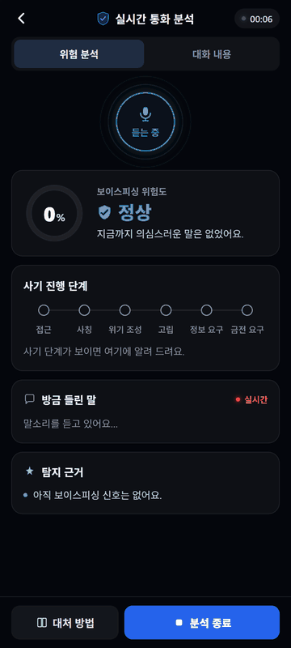
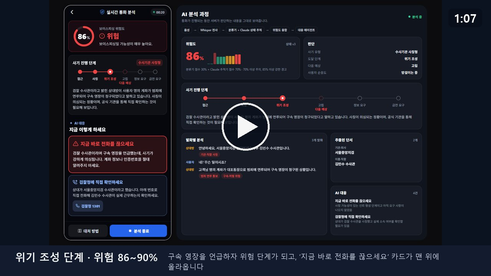
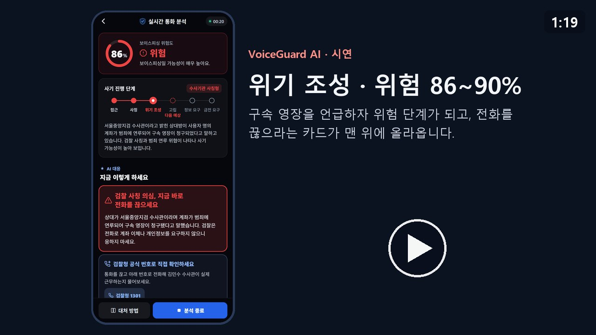
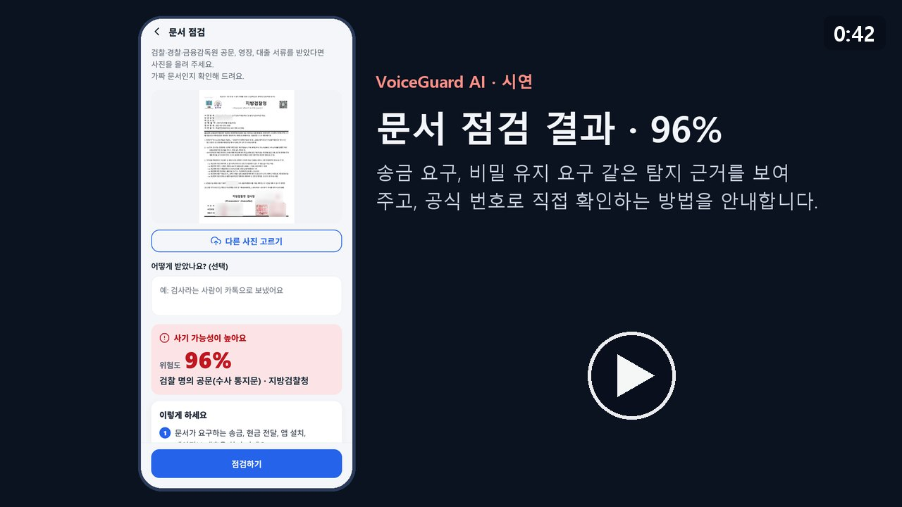
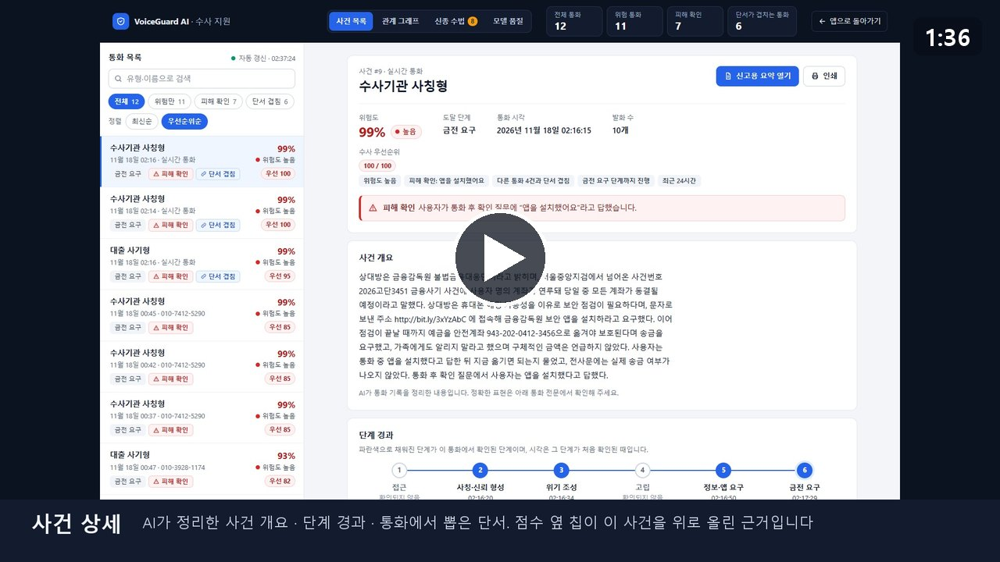
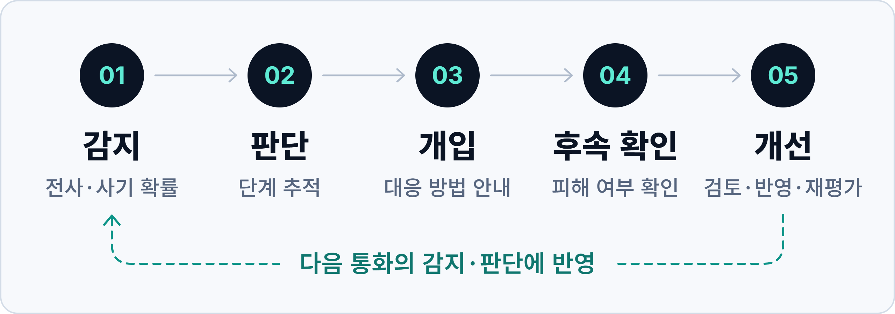
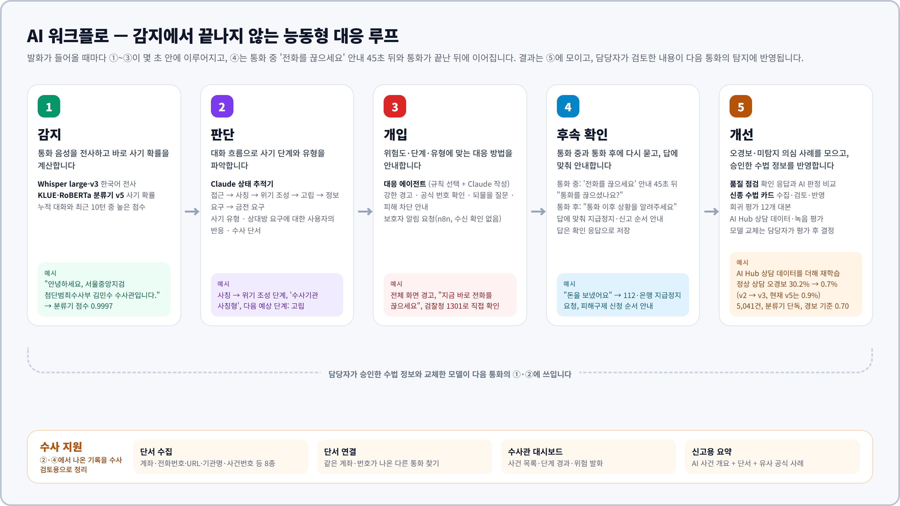
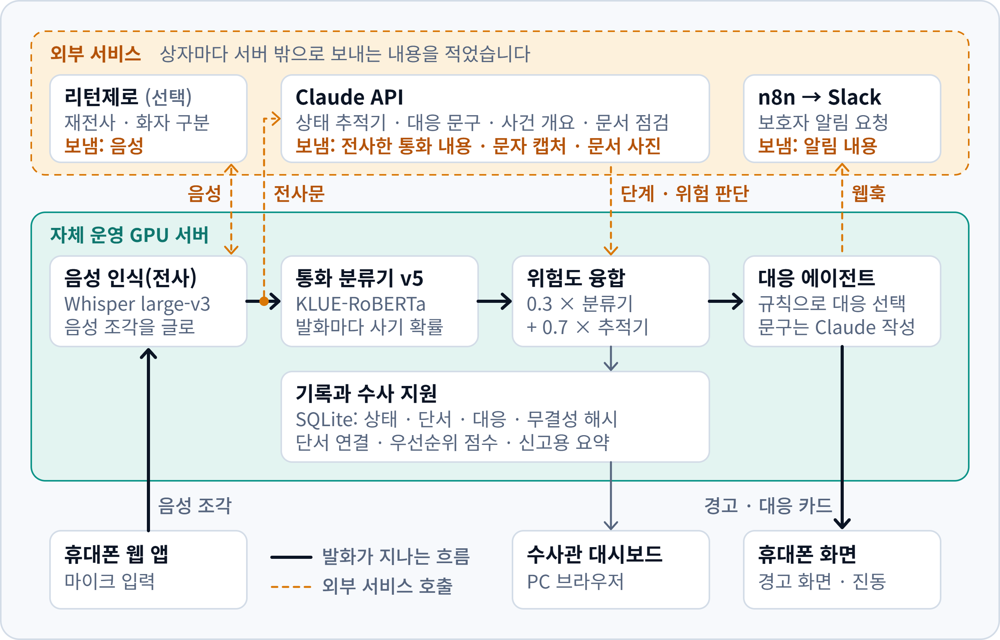
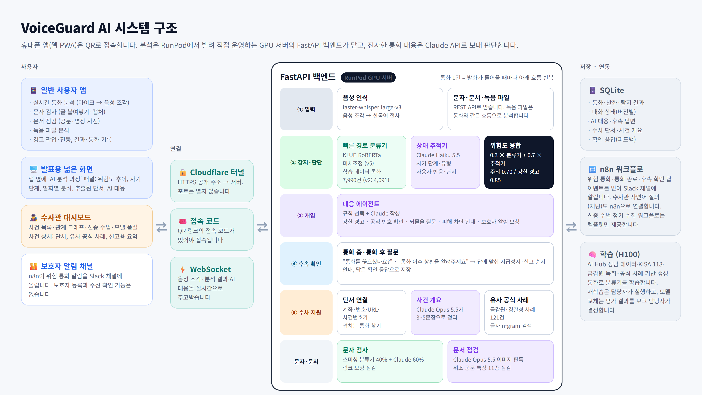

<picture>
  <source media="(prefers-color-scheme: dark)" srcset="docs/images/readme/hero-dark.webp">
  
</picture>

**VoiceGuard AI는 통화 내용을 분석해 보이스피싱 진행 단계를 파악하고, 단계에 맞는 대응 방법을 안내하는 웹 앱입니다.** 위험 탐지부터 통화 중 대응 안내, 통화 후 피해 확인, 수사 검토 자료 정리까지 연결합니다. AI 해커톤 출품작이며, 현재는 시연 서버에서 동작하는 시연 단계입니다.

<p align="center">
  <a href="#시연"><b>시연</b></a> &nbsp;·&nbsp;
  <a href="#검증-결과와-한계"><b>검증 결과와 한계</b></a> &nbsp;·&nbsp;
  <a href="docs/one-call.md"><b>통화 한 건의 흐름</b></a> &nbsp;·&nbsp;
  <a href="docs/investigator.md"><b>수사 지원</b></a> &nbsp;·&nbsp;
  <a href="#시스템-구조"><b>시스템 구조</b></a> &nbsp;·&nbsp;
  <a href="#실행"><b>실행</b></a>
</p>

<picture>
  <source media="(prefers-color-scheme: dark)" srcset="docs/images/readme/numbers-dark.png">
  
</picture>

<sub>경보 기준은 0.70입니다. 세 값은 평가 대상과 데이터가 서로 다르며, 앞의 두 값은 분류기 단독, 셋째 값은 전체 시스템의 결과입니다. 불리한 수치는 <a href="#검증-결과와-한계">검증 결과와 한계</a>에, 현재 한계는 <a href="#현재-한계">현재 한계</a>에 적었습니다.</sub>

## 시연



- **통화 중** — 사기 단계에 맞춰 경고, 공식 대표번호, 상대에게 되물어 볼 질문을 안내합니다.
- **통화가 끝난 뒤** — 피해 여부를 묻고, 답에 맞춰 지급정지와 신고 순서를 안내합니다.
- **수사 지원** — 공통 단서가 있는 통화를 연결하고, 먼저 검토할 통화와 그 근거를 정리합니다.

**영상에서 일어나는 일**

1. 첫 말: 위험도 0~7%, '정상'으로 시작합니다.
2. 범죄 연루 언급: 위험도가 오르고, 79%(주의)에서 기관에 직접 확인하라는 안내와 끊으라는 안내가 나옵니다.
3. 위험도 86%(위험): 전체 화면 경고가 뜹니다.
4. 위험도 90~96%: "지금 바로 전화를 끊으세요" 카드가 맨 위에 놓입니다.

**시연 조건** — 금융감독원이 공개한 수사기관 사칭 통화 녹음의 앞 90초(음성 변조)를 브라우저의 마이크 입력으로 넣은 시연입니다(2026-11-20, 통화 분류기 v5). 서버가 Whisper large-v3로 받아 적었고, 분류기, 상태 추적기, 대응 에이전트는 실제 앱과 같은 코드로 실행했습니다. 웹 앱은 휴대폰의 통화 음성을 직접 가져오지 못하며, 기기 마이크로 들어온 소리를 전사합니다.

<sub>통화의 일부 구간만 이어 붙였으며, 재생 속도는 실제와 같습니다. 화면의 전사문과 단서는 공개된 녹음에서 받아 적은 것이고, 변조된 음성이라 틀린 글자가 섞여 있습니다. 'AI 분석 과정' 패널이 함께 보이는 <a href="docs/images/readme/demo_wide.gif">넓은 화면 시연</a>과 통화가 끝난 뒤의 <a href="docs/images/v2/web_result.png">분석 결과 화면</a>도 볼 수 있습니다.</sub>

<br clear="both">

**전체 시연 영상** — 그림을 누르면 [시연 영상](docs/demo.md) 문서에서 바로 재생됩니다. 네 편 모두 자막으로 설명합니다. 통화 영상 두 편은 위와 같은 조건(2026-11-20, 실제 통화 녹음)으로 기록했고 그 음원이 함께 들립니다. 나머지 두 편은 2026-11-18에 기록했으며 소리가 없습니다.

<table>
<tr>
<td width="50%" valign="top"><a href="docs/demo.md#실시간-통화-분석"></a><br><b>실시간 통화 분석 · 판단 과정</b> · 2분 5초 · 소리 있음<br><sub>사용자 화면과 'AI 분석 과정' 패널을 함께 보여 줍니다. 낮은 위험도로 시작해 주의, 전체 화면 경고, 결과 화면까지 이어집니다.</sub></td>
<td width="50%" valign="top"><a href="docs/demo.md#휴대폰-화면"></a><br><b>휴대폰 화면 · 통화 중과 통화 후</b> · 2분 12초 · 소리 있음<br><sub>같은 통화를 휴대폰 화면으로 보여 줍니다. 통화가 끝난 뒤 '돈을 보냈어요'라고 답했을 때의 지급정지 안내까지 이어집니다.</sub></td>
</tr>
<tr>
<td width="50%" valign="top"><a href="docs/demo.md#문자-검사와-문서-점검"></a><br><b>문자 검사 · 문서 점검</b> · 42초<br><sub>스미싱 예시 문자와 위조 공문 사진을 한 건씩 검사합니다.</sub></td>
<td width="50%" valign="top"><a href="docs/demo.md#수사-지원-대시보드"></a><br><b>수사 지원 대시보드</b> · 1분 36초<br><sub>사건 상세, 다른 통화와 겹치는 단서, 관계 그래프, 신종 수법 검토, 모델 품질, 신고용 요약을 차례로 보여 줍니다.</sub></td>
</tr>
</table>

## 검증 결과와 한계

현재 구성(통화 분류기 v5, 2026-11-16 적용)의 결과입니다. 점수가 0.70 이상이면 경보로 판정합니다. 분류기 단독 결과와 전체 시스템(분류기 + Claude 상태 추적기 + 대응 에이전트) 결과를 나누어 적었으며, 전체 시스템은 음성이 아니라 통화 대본을 글로 입력해 평가했습니다.

<table>
<tr><th align="left" width="26%">지표</th><th align="left">평가 데이터 · 판정 기준</th><th align="right" nowrap>결과</th></tr>
<tr><td colspan="3"><b>분류기 단독</b></td></tr>
<tr><td valign="top">사기 통화 탐지율</td><td valign="top">학습에 쓰지 않은 사기 통화 307통 · 통화 끝 판정</td><td nowrap valign="top" align="right">99.7%</td></tr>
<tr><td valign="top">정상 상담 오경보율</td><td valign="top">AI Hub 일반 상담(금융·민원) 5,041건 · 통화 중 한 번이라도 경보</td><td nowrap valign="top" align="right">0.9%</td></tr>
<tr><td valign="top">정상 통화 오경보율</td><td valign="top">피싱 상담(KISA 118)이 섞인 정상 통화 530통 · 통화 중 한 번이라도 경보</td><td nowrap valign="top" align="right">5.5%</td></tr>
<tr><td colspan="3"><b>전체 시스템</b> · 통화 대본을 글로 입력해 평가</td></tr>
<tr><td valign="top">사기 통화 탐지</td><td valign="top">조정에 쓰지 않은 시험 통화 중 사기 14통</td><td nowrap valign="top" align="right">13/14</td></tr>
<tr><td valign="top">정상 상담 경고</td><td valign="top">같은 시험 통화 중 정상 상담 14통 · 분류기가 경보를 낸 어려운 상담만 선정</td><td nowrap valign="top" align="right">4/14</td></tr>
<tr><td valign="top">시험 통화 통과</td><td valign="top">위 28통 · 판정, 유형, 단계가 모두 맞아야 통과</td><td nowrap valign="top" align="right">20/28</td></tr>
</table>

현재 한계는 [아래](#현재-한계)에 정리했습니다.

평가 방법과 재현 명령, 버전별 비교(v1 → v5)는 [보이스피싱 탐지 성능](docs/tech/detection.md)과 [학습 기록](docs/MODEL_TRAINING_LOG.md)에 있습니다. 모델 후보를 고를 때 쓴 평가 세트와 보고한 평가 세트가 같다는 점을 포함한 한계 전체는 [탐지 성능의 한계](docs/tech/detection.md#한계)에 적었습니다.

<details>
<summary><b>나머지 평가 결과와 데이터 이용 조건</b> · 녹음 전사, 회귀 평가, 문자·문서, 음성 인식</summary>

<br>

| 구분 | 지표 | 평가 데이터 | 결과 |
| --- | --- | --- | ---: |
| 분류기 단독 | 녹음 전사 오경보율 | 대본을 읽어 녹음한 AI Hub 상담 1,400건의 Whisper 전사 | 1.1% |
| 분류기 단독 | 녹음 전사 탐지율 | 금감원 공개 사기 녹취 258건의 Whisper 전사 | 99.6% |
| 전체 시스템 | 회귀 평가 대본 통과 | 따로 작성한 대본 12개(사기 6 · 정상 6) | 12/12 |
| 전체 시스템 | 사기 통화 첫 경고 | 탐지한 사기 통화 13통 | 평균 6.5번째 발화 |

- 정상 통화의 첫 발화에 이름과 직함 소개를 넣은 시험에서는 80통 중 6통이 첫 세 발화 안에 경보를 냈습니다(첫 문장 경고의 원인).
- 상담 녹음은 실제 고객 통화가 아니라 대본을 읽어 녹음한 데이터입니다. 금감원 녹취 258건 중 212건은 같은 녹취를 다른 엔진으로 전사한 글이 학습 데이터에 있어, 99.6%는 처음 보는 사기 통화의 탐지율이 아닙니다.
- 분류기 단독으로는 회귀 평가 대본 12개 중 카드 배송 사칭 1개를 놓치며(11/12), 일부 유형은 초반 탐지가 이전 모델(v3)보다 늦습니다([유형별 초반 탐지](docs/tech/detection.md#유형별-초반-탐지)).
- **문자 검사 · 문서 점검** — 문자 분류기 단독은 학습에 쓰지 않은 문자 3,600건에서 정확도 99.4%(F1 99.2%)였습니다. 분류기 40%와 Claude 60%를 합친 문자 검사는 따로 작성한 문자 16건(스미싱 8 · 정상 8)을 모두 맞혔습니다. 문서 점검은 경찰청·금감원·검찰이 공개한 위조 문서와 실제 공문으로 구성한 test 23장에서 정확도 95.7%(위조 14/15 탐지, 오경보 0/8)였습니다.
- **전사 · 화자 분리** — 통화 음성을 글로 바꾸는 전사는 자체 운영 GPU 서버의 Whisper large-v3가 맡습니다. 문자 오류율(CER)은 AI Hub 민원(콜센터) 녹음에서 파일 전체 5.81%(녹음 100개), 실시간 조각 9.24%(녹음 40개)입니다. 콜센터 음성으로 추가 학습한 모델은 파일 전체 CER이 2.45%로 낮아졌지만, 실제 통화의 전화번호를 지우는 문제가 있어 쓰지 않습니다. → [음성 인식·화자 분리 성능](docs/tech/transcription.md)
- **데이터와 이용 조건** — 금감원 공개 사기 녹취 전사, 공식 사례를 근거로 생성한 통화, KISA 118 상담 합성데이터, AI Hub 상담 데이터, 공개 스미싱 문자 데이터 등으로 학습하고 평가했습니다. 데이터 원본은 이용 조건(AI Hub 재배포 금지, 스미싱 문자 데이터 CC BY-NC-SA 4.0 등) 때문에 올리지 않습니다(`data/`는 git 제외). 학습된 통화 분류기와 문자 분류기는 [릴리스](https://github.com/J-hosu/VoiceGuard-AI/releases/tag/models-v5)에서 받을 수 있습니다. → [데이터와 전처리](docs/tech/detection.md#데이터와-전처리)

</details>

## 통화 한 건의 흐름

**감지에서 개선까지 다섯 단계가 이어집니다.** 발화가 들어올 때마다 분류기와 Claude 상태 추적기가 함께 판단하고, 그 결과에 맞는 대응을 몇 초 안에 안내합니다. 다섯째 단계는 자동 학습이 아닙니다. 담당자가 검토해 승인한 내용만 다음 통화의 판단에 반영하며, 모델 재학습과 교체도 담당자가 결정합니다.

<picture>
  <source media="(prefers-color-scheme: dark)" srcset="docs/images/readme/loop-dark.png">
  
</picture>

아래 그림은 검찰 사칭 대본을 글로 입력해 기록한 위험도의 변화입니다(위 시연 영상과는 다른 통화입니다). 화면 위험도는 `0.3 × 분류기 + 0.7 × 상태 추적기`로 계산하며, 0.70 이상이면 주의, 0.85 이상이면 강한 경고입니다. 그림에는 상태 추적기의 판단이 반영된 값을 표시했으며, 추적기의 첫 판단이 도착하기 전에는 0%로 두었습니다.

<picture>
  <source media="(prefers-color-scheme: dark)" srcset="docs/images/readme/timeline-dark.png">
  
</picture>

<sub>2026-11-18 대본 시연 1회의 기록입니다. 위 시연 영상(실제 통화 녹음, 2026-11-20)과는 다른 통화여서 값과 시각이 다릅니다. ①은 상태 추적기의 첫 판단이 도착하기 전이므로 0%로 두었습니다. 이 구간에서는 분류기 점수만으로 화면 위험도를 결정하며, 이 기록에서는 약 3초 시점에 전체 화면 경고가 먼저 표시됐습니다. ②에서 추적기의 첫 판단이 도착하면서 위험도가 65%가 됐고, 단계가 진행되면서 올랐습니다. 발화별 화면과 판단 근거는 <a href="docs/one-call.md">전화 흐름으로 기능 보기</a>에 있습니다.</sub>

<details>
<summary><b>단계별 기술과 예시를 담은 워크플로 그림</b></summary>

<br>
<p></p>

</details>

## 사용자 화면

**통화 중에는 단계에 맞는 대응을 안내하고, 통화가 끝나면 피해 여부를 확인합니다.** 받은 문자와 문서, 지난 통화의 녹음 파일도 분석합니다.

<table>
<tr>
<td width="33%" align="center" valign="top"><br><b>통화 중 · 대응 안내</b><br><sub>위험도와 사기 단계를 실시간으로 보여 주고, 공식 대표번호와 상대에게 되물어 볼 질문을 카드로 안내합니다.</sub></td>
<td width="33%" align="center" valign="top"><br><b>통화 후 · 피해 확인</b><br><sub>"돈을 보냈어요"라고 답하면 지급정지를 요청하는 순서와 112 · 1332 전화 버튼을 보여 줍니다.</sub></td>
<td width="34%" align="center" valign="top"><br><b>문자 · 문서 · 녹음 파일</b><br><sub>받은 문자, 공문 사진, 지난 통화의 녹음을 올리면 사기 가능성과 대응 방법을 알려 줍니다.</sub></td>
</tr>
</table>

<sub>화면은 2026-11-18에 현재 빌드(통화 분류기 v5)에서 촬영했습니다. 통화 화면은 <a href="#입력-방식">대본 시연</a>으로 기록했고, 화면의 이름과 번호는 가상 정보입니다. 그림을 누르면 크게 볼 수 있습니다.</sub>

<details>
<summary><b>통화 중</b> · 화면 3장과 기능</summary>

<br>
<p align="center">
  
  
  
  <br><sub>실시간 통화 분석 &nbsp;·&nbsp; AI 대응 &nbsp;·&nbsp; 강한 경고</sub>
</p>

- **실시간 통화 분석** — 마이크 음성을 조각으로 보내 전사, 위험도, 사기 진행 단계를 실시간으로 표시합니다. 위험도 40\~69%는 '분석 중'으로 표시합니다.
- **대화 내용 탭** — 통화 중 전사를 상대방과 나의 말풍선으로 보여 주고, 보이스피싱에 자주 쓰이는 말을 빨간 굵은 글씨로 강조합니다. 상태 추적기가 판단한 수법은 말풍선 아래에 표시합니다.
- **AI 대응** — 지금 할 일, 공식 대표번호(누르면 전화 연결), 상대에게 되물어 볼 질문, 피해 차단 순서를 카드로 안내합니다.
- **강한 경고** — 위험도가 강한 경고 기준을 넘으면 전체 화면 경고를 통화당 한 번 띄우고, 진동을 지원하는 기기에서는 진동도 울립니다.
- **통화 중 단서 대조** — 상대가 말한 계좌·휴대전화·웹 주소·사건번호가 다른 통화에도 나왔거나 웹 주소 형태가 위험하면 바로 알립니다([단서 연결](docs/investigator.md#단서-연결)).

</details>

<details>
<summary><b>통화가 끝난 뒤</b> · 화면 3장과 기능</summary>

<br>
<p align="center">
  
  
  
  <br><sub>통화 후 확인 질문 &nbsp;·&nbsp; 답에 맞춘 피해 차단 안내 &nbsp;·&nbsp; 대화 내용과 수법 태그</sub>
</p>

- **후속 확인** — 통화 중에는 강한 경고 45초 뒤에 "통화를 끊으셨나요?", 위험 통화가 끝난 뒤에는 "통화 이후 상황을 알려주세요"라고 묻고, 고른 답(돈을 보냈어요, 앱을 설치했어요 등)에 맞는 지급정지·신고 순서를 안내합니다.
- **통화 결과** — 요약, 대화 내용(발화별 수법 태그), 탐지 근거를 확인하고, 판정이 맞았는지 확인 응답을 남길 수 있습니다.

</details>

<details>
<summary><b>문자 · 문서 · 녹음 파일 분석</b> · 화면 3장과 기능</summary>

<br>
<p align="center">
  
  
  
  <br><sub>문자 검사 &nbsp;·&nbsp; 문서 점검 &nbsp;·&nbsp; 녹음 파일 분석</sub>
</p>

- **문자 검사** — 받은 문자나 메신저 내용을 붙여 넣거나 캡처를 올리면 스미싱 여부와 링크 위험을 판단합니다.
- **문서 점검** — 검찰·법원·금감원 공문이나 영장 사진을 올리면 위조 문서의 특징을 점검합니다.
- **녹음 파일 분석** — 지난 통화 녹음(mp3 · wav · m4a)을 올리면 실시간 분석과 같은 분류기, 상태 추적기, 대응 에이전트로 분석하고 원본 파일의 SHA-256 해시를 남깁니다.

</details>

<details>
<summary><b>홈 · 통화 기록 · 정보</b> · 화면 3장</summary>

<br>
<p align="center">
  
  
  
  <br><sub>홈 &nbsp;·&nbsp; 히스토리(통화 기록) &nbsp;·&nbsp; 정보. 같은 주소(QR)로 여러 명이 접속해도 각자 기기의 기록만 보입니다.</sub>
</p>

</details>

## 수사 지원

**AI가 통화에서 단서를 추출하고, 공통 단서가 있는 통화를 연결해 수사 검토를 지원합니다.** 결과는 수사관 대시보드(`/dashboard`)에서 확인합니다.

> [!IMPORTANT]
> 수사 지원 기능은 시연 단계이며, 실제 수사기관에서 쓰거나 검증한 적이 없습니다. 수사관 개인 계정, 통화별 수사 공유 동의, 열람 기록은 구현하지 않았고, 대시보드는 공용 관리 코드로 엽니다. 수법 카드 반영, 모델 재학습과 교체, 신고와 수사 판단은 담당자가 결정합니다([자동 처리와 담당자 결정](docs/investigator.md#자동-처리와-담당자-결정)).

<p><br>
<sub><b>수사관 대시보드의 사건 상세 위쪽</b> — 우선순위 점수는 AI의 확신도가 아니라, 팀이 정한 규칙(위험도, 피해 확인, 공통 단서, 사기 단계, 최근성)으로 매긴 검토 순서 점수입니다. 통화 후 확인 질문의 답("앱을 설치했어요")도 반영됩니다. 화면의 통화는 실제 사건이 아니며, 이름과 번호는 가상 정보입니다.</sub></p>

<table>
<tr><th align="left" width="30%">기능</th><th align="left">AI가 처리하는 일</th></tr>
<tr><td valign="top"><a href="docs/investigator.md#단서-수집">단서 수집 · 연결</a></td><td valign="top">계좌번호, 전화번호, 웹 주소, 사건번호 등 단서 8종을 발화 번호와 함께 저장하고, 공통 단서가 있는 통화를 관련 후보로 표시합니다.</td></tr>
<tr><td valign="top"><a href="docs/investigator.md#수사-검토-우선순위-제안">검토 우선순위 제안</a></td><td valign="top">먼저 검토할 통화를 점수순으로 정렬하고, 점수의 근거를 함께 보여 줍니다.</td></tr>
<tr><td valign="top"><a href="docs/investigator.md#신고용-요약">신고용 요약</a> · <a href="docs/investigator.md#음성전사-기록의-무결성-확인">무결성 확인</a></td><td valign="top">저장된 기록으로 신고용 요약을 조립하고(사건 개요 3~5문장만 Claude가 작성), 음성과 전사문의 SHA-256 해시로 기록이 바뀌었는지 확인합니다.</td></tr>
<tr><td valign="top"><a href="docs/investigator.md#신종-수법-수집검토반영">신종 수법 반영</a> · <a href="docs/investigator.md#품질-점검">품질 점검</a></td><td valign="top">공식 게시판의 새 글을 수법 카드 초안으로 정리하고, 사용자의 확인 응답과 AI 판정을 비교해 오경보·미탐지 의심 사례를 모읍니다. 반영 여부는 담당자가 승인합니다.</td></tr>
<tr><td valign="top"><a href="docs/guidance.md">절차 안내 · 법령 찾기</a></td><td valign="top">미리 받아 둔 조문과 규칙표로 중대범죄수사청 통보 여부와 기한, 해외 연계 절차를 근거 조문과 함께 보여 줍니다. 판정은 규칙표가 하고, AI는 조문을 인용해 설명만 합니다.</td></tr>
</table>

절차 안내는 수사관이 마주칠 두 가지 상황으로 따라가 볼 수 있습니다. 단계별 화면은 [절차 안내: 두 가지 상황으로 보기](docs/guidance.md)에 있습니다.

| 상황 | 넣는 사실 | 화면이 주는 답 |
| --- | --- | --- |
| **A. 어느 기관이 맡는 사건인가**<br>중고거래 사기 신고 | 죄명 후보 · 이득액 · 인지한 날 | 중대범죄수사청 통보 여부 · 서면 통보 기한 · 근거 조문 |
| **B. 캄보디아에 있는 피의자를 데려오기**<br>해외와 이어진 보이스피싱 | 피의자의 국외 체류 · 여권법 사유 | 수사 공조와 범죄인 인도 청구 절차 · 여권 조치 · 조약 조문 찾기 |

수사관은 n8n 채팅으로 수사 데이터를 자연어로 물을 수도 있습니다(선택 설정). AI가 쓴 사건 개요는 초안이므로 통화 전문과 대조해야 하며, 같은 계좌나 번호가 나왔다는 사실만으로 같은 범죄 조직이라고 확정할 수 없습니다. 해시는 기록이 바뀌었는지 확인하는 수단이며, 외부 시각 인증이나 별도 보관이 없어 법적 증거의 무결성을 보증하지는 않습니다. 기능별 처리 범위와 한계는 [수사관 지원용 능동 AI 에이전트 기능](docs/investigator.md)에 있습니다.

<details>
<summary><b>대시보드 화면 더 보기</b> · 전체 화면, 공통 단서, 관계 그래프, 추출한 단서</summary>

<br>
<p><br>
<sub>대시보드 전체 화면. 왼쪽은 우선순위순으로 정렬한 통화 목록이고, 오른쪽은 선택한 사건의 위험도, 우선순위 근거, 사건 개요, 단계 경과입니다.</sub></p>

<p><br>
<sub>다른 통화와 겹치는 단서. 같은 사건번호, 계좌번호, 웹 주소가 나온 통화를 모아 보여 주고, 누르면 그 통화를 엽니다.</sub></p>

<p><br>
<sub>관계 그래프. 같은 계좌번호, 전화번호, 사건번호, 사칭 기관이 나온 통화가 선으로 이어집니다.</sub></p>

<p><br>
<sub>추출한 단서. 단서마다 나온 발화 번호와 다른 통화에 나온 횟수를 함께 표시합니다.</sub></p>

</details>

## 시스템 구조

**발화 하나가 들어오면 분류기(빠른 경로)와 Claude 상태 추적기가 함께 판단합니다.** 두 점수를 합친 위험도에 따라 대응 에이전트가 안내하고, 단서와 기록은 수사관 대시보드로 이어집니다.

<picture>
  <source media="(prefers-color-scheme: dark)" srcset="docs/images/readme/architecture-dark.png">
  
</picture>

음성 인식(전사)과 통화·문자 분류기는 자체 운영 GPU 서버에서 실행합니다. 전사한 통화 내용과 문자 캡처, 문서 사진은 Claude API로 보내 판단합니다. 리턴제로는 선택 설정이며, 켜면 해당 음성이 리턴제로 API로 전송됩니다([실행 위치와 외부 전송](docs/tech/models.md#실행-위치와-외부-전송)).

### 구현과 검증 상태

'동작'은 시연 서버에서 동작한다는 뜻이며, 실제 사용자나 기관이 쓰고 있다는 뜻은 아닙니다.

<table>
<tr><th align="left" width="30%">기능</th><th align="left" nowrap>구현 상태</th><th align="left">검증 수준</th></tr>
<tr><td valign="top">실시간 통화 분석<br>대응 안내 · 후속 확인</td><td nowrap valign="top">동작</td><td valign="top">글로 입력한 통화로 평가했습니다(대본 12개, 시험 통화 28통). 대본 시연 1회를 기록했고, 실제 음성으로 전체 경로를 잰 대규모 평가는 없습니다.</td></tr>
<tr><td valign="top">문자 검사 · 문서 점검</td><td nowrap valign="top">동작</td><td valign="top">문자 분류기 3,600건, 문자 검사 16건, 문서 점검 test 23장으로 평가했습니다.</td></tr>
<tr><td valign="top">녹음 파일 분석</td><td nowrap valign="top">동작</td><td valign="top">분류기를 녹음 전사로 평가했습니다(정상 상담 1,400건, 사기 녹취 258건).</td></tr>
<tr><td valign="top">수사관 대시보드<br><sub>단서 연결 · 우선순위 · 신고용 요약</sub></td><td nowrap valign="top">동작</td><td valign="top">시험 통화로 동작을 확인했습니다. 수사기관의 검증은 받지 않았습니다.</td></tr>
</table>

<details>
<summary><b>선택 설정과 실험 기능</b> · 신종 수법 반영, 리턴제로, 보호자 알림, 자연어 질의, 로컬 화자 분리</summary>

<br>

<table>
<tr><th align="left" width="30%">기능</th><th align="left" nowrap>구현 상태</th><th align="left">검증 수준</th></tr>
<tr><td valign="top">신종 수법<br>수집 · 검토 · 반영</td><td nowrap valign="top">동작<br><sub>수동 수집</sub></td><td valign="top">승인한 카드는 상태 추적기 프롬프트에 추가하며, 모델을 다시 학습하지 않습니다. 카드의 반영 효과는 검증하지 않았습니다. 승인 뒤 실행하는 회귀 평가에 승인한 카드가 들어가지 않기 때문입니다.</td></tr>
<tr><td valign="top">리턴제로<br>전사 · 화자 구분</td><td nowrap valign="top">선택 설정<br><sub>시연 서버는 켬</sub></td><td valign="top">파일 전사의 화자 분리는 문장 단위로 98.8%를 맞혔습니다(녹음 100개).</td></tr>
<tr><td valign="top">보호자 알림 요청<br>(n8n → Slack)</td><td nowrap valign="top">선택 설정</td><td valign="top">시연 서버에서 2026-11-17부터 Slack 채널에 알림이 올라옵니다. 앱은 전송을 요청하는 데까지만 하며, 보호자 등록과 수신 확인 기능은 없습니다.</td></tr>
<tr><td valign="top">수사관 자연어 질의<br>(n8n 채팅)</td><td nowrap valign="top">선택 설정</td><td valign="top">2026-11-18에 시연 서버에 연결해 질문 한 건에 약 9초 만에 답하는 것을 확인했습니다.</td></tr>
<tr><td valign="top">신종 수법 정기 수집<br>(n8n)</td><td nowrap valign="top">템플릿 제공</td><td valign="top">워크플로 템플릿만 제공합니다. 시연 서버에는 연결하지 않았고, 수집은 수동으로 실행합니다.</td></tr>
<tr><td valign="top">로컬 화자 분리 (3D-Speaker)<br>Whisper 추가 학습 모델</td><td nowrap valign="top">실험 완료<br><sub>앱에 연결하지 않음</sub></td><td valign="top">녹음으로 따로 평가했습니다. 추가 학습한 Whisper는 실제 통화의 전화번호를 지우는 문제가 있어 쓰지 않습니다.</td></tr>
</table>

</details>

<details>
<summary><b>기술 스택</b></summary>

<br>

| 영역 | 기술 |
| --- | --- |
| Frontend | React Native · Expo · TypeScript · Zustand · PWA |
| Backend · Infra | Python · FastAPI · WebSocket · SQLite · n8n · Cloudflare Tunnel · RunPod GPU 서버 (학습은 H100) |
| 음성 인식(전사) | faster-whisper large-v3 (자체 운영 GPU 서버) · 리턴제로 (선택 설정) |
| 통화 · 문자 분류기 | KLUE-RoBERTa (`klue/roberta-base`) 미세조정 (PyTorch · Hugging Face) · 통화 분류기는 v5 |
| Claude API | Claude Haiku 5.5: 상태 추적기 · 대응 에이전트 · 문자 판단<br>Claude Opus 5.5: 사건 개요 · 문서 점검 · 수법 카드 초안 |

모델별 성능과 실행 위치, 보관만 하는 실험 모델은 [모델 구성](docs/tech/models.md)에 있습니다.

</details>

<details>
<summary><b>전체 구조도</b> · 사용자 화면, 연결, FastAPI 백엔드, 저장·연동</summary>

<br>
<p></p>

</details>

## 실행

시연 주소와 접속 코드는 행사 현장에서 QR 코드로 안내합니다. 휴대폰으로 QR 코드를 열고 홈 화면에 추가하면 앱처럼 쓸 수 있습니다(PWA). 넓은 화면에서 열면 앱 옆에 'AI 분석 과정' 패널이 함께 보이고, 수사관 화면은 PC 브라우저에서 `/dashboard`로 엽니다.

학습된 통화 분류기와 문자 분류기는 [릴리스](https://github.com/J-hosu/VoiceGuard-AI/releases/tag/models-v5)에서 받아 `models/` 폴더에 풀면 됩니다. 모델 없이 실행하면 통화 분류기 대신 사례 검색 기반 탐지로 동작합니다. 데이터 원본은 이용 조건 때문에 저장소에 없으므로, 학습부터 다시 하려면 데이터를 직접 받아야 합니다([데이터와 전처리](docs/tech/detection.md#데이터와-전처리), [재현 방법](docs/tech/detection.md#재현-방법)).

### 입력 방식

- **마이크 입력** — 홈의 '실시간 분석 시작'으로 시작합니다. 기기 마이크로 들어온 소리를 무음 기준으로 잘라 실시간으로 전사하고, 분류기와 상태 추적기가 판단해 대응 카드를 보여 줍니다. 통화가 끝나면 전체 녹음을 다시 전사하고 상태를 다시 추적합니다.
- **녹음 업로드** — 홈의 '음성 파일 분석'으로 시작합니다. 지난 통화 녹음(mp3 · wav · m4a) 전체를 전사한 뒤 상태 추적기가 통화 전체를 한 번에 분석하고, 지난 통화에 맞는 대응을 안내합니다.
- **대본 시연** — 주소 뒤에 `/realtime?scenario=prosecutor`를 붙여 엽니다(대본은 `prosecutor`, `loan`, `normal`). 마이크와 전사를 거치지 않고 미리 적어 둔 문장을 정해진 간격으로 서버에 보냅니다. 이후의 분류기, 상태 추적기, 대응 에이전트는 실제 앱과 같은 코드입니다.

<details>
<summary><b>지원 환경</b> · 사용자 앱, 마이크, 화면 꺼짐 방지, 서버</summary>

<br>

- **사용자 앱** — 휴대폰·PC 브라우저에서 여는 웹 앱(PWA)입니다. Expo 프로젝트라 iOS·Android 빌드 설정도 있지만, 서버의 Whisper로 전사하는 실시간 분석은 웹 앱에만 연결했습니다.
- **마이크와 통화 음성** — 실시간 분석에는 브라우저의 마이크 권한이 필요하며, 브라우저는 HTTPS 주소(개발 중에는 localhost)에서만 마이크를 허용합니다. 웹 앱은 휴대폰의 통화 음성을 직접 가져오지 못하고, 기기 마이크로 들어온 소리를 전사합니다.
- **화면 꺼짐 방지** — 실시간 분석 중에는 휴대폰 화면이 꺼지지 않게 합니다. Screen Wake Lock API를 지원하는 브라우저에서만 동작하며, 지원하지 않는 브라우저에서는 화면이 꺼지면 마이크 입력이 멈출 수 있습니다.
- **서버** — 운영 서버는 Python 3.11과 CUDA GPU 환경에서 실행했습니다. Whisper large-v3에는 GPU가 필요합니다. GPU가 없으면 CPU에서 small(int8) 모델로 전사하지만, 측정한 노트북 환경에서는 실시간 처리에 필요한 속도가 나오지 않았습니다.

</details>

<details>
<summary><b>실행 방법</b> · 백엔드, 환경 변수, 프론트엔드, 배포 구조, 코드 위치</summary>

**백엔드**

```bash
python3 -m venv .venv && source .venv/bin/activate
pip install -r requirements.txt
uvicorn backend.app.main:app --host 0.0.0.0 --port 8000
```

통화 분류기는 `models/koelectra`(또는 `KOELECTRA_MODEL_DIR`)에서 가중치를 읽습니다. 이 폴더가 없으면 사례 검색 기반 탐지로 대신 동작합니다. 아래는 프로젝트 루트의 `.env`입니다. 값은 예시이며, 키는 저장소에 올리지 않습니다.

```env
ANTHROPIC_API_KEY=sk-ant-...
TRACKER_MODEL=claude-haiku-5-5      # 실시간 상태 추적기
AGENT_MODEL=claude-haiku-5-5        # 대응 에이전트 · 문자 판단
REPORT_MODEL=claude-opus-5-5        # 사건 개요 · 문서 점검
WHISPER_MODEL=large-v3
STT_LIVE_ENGINE=local               # 통화 중 실시간 조각 전사 (local | rtzr)
STT_FILE_ENGINE=local               # 녹음 파일 분석 · 통화 후 재전사 (local | rtzr), 시연 서버는 rtzr
STT_REFINE=off                      # 통화 중 전사 보정 · 화자 구분 (off | rtzr), 시연 서버는 rtzr
RTZR_CLIENT_ID=...                  # 리턴제로를 켤 때만 (켜면 해당 음성이 리턴제로 API로 전송)
RTZR_CLIENT_SECRET=...
ACCESS_CODE=...                     # 설정하면 접속 코드 필요 (QR 링크에 포함)
ADMIN_CODE=...                      # 설정하면 대시보드·수사·평가 화면에 관리 코드 따로 필요
N8N_WEBHOOK_URL=...                 # 보호자 알림 요청 (선택)
PUBLIC_BASE_URL=...                 # 알림 메시지 속 대시보드 링크 (선택)
SLACK_BOT_TOKEN=...                 # Slack에서 절차 안내 쓰기 (선택, docs/slack.md)
SLACK_SIGNING_SECRET=...
```

**프론트엔드**

```bash
cd frontend && npm install
npm run web                                         # 개발
EXPO_PUBLIC_API_BASE=same-origin npm run build:web  # 배포용 웹 빌드 (백엔드가 같은 주소로 제공)
```

**배포 구조**

휴대폰 → Cloudflare 터널(HTTPS) → RunPod에서 빌려 직접 운영하는 GPU 서버의 FastAPI(웹 앱 + API + WebSocket) 순서로 연결합니다. Whisper large-v3 전사, 통화·문자 분류기, 백엔드를 모두 이 서버에서 실행합니다. 모델 학습과 대부분의 평가는 H100 서버에서 했습니다. 서버를 옮기는 순서는 [docs/DEPLOY_RUNPOD.md](docs/DEPLOY_RUNPOD.md)에 있습니다.

**코드 위치**

웹 앱은 `frontend/`(화면 `app/`, WebSocket 세션 `src/hooks/useCallSession.ts`), 백엔드는 `backend/app/`(API `api/`, 판단·대응·수사 지원 `services/`, 수사관 대시보드 `web/dashboard.html`, 학습·평가 스크립트 `train_transformer.py`·`build_dataset_v*.py`·`eval_*.py`)에 있습니다. 전사 모델 추가 학습·평가는 `stt_lab/`, n8n 워크플로 템플릿(위험 통화 알림, 수사관 자연어 질의, 신종 수법 정기 수집)은 `n8n/`에 있습니다. 파일별 역할은 [전화 흐름으로 기능 보기](docs/one-call.md#관련-구현-코드)와 [수사관 지원용 능동 AI 에이전트 기능](docs/investigator.md#관련-구현-코드)의 '관련 구현 코드'에 정리했습니다.

</details>

## 현재 한계

- **실제 음성으로 전체 경로를 잰 대규모 평가는 아직 없습니다.** 전체 시스템 수치는 통화 대본을 글로 입력해 얻었습니다.
- **첫 문장에 강한 경고가 뜰 수 있습니다.** 상태 추적기의 첫 판단이 오기 전에는 분류기 점수만으로 위험도를 정하기 때문입니다.
- **피싱 상담이 섞인 정상 통화에서는 오경보율이 5.5%로 더 높았습니다.**
- **실제 사기 녹취로 확인한 유형은 기관 사칭과 대출 사기뿐입니다.** 나머지 유형은 공식 사례를 근거로 생성한 통화로 평가했습니다.

## 문서

| 문서 | 내용 |
| --- | --- |
| [발표 자료 (PDF)](docs/presentation/VoiceGuard_AI_presentation.pdf) · [PowerPoint](docs/presentation/VoiceGuard_AI_presentation.pptx) | 문제 정의, 다섯 단계 해법, AI 구조, 수사 지원, 검증 결과와 한계를 정리한 발표 슬라이드 27쪽(본문 11쪽, 부록 16쪽). PowerPoint 파일의 발표자 메모에 발표 대본이 들어 있습니다 |
| [시연 영상](docs/demo.md) | 통화 분석, 문자·문서 점검, 수사 지원 대시보드를 처음부터 끝까지 보여 주는 영상 네 편 |
| [전화 흐름으로 기능 보기](docs/one-call.md) | 검찰 사칭 시연 통화 한 건을 처음부터 끝까지 따라가며 본 화면과 판단 근거 |
| [수사관 지원용 능동 AI 에이전트 기능](docs/investigator.md) | AI가 처리하는 범위, 담당자가 결정하는 일, 수사 지원 결과와 한계 |
| [절차 안내](docs/guidance.md) | 수사관이 마주칠 두 가지 상황(어느 기관이 맡는 사건인가, 캄보디아에 있는 피의자를 어떻게 데려오는가)을 따라가며 화면으로 설명 |
| [Slack에서 쓰는 절차 안내](docs/slack.md) | Slack 명령과 입력 양식, 기한 알림의 사용법과 설정 |
| [수사 지원 고도화 설계](docs/investigation-guidance-design.md) | 수사 배분·법 안내와 해외 연계 사건 기능의 데이터, 구조, 구현 범위, 검증과 한계 |
| [보이스피싱 탐지 성능](docs/tech/detection.md) | 모델별 평가 방법과 결과, 버전별 비교, 한계, 재현 방법 |
| [음성 인식·화자 분리 성능](docs/tech/transcription.md) | 전사와 화자 분리 비교, 현재 구성과 채택 이유 |
| [모델 구성](docs/tech/models.md) | 모델별 역할과 실행 위치, 외부로 전송하는 데이터 |
| [API 명세 v2](docs/API_SPEC_V2.md) | WebSocket 이벤트, 상태·대응·수사 API, 문자·문서 분석 |
| [학습 기록](docs/MODEL_TRAINING_LOG.md) | 모델 학습과 평가의 원본 기록(데이터, 설정, 결과) |

그 밖에 [전사 모델 추가 학습 스크립트](stt_lab/README.md), [RunPod 배포 메모](docs/DEPLOY_RUNPOD.md), [추후 구현 사항](docs/BACKLOG.md), [v1 API 명세](docs/API_SPEC.md)가 있습니다. 구조도 원본(HTML)은 `docs/diagrams/`, README 그림 원본(SVG)과 굽는 방법은 [`docs/design/`](docs/design/README.md)에 있습니다.

## 팀

| 이름 | 역할 |
| --- | --- |
| **장지훈** · **김종헌** | 디자인, 프론트엔드, 백엔드 개발 |
| **이재현** | 자료 조사와 발표, 기획 및 문서 설계 |

VoiceGuard AI의 1차 프로젝트는 [KNU-AI-BOOT-7/KNU_AI_BOOT_Project](https://github.com/KNU-AI-BOOT-7/KNU_AI_BOOT_Project)입니다.
