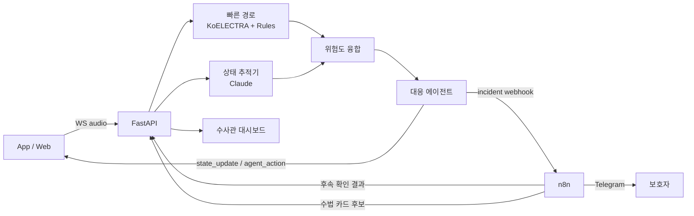

# API 명세 v2 — 능동형 대응 루프 · 수사 지원

> 상태: **P1 구현 완료** (3·4·5절, 5.6 피드백, 5.7 신고 패키지) · P2 이후는 설계 단계 · 작성일 2026-11-14
> 기존 명세 [API_SPEC.md](API_SPEC.md)(v1)는 그대로 유효하다. v2는 **추가만** 하며 v1의 요청·응답 필드를 바꾸거나 지우지 않는다.

## 0. 개요

v2는 "감지 → 판단 → 개입 → 후속 확인 → 학습" 루프를 만든다.



| 단계 | 범위 | 이 문서의 절 |
| --- | --- | --- |
| P1 | 상태 추적, 대응 에이전트, 후속 확인 | 3, 4, 5 |
| P2 | n8n 사건 대응, 보호자 알림 | 6, 9 |
| P3 | 신종 수법 수집 → 검토 → RAG/규칙 반영, 평가 | 7, 8 |
| P4 | 피드백, 수사 지원 대시보드 | 5.6, 10 |
| P5 (선택) | 문자·이미지·URL 분석, 맞춤 주의보 | 11 |

## 1. 공통 규약

### 1.1 주소

```text
HTTP: http://127.0.0.1:8000        (공개 시 https://<터널 도메인>)
WS:   ws://127.0.0.1:8000          (공개 시 wss://<터널 도메인>)
```

### 1.2 인증

| 구분 | 대상 경로 | 방식 |
| --- | --- | --- |
| 사용자 | `/devices`, `/calls`, `/ws`, `/alerts`, `/analyze` | 없음. `device_id`로 구분 (데모 범위) |
| 연동 | `/integrations/*`, `/knowledge/candidates` | 헤더 `X-API-Key: <INTEGRATION_API_KEY>` |
| 관리·수사 | `/knowledge/*/review`, `/rules`, `/eval`, `/quality`, `/investigation/*` | 헤더 `X-API-Key: <ADMIN_API_KEY>` |

키가 없거나 틀리면 `401`을 반환한다.

### 1.3 형식

- 본문은 JSON(UTF-8)이다. 파일 업로드만 `multipart/form-data`를 쓴다.
- 시각은 v1과 같은 `"YYYY-MM-DD HH:MM:SS"` (서버 로컬 시각) 문자열이다.
- 오류 응답은 FastAPI 기본 형식 `{"detail": "..."}`이다.
- 목록 조회는 `limit`(기본 50, 최대 200)과 `offset`(기본 0)을 받는다.

### 1.4 환경 변수 (추가분)

| 이름 | 설명 |
| --- | --- |
| `TRACKER_MODEL` | 상태 추적기 모델. 기본 `claude-haiku-5-5` |
| `AGENT_MODEL` | 대응 에이전트 모델. 기본 `claude-haiku-5-5` |
| `REPORT_MODEL` | 보고서·수법 분석 모델. 기본 `claude-opus-5-5` |
| `WHISPER_DEVICE` | STT 실행 장치 `auto`(기본)·`cuda`·`cpu`. `auto`는 CUDA가 있으면 GPU, 없으면 CPU |
| `WHISPER_MODEL`, `WHISPER_COMPUTE`, `WHISPER_BEAM` | STT 모델·정밀도·파일 전사 beam. 기본 GPU `large-v3`/`float16`/5, CPU `small`/`int8`/1 |
| `INTEGRATION_API_KEY`, `ADMIN_API_KEY` | 1.2의 API 키 |
| `N8N_WEBHOOK_URL` | 백엔드가 이벤트를 보낼 n8n 웹훅 주소 |
| `ACCESS_CODE` | 시연용 접속 코드. 설정하면 쿠키·`X-Access-Code` 헤더·`code` 쿼리 중 하나가 맞아야 웹 앱·API·WebSocket을 쓸 수 있다. 비우면 제한 없음(로컬 개발) |
| `WEB_DIST_DIR` | 웹 앱 빌드 폴더(기본 `web_dist/`). 있으면 백엔드가 같은 주소에서 웹 앱을 함께 제공한다 |
| `N8N_WEBHOOK_SECRET` | 웹훅 요청의 `X-Webhook-Secret` 값 |
| `TELEGRAM_BOT_USERNAME` | 보호자 연결 링크 생성용 봇 이름 |
| `EVIDENCE_DIR` | 증거 오디오 보존 경로. 기본 `data/evidence` |

## 2. 공통 코드값

### 2.1 사기 단계 `stage`

| 코드 | `stage_index` | 의미 |
| --- | --- | --- |
| `none` | 0 | 정상 또는 아직 판단 불가 |
| `approach` | 1 | 접근 — 신원·용건 제시 |
| `impersonation` | 2 | 사칭·신뢰 형성 — 기관·직함·사건번호 강조 |
| `pressure` | 3 | 위기 조성 — 범죄 연루, 처벌, 긴급성 |
| `isolation` | 4 | 고립 — 비밀 유지, 끊지 말라, 이동 지시 |
| `extraction` | 5 | 정보·앱 요구 — 개인정보, 인증번호, 원격 앱 |
| `payment` | 6 | 금전 요구 — 이체, 현금 인출, 선입금 |

### 2.2 사기 유형 `scam_type`

| 코드 | 표시 문자열(`phishing_type`) |
| --- | --- |
| `none` | 정상 |
| `agency` | 수사기관 사칭형 |
| `loan` | 대출 사기형 |
| `kidnap` | 납치 협박형 |
| `acquaintance` | 지인 사칭형 |
| `smishing` | 스미싱·악성앱 유도형 |
| `other` | 기타 |

### 2.3 수법 태그 `tactic`

| 코드 | 의미 | v1 `matched_patterns` 대응 |
| --- | --- | --- |
| `authority_claim` | 기관·직함 사칭 | 수사기관/공공기관 사칭 |
| `crime_involvement` | 범죄 연루 통보 | 범죄 연루 압박 |
| `legal_threat` | 구속·처벌 위협 | 범죄 연루 압박 |
| `urgency` | 시간 압박 | 긴급성/비밀 유지 압박 |
| `secrecy` | 비밀 유지 강요 | 긴급성/비밀 유지 압박 |
| `isolation` | 통화 유지·이동 지시 | (신규) |
| `info_request` | 개인정보·인증번호 요구 | 개인정보/인증 요구 |
| `app_install` | 앱 설치·원격제어 유도 | 앱 설치/원격제어 유도 |
| `link_click` | 링크 접속 유도 | 앱 설치/원격제어 유도 |
| `money_transfer` | 이체·송금 요구 | 금전 이체 유도 |
| `cash_withdrawal` | 현금 인출·전달 요구 | 금전 이체 유도 |
| `loan_bait` | 저금리·선상환 미끼 | 대출 사칭/상환금 요구 |
| `official_channel` | (정상 신호) 공식 앱·지점·대표번호 안내 | — |
| `no_pressure` | (정상 신호) 거절 수용, 숙고 권유 | — |

### 2.4 그 밖의 코드

| 필드 | 값 |
| --- | --- |
| `role` (화자 역할) | `suspect`(상대방), `user`(사용자), `unknown` |
| `compliance` (피해자 순응도) | `none`, `hesitant`, `complying`, `completed` |
| `action_type` | `warn`, `verify_guide`, `official_number`, `guardian_alert`, `block_guide`, `evidence_preserve`, `report_guide`, `followup_check` |
| `action.status` | `delivered`, `acknowledged`, `dismissed`, `answered`, `expired`, `failed` |
| `followup.answer` | `hung_up`, `still_talking`, `verified_safe`, `shared_info`, `installed_app`, `transferred_money`, `false_alarm` |
| `feedback.verdict` | `false_positive`, `confirmed_phishing`, `missed_phishing`, `unsure` |
| `entity_type` | `account`, `phone`, `url`, `org`, `person`, `amount`, `app`, `case_number` |
| 검토 상태 `status` | `pending`, `approved`, `rejected` (규칙은 `active`, `disabled` 추가) |

## 3. 데이터 모델 (추가 테이블)

v1 테이블은 유지한다. `call_messages`에는 열 2개만 더한다.

| 테이블 | 주요 열 | 용도 |
| --- | --- | --- |
| `devices` | `id`, `name`, `age_group`, `interests`(JSON), `consent`(JSON), `created_at` | 사용자 프로필·동의 |
| `guardians` | `id`, `device_id`, `channel`, `chat_id`, `display_name`, `status`, `link_code`, `link_expires_at` | 보호자 연결 |
| `call_messages` (열 추가) | `role`, `tactics`(JSON) | 발화별 역할·수법 태그 |
| `conversation_states` | `id`, `log_id`, `version`, `stage`, `scam_type`, `compliance`, `tracker_risk`, `predicted_next`, `summary`, `last_turn_index`, `model_version`, `created_at` | 상태 이력(버전마다 1행) |
| `agent_actions` | `id`, `log_id`, `state_version`, `action_type`, `title`, `message`, `reason`, `payload`(JSON), `status`, `response`, `created_at`, `responded_at` | 에이전트 결정과 결과 |
| `call_feedback` | `id`, `log_id`, `verdict`, `comment`, `damage`(JSON), `source`, `created_at` | 사용자 피드백 |
| `case_entities` | `id`, `log_id`, `entity_type`, `value`, `normalized`, `turn_index`, `context` | 수사 단서 |
| `evidence_files` | `id`, `log_id`, `chunk_index`, `path`, `sha256`, `prev_hash`, `chain_hash`, `size`, `created_at` | 증거 원본·해시 체인 |
| `knowledge_cards` | `id`, `title`, `scam_type`, `summary`, `script_phrases`(JSON), `red_flags`(JSON), `recommended_actions`(JSON), `target_groups`(JSON), `source_name`, `source_url`, `published_at`, `content_hash`, `status`, `reviewer`, `reviewed_at` | 수법 지식(RAG) |
| `detection_rules` | `id`, `card_id`, `pattern_label`, `regex`, `status`, `eval_run_id`, `created_at` | 규칙 후보·활성 규칙 |
| `eval_runs` | `id`, `target`, `metrics`(JSON), `passed`, `created_at` | 회귀 평가 기록 |
| `webhook_events` | `id`, `event`, `payload`(JSON), `status`, `attempts`, `created_at`, `sent_at` | n8n 발송 대기열 |

`evidence_files.chain_hash = sha256(prev_hash + sha256)`이며 첫 조각의 `prev_hash`는 빈 문자열이다.

## 4. 실시간 WebSocket (`/ws/calls/analyze`) 추가분

v1 이벤트(`start`, `audio_chunk`, `message`, `call_started`, `audio_analysis_ack`, `audio_phishing_detected`, `audio_chunk_ack`, `audio_chunk_error`, `analysis_ack`, `phishing_detected`, `error`)는 그대로다. 구버전 클라이언트는 아래 새 이벤트를 무시해도 동작한다.

### 4.1 클라이언트 → 서버

**`start` 선택 필드 추가**

| 필드 | 설명 |
| --- | --- |
| `agent` | `false`면 상태 추적·에이전트를 끈다. 기본 `true` |
| `preserve_evidence` | `true`면 오디오 조각을 증거로 보존한다. 기본은 기기 동의값 |

**`action_response`** — 에이전트 행동 카드에 대한 사용자 반응

```json
{ "type": "action_response", "action_id": 31, "response": "acknowledged" }
```

**`followup_answer`** — 후속 확인 질문에 대한 답

```json
{ "type": "followup_answer", "action_id": 34, "answer": "hung_up" }
```

**`end`** — 통화 종료. 서버는 최종 상태를 확정하고 `call_ended`를 보낸다.

```json
{ "type": "end" }
```

### 4.2 서버 → 클라이언트

**`state_update`** — 상태 추적기가 새 버전을 만들 때마다 보낸다. 오디오 응답과 별개로 비동기 도착한다.

```json
{
  "type": "state_update",
  "log_id": 10,
  "state_version": 3,
  "stage": "pressure",
  "stage_index": 3,
  "scam_type": "agency",
  "phishing_type": "수사기관 사칭형",
  "compliance": "hesitant",
  "risk_score": 0.83,
  "risk_level": "medium",
  "predicted_next": "payment",
  "summary": "검찰 수사관을 사칭해 계좌가 범죄에 연루됐다고 압박하고 있습니다.",
  "utterance_tags": [
    { "message_id": 101, "turn_index": 3, "role": "suspect", "tactics": ["authority_claim"] },
    { "message_id": 103, "turn_index": 5, "role": "suspect", "tactics": ["crime_involvement", "legal_threat"] }
  ],
  "entities": [
    { "entity_type": "org", "value": "서울중앙지검", "turn_index": 3 }
  ]
}
```

| 필드 | 설명 |
| --- | --- |
| `risk_score` | 빠른 경로 점수와 추적기 점수를 융합한 최종 점수(`0.3×빠른 경로 + 0.7×추적기`). 추적기 점수가 0.5 이상인 동안에는 빠른 경로 점수로 통화 중 최고값을 쓴다(조각난 전사로 점수가 출렁이는 것을 방지) |
| `predicted_next` | 다음에 올 가능성이 높은 단계. 없으면 `null` |
| `utterance_tags` | 이번 버전에서 새로 붙거나 바뀐 발화만 포함 |
| `entities` | 이번 버전에서 새로 추출된 단서만 포함 |

**`agent_action`** — 에이전트가 행동을 결정했을 때 보낸다.

```json
{
  "type": "agent_action",
  "log_id": 10,
  "action": {
    "id": 31,
    "action_type": "official_number",
    "title": "검찰청 대표번호로 직접 확인하세요",
    "message": "검찰은 전화로 계좌 이체를 요구하지 않습니다. 통화를 끊고 1301로 직접 확인하세요.",
    "reason": "수사기관 사칭 후 위기 조성 단계에 들어섰고 사용자가 망설이는 반응을 보였습니다.",
    "payload": { "org": "검찰청", "phone": "1301" },
    "status": "delivered",
    "state_version": 3,
    "created_at": "2026-11-14 21:40:12"
  }
}
```

`agent_action`은 `action.id` 기준 **upsert**다. 사용자가 반응하거나 후속 확인에 답하면 같은 `id`가 바뀐 `status`로 다시 온다. `action` 객체에는 위 필드 외에 `log_id`, `response`(후속 확인 답 등), `responded_at`이 함께 들어 있다.

`action_type`별 `payload`:

| `action_type` | `payload` |
| --- | --- |
| `warn` | `{ "level": "caution" \| "danger" }` |
| `verify_guide` | `{ "questions": ["..."] }` |
| `official_number` | `{ "org": "...", "phone": "..." }` |
| `guardian_alert` | `{ "guardian_count": 1 }` |
| `block_guide` | `{ "kind": "money" \| "info" \| "app", "steps": ["112 신고", "..."], "phones": ["112", "1332"] }` |
| `evidence_preserve` | `{ "chunk_count": 12 }` |
| `report_guide` | `{ "report_url": "/calls/10/report" }` |
| `followup_check` | `{ "phase": "in_call" \| "post_call", "question": "...", "options": [{ "answer": "hung_up", "label": "끊었어요" }], "due_in_sec": 45 }` |

`followup_check`는 서버가 바로 보내고, 클라이언트가 `due_in_sec`만큼 지난 뒤 화면에 띄운다. 전화번호와 `block_guide`의 절차는 서버의 고정 표에서 나오며 LLM이 쓰지 않는다.

**`call_ended`**

```json
{ "type": "call_ended", "log_id": 10, "final": { "stage": "pressure", "scam_type": "agency", "risk_score": 0.83, "risk_level": "medium" } }
```

## 5. 통화 · 상태 · 에이전트 REST

### 5.1 상태 조회 `GET /calls/{log_id}/state`

최신 상태 1건을 반환한다. 형식은 `state_update`에서 `type`을 뺀 것과 같고, `utterance_tags`와 `entities`는 **전체**를 담는다. 상태가 아직 없으면 `stage: "none"`, `state_version: 0`이다.

### 5.2 타임라인 `GET /calls/{log_id}/timeline`

결과 화면과 대시보드용으로 단계 전환·발화·행동을 시간순으로 합친다.

```json
{
  "log_id": 10,
  "stages": [
    { "stage": "impersonation", "stage_index": 2, "from_turn": 3, "state_version": 1, "at": "2026-11-14 21:39:40" },
    { "stage": "pressure", "stage_index": 3, "from_turn": 5, "state_version": 3, "at": "2026-11-14 21:40:10" }
  ],
  "messages": [
    { "message_id": 101, "turn_index": 3, "role": "suspect", "content": "서울중앙지검 수사관입니다.", "tactics": ["authority_claim"] }
  ],
  "actions": [ { "id": 31, "action_type": "official_number", "title": "...", "status": "acknowledged", "created_at": "..." } ]
}
```

### 5.3 행동 목록 `GET /calls/{log_id}/actions`

`{ "log_id": 10, "actions": [ <4.2의 action 객체> ] }`

### 5.4 행동 응답 `POST /calls/{log_id}/actions/{action_id}/respond`

WS가 끊긴 뒤(통화 종료 후 후속 확인 등)에 쓰는 REST 경로다. n8n이 대신 호출할 때는 `X-API-Key`와 `source`를 넣는다.

```json
{ "response": "answered", "answer": "transferred_money", "source": "app" }
```

| 필드 | 설명 |
| --- | --- |
| `response` | `acknowledged`, `dismissed`, `answered` |
| `answer` | `followup_check`일 때만 필수 |
| `source` | `app`(기본), `telegram`, `n8n` |

응답: 갱신된 action 객체와, 답에 따라 새로 만들어진 후속 행동 목록.

```json
{ "action": { "id": 34, "status": "answered", "response": "transferred_money" }, "next_actions": [ { "id": 35, "action_type": "block_guide", "...": "..." } ] }
```

### 5.5 통화 종료 `POST /calls/{log_id}/end`

WS `end`와 같은 처리를 REST로 한다. 응답: `{ "log_id": 10, "final": <call_ended의 final>, "actions": [ <새로 만든 통화 후 행동> ] }`. 위험 통화(`medium` 이상)면 `report_guide`와 통화 후 `followup_check`를 만든다. n8n `call.ended` 발송은 P2에서 붙인다.

클라이언트가 `end` 없이 WS를 끊어도 서버가 같은 마무리를 수행한다. 실시간 통화를 `POST /calls/{log_id}/retranscribe-audio`로 전체 재전사하면 교체된 발화로 상태를 다시 추적하고, 응답 `segments[].speaker`에는 추적기가 추정한 역할(`화자A`=상대방, `화자B`=사용자)이 들어간다.

### 5.6 피드백 `POST /calls/{log_id}/feedback`

```json
{
  "verdict": "false_positive",
  "comment": "실제 은행 대출 상담이었습니다.",
  "damage": null
}
```

`damage`는 `confirmed_phishing`일 때 선택 입력: `{ "amount": 3000000, "transferred": true, "reported": false }`.
응답: `{ "id": 7, "log_id": 10, "verdict": "false_positive", "created_at": "..." }`

### 5.7 신고 패키지 `GET /calls/{log_id}/report?format=json|md`

사용자가 경찰·금융사에 제출할 요약이다. 판정, 요약, 단계별 경과, 위험 발화와 수법, 추출 단서, 사용자 확인 내용, AI 대응 기록, 통화 전문을 담는다. 저장된 기록만으로 조립하며 LLM을 호출하지 않는다. `format=md`면 브라우저에서 바로 읽히도록 `text/plain`(마크다운 본문)으로 반환한다. 증거 해시 목록은 P4에서 추가한다.

### 5.8 v1 응답에 더하는 필드

`GET /calls/{log_id}`에 `stage`, `stage_index`, `scam_type`, `summary`, `state_version`을 추가한다. `GET /calls` 목록 항목에는 `stage`를 추가한다.

## 6. 기기 · 보호자

### 6.1 `POST /devices`

```json
{
  "name": "홍길동 폰",
  "age_group": "60s",
  "interests": ["대출", "투자"],
  "consent": { "guardian_alert": true, "evidence_retention": true, "investigation_share": false, "personalized_alert": true }
}
```

응답은 `id`와 `created_at`이 붙은 같은 객체다. `GET /devices/{id}`, `PATCH /devices/{id}`(부분 수정)를 함께 제공한다.
`age_group`: `10s`~`70s+`. v1의 고정 `device_id`는 그대로 받아들이며, 없는 ID는 기본 프로필로 자동 생성한다.

### 6.2 보호자 연결 `POST /devices/{id}/guardian-link`

응답:

```json
{ "link_code": "G7K2QX", "telegram_url": "https://t.me/<bot>?start=G7K2QX", "expires_at": "2026-11-14 22:10:00" }
```

보호자가 링크로 봇을 시작하면 n8n이 9.2의 연결 API를 호출한다.

### 6.3 `GET /devices/{id}/guardians`, `DELETE /devices/{id}/guardians/{guardian_id}`

`{ "guardians": [ { "id": 2, "channel": "telegram", "display_name": "김보호", "status": "active" } ] }` — `chat_id`는 응답에 넣지 않는다.

## 7. 수법 지식 · 규칙

### 7.1 후보 등록 `POST /knowledge/candidates` (연동 키)

n8n 수법 조사 워크플로가 호출한다.

```json
{
  "title": "카드 배송원 사칭 후 원격제어 앱 설치 유도",
  "scam_type": "agency",
  "summary": "신청하지 않은 카드가 배송된다며 접근한 뒤 가짜 고객센터로 연결해 원격제어 앱을 설치시킨다.",
  "script_phrases": ["카드 배송 예정입니다", "명의도용 신고는 이 번호로"],
  "red_flags": ["신청한 적 없는 카드 배송 연락", "앱 설치 요구"],
  "recommended_actions": ["카드사 공식 대표번호로 직접 확인"],
  "target_groups": ["50s", "60s"],
  "rule_candidates": [ { "pattern_label": "앱 설치/원격제어 유도", "regex": "카드.*배송.*(앱|설치)" } ],
  "source_name": "금융감독원 소비자경보",
  "source_url": "https://www.fss.or.kr/...",
  "published_at": "2026-11-10"
}
```

응답:

```json
{ "id": 12, "status": "pending", "duplicate_of": null, "rule_ids": [5] }
```

`content_hash`(출처 URL + 제목 정규화)가 같으면 새로 만들지 않고 `duplicate_of`에 기존 ID를 넣어 `200`으로 답한다.

### 7.2 조회 `GET /knowledge/cards?status=approved&scam_type=&q=`, `GET /knowledge/cards/{id}`

`status` 기본값은 `approved`다. `pending`·`rejected` 조회는 관리 키가 필요하다.

### 7.3 검토 `POST /knowledge/cards/{id}/review` (관리 키)

```json
{ "decision": "approve", "reviewer": "admin", "note": "", "activate_rule_ids": [5] }
```

승인하면 카드가 RAG 인덱스에 들어간다. `activate_rule_ids`의 규칙은 **회귀 평가(8.1)를 통과해야만** `active`가 된다.

응답:

```json
{ "card": { "id": 12, "status": "approved" }, "rules": [ { "id": 5, "status": "active", "eval_run_id": 9 } ], "eval": { "passed": true, "delta": { "fpr": 0.0, "recall": 0.02 } } }
```

### 7.4 규칙 `GET /rules?status=`, `POST /rules/{id}/status` (관리 키)

`POST` 본문: `{ "status": "active" | "disabled" }`. `active`로 바꿀 때는 7.3과 같이 평가를 거친다.

## 8. 평가 · 품질

### 8.1 회귀 평가 `POST /eval/run` (관리 키)

```json
{ "target": "candidate", "rule_ids": [5] }
```

`target`: `current`(현재 운영 구성), `candidate`(현재 + `rule_ids`). 평가셋(`backend/eval/scenarios.json`)을 돌려 지표를 낸다.

P1에서는 같은 평가셋을 명령으로 돌린다: `python -m backend.app.eval_loop`. 대본을 두 발화씩 흘려보내며 빠른 경로 → 상태 추적 → 융합 → 대응 결정을 실제로 실행하고 라벨·유형·도달 단계를 기대값과 비교한다(결과는 `data/eval_last_run.json`).

```json
{
  "id": 9,
  "target": "candidate",
  "metrics": { "precision": 0.96, "recall": 0.94, "f1": 0.95, "fpr": 0.03, "n": 120 },
  "baseline": { "precision": 0.96, "recall": 0.92, "f1": 0.94, "fpr": 0.03 },
  "passed": true,
  "failed_cases": [ { "scenario_id": "normal_loan_07", "expected": 0, "risk_score": 0.74 } ]
}
```

통과 기준: 기준선 대비 `fpr` 증가 ≤ 0.01 이고 `recall` 감소 없음.
`GET /eval/runs`, `GET /eval/runs/{id}`로 이력을 조회한다.

### 8.2 품질 요약 `GET /quality/summary?from=&to=` (관리 키)

```json
{
  "period": { "from": "2026-11-08", "to": "2026-11-14" },
  "calls": { "total": 84, "high": 12, "medium": 9 },
  "feedback": { "false_positive": 3, "confirmed_phishing": 5, "missed_phishing": 1, "unsure": 2 },
  "false_positive_rate": 0.14,
  "by_scam_type": [ { "scam_type": "loan", "alerts": 8, "false_positive": 3 } ],
  "followup": { "asked": 15, "answered": 11, "transferred_money": 1 }
}
```

### 8.3 재학습 후보 내보내기 `GET /quality/retrain-candidates` (관리 키)

피드백으로 라벨이 확정된 통화를 v1 학습 JSON 형식(`{"cases": [...]}`)으로 내려준다. `false_positive`는 `label: 0`, `confirmed_phishing`·`missed_phishing`은 `label: 1`이다.

## 9. n8n 연동

### 9.1 백엔드 → n8n 웹훅

`N8N_WEBHOOK_URL`로 `POST`한다. 헤더 `X-Webhook-Secret`를 붙인다. 실패하면 `webhook_events`에 남기고 최대 3회 재시도한다.

```json
{
  "event": "incident.high_risk",
  "event_id": "evt_000123",
  "occurred_at": "2026-11-14 21:40:12",
  "data": { "...": "..." }
}
```

| `event` | 발생 시점 | `data` |
| --- | --- | --- |
| `incident.high_risk` | 통화가 처음 `high`가 됐거나 `guardian_alert`가 결정됐을 때 | `log_id`, `device_id`, `risk_score`, `stage`, `scam_type`, `phishing_type`, `summary`, `guardians`[`chat_id`, `display_name`], `followup_action_id` |
| `call.ended` | 위험 통화(`medium` 이상) 종료 | `log_id`, `final`, `followup_action_id`, `followup_delay_sec`, `report_url` |
| `followup.answered` | 후속 확인에 피해 발생 답(`transferred_money` 등)이 왔을 때 | `log_id`, `answer`, `guardians` |
| `feedback.created` | 피드백 등록 | `log_id`, `verdict` |
| `knowledge.approved` | 수법 카드 승인 | `card_id`, `title`, `scam_type`, `target_groups` |

`guardians`는 `consent.guardian_alert`가 `true`인 기기에서만 채운다.

### 9.2 보호자 연결 `POST /integrations/telegram/link` (연동 키)

n8n Telegram 트리거가 `/start <link_code>`를 받으면 호출한다.

```json
{ "link_code": "G7K2QX", "chat_id": "123456789", "display_name": "김보호" }
```

응답: `{ "guardian_id": 2, "device_id": 1, "device_name": "홍길동 폰" }`. 코드가 없거나 만료면 `404`.

### 9.3 알림 결과 기록 `POST /integrations/notifications` (연동 키)

```json
{ "log_id": 10, "channel": "telegram", "target": "김보호", "status": "sent", "message": "..." }
```

v1 `notification_logs`에 기록한다.

### 9.4 후속 확인 답 전달

n8n은 5.4의 `POST /calls/{log_id}/actions/{action_id}/respond`를 `source: "telegram"`으로 호출한다.

## 10. 수사 지원 (관리 키)

> **구현 현황 (2026-11-15)**: 아래 중 다음이 구현됐다.
> - `GET /investigation/cases?min_risk=&limit=` → `{stats, cases[]}` (통화별 위험도·유형·도달 단계·단서 수·후속 확인 답·피해 확인 여부·단서 겹침 여부)
> - `GET /investigation/cases/{log_id}` → 신고용 요약(5.7)과 같은 본문에 `overview`(LLM이 쓴 사건 개요, 위험 통화만), `links`(같은 계좌·전화번호·주소·사건번호가 나온 다른 통화), `similar_official_cases`(금감원·경찰청 공개 사례 중 유사한 것), `damage_reported`를 더한 것
> - `GET /investigation/cases/{log_id}/links`
> - `GET /dashboard` 수사 지원 화면 (접속 코드 쿠키 필요)
> - `GET /calls/{log_id}/report`도 같은 항목을 포함한다.
> 유사 공식 사례는 참고 자료로만 붙이고 탐지 점수에는 쓰지 않는다(유형 일치 정확도 약 80%, `docs/MODEL_TRAINING_LOG.md` 참고).
> 증거 음성 보존과 해시 체인(10.5)은 아직 구현하지 않았다.

`consent.investigation_share`가 `true`인 기기의 통화와 데모 시드 데이터만 노출한다.

### 10.1 사건 목록 `GET /investigation/cases?risk_level=&scam_type=&from=&to=&q=`

```json
{
  "total": 23,
  "cases": [
    { "log_id": 10, "called_at": "2026-11-14 21:38:02", "scam_type": "agency", "stage": "payment", "risk_score": 0.94, "entity_count": 4, "linked_case_count": 2, "priority": 0.88 }
  ]
}
```

`priority`는 위험도, 단계, 연결 사건 수, 피해 발생 여부로 계산한 0~1 값이며 기본 정렬 기준이다.

### 10.2 사건 상세 `GET /investigation/cases/{log_id}`

`summary`, `timeline`(5.2와 동일), `entities`, `evidence`(10.5), `links`(10.3), `feedback`을 묶어 반환한다.

### 10.3 연관 사건 `GET /investigation/cases/{log_id}/links`

```json
{
  "links": [
    { "log_id": 7, "score": 0.91, "reasons": [ { "type": "shared_entity", "entity_type": "account", "value": "110-***-123456" }, { "type": "script_similarity", "similarity": 0.82 } ] }
  ]
}
```

### 10.4 관계 그래프 `GET /investigation/graph?log_id=&depth=2`

`log_id`를 생략하면 전체 그래프다.

```json
{
  "nodes": [
    { "id": "case:10", "type": "case", "label": "사건 #10", "risk_level": "high" },
    { "id": "account:110-***-123456", "type": "account", "label": "110-***-123456", "case_count": 3 }
  ],
  "edges": [
    { "source": "case:10", "target": "account:110-***-123456", "relation": "mentions" },
    { "source": "case:10", "target": "case:7", "relation": "similar_script", "weight": 0.82 }
  ]
}
```

### 10.5 단서 · 증거

- `GET /investigation/entities?entity_type=&q=` — 단서별 등장 사건 수
- `GET /investigation/cases/{log_id}/evidence` — `[ { "id": 55, "chunk_index": 1, "sha256": "...", "chain_hash": "...", "size": 96044, "created_at": "..." } ]`
- `GET /investigation/evidence/{id}/download` — 원본 오디오
- `POST /investigation/cases/{log_id}/evidence/verify` — 파일을 다시 해시해 체인과 대조. `{ "verified": true, "checked": 12, "broken_at": null }`

### 10.6 수사보고서 초안 `POST /investigation/cases/{log_id}/report`

Claude(`REPORT_MODEL`)로 사건 개요, 범행 수법, 시간순 경과, 확보 단서, 연관 사건, 추가 확인 필요 사항을 마크다운으로 만든다. 응답: `{ "log_id": 10, "markdown": "...", "generated_at": "..." }`. `GET`으로 마지막 생성본을 조회한다.

### 10.7 대시보드 `GET /dashboard`

FastAPI가 서빙하는 정적 웹 페이지다. 위 API를 호출하며, 접속 시 관리 키를 입력받는다.

## 11. 통합 탐지 · 맞춤 주의보 (P5, 선택)

### 11.1 `POST /analyze/message`

`multipart/form-data`: `text`(선택), `image`(선택, 문자·메신저 캡처), `device_id`(선택). 둘 중 하나는 필수다.

```json
{
  "is_phishing": true,
  "risk_score": 0.91,
  "risk_level": "high",
  "scam_type": "smishing",
  "extracted_text": "[국제발신] 택배 주소 불일치...",
  "tactics": ["link_click", "urgency"],
  "core_evidence": "...",
  "urls": [ { "url": "http://...", "verdict": "malicious", "reasons": ["공식 도메인과 유사한 철자", "등록 3일 된 도메인"] } ],
  "related_cards": [12]
}
```

> **구현 현황 (2026-11-15)**: 구현됨(`backend/app/api/analyze_routes.py`, `services/message_analyzer.py`). 실제 응답은 위 설계와 다음이 다르다.
> - 점수: 스미싱 문자 분류기(KLUE-RoBERTa, `models/sms_roberta`) 40% + Claude 판단 60%. 분류기 모델이 없으면 Claude만 쓴다. `scores: {classifier, llm}`에 각 점수를 담는다.
> - 유형은 `category`(`none`, `delivery`, `agency`, `finance`, `acquaintance`, `event`, `payment`, `investment`, `spam`, `other`)와 `category_label`, 위험 신호는 `red_flags: [{code, label}]`, 설명은 `explanation`.
> - `urls[].verdict`는 `suspicious`, `unknown`, `likely_official`(규칙 점검만 하고 접속하지 않는다), `urls[].host`, `urls[].reasons`. 본문의 전화번호는 `phones`.
> - 권장 행동은 고정 문구 `recommended_actions`(신고 번호를 LLM이 쓰지 않는다). `related_cards`와 `device_id`는 아직 없다.
> - 이미지는 jpg·png·webp·gif, 4MB 이하. 본문도 이미지도 없으면 422.
> - 정확도는 `docs/MODEL_TRAINING_LOG.md`의 스미싱 문자 분류기 항목 참고.

### 11.4 `POST /analyze/document`

`multipart/form-data`: `image`(필수, 받은 문서의 사진·캡처), `note`(선택, 어떻게 받은 문서인지). 구현됨(`services/document_analyzer.py`).

Claude(이미지 판독)가 보이스피싱에 쓰이는 위조 문서의 전형적 특징(송금·현금 전달 요구, 비밀 유지 강요, 개인 연락처로 회신 요구, 메신저로 전달된 공문, 기관명·직인·서식 오류 등)을 짚는다. 진짜 문서와 대조하는 감정이 아니다.

```json
{
  "readable": true,
  "is_phishing": true,
  "risk_score": 0.93,
  "risk_level": "high",
  "doc_type": "검찰 명의 공문",
  "claimed_issuer": "서울중앙지방검찰청",
  "flags": [ { "code": "money_request", "label": "송금·현금 전달·자산 이전 요구" } ],
  "evidence": ["'안전계좌로 자산을 이전하라'는 문구"],
  "explanation": "...",
  "recommended_actions": ["문서가 요구하는 송금, 현금 전달, 앱 설치, 개인정보 제출을 하지 마세요.", "..."],
  "thresholds": { "warning": 0.7, "danger": 0.85 },
  "disclaimer": "사진만으로 문서의 진위를 확정할 수는 없습니다. ..."
}
```

`flags[].code`: `money_request`, `secrecy`, `threat`, `personal_contact`, `info_request`, `app_or_link`, `format_errors`, `nonexistent_office`, `messenger_delivery`, `too_good_offer`. 글자를 읽을 수 없으면 `readable: false`, `risk_score: 0`. 평가는 `python -m backend.app.eval_documents`(평가 세트 `data/eval_documents/`).

### 11.2 `POST /analyze/url`

본문 `{ "url": "..." }`. 응답은 11.1의 `urls` 항목 1개와 같다. `verdict`: `safe`, `suspicious`, `malicious`, `unknown`.

### 11.3 `GET /alerts?device_id=`

승인된 수법 카드 중 기기 프로필(`age_group`, `interests`, 과거 경고 유형)에 맞는 것을 최신순으로 반환한다.

```json
{ "alerts": [ { "card_id": 12, "title": "...", "summary": "...", "match_reasons": ["연령대 60대 대상", "과거 대출 사기형 경고 이력"], "published_at": "2026-11-10" } ] }
```
