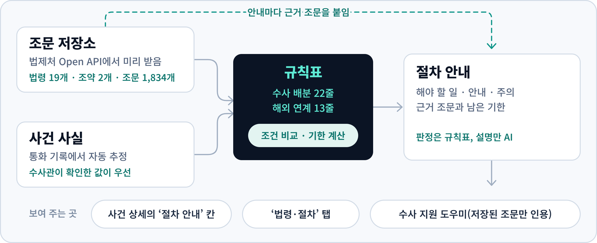
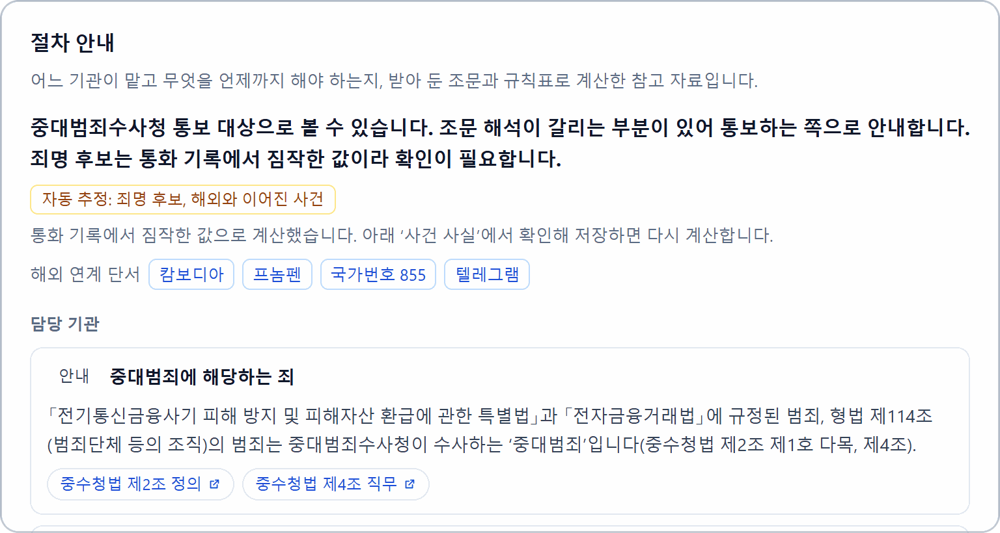
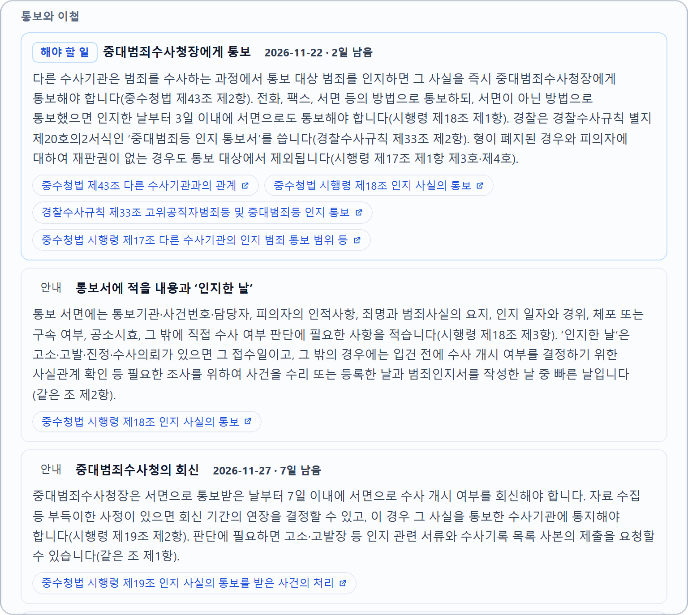
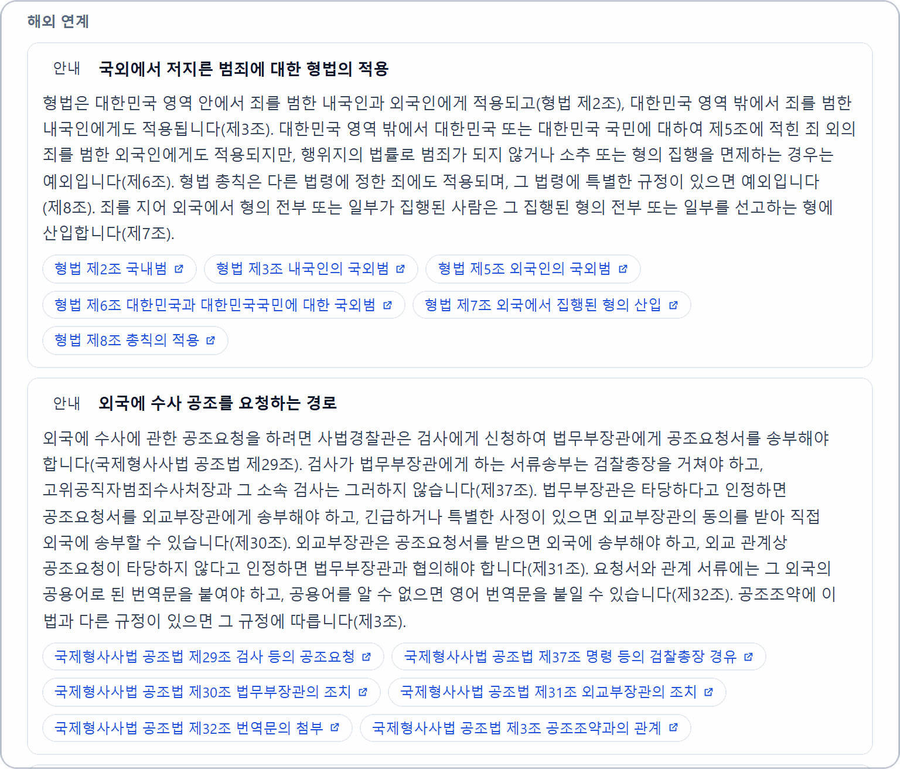
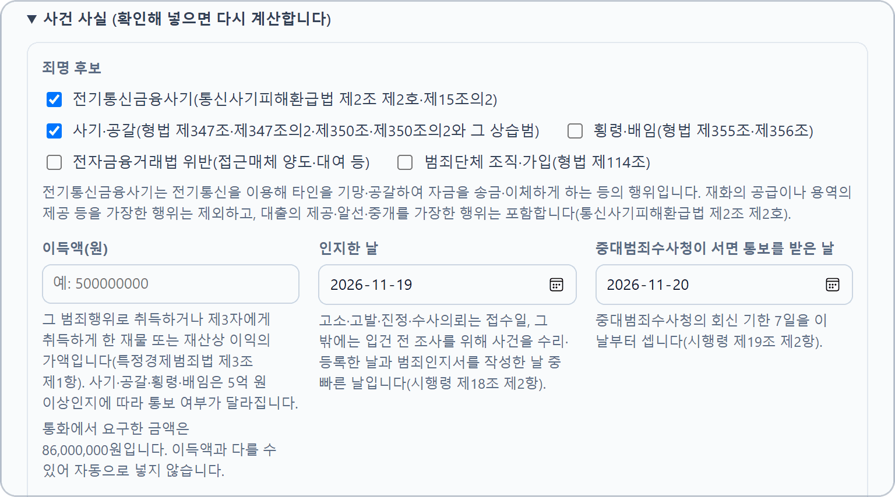
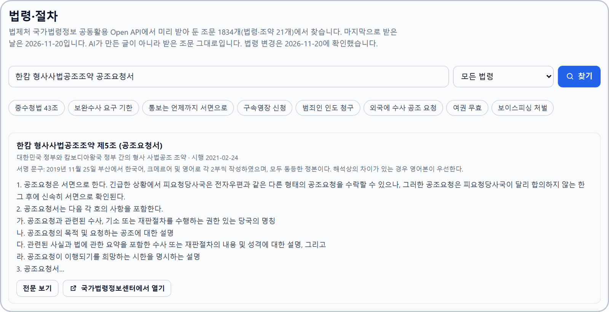
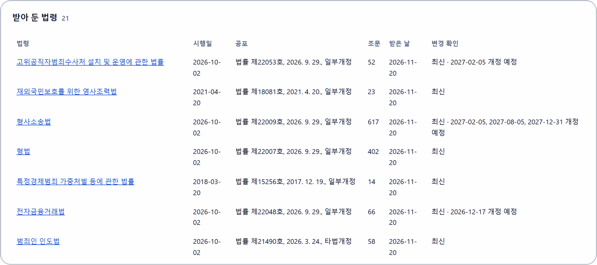

# 절차 안내: 수사 배분·법 안내와 해외 연계 사건

[← README로 돌아가기](../README.md) · [수사 지원](investigator.md) · [설계 문서](investigation-guidance-design.md)

**수사관이 통화 한 건을 열면, 해당 사건을 어느 기관이 맡고 무엇을 언제까지 해야 하는지 근거 조문과 함께 보여 줍니다.** 규칙표가 판정을 계산하고, 미리 받아 둔 조문을 근거로 제시하며, AI는 설명만 합니다.

> [!IMPORTANT]
> 이 안내는 참고 자료이며 법률 자문이 아닙니다. 규칙표를 조문과 대조해 검토했지만, 사람의 법률 검토는 받지 않았습니다. 실제 통보·이첩·청구는 소속 기관의 지침과 담당 부서의 확인을 거쳐야 합니다. 이 문서의 화면은 가상의 통화를 이용해 캡처했습니다.

<p align="center">
<picture>
  <source media="(prefers-color-scheme: dark)" srcset="images/readme/guidance-dark.png">
  
</picture><br>
<sub>미리 받아 둔 조문과 사건 사실을 규칙표에 입력해 절차 안내를 만듭니다. 각 안내에는 근거 조문이 붙습니다.</sub>
</p>

## 두 기능

2026년 10월 2일 검찰청이 없어지고 공소청과 중대범죄수사청이 생기면서, 수사관은 사건마다 어느 기관이 맡고 누구에게 언제까지 알려야 하는지 새 법령에서 찾아야 합니다. 해외와 연계된 사기 사건에는 국제 공조 절차가 추가됩니다. 두 기능은 이 두 가지 문제에 답하며, 동일한 조문 저장소와 판정 엔진을 함께 사용합니다.

| | 수사 배분·법 안내 | 해외 연계 사건 |
| --- | --- | --- |
| 묻는&nbsp;것 | 이 사건은 어느 기관이 맡고, 무엇을 누구에게 언제까지 해야 하는가 | 해외에 있는 피의자·증거·범죄수익은 어떤 경로로 다루는가 |
| 보여&nbsp;주는&nbsp;것 | 중대범죄수사청 통보 여부와 제외 사유, 서면 통보·회신 기한, 이첩, 영장·보완수사·송치 | 형법의 적용 범위, 수사 공조와 범죄인 인도의 경로, 여권, 공소시효, 범죄수익, 영사조력 |
| 근거&nbsp;법령 | 중수청법과 시행령, 형사소송법, 공소청법, 공수처법, 경찰수사규칙 | 국제형사사법 공조법, 범죄인 인도법, 여권법, 범죄수익은닉규제법, 부패재산몰수법, 영사조력법 |

## 화면으로 보기

아래 화면은 기관을 사칭한 시연 통화를 연 것입니다. 통화에는 ‘프놈펜’과 국가번호 +855가 등장합니다.

### 1. 사건을 열면 판정 요약이 먼저 나옵니다

<p align="center"></p>

- 통화 분석 단계에서 판단한 사기 유형을 바탕으로 죄명 후보를 추정하고, 통화 내용에 등장하는 나라·지명·국가번호를 바탕으로 해외 연계 여부를 추정합니다.
- 추정값으로 계산한 안내에는 ‘자동 추정’ 표시가 붙습니다.
- 각 항목에는 근거 조문이 표시되며, 이를 누르면 국가법령정보센터의 해당 조문이 열립니다.

### 2. 통보 여부와 기한을 계산합니다

<p align="center"></p>

- 전기통신금융사기는 금액과 관계없이 중대범죄이므로 중대범죄수사청 통보 대상입니다(중수청법 제2조).
- 인지한 즉시 통보해야 하며, 서면이 아닌 방법으로 통보한 경우 인지한 날부터 3일 이내에 서면으로도 통보해야 합니다(시행령 제18조). 인지한 날을 입력하면 이 기한을 계산합니다.
- 중대범죄수사청은 서면 통보를 받은 날부터 7일 이내에 수사 개시 여부를 회신합니다(시행령 제19조).
- 사기·공갈·횡령·배임은 이득액이 5억 원 이상이면 통보 대상이며, 그 미만이면 제외됩니다(시행령 제17조). 금액을 알 수 없으면 ‘입력 필요’로 표시됩니다.

### 3. 이어서 해외 연계 절차를 보여 줍니다

<p align="center"></p>

| 사건 사실 | 나오는 안내 |
| --- | --- |
| 해외와 이어진 사건 | 형법의 적용 범위, 수사 공조 요청 경로, 인터폴 협력, 범죄수익 몰수와 피해재산 환부 |
| 피의자가 국외에 있음 | 공소시효 정지, 범죄인 인도 청구 경로, 넘겨받은 뒤 다른 죄로 처벌하려면 |
| 여권법 사유에 해당 | 여권 발급 거부와 무효처분 |
| 현지 체포·구금 또는 감금·강요 정황 | 영사조력, 인신매매등 피해 정황(주의) |

수사 배분을 먼저 계산한 뒤, 해외 연계 규칙이 그 결과를 참조합니다. 따라서 통보 대상이면서 해외와 연계된 사건에는 중대범죄수사청의 국제협력 조문도 함께 표시됩니다. 현재는 한국 법령에서 정한 절차까지만 안내하며, 조약 조문을 활용한 판정은 아직 없습니다.

### 4. 확인한 사실을 넣으면 다시 계산합니다

<p align="center"></p>

- 죄명 후보 5가지, 이득액, 예/아니오 9가지, 날짜 3가지를 입력할 수 있습니다.
- 수사관이 확인한 값이 추정값보다 우선합니다.
- 통화에서 요구한 금액은 이득액과 다를 수 있으므로 자동으로 입력하지 않습니다.

### 5. 조문을 직접 찾아 읽습니다

<p align="center"></p>

<p align="center"></p>

- ‘법령·절차’ 탭에서 법령 19개와 한·캄 조약 2개에 포함된 조문 1,834개를 검색할 수 있습니다. AI가 생성한 글이 아니라 받아 둔 조문 그대로입니다.
- 조약 조문에는 정본 언어와 해석이 갈릴 때 우선하는 본을 명시한 서명 문구도 함께 표시됩니다.
- 법령마다 저장된 판이 최신인지, 어느 조문이 언제 개정될 예정인지 표시합니다.

## 동작 원리

1. **조문을 미리 받아 둡니다.** 법제처 Open API에서 현재 시행 중인 판을 받아 조 단위로 저장합니다. 조문마다 출처, 받아 온 시각, 시행일, 원본 해시를 기록합니다. 실행 중에는 AI가 법령을 가져오지 않습니다.
2. **사건 사실을 모읍니다.** 통화 기록에서 추정한 값과 수사관이 확인한 값을 합칩니다.
3. **규칙표의 각 규칙을 위에서 아래로 한 번씩 적용합니다.** 각 규칙은 조건, 화면에 표시할 문구, 근거 조문, 기한 계산법으로 구성됩니다. 뒤에 오는 규칙은 앞선 규칙이 정한 값(예: 통보 대상)을 참조합니다.
4. **기한을 계산하고 근거 조문을 표시합니다.** 기한은 시작일에 정해진 기간을 더해 계산합니다. 근거 조문의 개정이 예정되어 있으면 개정 예정일도 함께 알립니다.
5. **화면과 도우미를 통해 안내를 보여 줍니다.** 수사 지원 도우미는 도구를 이용해 조문 검색과 절차 안내를 호출하고, 저장된 조문을 인용해 설명합니다.

규칙은 코드가 아니라 데이터입니다. 아래는 통보 의무 규칙을 간추려 보여 준 것입니다. 시행령이 바뀌면 해당 줄만 수정합니다.

```json
{
  "id": "alloc-notify",
  "title": "중대범죄수사청장에게 통보",
  "when": [
    {"fact": "notify_candidate", "op": "is", "value": true},
    {"fact": "excluded", "op": "is_not", "value": true},
    {"fact": "notified_before", "op": "is_not", "value": true}
  ],
  "level": "duty",
  "deadline": {"from": "recognized_on", "days": 3},
  "basis": [["sca", "제43조"], ["sca_decree", "제18조"], ["police_rule", "제33조"], ["sca_decree", "제17조"]]
}
```

같은 엔진에 사건 사실만 바꿔 넣은 결과입니다.

| 사건 사실 | 결과 |
| --- | --- |
| 전기통신금융사기와 사기, 해외 연계(자동 추정만) | 통보 대상. 기한은 ‘인지한 날’ 입력 필요 |
| 위에 인지한 날, 서면 통보를 받은 날, 피의자 국외를 확인해 입력 | 서면 통보 기한과 회신 기한을 계산. 공소시효 정지와 범죄인 인도 청구 경로 추가 |
| 형법상 사기만, 이득액 3억 원 | 통보 제외. 중대범죄수사청이 요청하면 통보해야 한다는 안내 |

## AI가 하는 일과 하지 않는 일

- **하지 않는 일**: 통보 여부 및 경로 판정, 조문 생성, 웹 검색.
- **하는 일**: 통화에서 사기 유형과 단서를 추출하는 일, 수사관의 질문에 저장된 조문을 인용해 설명하는 일. 저장된 조문에 없는 내용은 없다고 답합니다.

이렇게 나눈 이유는 각 안내의 근거 조문을 따라가 확인할 수 있어야 하고, 법이 바뀌면 규칙표에서 해당 줄만 수정하면 되기 때문입니다. 이 기능을 위해 새로 학습한 모델은 없습니다.

## 한계

- 사람의 법률 검토를 받지 않았습니다.
- 해외 연계 안내는 한국 쪽 절차까지입니다. 조약 본문은 찾아 읽을 수 있지만, 조약 조문과 상대국 법령을 활용한 판정은 없습니다.
- 죄명 후보는 다섯 가지로 한정되며, 해외 연계 단서는 단어 목록을 이용해 찾습니다.
- 기한은 시작일 다음 날부터 계산한 참고값이며, 공휴일과 기관별 기준은 반영하지 않았습니다.
- 법령 변경 확인은 명령으로 실행하며, 정기 실행 기능은 없습니다.
- 담당자 배당, 결정 기록, 공조요청서 점검 기능은 구현하지 않았습니다.

## 더 읽기

- [수사 지원 고도화 설계](investigation-guidance-design.md): 확인한 사실, 받아 둔 법령, 규칙 목록, 검증 방법, 한계
- [수사 지원 문서의 ‘절차 안내와 법령 찾기’](investigator.md#절차-안내와-법령-찾기): 화면과 API, 도우미 도구
- 규칙표: [`allocation.json`](../backend/app/legal_data/rules/allocation.json), [`crossborder.json`](../backend/app/legal_data/rules/crossborder.json)
- 수집기와 변경 확인: [`fetch_legal.py`](../backend/app/fetch_legal.py)
