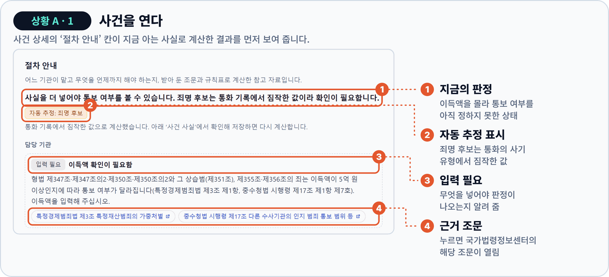
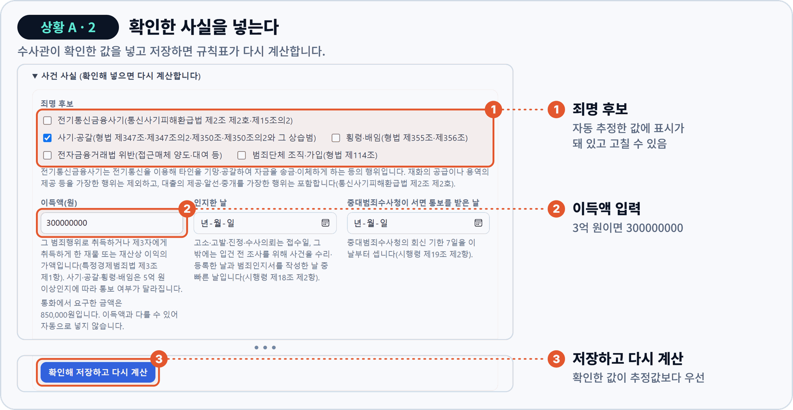
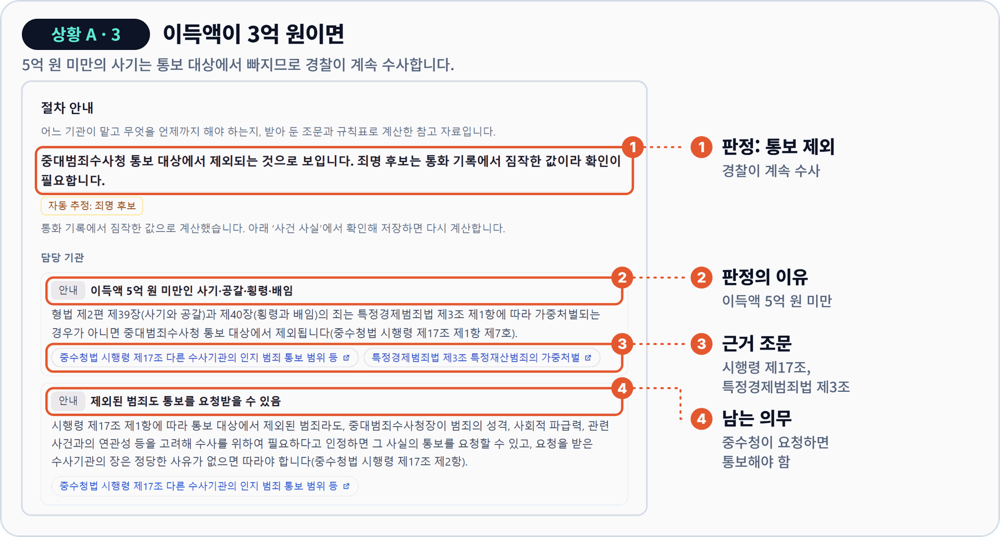
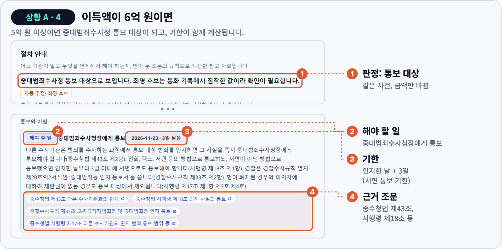
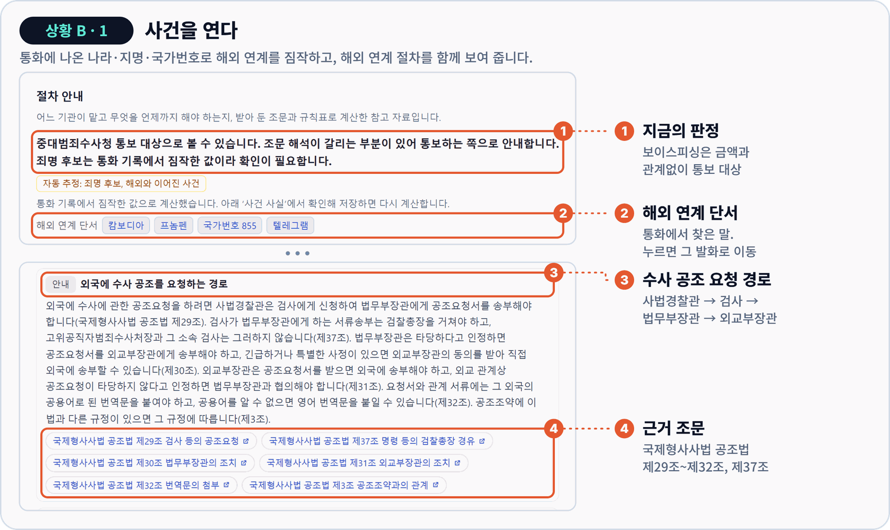
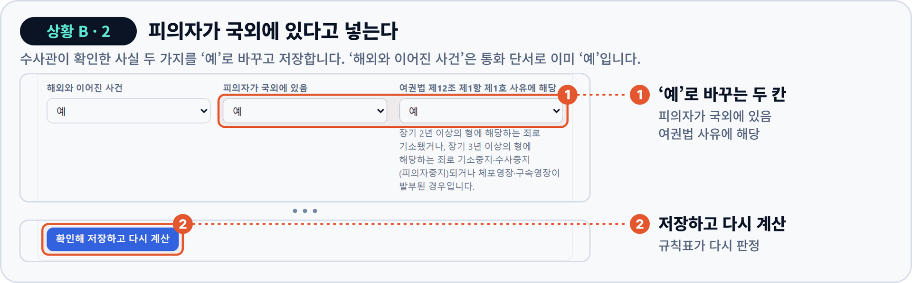
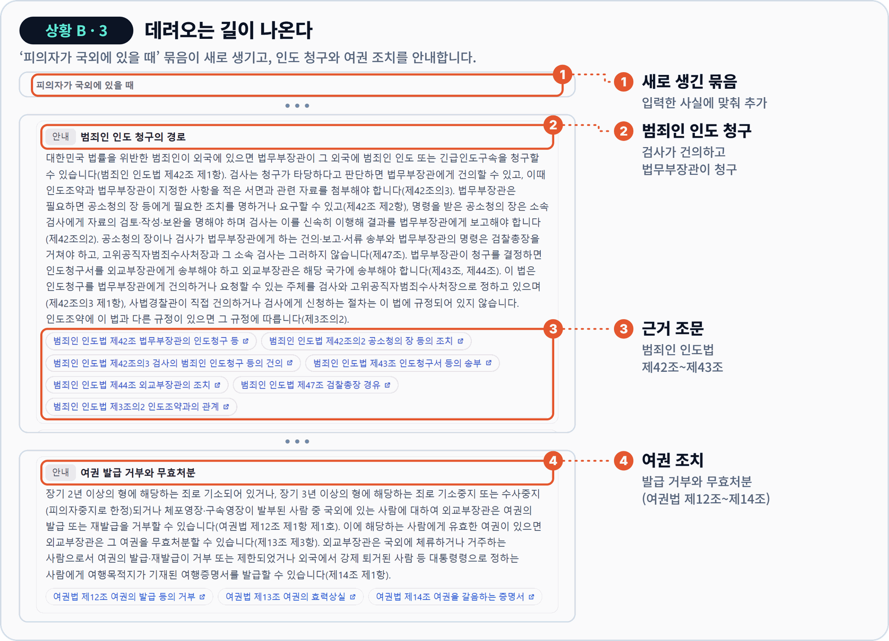
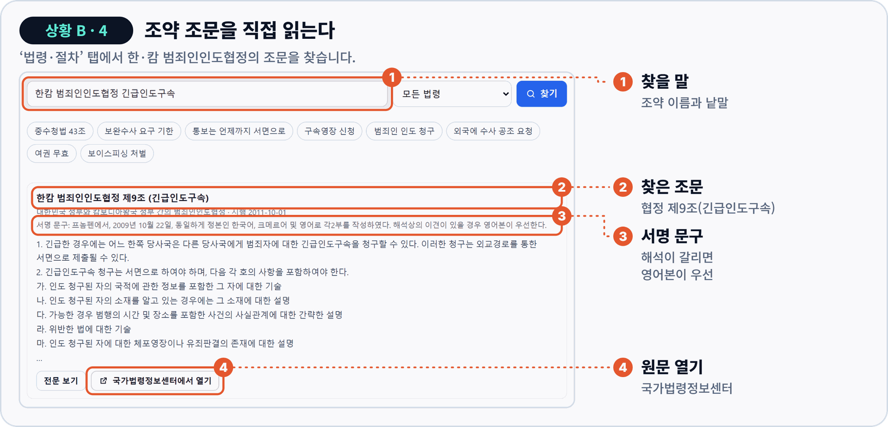

# 절차 안내: 두 가지 상황으로 보기

[← README로 돌아가기](../README.md) · [수사 지원](investigator.md) · [Slack에서 쓰기](slack.md) · [설계 문서](investigation-guidance-design.md)

**수사관이 사건을 열면, 어느 기관이 맡는 사건인지와 무엇을 언제까지 해야 하는지를 근거 조문과 함께 보여 줍니다.** 법과 수사 절차를 잘 몰라도 따라올 수 있도록, 수사관이 실제로 마주칠 두 가지 상황을 처음부터 끝까지 따라가며 설명합니다.

> [!IMPORTANT]
> 이 안내는 참고 자료이며 법률 자문이 아닙니다. 규칙표를 조문과 대조해 검토했지만, 사람의 법률 검토는 받지 않았습니다. 실제 통보·이첩·청구는 소속 기관의 지침과 담당 부서의 확인을 거쳐야 합니다. 화면의 통화는 모두 지어낸 것입니다.

| | 상황 A | 상황 B |
| --- | --- | --- |
| 받은&nbsp;사건 | 중고거래 사기 신고 | 캄보디아와 이어진 보이스피싱 |
| 수사관의&nbsp;질문 | 경찰이 계속 수사하는가, 중대범죄수사청에 알려야 하는가 | 캄보디아에 있는 피의자를 어떻게 데려오고, 어떤 법을 봐야 하는가 |
| 화면이&nbsp;주는&nbsp;답 | 통보 대상 여부와 그 이유, 통보 기한, 근거 조문 | 수사 공조와 범죄인 인도의 경로, 여권 조치, 조약 조문 |

## 먼저 알아 둘 것

2026년 10월 2일 검찰청이 없어지고 공소청과 중대범죄수사청이 생겼습니다. 그 뒤로 수사관은 사건마다 “이 사건을 누가 수사하고, 누구에게 언제까지 알려야 하는가”를 새 법령에서 확인해야 합니다.

| 기관 | 맡는 일 |
| --- | --- |
| 경찰 | 수사. 통보 대상 범죄를 알게 되면 중대범죄수사청에 통보 |
| 중대범죄수사청(중수청) | 중대범죄 수사. 통보를 받으면 수사 개시 여부를 회신하고, 필요하면 사건을 넘겨 달라고 요청(이첩 요청) |
| 공소청 | 수사가 아니라 영장 청구와 기소. 경찰은 영장을 검사에게 신청하고 사건을 검사에게 송치 |
| 고위공직자범죄수사처(공수처) | 고위공직자범죄 수사 |

화면은 이 판단을 대신 계산해 줍니다. **판정은 규칙표가 하고, 근거는 미리 받아 둔 조문이며, AI는 설명만 합니다.**

<p align="center">
<picture>
  <source media="(prefers-color-scheme: dark)" srcset="images/readme/guidance-dark.png">
  
</picture>
</p>

## 상황 A. 이 사건은 어느 기관이 맡는가

> **가정** 중고 장터에서 노트북을 판다며 선입금을 받은 사기 신고가 들어왔습니다. 피해자가 더 있을 수 있어, 전체 이득액이 얼마인지에 따라 처리가 달라집니다.

사기는 이득액이 5억 원 이상이면 중대범죄수사청에 통보해야 하고, 5억 원 미만이면 통보 대상에서 빠집니다. 화면은 이 기준을 조문에서 가져와 적용합니다.

### A-1. 사건을 연다

<p align="center">
<picture>
  <source media="(prefers-color-scheme: dark)" srcset="images/readme/flow_a1-dark.png">
  
</picture>
</p>

1. **지금의 판정** — 지금 아는 사실만으로 계산한 결과입니다. 이득액을 몰라 통보 여부를 아직 정하지 못했습니다.
2. **자동 추정 표시** — 죄명 후보(사기)는 통화의 사기 유형에서 추정한 값입니다. 수사관이 확인하기 전까지 이 표시가 붙습니다.
3. **입력 필요** — 무엇을 넣어야 판정이 나오는지 알려 줍니다.
4. **근거 조문** — 누르면 국가법령정보센터의 해당 조문이 열립니다.

### A-2. 확인한 사실을 넣는다

<p align="center">
<picture>
  <source media="(prefers-color-scheme: dark)" srcset="images/readme/flow_a2-dark.png">
  
</picture>
</p>

1. **죄명 후보** — 자동 추정한 값에 표시가 돼 있고, 수사관이 고칠 수 있습니다.
2. **이득액** — 원 단위 숫자로 넣습니다. 통화에서 요구한 금액(85만 원)은 칸 아래에 알려만 주고 자동으로 넣지 않습니다. 한 번 요구한 금액과 전체 이득액은 다를 수 있기 때문입니다.
3. **저장하고 다시 계산** — 수사관이 확인한 값이 추정값보다 우선합니다.

### A-3. 이득액이 3억 원이면

<p align="center">
<picture>
  <source media="(prefers-color-scheme: dark)" srcset="images/readme/flow_a3-dark.png">
  
</picture>
</p>

1. **판정: 통보 제외** — 경찰이 계속 수사하는 사건입니다.
2. **판정의 이유** — 이득액이 5억 원 미만입니다.
3. **근거 조문** — 중수청법 시행령 제17조, 특정경제범죄법 제3조.
4. **남는 의무** — 제외된 범죄라도 중수청이 요청하면 통보해야 합니다.

이 경우 영장은 검사에게 신청하고, 혐의가 인정되면 사건을 검사에게 송치합니다. 화면의 ‘기본 절차’ 묶음에 나옵니다.

### A-4. 이득액이 6억 원이면

<p align="center">
<picture>
  <source media="(prefers-color-scheme: dark)" srcset="images/readme/flow_a4-dark.png">
  
</picture>
</p>

1. **판정: 통보 대상** — 같은 사건에서 금액만 바뀌었는데 판정이 달라졌습니다.
2. **해야 할 일** — 중대범죄수사청장에게 통보합니다.
3. **기한** — 통보는 인지한 즉시 해야 합니다. 서면이 아닌 방법으로 통보했다면 인지한 날부터 3일 이내에 서면으로도 통보해야 하며, 화면의 날짜가 그 기한입니다.
4. **근거 조문** — 중수청법 제43조, 시행령 제18조 등.

이어서 중수청의 회신 기한(서면 통보를 받은 날부터 7일)과 이첩 요청을 받았을 때의 처리도 같은 칸에 나옵니다.

## 상황 B. 캄보디아에 있는 피의자를 데려와야 한다

> **가정** 검찰을 사칭한 보이스피싱 통화입니다. 통화에 ‘프놈펜’과 캄보디아 국가번호(+855)가 나왔고, 피의자가 캄보디아에 있는 것으로 확인됐습니다.

해외에 있는 피의자와 증거를 다루는 절차는 여러 법에 나뉘어 있습니다. 화면은 사건 사실에 맞는 절차만 골라 근거 조문과 함께 보여 줍니다.

### B-1. 사건을 연다

<p align="center">
<picture>
  <source media="(prefers-color-scheme: dark)" srcset="images/readme/flow_b1-dark.png">
  
</picture>
</p>

1. **지금의 판정** — 보이스피싱(전기통신금융사기)은 금액과 관계없이 통보 대상입니다.
2. **해외 연계 단서** — 통화에서 찾은 나라, 지명, 국가번호입니다. 누르면 그 말이 나온 발화로 이동합니다.
3. **수사 공조 요청 경로** — 현지 증거가 필요하면 사법경찰관이 검사에게 신청하고, 검사가 법무부장관에게 공조요청서를 보내며, 외교부장관을 거쳐 외국에 전달됩니다.
4. **근거 조문** — 국제형사사법 공조법 제29조~제32조, 제37조.

### B-2. 피의자가 국외에 있다고 넣는다

<p align="center">
<picture>
  <source media="(prefers-color-scheme: dark)" srcset="images/readme/flow_b2-dark.png">
  
</picture>
</p>

1. **‘예’로 바꾸는 두 칸** — ‘피의자가 국외에 있음’과 ‘여권법 사유에 해당’입니다. 여권법 사유는 기소중지나 영장 발부 같은 요건이며, 칸 아래에 설명이 있습니다.
2. **저장하고 다시 계산** — 규칙표가 새 사실로 다시 판정합니다.

### B-3. 데려오는 길이 나온다

<p align="center">
<picture>
  <source media="(prefers-color-scheme: dark)" srcset="images/readme/flow_b3-dark.png">
  
</picture>
</p>

1. **새로 생긴 묶음** — 입력한 사실에 맞춰 ‘피의자가 국외에 있을 때’ 묶음이 추가됩니다.
2. **범죄인 인도 청구** — 법무부장관이 외국에 청구합니다. 청구를 건의할 수 있는 사람은 검사이며, 사법경찰관이 직접 건의하는 절차는 법에 없습니다.
3. **근거 조문** — 범죄인 인도법 제42조~제44조, 제47조.
4. **여권 조치** — 요건에 해당하면 여권 발급을 거부하거나 유효한 여권을 무효처분할 수 있습니다(여권법 제12조~제14조).

같은 묶음에 국외에 있는 동안 공소시효가 정지된다는 안내도 함께 나옵니다.

### B-4. 조약 조문을 직접 읽는다

<p align="center">
<picture>
  <source media="(prefers-color-scheme: dark)" srcset="images/readme/flow_b4-dark.png">
  
</picture>
</p>

1. **찾을 말** — 조약 이름과 찾을 낱말을 넣습니다.
2. **찾은 조문** — 한·캄 범죄인인도협정 제9조(긴급인도구속)입니다. AI가 생성한 글이 아니라 받아 둔 조문 그대로입니다.
3. **서명 문구** — 해석이 갈리면 영어본이 우선한다고 정하고 있습니다. 받아 둔 것은 한국어본입니다.
4. **원문 열기** — 국가법령정보센터의 조약 화면으로 이동합니다.

현재는 한국 법령에서 정한 절차까지만 판정합니다. 조약 조문은 찾아 읽을 수 있지만, 조약의 요건을 따지는 판정은 아직 없습니다.

## 두 상황에서 공통으로 일어난 일

1. **조문을 미리 받아 둡니다.** 법제처 Open API에서 법령 19개와 한·캄 조약 2개(조문 1,834개)를 받아 조 단위로 저장합니다. 실행 중에는 AI가 법령을 가져오지 않습니다.
2. **사건 사실을 모읍니다.** 통화 기록에서 추정한 값과 수사관이 확인한 값을 합칩니다. 확인한 값이 우선합니다.
3. **규칙표를 적용합니다.** 각 규칙은 조건, 화면에 표시할 문구, 근거 조문, 기한 계산법으로 구성됩니다. 상황 A에서 금액만 바꿨을 때 판정이 달라진 것은 이 규칙표 때문입니다.
4. **기한을 계산하고 근거 조문을 표시합니다.** 근거 조문의 개정이 예정되어 있으면 개정 예정일도 함께 알립니다.
5. **화면과 도우미, Slack을 통해 보여 줍니다.** 수사 지원 도우미는 저장된 조문을 인용해 설명할 뿐 판정하지 않습니다.

규칙은 코드가 아니라 데이터입니다. 아래는 상황 A-4의 ‘통보’ 규칙을 간추린 것이며, 시행령이 바뀌면 해당 줄만 수정합니다.

```json
{
  "id": "alloc-notify",
  "title": "중대범죄수사청장에게 통보",
  "when": [
    {"fact": "notify_candidate", "op": "is", "value": true},
    {"fact": "excluded", "op": "is_not", "value": true},
    {"fact": "notified_before", "op": "is_not", "value": true}
  ],
  "level": "duty",
  "deadline": {"from": "recognized_on", "days": 3},
  "basis": [["sca", "제43조"], ["sca_decree", "제18조"], ["police_rule", "제33조"], ["sca_decree", "제17조"]]
}
```

**AI가 하는 일과 하지 않는 일**

- **하지 않는 일**: 통보 여부 및 경로 판정, 조문 생성, 웹 검색, 사건 사실 입력.
- **하는 일**: 통화에서 사기 유형과 단서를 추출하는 일, 수사관의 질문에 저장된 조문을 인용해 설명하는 일. 저장된 조문에 없는 내용은 없다고 답합니다.

이렇게 나눈 이유는 각 안내의 근거 조문을 따라가 확인할 수 있어야 하고, 법이 바뀌면 규칙표에서 해당 줄만 수정하면 되기 때문입니다. 이 기능을 위해 새로 학습한 모델은 없습니다.

## 직접 따라 해 보기

서버를 띄운 뒤 예시 통화 두 건을 넣으면 위의 두 상황을 그대로 따라 할 수 있습니다.

```bash
python -m backend.app.guidance_examples   # 지어낸 통화 두 건(예시 A, 예시 B)을 넣는다
```

| 상황 | 대시보드(`/dashboard`)에서 | 결과 |
| --- | --- | --- |
| A | ‘예시 A’를 열고 이득액에 `300000000`을 넣어 저장 | 통보 제외 |
| A | 이득액을 `600000000`으로 바꾸고 ‘인지한 날’을 넣어 저장 | 통보 대상, 서면 통보 기한 계산 |
| B | ‘예시 B’를 열고 ‘피의자가 국외에 있음’과 ‘여권법 사유에 해당’을 ‘예’로 저장 | 범죄인 인도 청구 경로, 여권 조치 추가 |
| B | ‘법령·절차’ 탭에서 `한캄 범죄인인도협정 긴급인도구속` 찾기 | 협정 제9조 |

Slack에서는 `/vg 사건 <번호>`로 같은 안내를 보고 `/vg 입력 <번호>`로 사실을 넣습니다. 설정과 사용법은 [Slack에서 쓰는 절차 안내](slack.md)에 있습니다.

## 한계

- 사람의 법률 검토를 받지 않았습니다.
- 해외 연계 안내는 한국 쪽 절차까지입니다. 조약 본문은 찾아 읽을 수 있지만, 조약 조문과 상대국 법령을 활용한 판정은 없습니다.
- 죄명 후보는 다섯 가지로 한정되며, 해외 연계 단서는 단어 목록을 이용해 찾습니다.
- 기한은 시작일 다음 날부터 계산한 참고값이며, 공휴일과 기관별 기준은 반영하지 않았습니다.
- 법령 변경 확인은 명령으로 실행하며, 정기 실행 기능은 없습니다.
- 담당자 배당, 결정 기록, 공조요청서 점검 기능은 구현하지 않았습니다.

## 더 읽기

- [수사 지원 고도화 설계](investigation-guidance-design.md): 확인한 사실, 받아 둔 법령, 규칙 목록, 검증 방법, 한계
- [Slack에서 쓰는 절차 안내](slack.md): 명령, 입력 양식, 기한 알림
- [수사 지원 문서의 ‘절차 안내와 법령 찾기’](investigator.md#절차-안내와-법령-찾기): 화면과 API, 도우미 도구
- 규칙표: [`allocation.json`](../backend/app/legal_data/rules/allocation.json), [`crossborder.json`](../backend/app/legal_data/rules/crossborder.json)
- 수집기와 변경 확인: [`fetch_legal.py`](../backend/app/fetch_legal.py)
