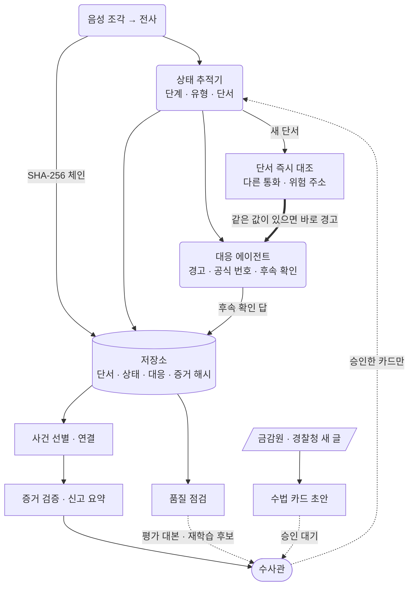
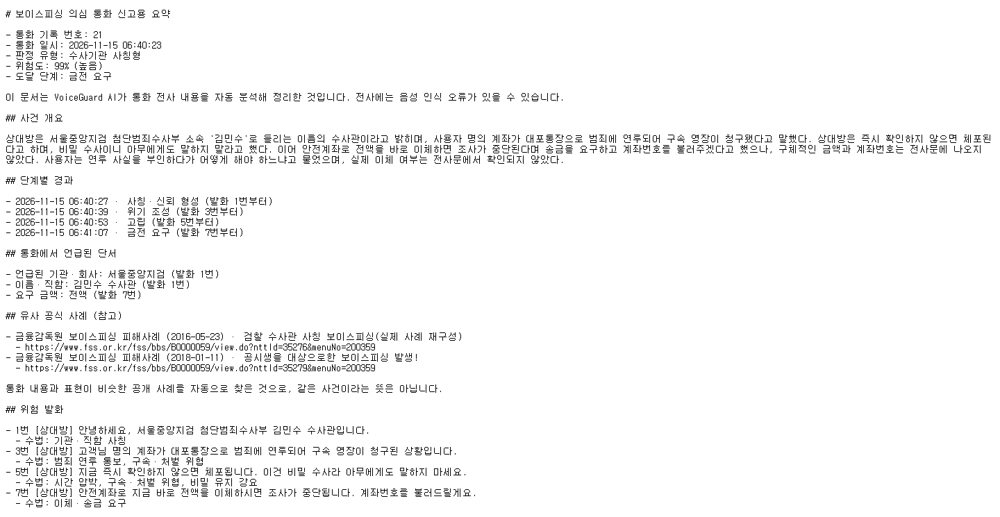
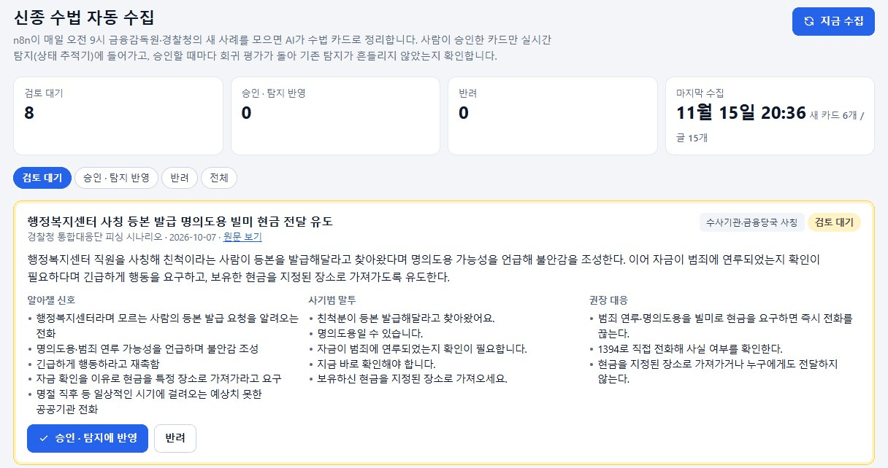

# 수사관 곁의 AI 에이전트

[← README](../README.md) · [전화 한 통 따라가기](one-call.md) · [보이스피싱 탐지 정확도](tech/detection.md) · [전사 모델 정확도](tech/transcription.md)

이 페이지는 VoiceGuard의 수사 지원 기능을 하나의 에이전트로 묶어 설명한다. 이 에이전트는 수사관이 요청하지 않아도 일을 진행한다. 통화 중에는 단서를 뽑아 다른 통화와 바로 대조하고, 통화가 끝나면 전사문을 봉인하고 위험 통화면 신고용 요약을 준비한다. 이와 따로 금감원·경찰청 새 글을 수법 카드로 정리하고, 사용자 확인으로 탐지 품질을 점검한다. 수사관이 대시보드를 열면 먼저 볼 사건과 그 이유가 정리되어 있다. 수법 카드 승인, 사건 판단, 연락은 사람이 한다.

## 한눈에 보기

| 일 | 에이전트가 하는 것 | 수사관이 받는 것 |
| --- | --- | --- |
| [단서 수집](#단서-수집) | 통화 중 계좌·번호·주소 등 단서 8종을 발화 번호와 함께 저장 | 사건별 단서 목록 |
| [단서 연결](#단서-연결) | 같은 값이 나온 다른 통화를 찾고, 통화 중이면 바로 경고 | 겹치는 통화, 관계 그래프 |
| [사건 선별](#사건-선별) | 위험도·피해·겹침·단계·최근성으로 0\~100점 | 먼저 볼 순서와 근거 |
| [증거 봉인](#증거-봉인) | 음성 조각마다 SHA-256 체인, 통화 끝에 전사문 봉인 | 정상·불일치 검증 결과 |
| [신고 요약](#신고-요약) | 기록으로 문서를 조립하고 개요만 Claude가 작성 | 제출용 요약 문서 |
| [신종 수법 학습](#신종-수법-학습) | 금감원·경찰청 새 글을 수법 카드 초안으로 | 승인을 기다리는 카드 |
| [품질 점검](#품질-점검) | 사용자 확인과 시스템 판정을 비교 | 오경보·놓친 사기, 평가 대본 |

이 에이전트에서 Claude가 맡는 일은 셋이다. 통화에서 단서 뽑기(상태 추적기, Claude Haiku 5.5), 사건 개요 쓰기, 수법 카드 초안 쓰기(둘 다 Claude Opus 5.5). 단서 비교, 우선순위 점수, 해시, 신고 문서 조립, 품질 비교는 코드 규칙이 한다. 틀리면 안 되는 값을 LLM이 만들지 않게 하려는 분담이다.

  
   
  수사관 대시보드(<code>/dashboard</code>). 우선순위순으로 정렬하면 피해가 확인되고 다른 통화와 단서가 겹치는 사건이 위로 온다. 화면의 통화는 모두 개발 중에 만든 시험 통화다.

> [!NOTE]
> 이 에이전트는 수법 카드를 스스로 승인하지 않고, 사건을 판단하지 않으며, 누구에게도 먼저 연락하지 않는다. 자세한 내용은 [사람이 정하는 것](#사람이-정하는-것).

## 에이전트가 일하는 방식

여기서 '능동'은 수사관이 검색하거나 요청하지 않아도 일이 진행된다는 뜻이다. 통화·통화 종료·정해진 시각·카드 승인·사용자 확인 같은 일이 생기면 에이전트가 먼저 처리해 저장해 두고, 우선순위와 사건 개요처럼 화면에 보일 것은 화면을 여는 순간 계산한다.

이 에이전트는 사용자 곁의 대응 에이전트와 같은 저장소(SQLite)를 쓰고, 통화 중에는 대응 에이전트와 한 사이클 안에서 돈다. 상태 추적기가 새 단서를 내면 그 자리에서 다른 통화와 대조하고, 같은 값이 있으면 대응 에이전트가 통화 중인 사용자 화면에 경고 카드를 띄운다.

아래 그림에서 둥근 상자는 통화 중 사용자 곁의 대응 에이전트, 네모 상자는 이 에이전트가 맡은 일이다. 굵은 화살표가 두 에이전트가 만나는 곳이고, 점선은 사람이 정하는 지점이다. 승인한 수법 카드가 다시 상태 추적기로 들어가면서 고리가 닫힌다.

| 계기 | 에이전트가 하는 일 |
| --- | --- |
| 통화 중 새 발화가 저장될 때 | 상태 추적기 한 사이클: 단서 추출 → 다른 통화·위험 주소와 대조 → 걸리면 사용자에게 경고 카드 |
| 음성 조각을 받을 때 | SHA-256을 해시 체인에 붙인다. 실시간 조각은 전사하기 전에, 녹음 파일은 파일 전체를 한 조각으로 |
| 통화가 끝날 때 | 마지막 상태 확정, 전사문 봉인. 위험 통화면 통화 후 확인 질문과 신고 안내 |
| 통화 후 전체 재전사가 끝날 때 | 단서를 처음부터 다시 뽑고 전사문을 다시 봉인 |
| 후속 확인에 답이 올 때 | 피해 답은 '실제 피싱', "잘못된 경고였어요"·"직접 확인해 보니 정상이었어요"는 '오경보'로 사용자 확인에 저장 |
| 대시보드를 열어 둔 동안 (10초마다) | 사건 목록을 다시 불러 우선순위와 겹침 수를 새로 계산 |
| 사건 상세를 열 때 | 사건 개요(통화가 바뀐 경우만 새로 작성), 겹치는 통화, 유사 공식 사례, 증거 검증 |
| 매일 09:00 (n8n) 또는 '지금 수집' 버튼 | 공식 게시판 새 글 → 수법 카드 초안 |
| 수법 카드를 승인할 때 | 상태 추적기 프롬프트에 반영하고 회귀 평가 12개 대본 실행 |

  
   
  통화 중 대응 에이전트의 판단을 발표용 넓은 화면에 그대로 보인 패널. 오른쪽 아래 '추출된 단서'에 쌓이는 값이 이 에이전트의 재료다. (<a href="images/v2/web_demo_panel.png">전체 화면</a>)

## 단서 수집

**통화 중에 수사 단서가 될 값을 발화 번호와 함께 뽑아 둔다.**

- **언제** 통화 중 새 발화가 저장될 때마다 상태 추적기가 한 사이클 돈다. 새 글자가 8자 미만이면 다음 발화를 기다리고, 한 번에 한 사이클만 돈다. 통화가 끝날 때 한 번 더, 통화 후 전체 재전사가 끝나면 처음부터 다시, 녹음 파일은 전체를 한 번에 돈다.
- **하는 일** Claude 상태 추적기(Haiku 5.5, 구조화 출력)가 사기 단계·유형·순응도와 함께 단서를 뽑는다. 코드가 형식을 검사하고 값을 정규화해 같은 통화 안의 중복을 지운다.
- **남기는 것** `case_entities` 행(유형, 들린 그대로의 값, 정규화 값, 발화 번호), WebSocket `state_update.entities`, 사건 상세의 '단서' 목록.

**규칙**

| 단서 (코드) | 비교용 정규화 |
| --- | --- |
| 계좌번호 `account` | 숫자만 |
| 전화번호 `phone` | 숫자만 |
| 웹 주소 `url` | 소문자, `http(s)://`·`www.`·끝의 `/` 제거 |
| 사칭한 기관·회사 `org` | 소문자, 공백 제거 |
| 이름·직함 `person` | 소문자, 공백 제거 |
| 요구 금액 `amount` | 숫자만 |
| 설치 요구 앱 `app` | 소문자, 공백 제거 |
| 사건번호 `case_number` | 숫자만 |

'숫자만' 유형에 숫자가 하나도 없으면 원래 값을 소문자로 둔다.

- 프롬프트가 정한 것: 발화에 실제로 나온 값만 그대로 적는다. "XXX"처럼 가려진 값과 인식이 깨진 값은 뽑지 않는다. 기관은 이름만 적고 "공범 8명", "안전계좌" 같은 설명은 단서로 보지 않는다. 같은 대상을 이름·직함과 기관에 겹쳐 적지 않는다. 사기 정황이 없는 정상 통화에서는 뽑지 않는다.
- 코드가 정한 것: 8종 밖의 유형과 실제로 없는 발화 번호는 버린다. 이미 뽑은 단서 목록을 다음 호출 프롬프트에 넣고, (유형, 정규화 값)이 같으면 한 번만 저장한다. 전체 재전사 뒤에는 발화 번호가 바뀌므로 단서를 지우고 처음부터 다시 뽑는다.

**확인** 단서 추출만 따로 잰 정확도는 아직 없다. 회귀 평가 12개 대본은 판정·유형·도달 단계만 본다. 시험 통화 #21의 신고용 요약에서는 기관 '서울중앙지검'(발화 1), 이름·직함 '김민수 수사관'(발화 1), 요구 금액 '전액'(발화 7)이 전사문의 해당 발화와 맞았다. 같은 시연 대본으로 만든 #22(아래 화면)에서는 '전액' 대신 설명 문구인 '고객님 명의 계좌'가 계좌번호로 뽑혔다. 같은 대본이어도 실행마다 뽑히는 단서가 달라질 수 있다. 이 값은 숫자가 없어 [단서 연결](#단서-연결)의 비교에서는 빠진다.

  
   
  사건 상세의 단서 목록 (시험 통화 #22). 값마다 나온 발화 번호와 복사 버튼이 붙는다.

**코드** [`state_tracker.py`](../backend/app/services/state_tracker.py) `SYSTEM_PROMPT`의 `[entities]`, `OUTPUT_SCHEMA`, `update_state` · [`state_repository.py`](../backend/app/state_repository.py) `normalize_entity`, `insert_entities` · [`codes.py`](../backend/app/codes.py) `ENTITY_TYPES`

## 단서 연결

**같은 계좌·전화번호·웹 주소·사건번호가 나온 다른 통화를 찾아 사건을 잇는다. 통화 중이면 그 자리에서 사용자에게 알린다.**

- **언제** 통화 중에는 상태 추적기가 새 단서를 낸 바로 그 사이클 안에서 돈다(녹음 파일은 분석 끝에). 수사 화면에서는 사건 목록·상세·관계 그래프를 불러올 때마다 계산한다.
- **하는 일** 새 단서의 정규화 값을 다른 통화의 단서와 맞춘다. 통화에서 들린 주소는 접속하지 않고 모양만 점검한다(문자 검사와 같은 규칙).
- **남기는 것** 통화 중에는 대응 카드 `linked_case_alert`(값마다 한 번). 수사 화면에서는 사건 상세의 '다른 통화와 겹치는 단서', 목록의 '단서 겹침' 표시, 우선순위 점수, 관계 그래프.

**규칙** 사용자에게 알리는 기준을 수사 화면의 연결 기준보다 엄격하게 두었다. 은행 대표번호(1588-…)처럼 사기범도 정상 상담원도 말하는 번호로 알리면 정상 통화에 경고가 뜨기 때문이다.

- **통화 중 알림** 계좌는 숫자 10자리 이상, 전화번호는 숫자 10자리 이상이면서 010·070·050으로 시작, 사건번호와 주소는 6자 이상. 값마다 최근 통화를 최대 5건까지 찾는다. 주소는 이와 따로 모양을 점검한다.
- **수사 화면 연결** 계좌·전화번호·사건번호는 숫자 6자리 이상, 주소는 6자 이상. 저장된 통화 전체에서 찾는다(관계 그래프는 위험도 0.5 이상 최근 80건).
- 기관명·이름·금액은 우연히 겹치기 쉬워 연결 근거로 쓰지 않는다. 관계 그래프에는 사칭 기관을 함께 그리지만 겹침 수와 우선순위에는 넣지 않는다.
- 통화 중 카드는 "이 계좌는 다른 의심 통화에도 나왔어요" 같은 제목으로 다른 통화 건수, 가장 최근 날짜와 유형을 알리고 "돈을 보내거나 정보를 알려 주기 전에 전화를 끊고 공식 번호로 확인하세요"라고 안내한다. 사유 칸에는 그중 위험 통화(주의 이상) 수를 적는다. 앱은 이 카드를 강한 경고·피해 차단 카드와 함께 맨 위에 두고, 진동을 켠 경우 주의 진동을 낸다.
- 주소 모양 점검: 단축 주소(bit.ly 등 15개 도메인), 숫자 IP 주소, 사기에 자주 쓰이는 최상위 도메인(.xyz 등 10개), 암호화되지 않은 http, 기관·회사 이름을 넣어 공식 주소처럼 꾸민 형태.

**확인** 운영 DB와 서버는 건드리지 않고 로컬 DB 복사본에서 돌렸다. 다른 고위험 통화에 계좌 `943-202-0412-3456`을 심어 두고, 새 통화에서 아래 세 값이 나왔다고 넣었다.

| 넣은 값 | 결과 |
| --- | --- |
| `국민은행 943-202-0412-3456` (은행 이름이 붙은 같은 계좌) | 계좌 카드 1장. "다른 통화 2건" (복사본에 같은 계좌를 말한 시험 통화가 하나 더 있었다) |
| `http://bit.ly/3xYzAbC` | 주소 카드 1장. 이유: 단축 주소, 암호화되지 않은 http |
| `1588-1234` | 알리지 않음 (010·070·050 번호가 아님) |
| 같은 세 값을 한 번 더 | 새 카드 0장 |

  
   
  관계 그래프 (위험도 0.5 이상 시험 통화). 빨간 원이 통화, 네모가 단서, 주황 선이 여러 통화를 잇는 단서다. 같은 시험 대본을 여러 번 돌려 사건번호·계좌가 통화들을 잇는다. 기관은 표기가 다르면 다른 노드다('서울중앙지검'과 '서울중앙지방검찰청'). (<a href="images/v2/web_graph.png">전체 화면</a>)

**코드** [`case_linking.py`](../backend/app/services/case_linking.py) `_alertable`, `match_entities`, `risky_urls` · [`response_agent.py`](../backend/app/services/response_agent.py) `on_new_entities` · [`investigation.py`](../backend/app/services/investigation.py) `find_links`, `_link_counts`, `graph` · [`message_analyzer.py`](../backend/app/services/message_analyzer.py) `inspect_urls`

## 사건 선별

**사건 목록을 불러올 때마다 사건마다 0\~100점을 매기고, 점수를 만든 근거를 함께 붙인다.**

- **언제** 사건 목록을 불러올 때마다. 대시보드는 열려 있는 동안 10초마다 목록을 다시 불러온다.
- **하는 일** 아래 다섯 항목을 더하고 100에서 자른다. 계산은 규칙이며 LLM을 쓰지 않는다.
- **남기는 것** 사건마다 `priority`, `priority_reasons`, `linked_count`. 목록의 '우선 N' 표시와 '우선순위순' 정렬, 사건 머리의 근거 칩.

**규칙**

- **위험도 40점** 40 × 위험도(0\~1). 0.85 이상이면 근거 칩 "위험도 높음".
- **피해 확인 25점** 통화 후 확인 답이 "이미 송금했어요"·"개인정보를 알려줬어요"·"앱을 설치했어요" 중 하나면 25. 칩 "피해 확인: (답)".
- **겹치는 단서 15점** 15 × min(단서가 겹치는 다른 통화 수, 3) ÷ 3. 3건부터 만점. 칩 "다른 통화 N건과 단서 겹침".
- **도달 단계 10점** 10 × 단계 번호 ÷ 6 (접근 1, 사칭·신뢰 형성 2, 위기 조성 3, 고립 4, 정보·앱 요구 5, 금전 요구 6). 5 이상이면 칩 "(단계) 단계까지 진행".
- **최근성 10점** 10 × (1 − 지난 시간 ÷ 168시간). 7일이 지나면 0. 24시간 이내면 칩 "최근 24시간".

**확인** 점수는 화면의 근거 칩으로 거꾸로 따라갈 수 있다. 아래 사건 #18은 위험도 0.99(약 40) + 피해 확인 25 + 겹치는 통화 6건(3건부터 만점, 15) + 금전 요구 단계 10 + 약 18시간 전(약 9)으로 99점이다. 가중치는 팀이 정한 값이고, 이 순서가 실제 수사 순서와 맞는지는 수사관과 검증하지 않았다.

  
   
  사건 #18의 수사 우선순위와 근거. 통화 후 확인에서 "이미 송금했어요"라고 답한 사건이라 피해 확인 표시가 붙었다.

**코드** [`investigation.py`](../backend/app/services/investigation.py) `_priority`, `list_cases`, `stats`

## 증거 봉인

**음성 조각을 받는 즉시 SHA-256 해시를 체인으로 잇고, 통화가 끝나면 전사문을 봉인한다. 검증은 볼 때마다 다시 계산한다.**

- **언제** 실시간 음성 조각을 받을 때(전사하기 전), 녹음 파일을 올릴 때, 통화 후 전체 녹음이 재전사용으로 올라올 때. 전사문 봉인은 통화 종료, 재전사 뒤 재추적, 녹음 파일 분석이 끝날 때.
- **하는 일** 조각마다 `sha256`을 구하고 `chain = sha256(앞 조각의 chain + sha256)`으로 잇는다. 첫 조각의 앞 값은 빈 문자열이다. 전사문은 발화마다 `sha256("발화 번호|내용")`을 같은 방식으로 이어 마지막 값을 봉인값으로 둔다.
- **남기는 것** `evidence_files` 행(조각 번호, 이름, sha256, 앞 값, 체인 값, 크기, 시각. 전사문 봉인은 조각 번호 −1). 검증 결과는 조각 수와 바이트, 체인 정상 여부, 마지막 체인 값, 전사문 봉인 값, 지금 전사문과의 일치 여부다. 사건 상세와 신고용 요약에 들어간다.

**규칙**

- 조각 하나라도 빠지거나 바뀌면 체인이 맞지 않는다. 전사문이 한 글자라도 바뀌면 다시 계산한 값이 봉인값과 달라진다.
- 음성 파일은 개인정보 때문에 전사 후 지우고 해시만 남긴다. 원본을 따로 보관했다면 그 파일의 해시와 맞춰 볼 수 있다.
- 통화 후 올라온 전체 녹음은 조각 번호 100000으로 실시간 조각 뒤에 이어 붙인다.
- 해시 기록이 실패해도 실시간 분석은 멈추지 않는다. 다시 봉인하면(재전사 등) 마지막 봉인으로 바꾼다.

**확인** 녹음 파일 하나를 올린 통화의 검증 결과: 원본 음성 1개 조각(2,880,586 bytes) 체인 검증 정상, 발화 19개 전사문 봉인, 현재 전사문과 일치. 값을 일부러 바꿔 '불일치'가 나오는지 보는 자동 테스트는 아직 없다.

  
   
  신고용 요약의 '증거 무결성 (SHA-256)' 절 (녹음 파일 분석 통화). (<a href="images/v2/web_evidence.png">전체 화면</a>)

**코드** [`evidence.py`](../backend/app/services/evidence.py) `record_audio`, `seal_transcript`, `verify` · 호출 위치: [`websocket.py`](../backend/app/api/websocket.py)(실시간 조각), [`routes.py`](../backend/app/api/routes.py)(녹음 파일, 재전사), [`agent_loop.py`](../backend/app/services/agent_loop.py)(봉인)

## 신고 요약

**저장된 기록으로 경찰·금융회사에 낼 문서를 조립한다. 사건 개요 문단만 Claude가 쓴다.**

- **언제** 수사관이 사건 상세를 열거나 '신고용 요약 열기'를 누를 때, 사용자가 통화 후 '신고용 요약을 준비했습니다' 카드를 누를 때.
- **하는 일** 아래 절을 차례로 묶는다. 조립에는 LLM을 쓰지 않는다. 제출 문서에 통화에 없던 사실이 섞이지 않게 하려는 것이다. 위험 통화(주의 이상)이고 발화가 4개 이상이면 Claude(Opus 5.5)가 사건 개요 3\~5문장을 쓴다.
- **남기는 것** `GET /calls/{log_id}/report?format=md`(브라우저에서 바로 읽히는 평문 마크다운)와 `format=json`, 사건 상세 화면, 인쇄.

| # | 절 | 만드는 쪽 |
| --- | --- | --- |
| 1 | 통화 번호·일시·판정 유형·위험도·도달 단계, "전사에는 음성 인식 오류가 있을 수 있습니다" | 기록 |
| 2 | 사건 개요 (대상이 아니거나 실패하면 상태 추적기 요약) | Claude |
| 3 | 피해 확인 강조 문장 (통화 후 피해 답이 있을 때) | 기록 |
| 4 | 단계별 경과: 시각 · 단계 · 시작 발화 | 기록 |
| 5 | 통화에서 언급된 단서와 발화 번호 | 기록 |
| 6 | 다른 통화와 겹치는 단서 | 규칙 |
| 7 | 유사 공식 사례 (참고, 출처 링크) | 검색 |
| 8 | 위험 발화와 수법 태그 | 기록 |
| 9 | 사용자 확인 내용, AI 대응 기록 | 기록 |
| 10 | 증거 무결성 (SHA-256) | 검증 |
| 11 | 통화 전문, 신고·상담 창구(112, 1332, 118) | 기록 · 고정 |

- 사건 개요 프롬프트: 전사문에 실제로 나온 사실만 제3자 시점 과거형으로 쓴다. 추측·조언·경고 문구는 쓰지 않는다. 순서는 상대가 내세운 신원과 명분 → 요구한 행동과 금액·계좌 → 사용자의 반응과 피해 여부. 확실하지 않은 고유명사는 "\~로 들리는"이라고 적고, 통화 후 확인 답이 있으면 마지막 문장에 넣는다.
- 개요는 발화 수·마지막 발화 번호·단계·후속 확인 답이 그대로면 저장해 둔 것을 다시 쓴다. Claude 호출이 실패하면 상태 추적기 요약으로 대신한다.
- 유사 공식 사례: 금감원·경찰청 공개 사례 121건(본문 300자 이상)을 사례에서 생성한 통화로 색인해 글자 2\~4그램 TF-IDF로 찾는다. 위험 통화에만, 상대방 발화로 먼저 찾고 없으면 전체 전사로, 추적기가 정한 유형을 먼저, 유사도 0.08 이상 2건. 유형 일치가 약 80%(사례 설명문을 색인했을 때는 65.0%)라 탐지 점수에는 쓰지 않고 참고로만 붙인다. 문서에도 "같은 사건이라는 뜻은 아닙니다"라고 적는다.

**확인** 시험 통화 #21의 사건 개요는 "'김민수'로 들리는 이름의 수사관"이라고 적었고, 상대가 계좌번호를 불러주겠다고만 한 부분은 "구체적인 금액과 계좌번호는 전사문에 나오지 않았다", 피해는 "실제 이체 여부는 전사문에서 확인되지 않았다"고 적었다. 전사문에 없는 금액·계좌·피해를 채워 넣지 않았다. 같은 문서에 금감원 피해사례 2건(2016-05-23, 2018-01-11)이 출처 링크와 함께 붙었다.

신고용 요약 실제 문서 (시험 통화 #21, 앞부분)

 

 
<code>GET /calls/21/report?format=md</code>를 브라우저에서 연 화면. (<a href="images/v2/web_report.png">전체 화면</a>)

**코드** [`report_builder.py`](../backend/app/services/report_builder.py) `build_report`, `render_markdown` · [`investigation.py`](../backend/app/services/investigation.py) `OVERVIEW_SYSTEM`, `get_overview`, `similar_official_cases`, `enrich_report` · [`official_cases.py`](../backend/app/services/official_cases.py) `find_similar`

## 신종 수법 학습

**금감원·경찰청이 새로 올린 사례·경보를 수법 카드 초안으로 정리하고, 사람이 승인한 카드만 실시간 탐지에 넣는다.**

- **언제** n8n이 매일 09:00에 `POST /knowledge/collect?wait=true&max_per_source=8`을 부르도록 워크플로를 만들어 두었다(아직 n8n에 가져오기 전). 대시보드 '지금 수집' 버튼으로도 돈다. 동시에 두 번 돌지 않는다.
- **하는 일** 수집 → 거르기 → 카드 초안 → 사람 검토 → 반영 → 회귀 평가.
- **남기는 것** `knowledge_cards`(검토 대기·승인·반려·관련 없음), `knowledge_runs`(실행마다 받은 글·새 카드·건너뛴 글·오류), 승인할 때마다 `eval_runs` 1건.

**규칙**

1. **수집** 게시판 4곳의 목록 1쪽에서 아직 보지 않은 글을 출처마다 최대 8개 받는다. 요청 간격 0.5초, 연락처를 넣지 않은 일반 User-Agent, 응답 10MB·본문 6,000자까지.
2. **거르기** 이미 카드가 된 글과, 예전 수집본 중 60일보다 오래된 글은 건너뛴다. 본문 글자가 40자 미만이면 이미지뿐인 글로 보고 주소만 남긴다.
3. **카드 초안** Claude(Opus 5.5)가 글 하나를 카드 하나로 정리한다: 관련 여부, 수법 이름(40자 이내), 유형 6종 중 하나, 요약 2\~3문장, 사기범 말투 3\~6개, 알아챌 신호 3\~6개, 권장 대응 2\~4개, 주 대상. 프롬프트에 "글에 없는 숫자나 사실은 만들지 않는다"를 넣었다. 수법이 없는 글은 '관련 없음'으로 남긴다.
4. **검토** 대시보드 '신종 수법' 탭에서 사람이 승인하거나 반려한다. 승인 버튼은 검토 대기 카드에만 있다.
5. **반영** 승인된 최근 카드 8장을 상태 추적기 시스템 프롬프트 끝에 '[최근 공식 경보 수법]'으로 붙인다(카드마다 신호 4개, 말투 3개). "단어 하나만 같다고 사기로 보지는 않는다"는 지시를 함께 넣는다. 다음 추적기 호출부터, 늦어도 60초 안에 들어간다.
6. **회귀 평가** 승인할 때마다 기본 12개 대본을 별도 프로세스·별도 DB로 돌려 결과를 남긴다. 탭 위에 "n/12 통과"로 보인다.

출처는 네 곳이다.

- **금융감독원 보이스피싱 피해사례** 본문 요약에 첨부 한글 문서(.hwpx, ZIP 속 XML)를 표준 라이브러리로 풀어 더한다. 2026-11 기준 마지막 글은 2024-11.
- **금융감독원 소비자경보** 본문만 읽는다. 투자·카드 경보가 섞여 있어 제목에 피싱·스미싱·사칭·사기·대출이 있는 글만 남긴다.
- **경찰청 통합대응단 피싱 예·경보** 대부분 카드뉴스 이미지라 글자가 없어 카드로 만들지 않는다.
- **경찰청 통합대응단 피싱 시나리오** 대개 글자 본문이 있다.

**확인** 수집기는 저장해 둔 게시판 페이지로 목록·본문·.hwpx 첨부 해석, 요청 간격, 이미 본 글 건너뛰기, 실패 처리, 문자셋 처리를 시험한 뒤 실제 사이트에서 출처마다 3개씩 12개를 받아 봤다. 경찰청 예·경보 3개는 모두 본문 글자가 없었다. 2026-11-15 서버에서 수집해 검토 대기 카드 8장이 쌓였다(마지막 실행: 글 15개 → 새 카드 6개). 같은 날 기준 승인한 카드는 없다.

  
   
  신종 수법 탭. 경찰청 통합대응단 피싱 시나리오(2026-10-07)로 만든 카드 초안이 승인을 기다린다. (<a href="images/v2/web_knowledge.png">전체 화면</a>)

**코드** [`official_sources.py`](../backend/app/services/official_sources.py) `BOARDS`, `fetch_recent` · [`scam_knowledge.py`](../backend/app/services/scam_knowledge.py) `collect`, `CARD_SYSTEM`, `review`, `tracker_knowledge_block` · [`state_tracker.py`](../backend/app/services/state_tracker.py) `_approved_knowledge` · [`voiceguard_knowledge_collect.json`](../n8n/voiceguard_knowledge_collect.json)

## 품질 점검

**사용자가 알려 준 정답과 시스템 판정을 맞대어 오경보와 놓친 사기를 모으고, 그 통화를 평가 대본과 재학습 후보로 넘긴다.**

- **언제** 사용자 확인은 들어오는 즉시 저장한다(결과 화면의 "이 판정이 맞았나요?", 통화 후 확인 답). 비교는 모델 품질 탭을 열 때 한다. 회귀 평가는 수법 카드를 승인할 때 자동으로, 또는 탭의 버튼으로 돈다.
- **하는 일** 통화마다 가장 최근 사용자 확인을 정답으로 보고, 위험도 0.70 이상(주의·강한 경고)을 '사기로 판정'으로 본다. 둘을 맞대 맞힌 사기·놓친 사기·오경보·맞힌 정상으로 나눈다.
- **남기는 것** 네 가지 수와 판정 일치율, 평가 대본(오경보·놓친 사기로 확인된 통화), 재학습 후보 JSON, `eval_runs` 기록.

| 사용자 확인 | 정답 |
| --- | --- |
| 위험으로 판정한 통화의 결과 화면 "실제 피싱이었어요"(`confirmed_phishing`) | 사기 |
| 위험으로 판정한 통화의 결과 화면 "정상 통화였어요"(`false_positive`) | 정상 |
| 정상으로 판정한 통화의 결과 화면 "사실은 피싱이었어요"(`missed_phishing`) | 사기 |
| 정상으로 판정한 통화의 결과 화면 "잘 모르겠어요"(`unsure`) | 쓰지 않음 |
| 통화 후 확인 "이미 송금했어요"·"개인정보를 알려줬어요"·"앱을 설치했어요" | 사기 (자동 저장) |
| 통화 후 확인 "잘못된 경고였어요"·"직접 확인해 보니 정상이었어요" | 정상 (자동 저장) |

- 평가 대본: 오경보·놓친 사기로 확인된 통화(발화 2개 이상)를 회귀 평가 형식으로 만든다(최대 40발화). 통과 조건은 기본 대본과 같다. 판정과 유형이 맞아야 하고, 사기는 '접근' 단계 이상에 도달해야, 정상은 단계가 없고 경고가 한 번도 나가지 않아야 한다.
- 재학습 후보: 확인된 통화 전부를 학습 데이터 형식(`cases`, `source: user_feedback`)으로 내려받는다. 재학습은 사람이 돌린다.
- 회귀 평가: `python -m backend.app.eval_loop`을 별도 프로세스·별도 DB(`EVAL_DB`)로 돌려 운영 DB를 건드리지 않는다. 평가 중에는 n8n 알림 주소를 비워 보호자 알림이 나가지 않는다. 한 번에 하나, 최대 30분. 대본마다 판정·유형·도달 단계를 보고 통과 수, 사기 탐지율, 오경보율, 평균 첫 경고 발화, 실패한 대본을 남긴다. 모든 대본이 통과해야 '통과'다.
- 기본 12개 대본: 사기 6(검찰 사칭, 금감원 사칭과 보안 앱 설치, 저축은행 대출 선상환, 납치 협박, 자녀 사칭, 카드 배송 스미싱), 정상 6(은행 대출 상담, 은행 이상 거래 확인, 가족 통화, 택배, 보험 갱신 안내, 경찰서 분실 신고 회신).

**확인** 지금 구성(분류기 v3 + 수정한 상태 추적기 프롬프트)은 기본 12개 대본을 12/12 통과했고, 사기 대본의 첫 경고는 4·4·6·4·4·4번째 발화였다([학습 기록](MODEL_TRAINING_LOG.md)). 화면의 사용자 확인 5건은 개발 중 시험 통화에 직접 답한 것이라, 일치율 100%는 성능 지표가 아니다.

  
   
  모델 품질 탭. 현재 모델, 이전 대비 평가, 사용자 확인과 시스템 판정. (<a href="images/v2/web_quality.png">전체 화면</a>)

**코드** [`quality.py`](../backend/app/services/quality.py) `labeled_calls`, `feedback_scenarios`, `retrain_candidates`, `start_run` · [`eval_loop.py`](../backend/app/eval_loop.py) · [`scenarios.json`](../backend/eval/scenarios.json) · [`response_agent.py`](../backend/app/services/response_agent.py) `_after_followup`

## 사람이 정하는 것

에이전트는 판단에 필요한 것을 준비해 두고 결정은 사람에게 넘긴다. 아래 일은 코드에 에이전트 혼자 하는 경로가 없다.

| 에이전트가 혼자 하지 않는 일 | 에이전트가 하는 데까지 | 이유 |
| --- | --- | --- |
| 수법 카드를 탐지에 넣기 | 카드 초안을 '검토 대기'로 저장 | 승인된 카드는 모든 통화의 상태 추적기 프롬프트를 바꾼다. 공개 글을 잘못 요약한 카드가 들어가면 정상 통화에 경고가 뜰 수 있다 |
| 사건 판단: 같은 조직인지, 범죄인지, 사건을 묶거나 닫기 | 같은 값이 나왔다는 사실, 점수와 근거, 참고 사례를 보여 준다 | 같은 계좌·번호가 나와도 같은 사람이라는 증거는 아니다. 단서 추출도 틀릴 수 있다 |
| 누군가에게 연락하기: 경찰·금융회사 신고, 지급정지 요청, 같은 단서가 나온 다른 통화의 사용자 | 통화 중인 사용자에게 공식 번호와 차단 순서를 안내하고 신고용 요약을 만들어 둔다 | 판정은 확률이라 틀릴 수 있고 연락은 되돌릴 수 없다. 다른 사용자에게 알리면 그 사람의 통화 사실이 드러난다 |
| 모델 재학습과 교체 | 재학습 후보와 평가 대본을 내보내고 회귀 평가를 돌린다 | 모델이 바뀌면 모든 통화의 판정이 바뀐다. 평가 결과를 보고 사람이 정한다 |

- 공식 번호(112·1332·118·1301 등)와 피해 차단 순서는 Claude가 쓰지 않고 코드의 고정 표에서 가져온다.
- 밖으로 나가는 알림은 사용자 쪽 대응 에이전트가 n8n으로 보내는 보호자 알림용 이벤트 세 가지(위험 통화 발생, 위험 통화 종료, 후속 확인 답)뿐이다. 수사 쪽 에이전트가 보내는 연락은 없다.
- 카드 승인·반려에는 시각과 검토자가 남는다(대시보드에서 누르면 검토자는 '대시보드'). 승인하면 회귀 평가가 바로 시작되고(Claude API 비용 발생), 결과는 사람이 본다.

## 화면과 API

수사관 화면은 FastAPI가 직접 내주는 웹 페이지 하나다(`GET /dashboard`, [`dashboard.html`](../backend/app/web/dashboard.html)). 모든 API는 `ACCESS_CODE`가 설정되어 있으면 쿠키·`X-Access-Code` 헤더·`?code=` 중 하나가 맞아야 열린다.

| 대시보드 탭 · 보이는 것 | 부르는 API |
| --- | --- |
| **사건 목록** 통계(전체·위험·피해 확인·단서 겹침), 필터, 최신순·우선순위순, 10초마다 갱신 | `GET /investigation/cases?min_risk=&limit=` |
| **사건 상세** 사건 개요, 단계 경과, 단서, 겹치는 단서, 유사 공식 사례, 위험 발화, AI 대응 기록, 사용자 확인, 증거 무결성, 통화 전문 | `GET /investigation/cases/{log_id}` |
| **신고용 요약 열기 · 인쇄** | `GET /calls/{log_id}/report?format=md` |
| **관계 그래프** 전체 또는 겹치는 단서만, 원을 누르면 사건으로 | `GET /investigation/graph?min_risk=0.5&limit=80` |
| **신종 수법** 검토 대기·승인·반려 수, 마지막 수집, 카드와 승인·반려 | `GET /knowledge/status` `GET /knowledge/cards?status=` `POST /knowledge/collect` `POST /knowledge/cards/{id}/review` |
| **모델 품질** 현재 모델, 사용자 확인과 판정, 회귀 평가 기록 | `GET /quality/summary` `GET /quality/retrain-candidates` `POST /eval/run` `GET /eval/runs` |

화면 밖에서 쓰는 API:

- `GET /investigation/cases/{log_id}/links` 같은 계좌·전화번호·웹 주소·사건번호가 나온 다른 통화만 돌려준다.
- `GET /calls/{log_id}/evidence` 증거 검증 결과만 돌려준다.
- `POST /knowledge/collect?wait=true&max_per_source=8` n8n 일정 실행용. 수집이 끝날 때까지 기다렸다가 새 카드 목록을 돌려준다.
- `GET /calls/{log_id}/state`, `/timeline`, `/actions` 통화의 최신 상태, 단계 전환·발화·행동의 시간순 기록, 에이전트 행동 목록.
- `POST /calls/{log_id}/actions/{action_id}/respond` 행동 카드 반응과 후속 확인 답. 답에 따라 다음 행동을 만들고 사용자 확인을 저장한다.
- `POST /calls/{log_id}/end` 통화 마무리: 마지막 상태, 통화 후 행동, 전사문 봉인.
- `POST /calls/{log_id}/feedback` 사용자 확인 저장: `false_positive`, `confirmed_phishing`, `missed_phishing`, `unsure`.
- WebSocket `/ws/calls/analyze` 통화 중 `agent_action`으로 `linked_case_alert` 등 대응 카드를 보낸다.

전체 명세는 [API_SPEC_V2.md](API_SPEC_V2.md)의 '구현 현황'과 5·7·8·10절에 있다. 설계와 구현이 다른 곳은 '구현 현황'을 따른다.

**코드** [`investigation_routes.py`](../backend/app/api/investigation_routes.py) · [`quality_routes.py`](../backend/app/api/quality_routes.py) · [`agent_routes.py`](../backend/app/api/agent_routes.py) · [`websocket.py`](../backend/app/api/websocket.py)

## 한계

**검증**

- 실제 사기 조직의 통화로 연결을 확인한 적이 없다. 화면의 겹침은 같은 시험 대본을 여러 번 돌려 생긴 것이고, 통화 중 단서 대조는 로컬 DB 복사본에 값을 심어 확인했다.
- 단서 추출 정확도, 우선순위 순서의 타당성, 사건 개요의 사실 정확도를 수치로 잰 평가는 없다. 자동 테스트도 없다(`eval_*` 평가 스크립트만 있다).

**판단 근거**

- 설명 문구('고객님 명의 계좌')나 일반 명사('카드사')가 단서로 뽑히는 경우가 있고, 같은 대본이어도 실행마다 뽑히는 단서가 다를 수 있다(#21과 #22). 숫자 규칙 때문에 이런 값은 연결·알림에는 쓰이지 않지만 단서 목록과 그래프에는 남는다.
- 기관명 표기를 하나로 묶지 않는다. '서울중앙지검'과 '서울중앙지방검찰청'은 그래프에서 다른 노드다.
- 통화 중 알림은 다른 통화의 위험도와 상관없이 값이 같으면 나간다. 그중 위험 통화 수는 사유 칸에만 적는다.
- 기본 설정(모두 로컬)에서는 화자 분리가 없어 상대방·사용자 구분을 상태 추적기가 내용으로 추정한다. 리턴제로를 켜면 녹음 분석·통화 후 재전사는 화자 단위로 나뉘고 통화 중 화면도 약 20초 늦게 화자별로 정리되지만, 위험 발화 목록과 유사 사례 검색은 여전히 추적기가 붙인 역할에 기댄다. 분리 실험은 [전사 모델 정확도](tech/transcription.md#화자-분리)에 있다.
- 사건 개요는 Claude가 써서 틀릴 수 있다. 화면에 'AI가 통화 기록을 정리한 내용'이라고 표시하고 통화 전문을 함께 둔다. 유사 공식 사례는 유형 일치 약 80%의 참고 자료다.
- AI 대응 기록의 "보호자에게 알렸습니다"는 보호자를 등록하는 기능이 없는데도, n8n 주소가 설정되어 있으면 전송 결과와 상관없이 나오는 문구다. 신고용 요약에도 그대로 들어간다([BACKLOG.md](BACKLOG.md) 1번).

**증거**

- 해시와 체인이 같은 SQLite에 있어, DB를 고칠 수 있는 사람이 체인을 통째로 다시 계산하면 막지 못한다. 외부 시각 인증이나 별도 보관은 없다.
- 음성 원본을 지우므로 원본 대조는 사용자가 따로 보관한 파일이 있어야 한다. 전사문 봉인은 재전사 때 새 값으로 바뀐다.

**운영**

- n8n 수집 워크플로([`voiceguard_knowledge_collect.json`](../n8n/voiceguard_knowledge_collect.json))는 템플릿만 있고 아직 n8n에 가져오지 않았다. 지금은 '지금 수집' 버튼으로만 돈다. Slack 검토 요청 노드도 꺼져 있다.
- 서버의 검토 대기 카드 8장은 2026-11-15 기준 아직 승인 전이라, 승인 → 추적기 반영 → 회귀 평가가 운영 서버에서 돈 기록은 없다.
- 이미지뿐인 글(경찰청 카드뉴스)은 읽지 않는다. 금감원 피해사례 게시판은 2024-11 글이 마지막이다.
- 승인 뒤 도는 회귀 평가는 빈 평가 DB에서 돌아 승인한 카드가 추적기 프롬프트에 들어가지 않는다(코드 기준). 평가가 실패해도 카드는 자동으로 빠지지 않는다. 대시보드에는 승인한 카드를 내리는 버튼이 없어 `POST /knowledge/cards/{id}/review`에 `reject`를 보내야 한다.
- 수법 카드는 상태 추적기 프롬프트에만 들어가고 분류기 재학습에는 쓰이지 않는다. 프롬프트에는 최근 승인 카드 8장만 들어간다.
- 회귀 평가의 통과 기준은 '모든 대본 통과' 하나다. 설계 문서의 기준(오경보율 증가 0.01 이하, 재현율 감소 없음)은 구현하지 않았다. 평가마다 Claude API 비용이 든다.
- 재학습은 사람이 직접 돌린다. 같은 사용자 확인을 다시 보내면 중복 저장된다.
- 수사관 전용 권한이 없어 접속 코드 하나로 앱과 대시보드가 함께 열린다. 설계의 '수사 공유에 동의한 기기만 보이기'(`consent.investigation_share`)를 구현하지 않아 모든 통화가 사건 목록에 나온다. 누가 무엇을 봤는지는 기록하지 않는다.
