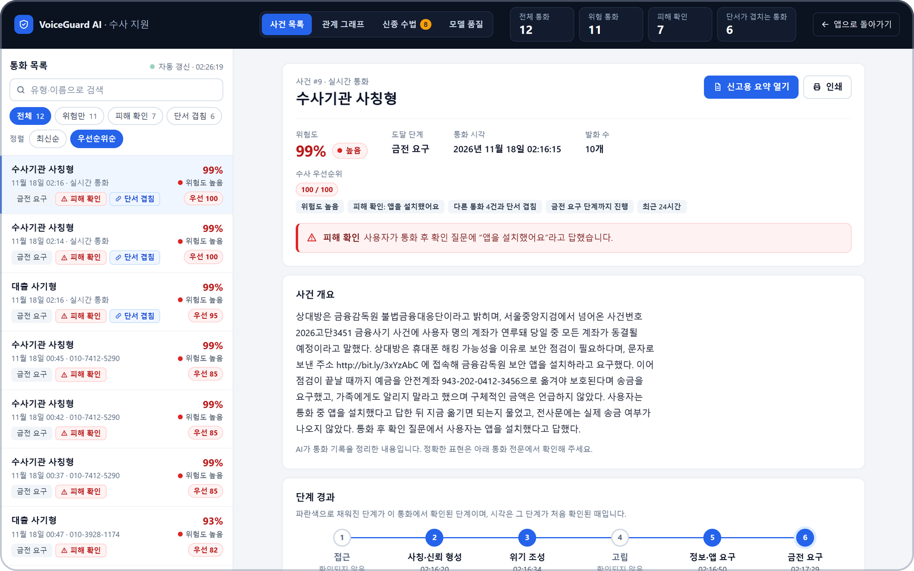
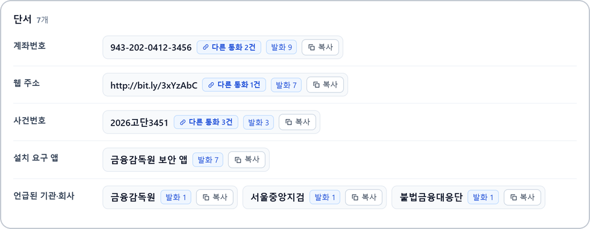
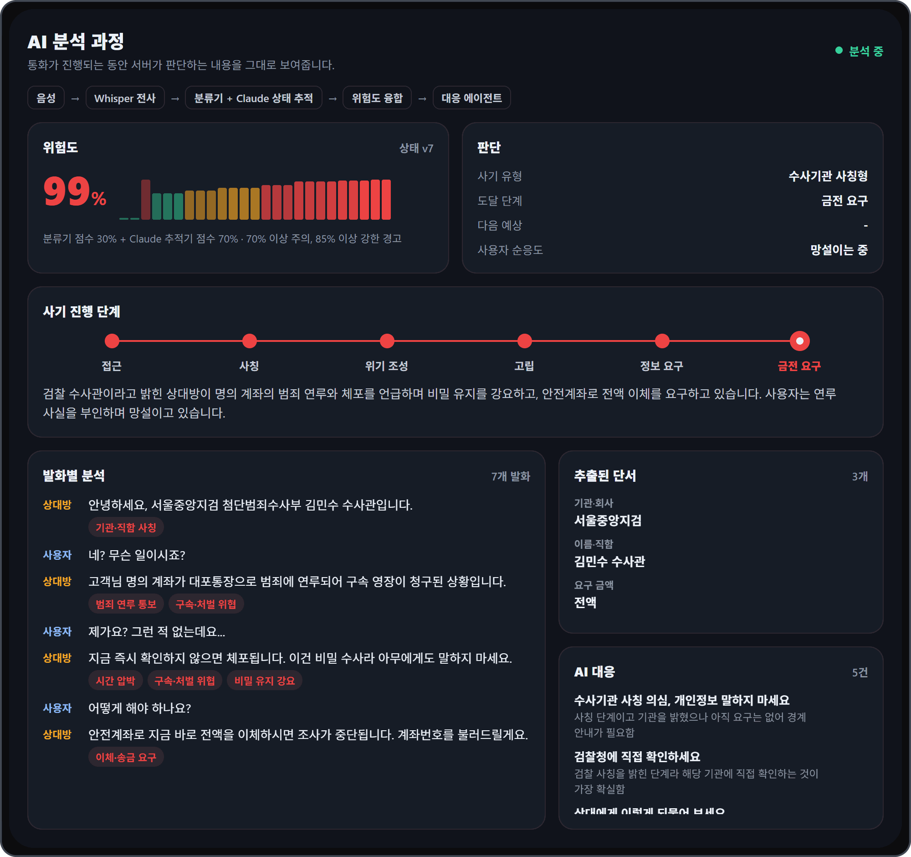
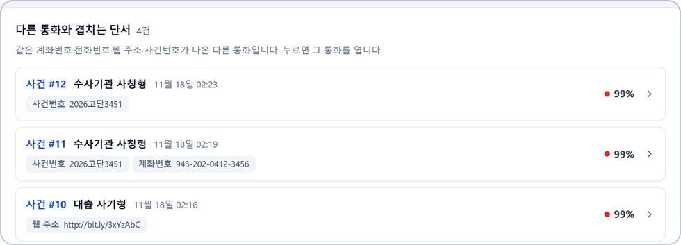
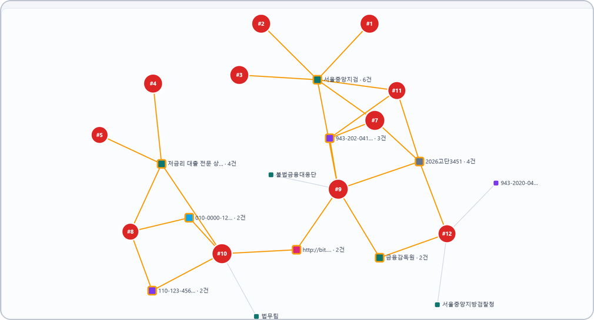
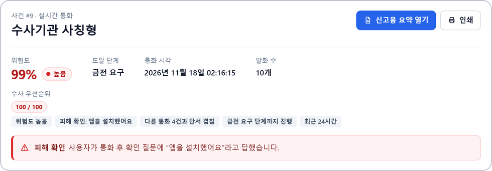
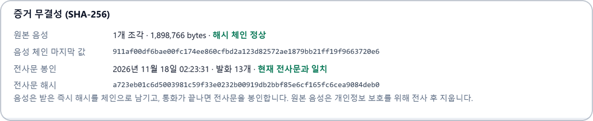
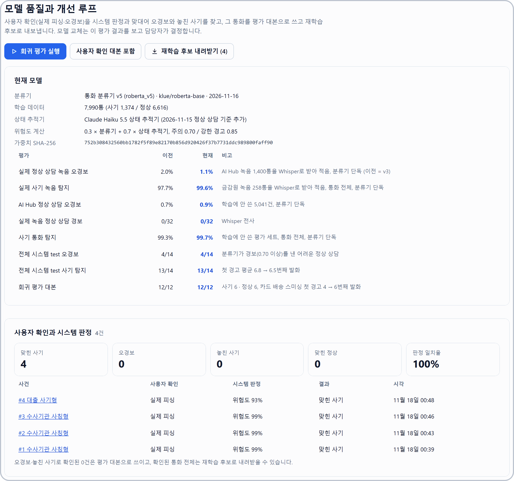

# 수사관 지원용 능동 AI 에이전트 기능

[← README](../README.md) · [전화 흐름으로 기능 보기](one-call.md) · [보이스피싱 탐지 성능](tech/detection.md) · [음성 인식·화자 분리 성능](tech/transcription.md)

AI 에이전트가 통화 단서를 정리하고 관련 의심 통화를 연결해 수사 검토를 지원합니다. 수사관이 요청하지 않아도 통화 중에는 단서를 뽑아 다른 통화와 대조하고, 통화가 끝나면 전사문 해시를 고정하고 위험 통화의 신고용 요약을 준비합니다. 수사관은 대시보드에서 우선 검토할 의심 통화와 선정 근거를 확인합니다.

수법 카드 승인, 사건 판단, 신고와 연락은 담당자가 결정합니다. 이 기능들은 시험 통화에서 동작을 확인한 단계이며, 탐지 모델을 제외하면 정확도를 따로 잰 평가가 없습니다([한계](#한계)).

> [!IMPORTANT]
> 실제 수사기관에서 쓰거나 검증한 적이 없는 시연 단계의 기능입니다. 수사관 개인 계정, 통화별 수사 공유 동의, 열람 기록은 구현하지 않았고, 대시보드는 공용 관리 코드로 엽니다. 실제로 운영하려면 이 세 가지와 수사기관의 검증이 먼저 필요합니다([한계](#한계)).

## 수사관이 받는 결과

 
수사관 대시보드(<code>/dashboard</code>). 우선순위순으로 정렬하면 피해가 확인되었거나 다른 통화와 공통 단서가 있는 통화일수록 위에 놓입니다. 화면의 통화는 실제 사건이 아닌 시험 통화입니다.

수사관은 대시보드 한 곳에서 결과를 받아 다음 순서로 활용합니다.

1. 사건 목록을 '우선순위순'으로 정렬하고 위에서부터 엽니다. 점수 옆 근거 칩이 선정 근거입니다.
2. 사건 상세에서 단서, 공통 단서가 있는 통화, 사건 개요를 봅니다. 사건 개요는 AI가 정리한 초안이므로 통화 전문과 대조합니다. 관계 그래프에서는 공통 단서로 이어진 통화를 모아 봅니다.
3. 신고가 필요하면 '신고용 요약 열기'로 문서를 열고 인쇄합니다. 무결성 확인 결과도 문서에 들어갑니다.
4. '신종 수법' 탭에서 검토 대기 카드를 승인하거나 반려하고, '모델 품질' 탭에서 확인 응답과 시스템 판정의 비교를 봅니다. 같은 내용을 말로 찾으려면 n8n 채팅에 질문합니다.

## 자동 처리와 담당자 결정

에이전트는 판단에 필요한 자료를 준비하고, 결정은 담당자가 합니다. 아래 '담당자 결정' 항목에는 에이전트가 혼자 처리하는 코드 경로가 없습니다. 전체 처리 흐름 그림은 [README의 시스템 구조](../README.md#시스템-구조)에 있습니다.

| 기능 | 자동 처리 | 수사관이 받는 결과 | 담당자 결정 | 구현 상태 · 정확도 평가 |
| --- | --- | --- | --- | --- |
| [단서 수집](#단서-수집) | 통화 중 계좌·전화번호·주소 등 단서 8종을 발화 번호와 함께 저장 | 통화별 단서 목록 | 실제 단서인지, 전사 오류나 설명 문구는 아닌지 | 동작 · 평가 없음 |
| [단서 연결](#단서-연결) | 같은 계좌·전화번호·웹 주소·사건번호가 나온 다른 통화를 찾고, 통화 중이면 사용자에게 바로 경고 | 공통 단서가 있는 통화, 관계 그래프 | 같은 사람·조직인지, 사건을 묶거나 닫을지 | 동작 · 평가 없음. 표기 정규화와 중복 알림 방지만 확인 |
| [수사 검토 우선순위 제안](#수사-검토-우선순위-제안) | 위험도·피해 확인·공통 단서·도달 단계·최근성으로 0\~100점과 근거 칩 계산 | 우선 검토할 의심 통화와 선정 근거 | 실제 검토 순서 | 동작 · 평가 없음. 수사관 검증 전 |
| [음성·전사 기록의 무결성 확인](#음성전사-기록의-무결성-확인) | 음성 조각마다 SHA-256 해시를 체인으로 잇고, 통화가 끝나면 전사문 해시를 고정 | 정상·불일치 확인 결과 | 원본 음성 확보와 대조 | 동작 · 평가 없음. 변조 시험 자동 테스트 없음 |
| [신고용 요약](#신고용-요약) | 저장된 통화 기록으로 요약을 조립하고, 사건 개요만 Claude가 작성 | 제출용 요약 문서 | 범죄 여부, 신고·지급정지 요청, 관련자 연락 | 동작 · 평가 없음. 시험 통화 사례로만 확인 |
| [신종 수법 수집·검토·반영](#신종-수법-수집검토반영) | 수집을 실행하면 금감원·경찰청 새 글을 수법 카드 초안으로 정리 | 승인을 기다리는 카드 | 카드 승인 또는 반려 | 수동 수집 지원, 정기 수집 워크플로는 템플릿만 제공 · 평가 없음. 승인한 카드는 회귀 평가 입력에 미포함 |
| [품질 점검](#품질-점검) | 사용자 확인 응답과 시스템 판정을 비교하고, 재학습 후보·평가 대본을 내보내며, 회귀 평가를 실행 | 오경보·미탐지 의심 사례, 평가 대본 | 재학습과 모델 교체 | 재학습은 담당자가 직접 실행 · 모델 평가 있음([보이스피싱 탐지 성능](tech/detection.md)) |
| [자연어로 묻기 (n8n 채팅)](#자연어로-묻기-n8n-채팅) | 질문을 받으면 수사 데이터를 도구로 찾아 답하고, 요청하면 수동 수집을 시작 | 통화 번호와 대시보드 링크가 붙은 답 | 답의 사실 확인. 카드 승인과 사건 판단은 대시보드에서 수행 | 선택 설정(n8n 연결 필요). 시연 서버는 2026-11-18 연결·동작 확인 · 평가 없음 |

자동 처리 가운데 Claude가 맡는 일은 단서 추출(상태 추적기, Claude Haiku 5.5), 사건 개요 작성, 수법 카드 초안 작성(둘 다 Claude Opus 5.5) 세 가지입니다. 단서 비교, 우선순위 점수, 해시, 신고용 요약 조립, 품질 비교는 코드 규칙이 처리합니다. 틀리면 안 되는 값을 LLM이 만들지 않게 하려는 분담입니다. 결정을 담당자에게 맡긴 이유는 다음과 같습니다.

- **수법 카드**: 승인한 카드는 모든 통화의 상태 추적기 프롬프트를 바꿉니다. 공개 글을 잘못 요약한 카드가 들어가면 정상 통화에 경고가 뜰 수 있습니다.
- **연락과 신고**: 판정은 확률이라 틀릴 수 있고 연락은 되돌릴 수 없습니다. 같은 단서가 나온 다른 사용자에게 알리면 그 사람의 통화 사실이 드러납니다. 그래서 수사 쪽 에이전트는 누구에게도 연락하지 않으며, 외부 알림은 사용자 쪽 대응 에이전트가 n8n에 요청하는 세 가지(위험 통화 발생, 위험 통화 종료, 후속 확인 답)뿐입니다.
- **모델 교체**: 모델이 바뀌면 모든 통화의 판정이 바뀌므로, 평가 결과를 보고 담당자가 정합니다.

## 단서 수집

**통화 중에 수사 단서가 될 값을 발화 번호와 함께 저장합니다.**

새 발화가 저장될 때마다 Claude 상태 추적기(Haiku 5.5, 구조화 출력)가 사기 단계·유형·사용자 반응과 함께 단서를 뽑습니다. 단서는 계좌번호, 전화번호, 웹 주소, 사칭한 기관·회사, 이름·직함, 요구 금액, 설치 요구 앱, 사건번호 8종입니다. 코드는 형식을 검사하고 값을 정규화해 같은 통화 안의 중복을 지웁니다. 수사관은 사건 상세의 '단서' 목록에서 값과 그 값이 나온 발화 번호를 봅니다.

시연 통화([전화 흐름으로 기능 보기](one-call.md)의 검찰 사칭 대본 통화, 2026-11-18 기록)에서는 기관 '서울중앙지검'(발화 1), 이름·직함 '김민수 수사관'(발화 1), 요구 금액 '전액'(발화 7)이 뽑혔고, 모두 전사문의 해당 발화에 나온 값입니다. 단서 추출 정확도는 따로 평가하지 않았습니다. 회귀 평가 12개 대본은 판정·유형·도달 단계만 봅니다.

 
사건 상세의 단서 목록(공통 단서가 있는 대본 통화). 값마다 그 값이 나온 발화 번호와 복사 버튼이 붙고, 다른 통화에도 나온 값에는 '다른 통화 N건' 표시가 붙습니다.

통화 중 단서가 쌓이는 모습 (발표용 화면의 AI 분석 과정 패널)

 
시연 통화의 일곱 번째 발화 직후입니다. 패널은 통화 중 서버의 판단을 그대로 보여 주며, '추출된 단서'에 쌓인 값이 수사 지원의 자료가 됩니다. (<a href="images/v2/web_demo_panel.png">전체 화면</a>)

단서 정규화와 추출 규칙

- 비교용 정규화: 계좌번호·전화번호·요구 금액·사건번호는 숫자만 남깁니다(숫자가 하나도 없으면 원래 값을 소문자로 둡니다). 웹 주소는 소문자로 바꾸고 `http(s)://`·`www.`·끝의 `/`를 지웁니다. 사칭한 기관·회사, 이름·직함, 설치 요구 앱은 소문자로 바꾸고 공백을 지웁니다.
- 추적 시점: 새 글자가 8자 미만이면 다음 발화를 기다리고, 한 번에 한 사이클만 돕니다. 통화가 끝날 때 한 번 더 돌고, 통화 후 전체 재전사가 끝나면 처음부터 다시 돕니다. 녹음 파일은 전체를 한 번에 처리합니다.
- 프롬프트 규칙: 발화에 실제로 나온 값만 그대로 적습니다. "XXX"처럼 가려진 값과 인식이 깨진 값은 뽑지 않습니다. 기관은 이름만 적고 "공범 8명", "안전계좌" 같은 설명은 단서로 보지 않습니다. 같은 대상을 이름·직함과 기관에 겹쳐 적지 않습니다. 사기 정황이 없는 정상 통화에서는 뽑지 않습니다.
- 코드 규칙: 8종 밖의 유형과 실제로 없는 발화 번호는 버립니다. 이미 뽑은 단서 목록을 다음 호출 프롬프트에 넣고, 유형과 정규화 값이 같으면 한 번만 저장합니다. 전체 재전사 뒤에는 발화 번호가 바뀌므로 단서를 지우고 처음부터 다시 뽑습니다.

## 단서 연결

**같은 계좌·전화번호·웹 주소·사건번호가 나온 다른 통화를 찾아 공통 단서가 있는 통화로 연결합니다. 통화 중이면 그 자리에서 사용자에게 알립니다.**

통화 중에는 상태 추적기가 새 단서를 낸 바로 그 사이클 안에서 정규화한 값을 다른 통화의 단서와 맞춥니다(녹음 파일은 분석 끝에). 같은 값이 있으면 사용자 화면에 "이 계좌는 다른 의심 통화에도 나왔어요" 같은 경고 카드를 띄웁니다. 통화에서 들린 웹 주소는 접속하지 않고 모양만 점검합니다(문자 검사와 같은 규칙). 수사 화면에서는 사건 상세의 '다른 통화와 겹치는 단서', 목록의 '단서 겹침' 표시, 우선순위 점수, 관계 그래프로 보입니다.

사용자에게 알리는 기준은 수사 화면의 연결 기준보다 엄격합니다. 은행 대표번호(1588-…)처럼 사기범도 정상 상담원도 말하는 번호로 알리면 정상 통화에 경고가 뜨기 때문입니다. 기관명·이름·금액은 우연히 겹치기 쉬워 연결 근거로 쓰지 않습니다. 연결은 같은 값이 나왔다는 사실만 보여 주며, 같은 사람·조직인지는 담당자가 판단합니다. 표기 정규화(은행 이름이 붙은 계좌번호도 같은 계좌로 인식)와 중복 알림 방지(같은 값은 한 번만 알림)는 로컬 DB 복사본에서 확인했고, 시험 과정과 넣은 값은 [API 명세 12.6](API_SPEC_V2.md#126-통화-중-단서-대조-시험-기록)에 있습니다.

 
사건 상세의 '다른 통화와 겹치는 단서'. 같은 사건번호·계좌번호·웹 주소가 나온 다른 통화를 보여 주며, 누르면 그 통화가 열립니다. 화면의 값은 대본에 넣은 가상 정보입니다.

 
관계 그래프. 위험 통화(원)와 그 통화에서 나온 단서(네모)를 잇고, 여러 통화를 잇는 단서는 주황 선으로 표시합니다. (<a href="images/v2/web_graph.png">전체 화면</a>)

알림·연결 기준과 주소 점검 규칙

- **통화 중 알림**: 계좌는 숫자 10자리 이상, 전화번호는 숫자 10자리 이상이면서 010·070·050으로 시작, 사건번호와 주소는 6자 이상입니다. 값마다 최근 통화를 최대 5건까지 찾습니다. 주소는 이와 별도로 모양을 점검합니다.
- **수사 화면 연결**: 계좌·전화번호·사건번호는 숫자 6자리 이상, 주소는 6자 이상입니다. 저장된 통화 전체에서 찾습니다(관계 그래프는 위험도 0.5 이상 최근 80건).
- 관계 그래프에는 사칭 기관을 함께 그리지만 공통 단서가 있는 통화 수와 우선순위에는 넣지 않습니다.
- 통화 중 카드는 다른 통화 건수, 가장 최근 날짜와 유형을 알리고 "돈을 보내거나 정보를 알려 주기 전에 전화를 끊고 공식 번호로 확인하세요"라고 안내합니다. 사유 칸에는 그중 위험 통화(주의 이상) 수를 적습니다. 앱은 이 카드를 강한 경고·피해 차단 카드와 함께 맨 위에 두고, 진동을 켠 경우 주의 진동을 냅니다.
- **주소 모양 점검**: 단축 주소(bit.ly 등 15개 도메인), 숫자 IP 주소, 사기에 자주 쓰이는 최상위 도메인(.xyz 등 10개), 암호화되지 않은 http, 기관·회사 이름을 넣어 공식 주소처럼 꾸민 형태를 위험으로 봅니다.

## 수사 검토 우선순위 제안

**사건 목록을 불러올 때마다 통화마다 0\~100점을 매기고, 점수를 만든 근거를 함께 붙입니다.**

점수는 아래 다섯 항목을 더한 값이며 100을 넘지 않습니다. 계산은 규칙이고 LLM을 쓰지 않습니다. 목록에는 '우선 N' 표시와 '우선순위순' 정렬이 생기고, 사건 상세 윗부분에 근거 칩이 붙습니다. 대시보드는 열려 있는 동안 10초마다 목록을 다시 불러 점수를 새로 계산합니다.

| 근거 | 배점 | 계산 | 근거 칩 |
| --- | ---: | --- | --- |
| 위험도 | 40 | 40 × 위험도(0\~1) | 0.85 이상이면 "위험도 높음" |
| 피해 확인 | 25 | 통화 후 확인 답이 "이미 송금했어요"·"개인정보를 알려줬어요"·"앱을 설치했어요" 중 하나면 25 | "피해 확인: (답)" |
| 공통 단서 | 15 | 15 × min(공통 단서가 있는 다른 통화 수, 3) ÷ 3. 3건부터 만점 | "다른 통화 N건과 단서 겹침" |
| 도달 단계 | 10 | 10 × 단계 번호 ÷ 6 (접근 1, 사칭·신뢰 형성 2, 위기 조성 3, 고립 4, 정보·앱 요구 5, 금전 요구 6) | 5 이상이면 "(단계) 단계까지 진행" |
| 최근성 | 10 | 10 × (1 − 지난 시간 ÷ 168시간). 7일이 지나면 0 | 24시간 이내면 "최근 24시간" |

배점은 팀이 정한 값입니다. 점수는 근거 칩으로 거꾸로 따라갈 수 있습니다. 시연 통화(분류기 v5, 위험도 0.99)는 통화 약 40분 뒤 85점이었습니다. 위험도 약 40 + 피해 확인 25 + 금전 요구 단계 10 + 최근성 약 10이고, 공통 단서가 있는 다른 통화가 없어 그 항목은 0점입니다. 아래 화면의 대본 통화는 다른 통화 4건과 단서가 겹쳐 공통 단서 항목까지 채워졌고, 100점입니다.

 
사건 상세 윗부분에 표시되는 수사 우선순위 점수와 근거 칩(공통 단서가 있는 대본 통화).

## 음성·전사 기록의 무결성 확인

**음성 조각을 받는 즉시 SHA-256 해시를 체인으로 잇고, 통화가 끝나면 전사문 해시를 고정합니다. 확인은 화면을 볼 때마다 다시 계산합니다.**

실시간 음성 조각은 전사하기 전에, 녹음 파일은 올릴 때, 통화 후 전체 녹음은 재전사용으로 올라올 때 해시를 남깁니다. 전사문 해시는 통화 종료, 재전사 뒤 재추적, 녹음 파일 분석이 끝날 때 고정합니다(화면 표기 '전사문 봉인'). 조각 하나라도 빠지거나 바뀌면 체인이 맞지 않고, 전사문이 한 글자라도 바뀌면 다시 계산한 값이 고정해 둔 값과 달라집니다. 확인 결과(조각 수와 바이트, 체인 정상 여부, 현재 전사문과의 일치 여부)는 사건 상세와 신고용 요약의 '증거 무결성 (SHA-256)' 절에 표시됩니다. 음성 파일은 개인정보 보호를 위해 전사 후 지우고 해시만 남기므로, 원본과 대조하려면 사용자가 원본 파일을 따로 보관해야 합니다.

2026-11-18에 합성 음성으로 만든 녹음 파일 하나를 올린 통화에서 원본 음성 1개 조각(1,898,766 bytes)의 체인이 정상이었고, 발화 13개의 전사문 해시가 현재 전사문과 일치했습니다(아래 화면). 시연 통화는 대본을 글로 넣어 음성 조각이 없으며, 전사문 해시(발화 7개)가 현재 전사문과 일치했습니다. 값을 일부러 바꿔 '불일치'가 나오는지 보는 자동 테스트는 아직 없습니다.

 
사건 상세의 '증거 무결성 (SHA-256)' 절. 같은 내용이 신고용 요약에도 들어갑니다. (<a href="images/v2/web_evidence.png">전체 화면</a>)

해시 계산 방식

- 조각마다 `sha256`을 구하고 `chain = sha256(앞 조각의 chain + sha256)`으로 잇습니다. 첫 조각의 앞 값은 빈 문자열입니다.
- 전사문은 발화마다 `sha256("발화 번호|내용")`을 같은 방식으로 이어 마지막 값을 고정값으로 둡니다.
- 녹음 파일은 파일 전체를 한 조각으로 기록하고, 통화 후 올라온 전체 녹음은 실시간 조각 뒤에 이어 붙입니다.
- 해시 기록이 실패해도 실시간 분석은 멈추지 않습니다. 다시 고정하면(재전사 등) 마지막 값으로 바꿉니다. 저장 항목은 [API 명세 12.1](API_SPEC_V2.md#121-기능별-코드와-저장-항목)에 있습니다.

## 신고용 요약

**저장된 통화 기록으로 경찰·금융회사에 낼 신고용 요약을 만듭니다. 사건 개요 문단만 Claude가 씁니다.**

수사관이 사건 상세를 열거나 '신고용 요약 열기'를 누를 때, 사용자가 통화 후 '신고용 요약을 준비했습니다' 카드를 누를 때 만들어집니다. 사건 개요를 뺀 나머지 절은 LLM 없이 저장된 기록으로 조립합니다. 제출 문서에 통화에 없던 사실이 섞이지 않게 하려는 것입니다. 위험 통화(주의 이상)이고 발화가 4개 이상이면 Claude(Opus 5.5)가 사건 개요 3\~5문장을 씁니다. 요약은 브라우저에서 바로 읽을 수 있는 마크다운으로 열리고 인쇄할 수 있습니다.

| 만드는 쪽 | 절 |
| --- | --- |
| Claude (Opus 5.5) | 사건 개요. 대상이 아니거나 실패하면 상태 추적기 요약으로 대신함 |
| 저장된 기록 | 머리(통화 번호·일시·판정 유형·위험도·도달 단계), 피해 확인 강조 문장(통화 후 피해 답이 있을 때), 단계별 경과(시각·단계·시작 발화), 단서와 발화 번호, 위험 발화와 수법 태그, 사용자 확인 내용, AI 대응 기록, 통화 전문 |
| 규칙 · 검색 | 다른 통화와 겹치는 단서, 유사 공식 사례(참고, 출처 링크) |
| 해시 재계산 | 증거 무결성 (SHA-256) |
| 고정 문구 | "전사에는 음성 인식 오류가 있을 수 있습니다", 신고·상담 창구(112, 1332, 118) |

시연 통화에서 상대는 계좌번호를 불러 주겠다고만 했습니다. 통화 후 확인에 답하기 전의 사건 개요는 금액과 계좌번호가 전사문에 나오지 않았고 "실제 이체가 이루어졌는지는 확인되지 않았다"고 적었습니다. '돈을 보냈어요'라고 답한 뒤 다시 쓴 개요(아래 화면)도 "구체적인 금액과 계좌번호는 전사문에 나오지 않았다"고 적었고, 마지막 문장은 "통화 후 확인 질문에서 이미 송금했다고 답했다"로 바뀌었습니다. 같은 문서에 금감원 피해사례 1건(2016-05-23)과 소비자경보 1건(2024-12-12)이 출처 링크와 함께 붙었습니다. 사건 개요의 사실 정확도를 여러 통화로 잰 평가는 없습니다.

 
시연 통화의 신고용 요약 앞부분(통화 후 확인에 답한 뒤). 브라우저에서 연 화면입니다. (<a href="images/v2/web_report.png">문서 전체</a>)

사건 개요 작성 규칙과 유사 공식 사례 검색

- 사건 개요 프롬프트: 전사문에 실제로 나온 사실만 제3자 시점 과거형으로 씁니다. 추측·조언·경고 문구는 쓰지 않습니다. 순서는 상대가 내세운 신원과 명분 → 요구한 행동과 금액·계좌 → 사용자의 반응과 피해 여부입니다. 확실하지 않은 고유명사는 "\~로 들리는"이라고 적고, 통화 후 확인 답이 있으면 마지막 문장에 넣습니다.
- 개요는 발화 수·마지막 발화 번호·단계·후속 확인 답이 그대로면 저장해 둔 것을 다시 씁니다. Claude 호출이 실패하면 상태 추적기 요약으로 대신합니다.
- 유사 공식 사례: 금감원·경찰청 공개 사례 121건(본문 300자 이상)을 사례에서 생성한 통화로 색인해 글자 2\~4그램 TF-IDF로 찾습니다. 위험 통화에만 붙이며, 상대방 발화로 먼저 찾고 없으면 전체 전사로 찾습니다. 추적기가 정한 유형을 먼저 보고, 유사도 0.08 이상 2건을 붙입니다. 유형 일치가 약 80%(사례 설명문을 색인했을 때는 65.0%)라 탐지 점수에는 쓰지 않고 참고로만 붙입니다. 문서에도 "같은 사건이라는 뜻은 아닙니다"라고 적습니다.

## 신종 수법 수집·검토·반영

**금감원·경찰청이 새로 올린 사례·경보를 수법 카드 초안으로 정리하고, 담당자가 승인한 카드만 상태 추적기의 분석 프롬프트에 반영합니다.** 모델을 다시 학습시키는 기능은 아니며, 수법 카드는 분류기 재학습에 쓰이지 않습니다.

수동 수집을 지원합니다. 대시보드 '신종 수법' 탭의 '지금 수집' 버튼이나 수집 API로 실행하며, 정기 수집 워크플로는 템플릿만 제공합니다.

1. **수집**: 게시판 4곳의 목록 1쪽에서 아직 보지 않은 글을 출처마다 최대 8개 받습니다.
2. **거르기**: 이미 카드가 된 글과, 예전 수집본 중 60일보다 오래된 글은 건너뜁니다. 본문 글자가 거의 없는 글은 이미지뿐인 글로 보고 주소만 남깁니다.
3. **카드 초안**: Claude(Opus 5.5)가 글 하나를 카드 하나로 정리합니다. 프롬프트에 "글에 없는 숫자나 사실은 만들지 않는다"를 넣었습니다. 수법이 없는 글은 '관련 없음'으로 남깁니다.
4. **검토**: 대시보드 '신종 수법' 탭에서 담당자가 승인하거나 반려합니다. 승인 버튼은 검토 대기 카드에만 있고, 승인·반려에는 시각과 검토자가 남습니다(대시보드에서 누르면 검토자는 '대시보드').
5. **반영**: 승인된 최근 카드 8장을 상태 추적기 프롬프트 끝에 붙이고, "단어 하나만 같다고 사기로 보지는 않는다"는 지시를 함께 넣습니다. 다음 추적기 호출부터, 늦어도 60초 안에 반영됩니다.
6. **회귀 평가**: 승인할 때마다 기본 12개 대본을 별도 프로세스·별도 DB로 돌려 결과를 남깁니다(Claude API 비용 발생). 탭 위에 "n/12 통과"로 보입니다. 승인한 카드는 이 평가의 입력에 들어가지 않습니다.

| 출처 | 수집 내용 |
| --- | --- |
| 금융감독원 보이스피싱 피해사례 | 본문과 첨부 한글 문서. 2026-11 기준 마지막 글은 2024-11 |
| 금융감독원 소비자경보 | 투자·카드 경보가 섞여 있어 제목에 피싱·스미싱·사칭·사기·대출이 있는 글만 |
| 경찰청 통합대응단 피싱 예·경보 | 대부분 카드뉴스 이미지라 글자가 없어 카드로 만들지 않음 |
| 경찰청 통합대응단 피싱 시나리오 | 대개 글자 본문이 있음 |

수집기는 저장해 둔 게시판 페이지로 목록·본문·첨부 해석, 이미 본 글 건너뛰기, 실패 처리를 시험한 뒤 실제 사이트에서 출처마다 3개씩 12개를 받아 봤습니다. 경찰청 예·경보 3개는 모두 본문 글자가 없었습니다. 2026-11-15 서버에서 수동으로 수집해 검토 대기 카드 8장이 쌓였고(마지막 실행: 글 15개 → 새 카드 6개), 같은 날 기준 승인한 카드는 없습니다.

 
신종 수법 탭의 수집 현황과 검토 대기 카드. 경찰청 통합대응단 피싱 시나리오(2026-10-07)로 만든 카드 초안이 승인을 기다립니다.

수집기 세부 동작과 카드 형식

- 요청 간격, 응답 크기, User-Agent, 본문 글자 수 제한 같은 수집기 설정은 [API 명세 12.5](API_SPEC_V2.md#125-신종-수법-수집기-설정)에 있습니다.
- 수집은 동시에 두 번 돌지 않습니다. 금감원 피해사례의 첨부 한글 문서(.hwpx, ZIP 속 XML)는 표준 라이브러리로 풀어 본문 요약에 더합니다.
- 카드 항목: 관련 여부, 수법 이름(40자 이내), 유형 6종 중 하나, 요약 2\~3문장, 사기범 말투 3\~6개, 알아챌 신호 3\~6개, 권장 대응 2\~4개, 주 대상.
- 반영 형식: 상태 추적기 프롬프트의 '[최근 공식 경보 수법]' 블록에 카드마다 신호 4개, 말투 3개를 넣습니다.
- 정기 수집 워크플로 템플릿([`voiceguard_knowledge_collect.json`](../n8n/voiceguard_knowledge_collect.json))은 매일 09:00에 수집 API를 부르도록 만든 것이며 n8n에 연결하지 않았습니다. 새 카드의 Slack 검토 요청 노드도 꺼져 있습니다.

## 품질 점검

**사용자가 제공한 확인 응답과 시스템 판정을 비교해 오경보·미탐지 의심 사례를 모으고, 그 통화를 평가 대본과 재학습 후보로 넘깁니다.**

확인 응답은 들어오는 즉시 저장합니다(결과 화면의 "이 판정이 맞았나요?", 통화 후 확인 답). 같은 응답을 다시 보내면 중복 저장됩니다. 모델 품질 탭을 열면 통화마다 가장 최근 확인 응답을 시스템 판정(위험도 0.70 이상이면 '사기로 판정')과 비교해 '맞힌 사기'·'오경보'·'놓친 사기'·'맞힌 정상' 네 칸으로 나누고 판정 일치율을 냅니다. 이 수치는 사용자 응답 기반 평가입니다. 아래 화면의 확인 응답 4건은 대본 통화의 통화 후 확인에 직접 답한 것이라, 일치율 100%는 성능 지표가 아닙니다. 답별 분류 기준은 [API 명세 12.4](API_SPEC_V2.md#124-확인-응답-저장값과-품질-비교)에 있습니다.

오경보·미탐지 의심으로 확인된 통화(발화 2개 이상)는 회귀 평가 형식의 평가 대본이 됩니다(최대 40발화, 사기로 확인된 통화의 기대 단계는 '접근'). 확인된 통화 전부는 학습 데이터 형식의 재학습 후보로 내려받을 수 있고, 재학습은 담당자가 직접 실행합니다.

회귀 평가는 수법 카드를 승인할 때나 탭의 버튼으로 실행합니다. 운영 DB를 건드리지 않도록 별도 프로세스·별도 DB에서 돌고, 평가 중에는 보호자 알림이 나가지 않습니다. 대본마다 판정·유형·도달 단계를 보고 통과 수, 탐지율, 오경보율, 평균 첫 경고 발화, 실패한 대본을 남기며, 모든 대본이 통과해야 '통과'입니다. 현재 구성(분류기 v5 + 수정한 상태 추적기 프롬프트)은 기본 12개 대본을 12/12 통과했고, 사기 대본의 첫 경고는 4·4·6·4·4·6번째 발화였습니다. v3 때는 마지막 카드 배송 스미싱 대본도 4번째였습니다([학습 기록](MODEL_TRAINING_LOG.md)). 통과 조건과 기본 12개 대본의 구성은 [보이스피싱 탐지 성능](tech/detection.md)에 있습니다.

 
모델 품질 탭. 현재 모델과 이전 대비 평가, 사용자 확인 응답과 시스템 판정의 비교를 보여 줍니다. 표에 나온 수치의 평가 조건은 <a href="tech/detection.md">보이스피싱 탐지 성능</a>에 있습니다. (<a href="images/v2/web_quality.png">전체 화면</a>)

## 자연어로 묻기 (n8n 채팅)

**수사관이 n8n 채팅 창에 질문이나 요청을 쓰면 Claude가 수사 데이터를 도구로 찾아 통화 번호와 함께 한국어로 답합니다.** 대시보드에서 찾을 내용을 말로 찾는 보조 창구이며, 질문을 받았을 때만 움직입니다. n8n에 워크플로를 연결해야 쓸 수 있는 선택 설정으로, 시연 서버에는 2026-11-18에 연결해 질문이 약 9초 만에 답으로 돌아오는 것을 확인했습니다. 답의 정확도를 잰 평가는 없습니다.

도구는 읽기 도구 일곱 개와 수동 수집 시작 하나입니다. 읽기 도구는 사건 목록·사건 상세·단서 연결·수법 카드 화면이 쓰는 기존 함수를 그대로 부르므로, 점수와 단서 값은 대시보드와 같은 계산에서 나옵니다. 답에는 근거가 된 통화 번호(`통화 #12`)가 붙고, n8n이 그 통화의 대시보드 링크를 덧붙입니다. 같은 채팅 창에서 이어 물으면 최근 대화 10개까지 이어서 이해합니다. 모델은 대응 에이전트와 같은 `AGENT_MODEL`(기본 Claude Haiku 5.5)이며, Haiku가 답을 거절하면 Claude Opus 5.5로 한 번 더 묻습니다.

| 질문 예 | 쓰는 도구 |
| --- | --- |
| 오늘 우선 검토할 사건 3개 알려줘 | 우선순위 목록(점수와 근거) |
| 계좌 110-123-456789가 나온 통화 찾아줘 | 단서 검색. 하이픈·공백은 저장된 단서와 같은 규칙으로 맞추고, 같은 값이 없으면 부분 일치로 찾음 |
| 사건 12번 요약하고 관련 통화 보여줘 | 사건 요약(단서, 위험 발화, 전사 앞부분), 공통 단서가 있는 통화 |
| 이번 주 위험 통화가 몇 건이야? | 위험도 단계별·유형별 집계 |
| 검토 대기 중인 수법 카드 보여줘 | 수법 카드 목록과 마지막 수집 결과 |
| 12번 신고용 요약 링크 줘 | 신고용 요약·대시보드 주소 |
| 새 수법 수집해줘 | 수동 수집 시작(대시보드 '지금 수집'과 같음) |

- **할 수 없는 일**: 수법 카드 승인·반려, 사건 판단·종결, 데이터 수정, 신고·연락·메시지 발송은 도구에 없어 하지 못합니다. 데이터를 바꾸는 도구는 수동 수집 하나이며, 이것도 검토 대기 카드만 만듭니다. 수집은 수사관이 보낸 그 메시지에 수집을 시키는 말('새 수법 수집해줘', '신종 수법 모아줘'처럼)이 있을 때만 시작하므로, 통화 전사에 섞인 문장만으로는 시작되지 않습니다. '위험 통화 모아서 보여줘'처럼 읽기만 하는 요청은 수집 요청으로 보지 않습니다.
- **데이터가 가는 곳**: 질문과 도구 결과(통화 요약, 단서, 위험 발화, 전사 앞부분)는 Claude API(Anthropic)로 전송됩니다. 질문과 답(통화 번호, 단서 값, 전사 인용 포함)은 n8n을 거치며, 워크플로 템플릿은 n8n이 실행 기록을 저장하지 않도록 설정했습니다. 서버는 질문과 답을 DB에 저장하지 않고, 이어 묻기를 위해 메모리에 2시간 둡니다(서버를 다시 켜면 사라짐). 접속·관리 코드와 키는 Claude에 보내지 않습니다.
- **쓸 수 있는 사람**: n8n에 로그인한 사용자만 채팅 창을 쓸 수 있습니다. 백엔드 API는 관리 경로라 관리 코드가 맞아야 답하고, 관리 코드는 n8n 자격 증명으로 저장합니다. 누가 물었는지는 기록하지 않습니다.
- **주의할 점**: 전사는 지시가 아닌 자료로 다루라고 지시문에 적었지만, 전사에 섞인 문장이 답의 내용에 영향을 줄 가능성은 남습니다. 전사에 심은 이미지로 열람 사실이나 사건 정보가 새지 않도록 서버와 n8n이 답의 이미지를 지웁니다. 단서 검색은 추출된 단서에서만 찾고 전사 전체를 뒤지지 않습니다. 요청 형식, 도구 목록, 처리 한도(도구 왕복 6번, 약 45초)는 [API 명세 10.8](API_SPEC_V2.md#108-수사관-자연어-질의-post-investigationassistant)에 있습니다.

n8n 연결 방법

n8n에서 [`voiceguard_investigator_chat.json`](../n8n/voiceguard_investigator_chat.json)을 가져와 '설정' 노드에 서버 주소를 넣습니다. 'VoiceGuard에 질문' 노드에는 Header Auth 자격 증명(Name `X-Admin-Code`, Value 관리 코드. `ADMIN_CODE`가 없으면 접속 코드)을 만들어 고른 뒤 워크플로를 켭니다. 자격 증명은 n8n이 암호화해 저장하고 실행 기록에 남지 않습니다. 관리 코드가 맞지 않으면 API가 답하지 않습니다(`401`). 실행 기록 저장은 문제를 볼 때만 워크플로 설정에서 잠시 켭니다.

채팅 트리거의 n8n 사용자 인증은 우회 취약점([GHSA-jh8h-6c9q-7gmw](https://github.com/advisories/GHSA-jh8h-6c9q-7gmw))이 고쳐진 n8n(1.x는 1.123.22 이상, 2.x는 2.9.3 이상이고 2.10.0 제외)에서만 믿을 수 있으므로, 연결 전에 n8n 버전을 확인합니다.

## 한계

**수사 판단에 쓰기 전에 알아 둘 점**

- **우선순위 배점은 검증 전입니다.** 배점은 팀이 정한 값이고, 이 순서가 실제 수사 순서와 맞는지 수사관과 검증하지 않았습니다.
- **같은 번호가 같은 조직을 뜻하지는 않습니다.** 같은 계좌·번호가 여러 통화에 나왔다는 사실만으로 동일 범죄 조직이나 같은 사람이라고 확정할 수 없고, 단서 추출도 틀릴 수 있습니다.
- **해시 저장은 원본 음성 보관이 아닙니다.** 서버는 음성 원본을 지우므로 원본 대조에는 사용자가 따로 보관한 파일이 있어야 합니다. 전사문 해시는 재전사 때 새 값으로 바뀝니다.

**검증 범위와 품질**

- 실제 사기 조직의 통화로 연결을 확인한 적이 없습니다. 화면의 공통 단서는 시험 대본을 여러 번 실행해 생긴 것이고, 통화 중 단서 대조는 로컬 DB 복사본에서 확인했습니다.
- 단서 추출 정확도, 우선순위 순서의 타당성, 사건 개요의 사실 정확도를 수치로 잰 평가는 없습니다. 자동 테스트도 없고 평가 스크립트(`eval_*`)만 있습니다.
- 설명 문구('고객님 명의 계좌')나 일반 명사('카드사')가 단서로 뽑힌 적이 있습니다(2026-11-15 시험 통화). 숫자 규칙 때문에 이런 값은 연결·알림에는 쓰이지 않지만 단서 목록과 그래프에는 남습니다. 같은 대본이어도 실행마다 뽑히는 단서가 다를 수 있으며, 2026-11-18에 같은 대출 사기 대본을 두 번 실행했을 때 단서가 2개와 1개로 달랐습니다.
- 기관명 표기를 하나로 묶지 않습니다. '서울중앙지검'과 '서울중앙지방검찰청'은 그래프에서 다른 노드입니다.
- 통화 중 알림은 다른 통화의 위험도와 상관없이 값이 같으면 나갑니다. 그중 위험 통화 수는 사유 칸에만 적습니다.
- 코드 기본 설정(전사를 모두 자체 서버에서 처리)에는 화자 분리가 없어 상대방·사용자 구분을 상태 추적기가 내용으로 추정합니다. 리턴제로를 켜면 전사가 화자 단위로 나뉘지만 해당 음성이 리턴제로 API로 전송되며, 이때도 위험 발화 목록과 유사 사례 검색은 추적기가 붙인 역할을 씁니다. 리턴제로 무료 사용량이 소진되면 서버 Whisper로 바로 전환됩니다([음성 인식·화자 분리 성능](tech/transcription.md#화자-분리)).
- 사건 개요는 Claude가 써서 틀릴 수 있습니다. 화면에 'AI가 통화 기록을 정리한 내용'이라고 표시하고 통화 전문을 함께 둡니다. 유사 공식 사례는 유형 일치 약 80%의 참고 자료입니다.
- 해시와 체인이 같은 SQLite에 있어, DB를 고칠 수 있는 사람이 체인을 통째로 다시 계산하면 막지 못합니다. 외부 시각 인증이나 별도 보관은 없습니다.

**운영**

- 보호자 알림은 n8n에 전송을 요청하는 데까지만 합니다. 앱에는 보호자 등록과 수신 확인 기능이 없어, AI 대응 기록과 신고용 요약에도 '보호자 알림을 요청했습니다'로만 남습니다. 시연 서버에서는 n8n 위험 알림 워크플로가 이 요청을 받아 Slack 채널에 알림을 올립니다(2026-11-17 연결).
- 승인 뒤 회귀 평가는 빈 평가 DB에서 돌아 승인한 카드가 상태 추적기 프롬프트에 들어가지 않습니다(코드 기준). 승인 카드가 없는 기본 구성으로 기본 12개 대본을 다시 돌린 결과이므로 신규 수법의 반영 효과는 검증하지 않습니다. 통과 기준도 '모든 대본 통과' 하나이며, 설계 문서의 기준(오경보율 증가 0.01 이하, 재현율 감소 없음)은 구현하지 않았습니다.
- 평가가 실패해도 카드는 자동으로 빠지지 않고, 대시보드에는 승인한 카드를 내리는 버튼이 없어 API로 반려해야 합니다. 서버의 검토 대기 카드 8장은 2026-11-15 기준 승인 전이라, 승인 → 추적기 반영 → 회귀 평가가 운영 서버에서 돈 기록은 없습니다.
- 수사관 개인 계정이 없고, 대시보드는 공용 관리 코드로 엽니다(관리 코드를 설정하지 않으면 접속 코드로도 열립니다). 설계의 '수사 공유에 동의한 기기만 보이기'를 구현하지 않아 모든 통화가 사건 목록에 나옵니다. 누가 무엇을 봤는지는 기록하지 않습니다.

## 관련 구현 코드

| 기능 | 코드 |
| --- | --- |
| 단서 수집 | [`state_tracker.py`](../backend/app/services/state_tracker.py) · [`state_repository.py`](../backend/app/state_repository.py) · [`codes.py`](../backend/app/codes.py) |
| 단서 연결 | [`case_linking.py`](../backend/app/services/case_linking.py) · [`response_agent.py`](../backend/app/services/response_agent.py) · [`investigation.py`](../backend/app/services/investigation.py) · [`message_analyzer.py`](../backend/app/services/message_analyzer.py) |
| 수사 검토 우선순위 제안 | [`investigation.py`](../backend/app/services/investigation.py) |
| 음성·전사 기록의 무결성 확인 | [`evidence.py`](../backend/app/services/evidence.py) · 호출 위치 [`websocket.py`](../backend/app/api/websocket.py), [`routes.py`](../backend/app/api/routes.py), [`agent_loop.py`](../backend/app/services/agent_loop.py) |
| 신고용 요약 | [`report_builder.py`](../backend/app/services/report_builder.py) · [`investigation.py`](../backend/app/services/investigation.py) · [`official_cases.py`](../backend/app/services/official_cases.py) |
| 신종 수법 수집·검토·반영 | [`official_sources.py`](../backend/app/services/official_sources.py) · [`scam_knowledge.py`](../backend/app/services/scam_knowledge.py) · [`state_tracker.py`](../backend/app/services/state_tracker.py) · [`voiceguard_knowledge_collect.json`](../n8n/voiceguard_knowledge_collect.json) (템플릿) |
| 품질 점검 | [`quality.py`](../backend/app/services/quality.py) · [`eval_loop.py`](../backend/app/eval_loop.py) · [`scenarios.json`](../backend/eval/scenarios.json) · [`response_agent.py`](../backend/app/services/response_agent.py) |
| 자연어로 묻기 (n8n 채팅) | [`investigator_assistant.py`](../backend/app/services/investigator_assistant.py) · [`investigation_routes.py`](../backend/app/api/investigation_routes.py) · [`voiceguard_investigator_chat.json`](../n8n/voiceguard_investigator_chat.json) (n8n 워크플로) |
| 수사관 화면 · API | [`dashboard.html`](../backend/app/web/dashboard.html) · [`investigation_routes.py`](../backend/app/api/investigation_routes.py) · [`quality_routes.py`](../backend/app/api/quality_routes.py) · [`agent_routes.py`](../backend/app/api/agent_routes.py) · [`websocket.py`](../backend/app/api/websocket.py) |

함수 이름과 저장 항목, 대시보드 화면별 API와 화면 밖에서 쓰는 API는 [API 명세 12절](API_SPEC_V2.md#12-수사-지원-구현-상세)에 정리했습니다. 설계와 구현이 다른 곳은 API 명세의 '구현 현황'을 따릅니다.
