# 전화 한 통 따라가기

[← README](../README.md) · [수사관 곁의 AI 에이전트](investigator.md) · [보이스피싱 탐지 정확도](tech/detection.md) · [전사 모델 정확도](tech/transcription.md)

검찰 수사관을 사칭하는 전화 한 통을 받는 사람 쪽에서 처음부터 끝까지 따라간다. 통화 기록 21번(2026-11-15 06:40:23 시작, 1분 4초)의 서버 기록과 그때 찍은 화면을 그대로 쓴다. 같은 기록이 수사관 쪽에서 어떻게 쓰이는지는 [수사관 곁의 AI 에이전트](investigator.md)에 따로 정리했다.

> [!NOTE]
> **시연용 대본으로 만든 통화다.** 앱의 시연 모드(`/realtime?scenario=prosecutor`)가 미리 적어 둔 일곱 문장을 정해진 간격으로 서버에 글자로 보냈다. 그래서 마이크와 음성 인식(Whisper)은 거치지 않았다. 그 뒤의 분류기, Claude 상태 추적기, 대응 에이전트, n8n 전송, 기록 저장은 서비스와 같은 코드가 처리했다.
>
> 시각은 서버 기록 기준이다(06:40:23 = `00:00`). 화면 타이머는 앱이 따로 재서 1초쯤 앞선다. 화면은 설명에 따로 적지 않으면 21번 통화 때 찍은 것이다. 이 통화 뒤에 분류기를 v3로, 2026-11-16에는 v5로 바꾸고 증거 해시를 넣었으므로, 지금 같은 대본을 돌리면 점수와 문구가 조금 다를 수 있다.

## 한눈에 보기

<p align="center">
  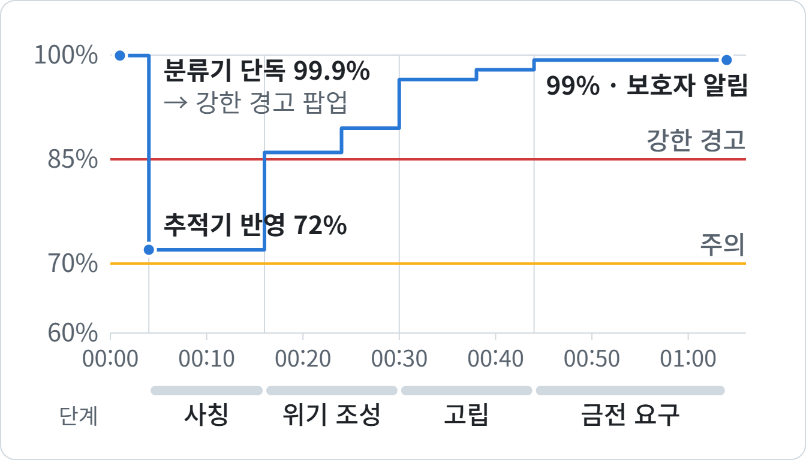
  <br>
  <sub>화면에 보인 위험도(서버 기록). 70% 이상 주의, 85% 이상 강한 경고. 아래 띠는 상태 추적기가 판단한 사기 단계다.</sub>
</p>

| 시각 | 무슨 일이 있었나 (화면 위험도) |
| --- | --- |
| [`00:01`](#0001-첫-문장에-분류기가-먼저-반응) | 상대방 첫 문장. 분류기 단독 **99.9%**, 강한 경고 팝업(화면 타이머 00:03) |
| [`00:04`](#0004-추적기가-사칭-단계로-읽고-주의로-낮춤) | 상태 추적기 첫 판단: 사칭·신뢰 형성, 수사기관 사칭형. **72%** 주의로 내려감 |
| [`00:07`](#0007-첫-경고-카드와-공식-번호) | 카드 "검찰 사칭 의심, 지금 바로 끊으세요"와 검찰청 공식 번호 1301. `00:12` 되물어 볼 질문 3개 |
| [`00:16`](#0016-위기-조성-강한-경고) | "명의 계좌가 범죄에 연루돼 구속 영장 청구" → 위기 조성, **86%** 강한 경고. `00:18` 카드 "지금 바로 전화를 끊으세요" |
| [`00:30`](#0030-고립) | "확인 안 하면 체포, 비밀 수사" → 고립, **96%** |
| [`00:44`](#0044-금전-요구와-보호자-알림) | "안전계좌로 전액 이체" → 금전 요구, **99%**. 보호자 알림을 n8n으로 보냄 |
| [`01:04`](#0104-분석-종료) | 분석 종료. 신고용 요약 카드와 통화 후 확인 질문 |

## 통화 중

사용자가 홈에서 '실시간 분석 시작'을, 다음 화면에서 '분석 시작'을 누르면 앱이 WebSocket(`/ws/calls/analyze`)을 열고 서버가 통화 기록을 만든다. 21번에서는 여기서부터 앱이 대본 일곱 문장을 하나씩 보냈다(서버 도착 기준 `00:01`부터 `00:42`까지).

발화가 하나 들어올 때마다 서버는 두 길로 판단한다. KLUE-RoBERTa 분류기는 그 자리에서 사기 확률을 내고, Claude 상태 추적기(Haiku 5.5)는 통화 전체를 다시 읽어 2\~3초 뒤에 사기 단계, 유형, 사용자가 따르는 정도(순응도), 단서를 낸다. 화면 위험도는 `0.3 × 분류기 + 0.7 × 추적기`이고 70% 이상이면 주의, 85% 이상이면 강한 경고다. 대응 에이전트는 이 판단을 보고 낼 카드를 규칙으로 고르고, 문구는 Claude가 이 통화에 맞춰 쓴다. 전화번호와 피해 차단 절차는 틀리면 안 되므로 코드의 고정 표에서 가져온다. 모두 같은 WebSocket으로 앱에 온다. 분류기 점수는 발화마다 바로 돌아오는 응답에, 추적기 판단은 `state_update`, 카드는 `agent_action` 이벤트에 실린다.

실제 통화라면 그 앞에 한 단계가 더 있다. 앱이 마이크 음성을 무음 기준으로 잘라(1.2초 이상 쌓고 0.25초 조용하면 자르며, 10초면 강제로 자른다) 보내고, 서버가 조각마다 faster-whisper large-v3로 받아 적는다. 통화가 끝나면 녹음 전체를 다시 받아 적고 상태를 처음부터 다시 추적한다. 누가 한 말인지는 아직 목소리가 아니라 추적기가 내용으로 정한다. 전사와 [화자 분리](tech/transcription.md#화자-분리)를 얼마나 맞히는지는 [전사 모델 정확도](tech/transcription.md)에 있다.

### `00:01` 첫 문장에 분류기가 먼저 반응

> <kbd>상대방</kbd> 안녕하세요, 서울중앙지검 첨단범죄수사부 김민수 수사관입니다.

발화가 서버에 닿은 그 초에 분류기가 99.9%를 냈다. 추적기 판단이 오기 전에는 분류기 점수를 그대로 화면에 쓰므로 위험도가 100%로 보였고, 강한 경고 기준 85%를 처음 넘은 순간이라 앱이 전체 화면 경고를 띄웠다(화면 타이머 00:03). 이 팝업은 통화당 한 번 뜨고, 기기가 지원하면 진동이 함께 울린다. '대처 방법 보기'는 예방·대처 정보로, '계속 지켜보기'는 분석 화면으로 돌아간다. 팝업의 '수사기관 사칭 표현'은 키워드 규칙이 붙인 근거다. 강한 경고 기준은 설정에서 70\~85% 사이로 낮출 수 있다.

<p align="center">
  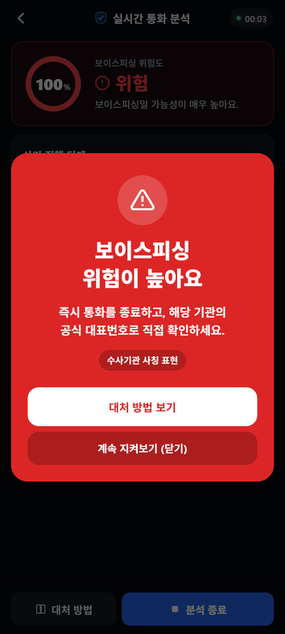
  <br>
  <sub>화면 타이머 00:03. 분류기 단독 점수로 뜬 강한 경고</sub>
</p>

<sub>부품: 분류기 <code>koelectra_scorer.py</code>(파일 이름은 v1 KoELECTRA 때 것이고 지금 모델은 KLUE-RoBERTa), 키워드 규칙 <code>rag_detector.py</code>, 경고 화면 <code>warning.tsx</code></sub>

### `00:04` 추적기가 사칭 단계로 읽고 주의로 낮춤

Claude 상태 추적기의 첫 판단이 나왔다. 단계는 '사칭·신뢰 형성', 유형은 '수사기관 사칭형', 추적기 위험도는 0.60, 다음 예상 단계는 '위기 조성'이다. 기관(서울중앙지검)과 이름·직함(김민수 수사관)은 단서로 저장했다. 화면에 뜬 요약은 이렇다.

> 검찰 수사관이라고 밝힌 상대방이 통화를 시작했습니다. 아직 구체적인 요구는 나오지 않았지만 수사기관 사칭이 의심됩니다.

화면 위험도는 `0.3 × 0.999 + 0.7 × 0.60 = 0.72`, 72% 주의로 내려갔다. 신원을 밝혔을 뿐 아직 아무것도 요구하지 않았다는 추적기 판단이 분류기의 99.9%를 누른 것이다. 분류기는 추적기가 따라오기 전 몇 초의 신호를, 추적기는 통화 전체의 의도를 맡는다.

<p align="center">
  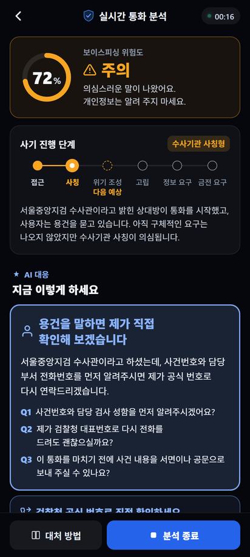
  <br>
  <sub>화면 타이머 00:16(추적기의 두 번째 판단까지 반영). 72% 주의, 사칭 단계, 다음 예상 위기 조성. 맨 위 카드는 <code>00:12</code>에 온 되물어 볼 질문</sub>
</p>

<sub>부품: 상태 추적기 <code>state_tracker.py</code>, 위험도 융합 <code>call_analyzer.py</code>의 <code>fuse_risk</code></sub>

### `00:07` 첫 경고 카드와 공식 번호

> <kbd>나</kbd> 네? 무슨 일이시죠?

`00:04` 판단을 받은 대응 에이전트가 카드 두 장을 냈다.

- **검찰 사칭 의심, 지금 바로 끊으세요** (주의 단계 경고): "서울중앙지검 수사관이라고 밝혔지만 아직 확인되지 않았습니다. 개인정보나 계좌 정보는 말하지 말고 통화를 끊으세요."
- **검찰청 공식 번호로 직접 확인하세요**: "통화를 끊고 아래 번호로 전화해 김민수 수사관이 실제 근무하는지 물어보세요." 아래에 `검찰청 1301` 버튼이 붙는다(누르면 전화).

`00:12`에는 상대에게 그대로 읽을 수 있는 질문 카드가 왔다.

- **용건을 말하면 제가 직접 확인해 보겠습니다**: 사건번호와 담당 검사 성함을 먼저 알려주시겠어요? / 제가 검찰청 대표번호로 다시 전화를 드려도 괜찮으실까요? / 이 통화를 마치기 전에 사건 내용을 서면이나 공문으로 보내 주실 수 있나요?

어떤 카드를 낼지는 규칙이 정한다. 위험도가 주의 이상이면 경고가, 거기에 사기 유형이 있고 단계가 사칭 이상이면 공식 번호 확인과 되물어 볼 질문이 후보가 되고, 같은 종류는 한 번만 낸다(경고만 주의 한 번, 강한 경고 한 번). Claude는 후보마다 문구와 '안내 이유'를 쓰고, 안내할 기관은 정해진 목록(검찰청, 경찰청, 금감원, KISA, 은행, 카드사, 가족)에서 고른다. 번호는 Claude가 쓰지 않고 고정 표에서 붙인다. Claude 호출이 실패해도 카드는 고정 문구로 나간다.

<p align="center">
  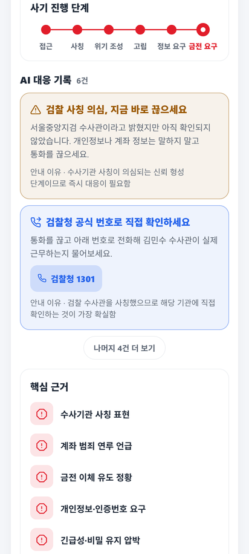
  <br>
  <sub>통화가 끝난 뒤 결과 화면의 AI 대응 기록. <code>00:07</code>의 두 카드와 각자의 안내 이유</sub>
</p>

<sub>부품: 대응 에이전트 <code>response_agent.py</code>, 고정 번호표 <code>codes.py</code>, 카드 화면 <code>agentCards.tsx</code></sub>

### `00:16` 위기 조성, 강한 경고

> <kbd>상대방</kbd> 고객님 명의 계좌가 대포통장으로 범죄에 연루되어 구속 영장이 청구된 상황입니다.

`00:13`에 들어온 이 발화를 추적기가 '위기 조성'으로 읽고 추적기 위험도를 0.80으로 올렸다. 화면 위험도는 86%로 강한 경고 기준을 넘었다. 발화에는 수법 태그 '범죄 연루 통보', '구속·처벌 위협'이 붙었다.

`00:18` 대응 에이전트가 강한 경고 카드를 냈다.

- **지금 바로 전화를 끊으세요**: "검찰 수사관을 사칭하며 구속 영장을 언급하고 있어 사기가 의심됩니다. 계좌 정보나 개인정보를 절대 말하지 말고 전화를 끊으세요."

화면에서는 주의 경고가 이 카드로 바뀌고, 되물어 볼 질문 카드는 내려간다. 끊으라고 한 뒤에 통화를 이어 가라는 안내가 같이 보이지 않게 하려는 것이다. 같은 순간 '통화를 끊으셨나요?' 확인 질문도 만들어지는데, 앱은 이것을 45초 뒤에 띄운다. 경고 직후에 바로 묻지 않으려는 것이다. 답이 '아직 통화 중이에요'면 "지금 바로 끊으세요"를 다시 띄우고 질문을 다시 예약한다(통화당 최대 3번).

<p align="center">
  
  <br>
  <sub>결과 화면 '대화 내용' 탭의 3·4번 발화. 태그는 추적기가 발화마다 붙인다</sub>
</p>

<sub>부품: 상태 추적기 <code>state_tracker.py</code>, 카드 규칙과 확인 질문 <code>response_agent.py</code>, 카드 정리와 45초 대기 <code>realtime.tsx</code></sub>

### `00:30` 고립

> <kbd>나</kbd> 제가요? 그런 적 없는데요...<br>
> <kbd>상대방</kbd> 지금 즉시 확인하지 않으면 체포됩니다. 이건 비밀 수사라 아무에게도 말하지 마세요.

사용자가 부인하자 추적기는 순응도를 '망설이는 중'으로 바꿨다(`00:24`, 89%). 비밀 유지 요구가 나오자 단계를 '고립'으로 올렸다(`00:30`, 96%). 5번 발화의 태그는 '시간 압박', '구속·처벌 위협', '비밀 유지 강요'다. 강한 경고가 이미 나간 뒤라 새 카드는 없다. 같은 카드를 되풀이하지 않는 것도 규칙이다. 화면의 상황 요약은 "가족이나 공식 기관에 먼저 확인하세요"로 바뀌었다.

<p align="center">
  
  <br>
  <sub>결과 화면 '대화 내용' 탭의 5·6번 발화</sub>
</p>

<sub>부품: 순응도·단계 판단 <code>state_tracker.py</code>, 같은 카드를 다시 내지 않는 규칙 <code>response_agent.py</code></sub>

### `00:44` 금전 요구와 보호자 알림

> <kbd>나</kbd> 어떻게 해야 하나요?<br>
> <kbd>상대방</kbd> 안전계좌로 지금 바로 전액을 이체하시면 조사가 중단됩니다. 계좌번호를 불러드릴게요.

추적기가 단계를 '금전 요구'로 올리고(추적기 0.99, 화면 99%) 요구 금액 '전액'을 단서로 뽑았다. 위험도가 강한 경고 이상인 채로 사용자가 요구를 따르기 시작했거나 금전 요구 단계에 이르면 보호자 알림이 후보가 된다(알림 채널인 n8n 웹훅이 설정돼 있을 때). 대응 에이전트는 고정 문구 카드(이 통화 때 문구는 **보호자에게 알렸습니다**, 지금은 **보호자 알림을 요청했습니다**)를 내고, 같은 순간 n8n 웹훅으로 `incident.high_risk` 이벤트(유형, 위험도, 단계, 요약, 대시보드 링크)를 보냈다. 전송 기록은 1초 뒤 `sent`다. n8n 워크플로([`n8n/`](../n8n))가 이 이벤트를 보호자에게 보낼 문장으로 바꿔 Slack이나 텔레그램으로 넘긴다.

> [!NOTE]
> 앱에는 아직 보호자를 등록하는 화면이 없다. 서버는 n8n까지 보내고 끝나서 보호자에게 실제로 닿았는지는 알 수 없다. 그래서 2026-11-16에 카드 문구를 '보호자 알림을 요청했습니다'로 바꾸고, 알림 채널이 연결돼 있을 때만 알림이 가며 받았는지는 앱에서 확인할 수 없다고 함께 적었다.

상대가 계좌번호를 실제로 불렀다면 한 가지가 더 일어난다. 21번 뒤에 넣은 통화 중 단서 대조는 새로 나온 계좌(10자리 이상)·휴대전화·사건번호·주소가 저장된 다른 통화에도 나왔는지 바로 찾아 "이 계좌는 다른 의심 통화에도 나왔어요" 같은 카드를 띄운다. 주소는 접속하지 않고 모양만 점검한다. 이 통화에서는 그런 값이 나오기 전에 통화가 끝났다. 자세한 기준은 [수사관 곁의 AI 에이전트](investigator.md#단서-연결)에 있다.

<p align="center">
  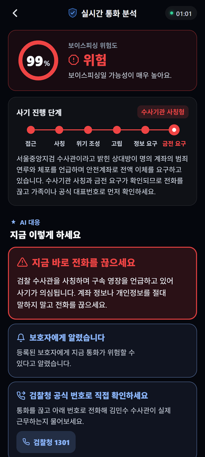
  
  <br>
  <sub>화면 타이머 01:01. 왼쪽은 화면 위쪽(강한 경고, 보호자 알림, 공식 번호 카드), 오른쪽은 같은 화면 아래쪽(방금 들린 말, 탐지 근거)</sub>
</p>

<sub>부품: n8n 전송 <code>webhook_emitter.py</code>, 워크플로 <code>n8n/voiceguard_slack_alert.json</code>(텔레그램판 <code>voiceguard_guardian_alert.json</code>)</sub>

### `01:04` 분석 종료

사용자가 '분석 종료'를 누르자 서버가 마지막 상태를 확정하고 통화 후 행동 두 가지를 만들었다. **신고용 요약을 준비했습니다** 카드(카드의 '신고용 요약 열기'로 문서가 열린다)와 통화 후 확인 질문이다. n8n에는 `call.ended`를 보냈다. 앱은 결과 화면으로 넘어간다.

<p align="center">
  
  <br>
  <sub>통화가 끝난 직후의 결과 화면. 맨 위가 통화 후 확인 질문</sub>
</p>

<sub>부품: 통화 마무리 <code>agent_loop.py</code>의 <code>end_call</code>, 통화 후 행동 <code>response_agent.py</code>의 <code>on_call_end</code>, 결과 화면 <code>result.tsx</code></sub>

## 통화 후

### 다시 묻기

결과 화면 맨 위에 "통화 이후 상황을 알려주세요"와 답 여섯 개가 뜬다. 21번 통화에서는 답하지 않았다. 답하면(`POST /calls/{log_id}/actions/{action_id}/respond`) 서버가 이렇게 움직인다.

- **끊었고 피해는 없어요**: 신고용 요약 카드가 아직 없으면 띄우고, 답만 남긴다.
- **직접 확인해 보니 정상이었어요**, **잘못된 경고였어요**: 새 카드는 없다. '오경보'로 저장해 [품질 점검](investigator.md#품질-점검)에 쓴다.
- **돈을 보냈어요**: 지급정지 안내가 맨 위에 뜬다. 112나 돈을 보낸 은행에 지급정지를 요청하고, 사건사고사실확인원을 받아 3영업일 안에 피해구제를 신청하고, 녹음과 이체 내역을 보관하라는 순서다(112, 1332).
- **개인정보를 알려줬어요**: 명의도용 차단 안내. 개인정보노출자 사고예방시스템 등록, 계좌정보통합관리서비스로 일괄 지급정지, 엠세이퍼로 내 명의 개통 확인, 비밀번호·인증서 재발급(1332, 118).
- **앱을 설치했어요**: 휴대전화 먼저 차단. 비행기 모드나 전원 끄기, 다른 전화로 112·은행에 지급정지 요청, 앱 삭제와 점검, 신분증 사진·인증서 재발급(112, 118).

피해가 있다는 세 답은 '실제 피싱, 피해 있음'으로 저장되어 [수사 우선순위](investigator.md#사건-선별)에 25점이 더해지고, 신고용 요약에 피해 응답이 표시된다. 피해 안내의 절차와 번호도 고정 문구다. 답은 n8n에 `followup.answered`로도 가고, 피해가 있다는 답이면 보호자 메시지가 "피해가 있었다고 답했습니다"로 바뀐다. 사건 개요(아래)는 답을 마지막 문장에 반영해 다시 쓴다.

<details>
<summary>피해 응답이 들어간 사건이 수사 화면에서 어떻게 보이나 (18번 통화, 다른 시연)</summary>
<br>
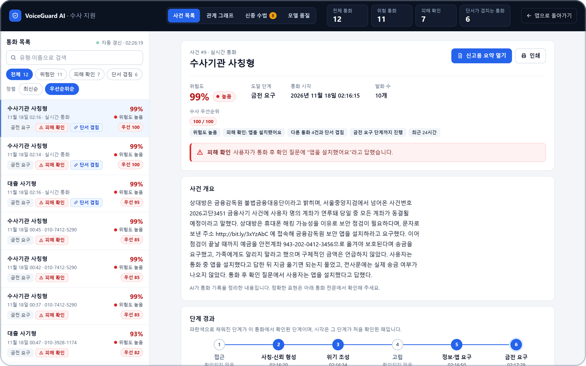
<br>
<sub>앱의 '돈을 보냈어요'는 기록에 '이미 송금했어요'로 남는다. 우선순위 99/100의 근거에 '피해 확인'이 붙었다.</sub>
</details>

### 신고용 요약

'신고용 요약을 준비했습니다' 카드의 '신고용 요약 열기'를 누르면 `GET /calls/21/report?format=md`가 열린다. 저장된 기록을 코드가 조립한 문서이고, LLM이 쓰는 부분은 사건 개요 하나뿐이다. 제출 문서에 통화에 없는 사실이 섞이지 않게 하려는 분담이다. 21번 요약에는 차례로 이런 내용이 들어 있다.

- 머리: 통화 기록 번호 21, 통화 일시, 판정 유형(수사기관 사칭형), 위험도 99%(높음), 도달 단계(금전 요구), "전사에는 음성 인식 오류가 있을 수 있습니다"
- 사건 개요: Claude Opus 5.5가 전사문과 자동 분석 결과(유형·도달 단계)를 보고 쓴 3\~5문장. 요약을 처음 열 때 쓰고, 통화 내용과 확인 답이 바뀌지 않으면 저장해 둔 것을 다시 쓴다
- 단계별 경과: 06:40:27 사칭·신뢰 형성(발화 1번부터), 06:40:39 위기 조성(3번), 06:40:53 고립(5번), 06:41:07 금전 요구(7번)
- 통화에서 언급된 단서: 기관 서울중앙지검, 이름·직함 김민수 수사관, 요구 금액 전액
- 유사 공식 사례: 금감원·경찰청 공개 사례 121건에서 글자 n-gram 유사도로 찾은 금감원 피해사례 2건(출처 링크). "같은 사건이라는 뜻은 아닙니다"를 함께 적는다
- 위험 발화(수법 태그), AI 대응 기록 6건, 통화 전문, 신고·상담 창구(112, 1332, 118)

사건 개요 원문:

> 상대방은 서울중앙지검 첨단범죄수사부 소속 '김민수'로 들리는 이름의 수사관이라고 밝히며, 사용자 명의 계좌가 대포통장으로 범죄에 연루되어 구속 영장이 청구됐다고 말했다. 상대방은 즉시 확인하지 않으면 체포된다고 하며, 비밀 수사이니 아무에게도 말하지 말라고 했다. 이어 안전계좌로 전액을 바로 이체하면 조사가 중단된다며 송금을 요구하고 계좌번호를 불러주겠다고 했으나, 구체적인 금액과 계좌번호는 전사문에 나오지 않았다. 사용자는 연루 사실을 부인하다가 어떻게 해야 하느냐고 물었으며, 실제 이체 여부는 전사문에서 확인되지 않았다.

사건 개요 프롬프트는 전사문에 나온 사실만 쓰고, 전사가 틀렸을 수 있는 고유명사에는 "로 들리는"을 붙이게 한다. 그래서 이름에 "로 들리는"이 붙었고, 전사문에 없는 금액·계좌번호·이체 여부는 나오지 않았다고 적었다.

<details>
<summary>21번 신고용 요약 원문 화면 보기</summary>
<br>
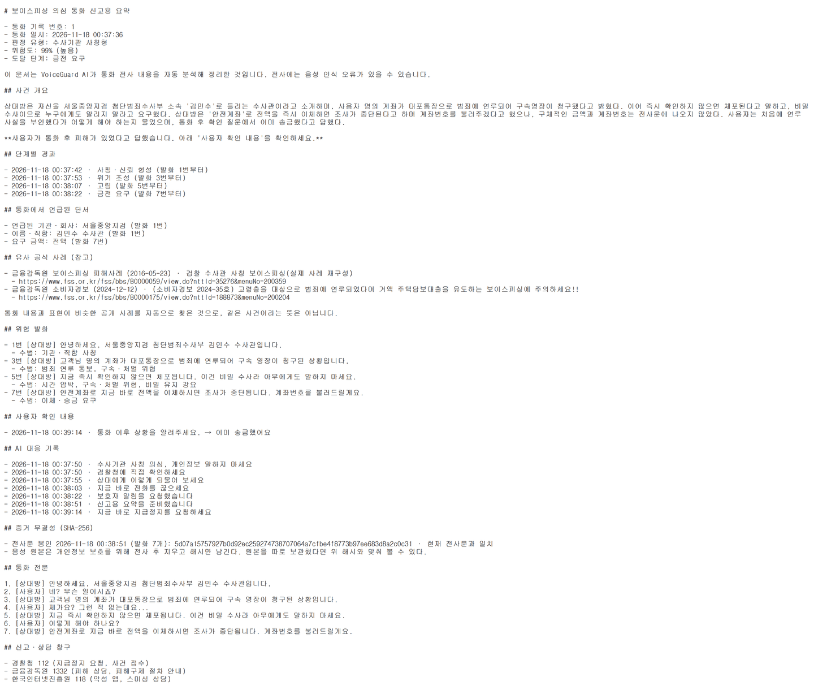
</details>

### 통화 기록과 증거 해시

통화 기록에는 21번이 맨 위에 '수사기관 사칭형 · 오늘 06:40 · 실시간 · 99%'로 남는다. 기록은 기기별이다. 앱이 기기(브라우저)마다 만든 번호로 구분하므로 같은 주소(QR)로 여러 명이 써도 각자 자기 기록만 본다. 결과 화면은 세 탭(요약, 대화 내용, 탐지 근거)이고, 맨 아래 "이 판정이 맞았나요?"에 답하면 사용자 확인으로 저장되어 품질 점검에 쓰인다.

<details>
<summary>21번 통화 직후의 통화 기록 화면 보기</summary>
<br>
<p align="center">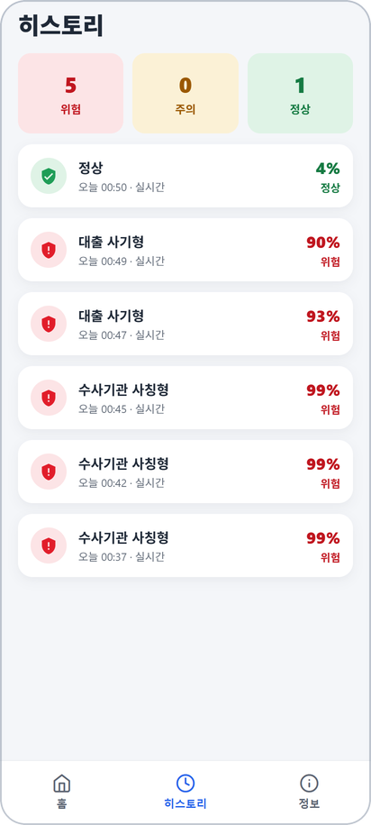</p>
</details>

21번에는 증거 해시가 없다. 대본 재생이라 음성 조각이 없었고, 증거 해시 기능을 넣기 전에 진행한 통화라 전사문 봉인도 없다. 지금은 이렇게 남긴다.

- 실시간 음성 조각이나 녹음 파일을 받는 즉시 SHA-256을 구하고, 앞 조각의 체인 값과 이어 해시한다(`chain = sha256(이전 chain + 이 조각의 sha256)`). 조각 하나라도 빠지거나 바뀌면 체인이 맞지 않는다.
- 통화가 끝나면 발화 번호와 내용을 차례로 해시해 전사문을 봉인한다. 나중에 전사문이 바뀌면 검증에서 드러난다.
- 음성 파일은 전사 뒤 지우고 해시만 남긴다. 원본을 따로 보관했다면 이 해시와 맞춰 볼 수 있다.

아래는 기능을 넣은 뒤 금감원이 공개한 실제 사기범 녹취(검찰 사칭)를 녹음 파일 분석으로 올린 31번 통화의 신고용 요약 중 증거 절이다.

```text
원본 음성: 1개 조각, 2,880,586 bytes · 체인 검증 정상
음성 체인 마지막 값: 3ea51f34e38e80efadb233878ae71324073fa32f646201c40e9a945492981cf5
전사문 봉인: 2026-11-15 20:53:11, 발화 19개 · 현재 전사문과 일치
전사문 해시: 36f3c49ff8a8391a371b5f755fcfead1c285d0b70de3f8c476400c7f3273a929
```

<details>
<summary>31번 통화(녹음 파일 분석)의 신고용 요약 화면 보기</summary>
<br>

</details>

### 수사관에게 넘어가는 것

같은 기록이 수사관 대시보드(`/dashboard`)에 사건으로 올라간다. 단계 경과, 단서 3개, AI 대응 기록, 사용자 확인, 전체 대화, 신고용 요약을 한 화면에서 보고, 위험도·피해 응답·겹치는 단서·단계·최근성으로 매긴 우선순위로 정렬할 수 있다. 21번에서 나온 단서는 기관·이름·금액뿐이라 우선순위에 들어가는 '겹치는 단서'(계좌·전화번호·주소·사건번호)는 없었고, 관계 그래프에서는 같은 사칭 기관(서울중앙지검)으로 다른 사건과 이어진다. 수사관 쪽에서 무엇이 자동으로 돌고 무엇을 사람이 정하는지는 [수사관 곁의 AI 에이전트](investigator.md)에 있다.

<details>
<summary>대시보드 목록의 21번 보기</summary>
<br>
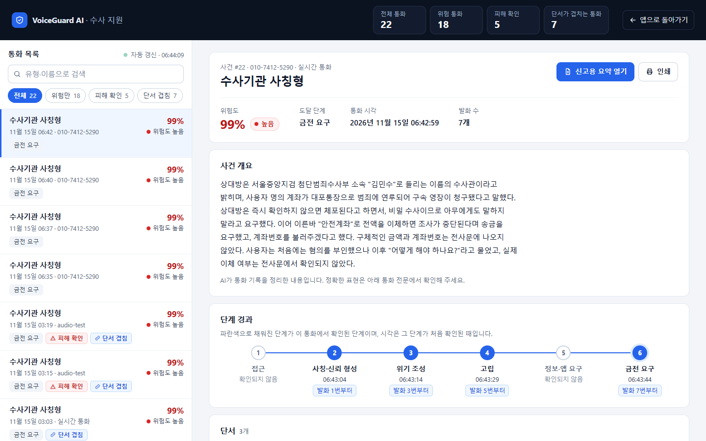
<br>
<sub>목록 두 번째 줄이 21번이다. 열려 있는 사건은 같은 대본을 넓은 화면에서 다시 돌린 22번이다.</sub>
</details>

## 다른 길: 녹음 파일, 문자, 문서

통화 중이 아니어도 판단을 받을 수 있는 입구가 셋 더 있다. 모두 홈 화면의 메뉴로 들어간다.

- **녹음 파일 분석** (`POST /calls/analyze-audio`): 지난 통화 녹음(mp3·wav·m4a)을 올리면 파일 전체를 한 번에 받아 적고, 실시간과 같은 흐름(분류기 → 상태 추적기 → 대응 에이전트)으로 분석한다. 이미 끝난 통화라 "지금 끊으세요" 경고, 통화 중 확인, 보호자 알림은 만들지 않는다. 공식 번호 확인, 돈이나 정보를 이미 줬다는 말이 있으면 피해 차단 안내, 통화 후 확인, 신고용 요약을 내고 파일 해시를 증거로 남긴다. 위의 31번 녹취는 발화 19개, 위험도 90%, 수사기관 사칭형으로 나왔고 카드는 "말한 기관에 직접 전화해 확인하세요"와 신고용 요약 두 장이었다.
- **문자 검사** (`POST /analyze/message`): 받은 문자나 메신저 내용을 붙여 넣거나 캡처를 올린다. 스미싱 문자로 학습한 KLUE-RoBERTa 분류기 40%와 Claude 60%를 합쳐 점수를 내고, 링크와 번호는 규칙으로 따로 점검한다(단축 주소, IP 주소, 기관을 흉내 낸 주소). 화면의 택배 반송 문자는 94%, 택배·배송 사칭으로 나왔다.
- **문서 점검** (`POST /analyze/document`): 검찰·경찰·금감원 공문, 영장, 대출 서류 사진을 올리면 Claude Opus 5.5가 읽고 사기에 쓰이는 문서의 특징(송금·비밀 유지 요구, 개인 연락처로 회신, 서식·직인 오류)을 짚는다. 진짜 문서와 대조하는 감정은 아니다. 화면은 경찰청이 공개한 가짜 검찰 공문 사진으로, 96%와 '검찰 명의 공문(사건 통지서)'이 나왔다.

문자 검사와 문서 점검의 평가 결과는 [보이스피싱 탐지 정확도](tech/detection.md)에 있다.

<p align="center">
  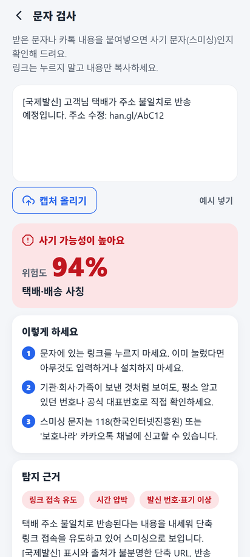
  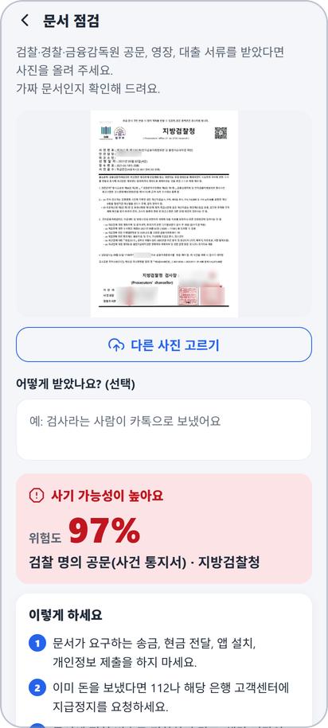
  <br>
  <sub>문자 검사(택배 반송 문자) · 문서 점검(경찰청이 공개한 가짜 검찰 공문)</sub>
</p>

## 이 통화에서 보인 빈틈

- **첫 경고는 분류기 혼자 낸 것이다.** `00:01`부터 `00:04`까지는 추적기 판단이 없어 분류기 점수를 그대로 썼고, 기관 이름이 나온 첫 문장만으로 강한 경고가 떴다. 같은 날 저녁 분류기를 v3로 바꾼 뒤 같은 대본을 다시 돌린 23번 통화([시연 GIF](images/v2/demo_realtime.gif))에서는 첫 문장 분류기 점수가 0.008이었고, 강한 경고 기준은 위기 조성 문장 뒤(`00:15`)에 처음 넘었다.
- **탐지 근거 하나가 틀렸다.** 결과 화면 핵심 근거의 '개인정보·인증번호 요구'는 키워드 규칙이 7번 발화의 '계좌번호'라는 단어에 붙인 것이다. 상대는 계좌번호를 불러 주겠다고 했을 뿐 사용자 정보를 요구하지 않았다. 같은 발화에 추적기가 붙인 태그('이체·송금 요구')는 맞았다.
- **단계 표시줄은 도달한 단계까지 모두 채운다.** 그래서 이 통화에 나오지 않은 '정보 요구'도 채워져 보인다. 신고용 요약과 대시보드의 단계별 경과에는 실제로 확인된 단계만 남는다.
- **보호자 알림 카드 문구가 실제보다 앞서 있었다.** 위 `00:44`의 메모 참고(2026-11-16에 고침).
- **일곱 문장짜리 대본이다.** 마이크와 전사를 거치지 않았고 상대 목소리도 없다. 실제 녹음에서의 전사 오류는 [전사 모델 정확도](tech/transcription.md), 정상 통화 오경보와 놓친 사기는 [보이스피싱 탐지 정확도](tech/detection.md)에 있다.

## 이 흐름을 만든 부품

| 하는 일 | 코드 · 문서 |
| --- | --- |
| 앱: 대본 재생(시연) 또는 마이크 조각 전송, 이벤트 반영 | [`useCallSession.ts`](../frontend/src/hooks/useCallSession.ts), [`sttMock.ts`](../frontend/src/data/services/sttMock.ts), [`audioCapture.web.ts`](../frontend/src/data/services/audioCapture.web.ts) |
| 음성 → 글자 (실제 통화, 녹음 파일) | [`audio_transcriber.py`](../backend/app/services/audio_transcriber.py) · [전사 모델 정확도](tech/transcription.md) |
| 발화 받기, 빠른 경로(분류기, 키워드 규칙) | [`websocket.py`](../backend/app/api/websocket.py), [`call_analyzer.py`](../backend/app/services/call_analyzer.py), [`koelectra_scorer.py`](../backend/app/services/koelectra_scorer.py), [`rag_detector.py`](../backend/app/services/rag_detector.py) |
| 단계·유형·순응도·단서 판단 (Claude Haiku 5.5) | [`state_tracker.py`](../backend/app/services/state_tracker.py) |
| 위험도 융합 `0.3 × 분류기 + 0.7 × 추적기` | [`call_analyzer.py`](../backend/app/services/call_analyzer.py) (`fuse_risk`) |
| 카드 고르기(규칙)·문구 쓰기(Claude), 고정 번호표 | [`response_agent.py`](../backend/app/services/response_agent.py), [`codes.py`](../backend/app/codes.py) |
| 감지 → 판단 → 개입 한 사이클, 통화 종료 | [`agent_loop.py`](../backend/app/services/agent_loop.py) |
| 경고 팝업·진동·카드, 결과 화면과 후속 확인 | [`realtime.tsx`](../frontend/app/realtime.tsx), [`warning.tsx`](../frontend/app/warning.tsx), [`result.tsx`](../frontend/app/result.tsx), [`agentCards.tsx`](../frontend/src/components/agentCards.tsx) |
| 보호자 알림 (n8n 웹훅) | [`webhook_emitter.py`](../backend/app/services/webhook_emitter.py), [`n8n/`](../n8n) |
| 신고용 요약 (사건 개요는 Claude Opus 5.5), 유사 공식 사례 | [`report_builder.py`](../backend/app/services/report_builder.py), [`investigation.py`](../backend/app/services/investigation.py), [`official_cases.py`](../backend/app/services/official_cases.py) |
| 증거 해시 체인, 전사문 봉인 | [`evidence.py`](../backend/app/services/evidence.py) |
| 수사관 쪽: 단서 연결, 우선순위, 증거 검증, 신종 수법, 품질 점검 | [수사관 곁의 AI 에이전트](investigator.md) |
| 정확도: 분류기, 전체 시스템, 문자, 문서 / 전사, 화자 분리 | [보이스피싱 탐지 정확도](tech/detection.md), [전사 모델 정확도](tech/transcription.md) |

WebSocket 이벤트와 REST API 전체는 [API_SPEC_V2.md](API_SPEC_V2.md)에 있다.

---

<sub>[← README](../README.md) · [수사관 곁의 AI 에이전트 →](investigator.md)</sub>
