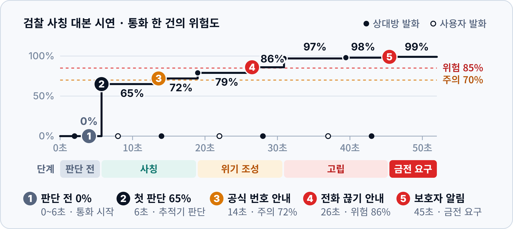
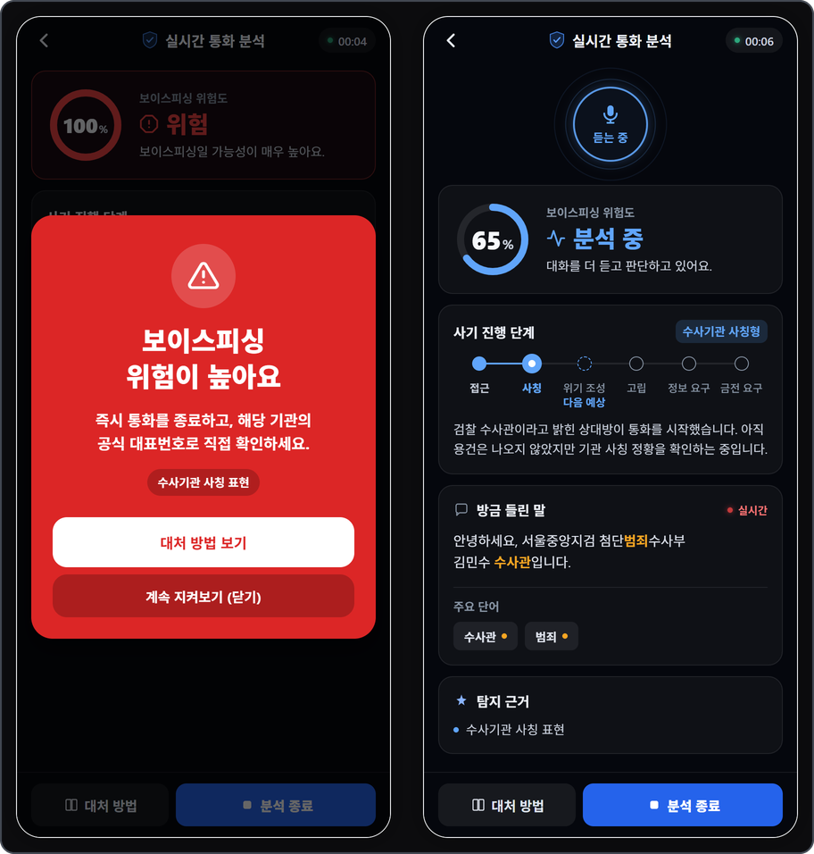
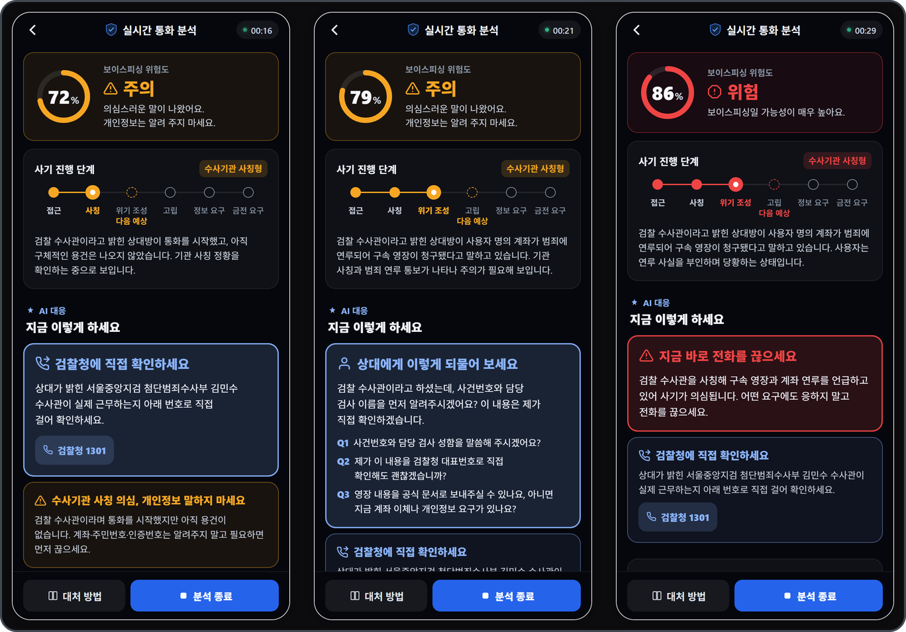
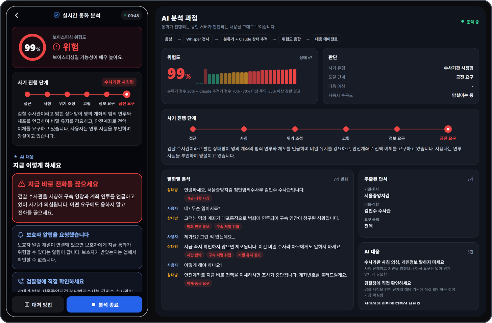
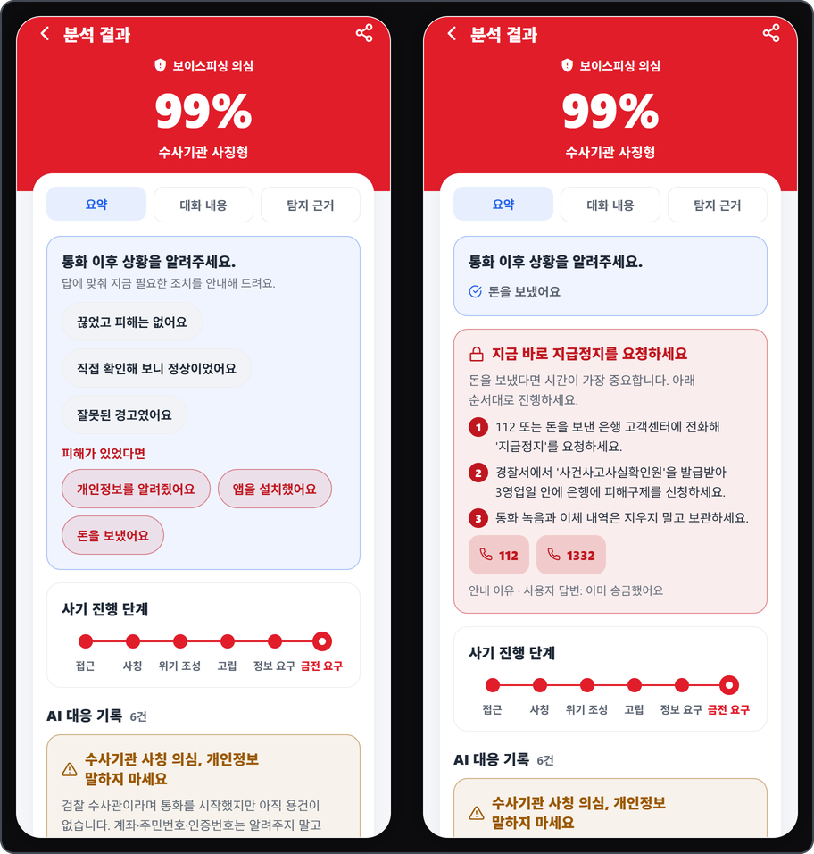

# 전화 흐름으로 기능 보기

[← README](../README.md) · [수사관 지원용 능동 AI 에이전트 기능](investigator.md) · [보이스피싱 탐지 성능](tech/detection.md) · [음성 인식·화자 분리 성능](tech/transcription.md)

검찰 사칭 대본 통화 한 건을 현재 빌드(통화 분류기 v5)로 실행한 기록입니다. 통화가 시작될 때부터 끝난 뒤까지 AI가 판단한 내용과 앱이 안내한 내용을 순서대로 정리했습니다.

- **통화 중**: 첫 발화 직후(분석 시작 약 3초) 분류기 점수만으로 전체 화면 경고가 표시됐습니다. 상태 추적기가 대화 맥락을 반영하자 위험도는 65%로 재평가됐고, 통화가 진행되면서 72%, 79%, 86%를 거쳐 99%까지 올랐습니다. 그동안 앱은 주의 경고, 검찰청 공식 번호, 되물어 볼 질문, "지금 바로 전화를 끊으세요", 보호자 알림 요청 카드를 차례로 표시했습니다.
- **통화 후**: 신고용 요약을 준비하고 피해 여부를 물었습니다. "돈을 보냈어요"라고 답하자 지급정지 절차와 전화번호(112, 1332)를 안내했습니다.
- **수사 지원**: 같은 기록이 단계별 경과, 단서, 확인 응답과 함께 수사 지원 대시보드에 사건으로 등록됐습니다.

아래 그림은 이 통화의 위험도 변화입니다(README와 같은 그림). 음성 입력으로 잰 결과가 아니라, 대본을 글로 입력한 시연 1회의 기록입니다. 화면 위험도는 `0.3 × 분류기 + 0.7 × 상태 추적기`로 계산하며, 그림에는 상태 추적기의 판단이 반영된 값을 표시했고 추적기의 첫 판단이 도착하기 전에는 0%로 두었습니다.

<picture>
  <source media="(prefers-color-scheme: dark)" srcset="images/readme/timeline-dark.png">
  
</picture>

①은 상태 추적기의 첫 판단이 도착하기 전이므로 0%로 두었습니다. 이 구간에서는 분류기 점수만으로 화면 위험도를 결정하며, 이 기록에서는 약 3초 시점에 전체 화면 경고가 먼저 표시됐습니다(아래 표의 `00:02` 행). ②에서 추적기의 첫 판단이 도착하면서 위험도가 65%가 됐고, 단계가 진행되면서 올랐습니다.

## 시연 조건

> [!NOTE]
> 대본을 글자로 보낸 시연입니다. 앱의 시연 모드가 미리 적어 둔 일곱 문장을 정해진 시각에 서버로 보냈으므로 마이크 입력과 음성 인식(전사)은 포함하지 않았습니다. 2026-11-18에 한 번 실행한 기록이며, 이 페이지의 점수와 시각은 탐지 성능을 나타내지 않습니다. 성능은 [보이스피싱 탐지 성능](tech/detection.md)에 있습니다.

- **모델**: 통화 분류기는 v5(KLUE-RoBERTa), 상태 추적기는 Claude Haiku 5.5, 사건 개요 작성은 Claude Opus 5.5입니다.
- **입력**: 검찰 사칭 대본 일곱 문장을 분석 시작 2·8·14·22·28·37·43초에 보냈습니다. 대본의 인물과 전화번호는 가상입니다.
- **환경**: 공개 시연 서버가 아닌 로컬 스테이징 서버에서, 통화 기록을 비운 DB로 실행했습니다. 알림 요청은 n8n 대신 로컬 수신기가 받았고 실제 알림은 나가지 않았습니다.
- **화면**: 넓은 화면으로 찍어 왼쪽에 앱, 오른쪽에 'AI 분석 과정' 패널이 함께 보입니다. 패널 위쪽의 '음성 → Whisper 전사' 표시는 고정 문구이며 이 시연에서는 거치지 않았습니다.

글자를 받은 뒤의 처리(분류기, 상태 추적기, 대응 에이전트, 알림 전송 요청, 기록 저장)는 실제 앱과 같은 코드가 맡았습니다. 이 페이지의 화면은 모두 이 실행에서 찍었습니다. 2026-11-15에 분류기 v2로 기록한 이전 내용은 저장소 이력에 있습니다.

재현 방법

- 웹 앱 주소 뒤에 `/realtime?scenario=prosecutor`를 붙여 열고 '분석 시작'을 누릅니다. 창 너비가 1180px 이상이면 오른쪽에 'AI 분석 과정' 패널이 함께 표시됩니다.
- 대본과 전송 시각은 [`mockScenarios.ts`](../frontend/src/data/mock/mockScenarios.ts)에 있습니다.
- 보호자 알림 요청 카드는 서버에 n8n 알림 주소가 설정돼 있을 때만 나옵니다.
- Claude가 쓰는 카드 문구와 추적기 점수는 실행마다 조금 달라질 수 있습니다. 이 실행 전에 같은 서버에서 시험 통화를 먼저 실행해, 유사 사례 색인과 Claude 호출이 준비된 상태였습니다.
- 통화 중에 주고받는 이벤트와 API는 [API_SPEC_V2.md](API_SPEC_V2.md)에 있습니다.

### 실제 통화에서 추가되는 처리

- **음성 입력과 전사**: 앱이 마이크 음성을 말이 끊긴 지점에서 잘라 보내면, 서버가 조각마다 Whisper large-v3로 전사한 뒤 이 페이지와 같은 판단 과정을 거칩니다. 웹 앱은 분석하는 동안 휴대폰 화면이 꺼지지 않게 합니다(Screen Wake Lock API를 지원하는 브라우저).
- **화자 구분**: 기본 설정에서는 누가 한 말인지를 목소리가 아니라 상태 추적기가 발화 내용으로 추정합니다.
- **통화 종료 후 재전사**: 녹음 전체를 다시 전사하고 상태를 처음부터 다시 추적해 결과 화면과 신고용 요약에 반영합니다.

선택 설정인 리턴제로를 포함한 전사 엔진 구성과 전사·화자 분리 성능은 [음성 인식·화자 분리 성능](tech/transcription.md)에 있습니다.

## 통화 흐름 요약

발화가 서버에 도착할 때마다 분류기와 상태 추적기가 각각 판단하고, 그 결과에 따라 대응 에이전트가 안내를 정합니다.

- **통화 분류기**(KLUE-RoBERTa v5): 발화가 도착하면 바로 사기 확률을 냅니다.
- **상태 추적기**(Claude Haiku 5.5): 통화 전체를 읽고 사기 단계, 유형, 사용자 반응, 단서를 판단하며 발화마다 수법 태그를 붙입니다. 이 통화에서는 발화 2.5\~5.6초 뒤에 판단이 도착했습니다.
- **대응 에이전트**: 위험도와 단계에 맞는 대응 안내 카드를 규칙으로 고르고, 문구는 Claude가 통화 내용에 맞춰 씁니다. 전화번호와 피해 차단 절차는 코드의 고정 표에서 가져옵니다.

화면에 표시하는 위험도는 `0.3 × 분류기 + 0.7 × 추적기`로 계산합니다. 추적기 판단이 도착하기 전에는 분류기 점수를 그대로 씁니다. 추적기가 위기 조성 이상 단계를 0.70 이상으로 판단하면 위험도를 0.70 아래로 내리지 않고, 정보 요구 이상 단계를 0.85 이상으로 판단하면 0.85 아래로 내리지 않습니다. 위험도가 70% 이상이면 주의, 85% 이상이면 강한 경고(화면 표시 '위험')이며, 40% 이상 70% 미만은 '분석 중'으로 표시합니다.

| 시각 | 발화 요지 | AI 판단 (단계 · 위험도) | 화면 안내 |
| --- | --- | --- | --- |
| `00:02` | 상대방: "서울중앙지검 첨단범죄수사부 김민수 수사관입니다." | 분류기 단독 0.9997 → **100%** 추적기 첫 판단 뒤: 사칭·신뢰 형성 · 추적기 0.50 → **65%** | 약 3초에 전체 화면 경고(화면 ①) 재평가 뒤 '분석 중', 카드 없음 |
| `00:08` | 사용자: "네? 무슨 일이시죠?" | 사칭·신뢰 형성 · 추적기 0.60 → **72%** (주의) | 주의 경고 카드, 검찰청 공식 번호(1301) 카드(화면 ②) |
| `00:14` | 상대방: 명의 계좌가 범죄에 연루돼 구속 영장이 청구됐다고 통보 | 위기 조성 · 추적기 0.70 → **79%** (주의) 사용자 반응 '망설이는 중' | 되물어 볼 질문 카드(화면 ②) |
| `00:22` | 사용자: "제가요? 그런 적 없는데요..." | 위기 조성 · 추적기 0.80 → **86%** (위험) | "지금 바로 전화를 끊으세요" 카드(화면 ②) 통화 중 확인 질문 생성 |
| `00:28` | 상대방: 즉시 확인하지 않으면 체포된다며 비밀 유지 요구 | 고립 · 추적기 0.95 → **97%** | 새 카드 없음 |
| `00:37` | 사용자: "어떻게 해야 하나요?" | 고립 · 추적기 0.97 → **98%** | 새 카드 없음 |
| `00:43` | 상대방: 안전계좌로 전액을 이체하라고 요구 | 금전 요구 · 추적기 0.99 → **99%** 요구 금액 '전액'을 단서로 저장 | 보호자 알림 요청 카드(화면 ③) |
| `01:12` | 발화 없음 | – | 통화 중 확인 질문 "통화를 끊으셨나요?" 표시, 답하지 않음 |
| `01:14` | 사용자가 '분석 종료'를 누름 | 최종 **99%** · 수사기관 사칭형 · 금전 요구 단계 | 신고용 요약 카드, 통화 후 확인 질문(화면 ④) |

시각은 분석을 시작한 때부터 잰 값입니다. 발화가 있는 행은 전송 시각이며, 화면 타이머와는 1초 안팎 차이가 납니다. 위험도는 그 발화까지 읽은 추적기 판단을 반영한 값입니다. 분류기 점수는 통화 내내 0.9997 이상이었습니다.

**첫 발화의 경고와 재평가**

1. 분류기는 소속과 이름을 밝힌 첫 문장 하나에 0.9997을 냈습니다. 추적기 판단이 아직 없어 이 값이 그대로 위험도가 됐고, 강한 경고 기준을 넘어 분석 시작 약 3초에 전체 화면 경고가 표시됐습니다.
2. 5.7초에 추적기의 첫 판단이 도착했습니다. 검찰 수사관이라고 밝혔지만 아직 용건은 나오지 않았다는 판단이었고(추적기 위험도 0.50), 위험도는 `0.3 × 0.9997 + 0.7 × 0.50 = 0.65`로 재평가됐습니다.
3. 그 뒤로는 대화가 이어지고 사기 단계가 진행되면서 추적기 위험도가 0.60에서 0.99까지 올랐고, 위험도도 함께 올랐습니다. 화면 ③의 패널에 있는 위험도 막대에서 이 흐름을 볼 수 있습니다.
4. 전체 화면 경고는 통화당 한 번만 표시합니다. 그래서 위험도가 86%가 된 시점에는 경고 화면이 다시 뜨지 않고 "지금 바로 전화를 끊으세요" 카드로 안내했습니다.

고립 단계에서 새 카드가 없었던 것은 같은 종류의 카드를 한 번만 내기 때문입니다. 통화 중 확인 질문은 "지금 바로 전화를 끊으세요" 카드와 함께 만들어지고 45초 뒤에 표시됩니다.

## 단계별 주요 화면

  
   
  ① 00:04 첫 발화 직후 분류기 점수만으로 표시된 전체 화면 경고(왼쪽)와 00:06 추적기의 첫 판단이 반영돼 65% '분석 중'으로 바뀐 화면(오른쪽)

  
   
  ② 위험도에 따라 바뀐 대응 안내 카드. 00:16 주의 72%: 공식 번호와 주의 경고 → 00:21 주의 79%: 되물어 볼 질문 → 00:29 위험 86%: "지금 바로 전화를 끊으세요"

  
   
  ③ 00:48 금전 요구 단계(99%). 보호자 알림 요청 카드가 추가된 앱(왼쪽)과 위험도 추이·단계·발화별 수법 태그·단서·대응 기록을 보여 주는 'AI 분석 과정' 패널(오른쪽)

  
   
  ④ 통화 종료 후 결과 화면. 맨 위의 통화 후 확인 질문(왼쪽)과 "돈을 보냈어요"라고 답한 뒤 표시된 지급정지 안내(오른쪽)

전체 화면 경고와 대응 안내 카드의 규칙

- **전체 화면 경고**: 위험도가 강한 경고 기준을 처음 넘을 때 통화당 한 번 표시합니다. 이 기준은 설정에서 70\~85% 사이로 낮출 수 있습니다.
- **경고 카드**: 위험도가 주의 이상이면 표시합니다. 주의 단계에서 한 번, 강한 경고 단계에서 한 번입니다.
- **공식 번호 안내, 되물어 볼 질문**: 위험도가 주의 이상이고 사기 유형이 정해졌으며 단계가 사칭 이상이면 후보가 됩니다. Claude가 지금은 맞지 않는다고 판단하면 건너뛰고 다음 판단 때 다시 봅니다.
- **보호자 알림 요청**: 강한 경고 상태에서 사용자가 요구를 따르기 시작했거나 금전 요구 단계에 이르면 표시하고, 같은 순간 n8n에 알림 전송을 요청합니다.
- **통화 중 확인 질문**: "아직 통화 중이에요"라고 답하면 "지금 바로 끊으세요"를 다시 표시하고 질문을 다시 예약합니다(통화당 최대 3번).
- **통화 중 단서 대조**: 새로 나온 계좌·전화번호·웹 주소·사건번호가 다른 통화에도 나왔으면 바로 알립니다([단서 연결](investigator.md#단서-연결)).
- **반복 방지**: 같은 종류의 카드는 한 번만 표시합니다. "지금 바로 전화를 끊으세요"가 나오면 주의 경고는 이 카드로 바뀌고 되물어 볼 질문은 화면에서 내려갑니다. 전화를 끊으라는 안내와 통화를 이어 가라는 안내가 함께 보이지 않게 하려는 것입니다.
- **문구**: 경고 카드, 공식 번호 안내, 되물어 볼 질문의 문구와 안내 이유는 Claude가 씁니다. 안내할 기관은 정해진 목록에서 고르고 전화번호는 코드의 고정 표에서 붙입니다. Claude 호출이 실패하면 고정 문구를 씁니다.

## 통화 후 대응

### 통화 후 피해 여부 확인

위험도가 주의 이상인 통화가 끝나면 대응 에이전트가 신고용 요약 카드와 통화 후 확인 질문을 만듭니다. 결과 화면 맨 위에 "통화 이후 상황을 알려주세요."와 답 여섯 개가 표시되며, 피해가 있었다는 세 답은 '피해가 있었다면' 아래에 따로 묶여 있습니다. 통화 중 확인 질문에 이미 답했다면('아직 통화 중이에요' 제외) 통화 후에는 다시 묻지 않습니다. 시연 통화에서는 "돈을 보냈어요"라고 답했습니다.

<table>
<tr><th>확인 응답</th><th>화면 안내</th><th>기록과 알림 요청</th></tr>
<tr><td nowrap><b>돈을 보냈어요</b></td><td><b>지금 바로 지급정지를 요청하세요</b> ① 112나 돈을 보낸 은행 고객센터에 지급정지 요청 ② 경찰서에서 사건사고사실확인원을 발급받아 3영업일 안에 은행에 피해구제 신청 ③ 통화 녹음과 이체 내역 보관 전화 버튼 112, 1332</td><td>피해 응답으로 기록. <a href="investigator.md#수사-검토-우선순위-제안">수사 검토 우선순위</a>에 25점 추가, 신고용 요약에 피해 응답 표시. n8n에 피해 응답 알림 요청</td></tr>
<tr><td nowrap><b>개인정보를 알려줬어요</b></td><td><b>명의도용을 막는 조치를 하세요</b> ① 금융감독원 개인정보노출자 사고예방시스템 등록 ② 계좌정보통합관리서비스에서 일괄 지급정지 신청 ③ 엠세이퍼에서 내 명의로 개통된 휴대전화 확인 ④ 알려 준 비밀번호 변경, 인증서 재발급 전화 버튼 1332, 118</td><td>위와 같음</td></tr>
<tr><td nowrap><b>앱을 설치했어요</b></td><td><b>휴대전화를 먼저 차단하세요</b> ① 비행기 모드로 바꾸거나 전원 끄기 ② 다른 전화기로 112나 은행 고객센터에 지급정지 요청 ③ 앱 삭제 후 통신사 대리점이나 서비스센터에서 점검 ④ 휴대전화에 저장한 신분증 사진과 인증서 재발급 전화 버튼 112, 118</td><td>위와 같음</td></tr>
<tr><td nowrap><b>끊었고 피해는 없어요</b></td><td>새 안내 없음</td><td>확인 응답만 기록. n8n에 확인 결과 알림 요청</td></tr>
<tr><td nowrap><b>직접 확인해 보니 정상이었어요</b> <b>잘못된 경고였어요</b></td><td>새 안내 없음</td><td>오경보 의심 사례로 기록해 <a href="investigator.md#품질-점검">품질 점검</a>에 사용. n8n에 확인 결과 알림 요청</td></tr>
</table>

피해 차단 절차와 전화번호는 Claude가 쓰지 않고 코드의 고정 문구를 씁니다. 앱의 '돈을 보냈어요'는 기록과 신고용 요약에 '이미 송금했어요'로 남습니다.

### 신고용 요약

'신고용 요약을 준비했습니다' 카드에서 '신고용 요약 열기'를 누르면 문서가 열립니다. 저장된 통화 기록을 코드가 조립한 문서이며, Claude Opus 5.5가 쓰는 부분은 사건 개요뿐입니다. 문서에는 사건 개요, 단계별 경과, 단서, 유사 공식 사례, 위험 발화, 확인 응답, AI 대응 기록, 무결성 확인, 통화 전문, 신고·상담 창구가 차례로 들어갑니다.

시연 통화의 사건 개요는 요구 금액과 계좌번호가 "전사문에 나오지 않았다"고 적었고, 확인 응답 뒤에는 그 답을 마지막 문장에 반영해 다시 작성됐습니다. 문서 구성과 작성 기준은 [신고용 요약](investigator.md#신고용-요약)에 있습니다.

시연 통화의 사건 개요 원문 (확인 응답 반영 후)

> 상대방은 자신을 서울중앙지검 첨단범죄수사부 소속 '김민수'로 들리는 수사관이라고 소개하며, 사용자 명의 계좌가 대포통장으로 범죄에 연루되어 구속영장이 청구됐다고 밝혔다. 이어 즉시 확인하지 않으면 체포된다고 말하고, 비밀 수사이므로 누구에게도 알리지 말라고 요구했다. 상대방은 '안전계좌'로 전액을 즉시 이체하면 조사가 중단된다고 하며 계좌번호를 불러주겠다고 했으나, 구체적인 금액과 계좌번호는 전사문에 나오지 않았다. 사용자는 처음에 연루 사실을 부인했다가 어떻게 해야 하는지 물었으며, 통화 후 확인 질문에서 이미 송금했다고 답했다.

## 수사 지원 대시보드에 제공되는 정보

통화 기록은 수사 지원 대시보드에 사건으로 등록됩니다. 사건 상세에서 사건 개요, 단계별 경과, 단서, 위험 발화, AI 대응 기록, 확인 응답, 통화 전문, 무결성 확인 결과를 함께 보고 신고용 요약을 열 수 있습니다. 시연 통화는 다음 정보를 남겼습니다.

- **단계별 경과**: 사칭·신뢰 형성(발화 1번부터) → 위기 조성(3번부터) → 고립(5번부터) → 금전 요구(7번)
- **단서**: 기관 '서울중앙지검', 이름·직함 '김민수 수사관', 요구 금액 '전액'. 계좌·전화번호·웹 주소·사건번호가 없어 다른 통화와 연결되지 않았습니다.
- **확인 응답**: '이미 송금했어요'. 수사 검토 우선순위에 피해 확인 25점이 반영됩니다.
- **무결성 확인**: 통화 종료 시 전사문 해시(SHA-256, 발화 7개)를 저장했고 현재 전사문과 일치합니다. 글자로 입력한 통화라 음성 해시 체인은 없습니다.

우선순위 배점은 팀이 정한 기준이며 수사관의 검증을 거치지 않았습니다. 단서 연결, 우선순위, 무결성 확인의 기준과 대시보드 화면은 [수사관 지원용 능동 AI 에이전트 기능](investigator.md)에 있습니다.

## 시연에서 확인된 한계와 개선 사항

- **첫 경고는 분류기 단독 판단이었습니다.** 소속과 이름을 밝힌 첫 문장만으로 전체 화면 경고가 표시됐고, 추적기는 같은 시점의 위험도를 0.50으로 봤습니다. 정상 통화에서도 이름과 직함을 소개하는 첫마디에 분류기가 경보를 낼 수 있습니다([현재 모델의 주의점](tech/detection.md#현재-모델의-주의점)). 또 전체 화면 경고는 통화당 한 번이라, 첫 문장에서 표시되고 나면 추적기 판단까지 반영한 위험도가 강한 경고 기준을 넘는 시점에는 다시 나오지 않습니다.
- **탐지 근거 하나가 틀렸습니다.** 결과 화면 핵심 근거의 '개인정보·인증번호 요구'는 키워드 규칙이 마지막 발화의 '계좌번호'라는 단어에 붙인 것입니다. 상대방은 계좌번호를 불러 주겠다고 했을 뿐 사용자의 정보를 요구하지 않았습니다. 같은 발화에 상태 추적기가 붙인 수법 태그 '이체·송금 요구'는 맞았습니다.
- **단계 표시줄은 도달한 단계까지 모두 채웁니다.** 이 통화에서 확인되지 않은 '접근'과 '정보 요구'도 채워져 보입니다. 신고용 요약과 대시보드의 단계별 경과에는 확인된 단계만 남습니다.
- **보호자 알림은 전송 요청까지만 지원합니다.** 서버는 n8n에 알림 전송을 요청할 뿐이며, 앱에는 보호자 등록 화면과 수신 확인 기능이 없습니다. 공개 시연 서버에서는 n8n 위험 알림 워크플로가 이 요청을 받아 Slack 채널에 알림을 올립니다(2026-11-17 연결).
- **대본 한 건을 한 번 실행한 기록입니다.** 마이크 입력과 전사를 거치지 않았고, 대본에 계좌번호나 전화번호가 없어 통화 중 단서 대조는 동작하지 않았습니다. 전사 오류는 [음성 인식·화자 분리 성능](tech/transcription.md)에, 탐지율과 오경보율은 [보이스피싱 탐지 성능](tech/detection.md)에 있습니다.

개선할 부분으로 남은 것은 추적기 판단이 도착하기 전의 전체 화면 경고 기준, 키워드 규칙의 '계좌번호' 조건, 확인되지 않은 단계까지 채우는 단계 표시줄입니다.

## 관련 구현 코드

| 하는 일 | 코드 |
| --- | --- |
| 시연 대본과 대본 재생 | [`mockScenarios.ts`](../frontend/src/data/mock/mockScenarios.ts), [`sttMock.ts`](../frontend/src/data/services/sttMock.ts) |
| 마이크 음성 조각 전송, 서버 이벤트 반영 | [`audioCapture.web.ts`](../frontend/src/data/services/audioCapture.web.ts), [`useCallSession.ts`](../frontend/src/hooks/useCallSession.ts) |
| 전사(실시간 조각, 녹음 파일, 통화 후 재전사), 선택 설정인 리턴제로 엔진과 통화 중 전사 보정 | [`audio_transcriber.py`](../backend/app/services/audio_transcriber.py), [`rtzr_client.py`](../backend/app/services/rtzr_client.py), [`live_refine.py`](../backend/app/services/live_refine.py) |
| 발화 수신, 분류기 점수와 키워드 규칙 | [`websocket.py`](../backend/app/api/websocket.py), [`call_analyzer.py`](../backend/app/services/call_analyzer.py), [`koelectra_scorer.py`](../backend/app/services/koelectra_scorer.py)1, [`rag_detector.py`](../backend/app/services/rag_detector.py) |
| 사기 단계·유형·사용자 반응·단서 판단 | [`state_tracker.py`](../backend/app/services/state_tracker.py) |
| 위험도 융합 | [`call_analyzer.py`](../backend/app/services/call_analyzer.py) (`fuse_risk`) |
| 대응 안내 카드 선택과 문구, 확인 질문과 확인 응답 처리, 고정 번호표와 피해 차단 절차 | [`response_agent.py`](../backend/app/services/response_agent.py), [`codes.py`](../backend/app/codes.py) |
| 판단부터 대응까지 한 사이클, 통화 종료 처리 | [`agent_loop.py`](../backend/app/services/agent_loop.py) (`run_cycle`, `end_call`) |
| 통화 중 단서 대조 | [`case_linking.py`](../backend/app/services/case_linking.py) |
| 전체 화면 경고, 실시간 화면, 결과 화면, 카드, 분석 패널 | [`warning.tsx`](../frontend/app/warning.tsx), [`realtime.tsx`](../frontend/app/realtime.tsx), [`result.tsx`](../frontend/app/result.tsx), [`agentCards.tsx`](../frontend/src/components/agentCards.tsx), [`DemoPanel.tsx`](../frontend/src/components/DemoPanel.tsx) |
| 알림 전송 요청(n8n 웹훅) | [`webhook_emitter.py`](../backend/app/services/webhook_emitter.py), [`voiceguard_slack_alert.json`](../n8n/voiceguard_slack_alert.json), 텔레그램용 [`voiceguard_guardian_alert.json`](../n8n/voiceguard_guardian_alert.json) |
| 신고용 요약과 사건 개요, 유사 공식 사례, 전사문 해시 | [`report_builder.py`](../backend/app/services/report_builder.py), [`investigation.py`](../backend/app/services/investigation.py), [`official_cases.py`](../backend/app/services/official_cases.py), [`evidence.py`](../backend/app/services/evidence.py) |
| 문자 검사, 문서 점검 | [`message_analyzer.py`](../backend/app/services/message_analyzer.py), [`document_analyzer.py`](../backend/app/services/document_analyzer.py) |

1 파일 이름은 v1(KoELECTRA) 때 것이고, 현재 모델은 KLUE-RoBERTa(v5)입니다.

수사 지원 기능의 코드는 [수사관 지원용 능동 AI 에이전트 기능](investigator.md#관련-구현-코드)에, WebSocket 이벤트와 REST API는 [API_SPEC_V2.md](API_SPEC_V2.md)에 있습니다. 녹음 파일 분석, 문자 검사, 문서 점검의 기능 설명은 [README](../README.md)에 있습니다.

---

[← README](../README.md) · [수사관 지원용 능동 AI 에이전트 기능 →](investigator.md)
