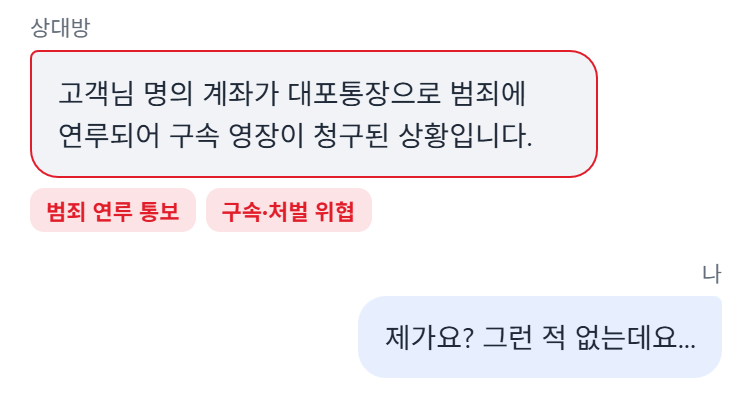
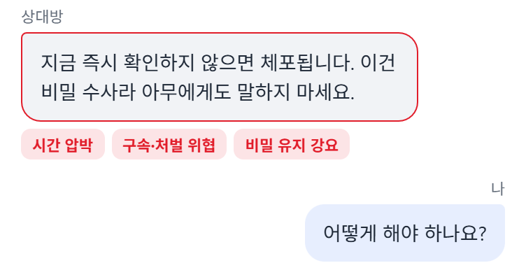
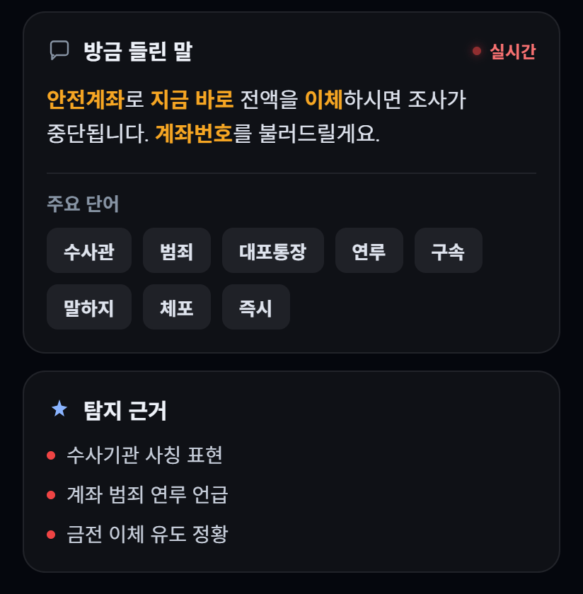
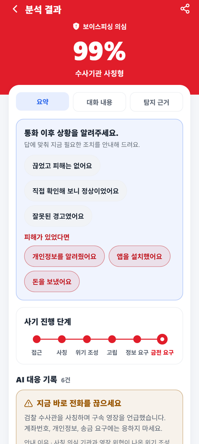
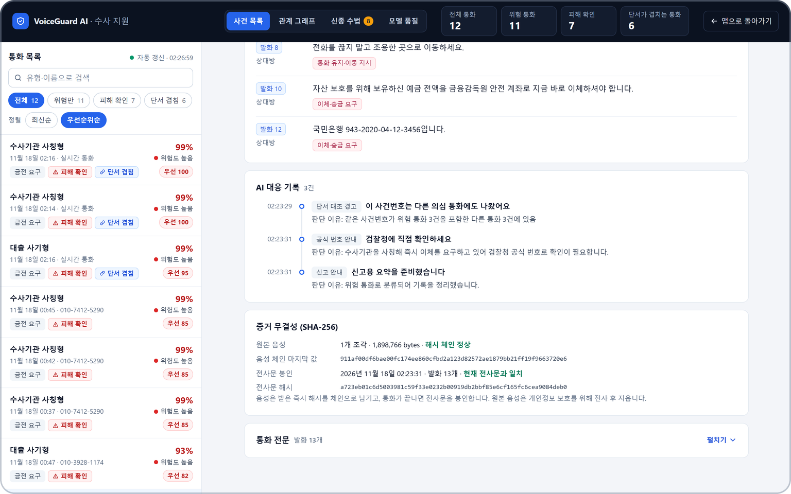

# 전화 흐름으로 기능 보기

[← README](../README.md) · [수사관 지원용 능동 AI 에이전트 기능](investigator.md) · [보이스피싱 탐지 성능](tech/detection.md) · [음성 인식·화자 분리 성능](tech/transcription.md)

검찰 사칭 전화 시나리오를 통해 통화 시작부터 종료 후 대응까지 살펴봅니다. 같은 통화 기록이 수사 지원에 어떻게 쓰이는지는 [수사관 지원용 능동 AI 에이전트 기능](investigator.md)에 정리했습니다.

## 시연 조건

> [!NOTE]
> 이 페이지는 대본 기반 시연을 기록한 것입니다. 앱의 시연 모드가 미리 적어 둔 일곱 문장을 정해진 간격으로 서버에 글자로 보냈으므로, 마이크 입력과 음성 인식(음성을 글자로 바꾸는 전사)은 포함하지 않았습니다.
>
> 2026-11-15 오전 버전(통화 분류기 v2)으로 기록했습니다. 이후 분류기가 v3를 거쳐 v5(2026-11-16부터)로 바뀌었으므로, 이 페이지의 점수·시점·화면은 당시 기록이며 현재 성능을 나타내지 않습니다.

글자를 받은 뒤의 처리(분류기, Claude 상태 추적기, 대응 에이전트, n8n 전송 요청, 기록 저장)는 실제 서비스와 같은 코드가 맡았습니다. 시연 뒤에 추가되거나 바뀐 기능(무결성 확인용 해시, 통화 중 단서 대조, 보호자 알림 카드 문구)은 본문에 따로 표시했습니다. 현재 성능은 [보이스피싱 탐지 성능](tech/detection.md)에 있습니다.

### 실제 통화에서 추가되는 처리

실제 통화에서는 대본 대신 마이크 음성이 들어옵니다. 앱이 음성을 말이 잠깐 끊긴 지점에서 잘라 서버로 보내면, 서버가 조각마다 faster-whisper large-v3로 전사한 뒤 아래와 같은 판단 과정을 거칩니다. 통화가 끝나면 녹음 전체를 다시 전사하고 상태를 처음부터 다시 추적합니다.

- **전사 위치**: 실시간 전사(음성 인식)는 자체 운영 GPU 서버에서 처리하며, 리턴제로 기능을 활성화하면 해당 음성이 외부 API로 전송됩니다.
- **기본 설정과 시연 서버 설정**: 코드 기본값은 실시간 조각, 녹음 파일, 통화 후 재전사를 모두 자체 서버에서 전사하고 통화 중 전사 보정은 끕니다. 시연 서버는 녹음 파일 분석·통화 후 재전사와 통화 중 전사 보정에 리턴제로를 켜 두었고, 실시간 조각은 자체 서버에서 전사합니다.
- **화자 구분**: 기본 설정에서는 누가 한 말인지를 목소리가 아니라 상태 추적기가 발화 내용으로 추정합니다. 리턴제로를 켜면 리턴제로의 화자 분리 결과를 씁니다. 로컬 화자 분리는 앱 코드로 옮겨 시험만 했고 앱에는 연결하지 않았습니다.

전사와 화자 분리 성능은 [음성 인식·화자 분리 성능](tech/transcription.md)에 있습니다.

## 통화 흐름 요약

발화가 서버에 도착할 때마다 AI가 두 경로로 판단합니다.

- **분류기**(KLUE-RoBERTa): 발화가 도착하자마자 사기 확률을 냅니다.
- **Claude 상태 추적기**(Claude Haiku 5.5): 통화 전체를 다시 읽고 2\~3초 뒤 사기 단계, 유형, 상대방 요구에 대한 사용자의 반응(순응도), 단서를 판단합니다.

화면 위험도는 `0.3 × 분류기 + 0.7 × 추적기`로 계산하며, 70% 이상이면 주의, 85% 이상이면 강한 경고입니다. 추적기 판단이 도착하기 전에는 분류기 점수를 그대로 씁니다. 대응 에이전트는 어떤 안내 카드를 낼지 규칙으로 고르고, 문구는 Claude가 이 통화 내용에 맞춰 씁니다. 전화번호와 피해 차단 절차는 틀리면 안 되므로 코드의 고정 표에서 가져옵니다.

<p align="center">
  
  <br>
  <sub>시연 통화에서 화면에 표시된 위험도(당시 기록). 70% 이상 주의, 85% 이상 강한 경고입니다. 아래 띠는 상태 추적기가 판단한 사기 단계이고, '보호자 알림'은 n8n에 알림 전송을 요청한 시점입니다.</sub>
</p>

| 사기 단계 | 상대방 발언 | AI 판단 | 화면 안내 |
| --- | --- | --- | --- |
| 사칭·신뢰 형성 | "서울중앙지검 첨단범죄수사부 김민수 수사관입니다." | 분류기 단독 99.9% → 추적기 판단을 반영해 **72%**(주의)로 재평가 | [강한 경고 팝업](#1-첫-발언에-대한-강한-경고-팝업) → [경고 카드, 검찰청 공식 번호, 되물어 볼 질문](#2-대화-맥락을-반영한-위험도-재평가와-대응-안내-카드) |
| 위기 조성 | "고객님 명의 계좌가 … 구속 영장이 청구된 상황입니다." | **86%**, 강한 경고 기준을 넘음 | ["지금 바로 전화를 끊으세요" 카드](#3-강한-경고와-보호자-알림-요청) |
| 고립 | "지금 즉시 확인하지 않으면 체포됩니다. … 아무에게도 말하지 마세요." | **96%**, 사용자 반응 '망설이는 중' | 같은 카드를 반복하지 않고 상황 요약만 갱신 |
| 금전 요구 | "안전계좌로 지금 바로 전액을 이체하시면 조사가 중단됩니다. …" | **99%**, 요구 금액 '전액'을 단서로 저장 | [보호자 알림 요청 카드](#3-강한-경고와-보호자-알림-요청) |
| 통화 종료 | (사용자가 '분석 종료'를 누름) | 최종 상태 확정 | [신고용 요약 카드와 통화 후 피해 여부 확인 질문](#4-통화-종료-후-결과-화면) |

## 단계별 주요 화면

각 단계는 상대방 발언 → AI 판단 → 화면 안내 순서로 정리했습니다. 주요 화면 네 개 외의 화면은 접어 두었습니다.

### 1. 첫 발언에 대한 강한 경고 팝업

**상대방 발언**

> <kbd>상대방</kbd> 안녕하세요, 서울중앙지검 첨단범죄수사부 김민수 수사관입니다.

**AI 판단** 발화가 서버에 도착하자 분류기가 사기 확률 99.9%를 냈습니다. 상태 추적기 판단이 아직 도착하지 않아 분류기 점수가 그대로 화면 위험도가 됐고(화면 표시 100%), 강한 경고 기준 85%를 처음 넘었습니다.

**화면 안내** 앱이 전체 화면 경고 팝업을 띄웠습니다. 이 팝업은 통화당 한 번 뜨고, 기기가 지원하면 진동이 함께 울립니다. '대처 방법 보기'를 누르면 예방·대처 정보로, '계속 지켜보기'를 누르면 분석 화면으로 돌아갑니다. 팝업의 '수사기관 사칭 표현'은 키워드 규칙이 붙인 근거입니다. 강한 경고 기준은 설정에서 70\~85% 사이로 낮출 수 있습니다.

<p align="center">
  
  <br>
  <sub>주요 화면 1 · 분류기 점수만으로 뜬 강한 경고 팝업(당시 기록)</sub>
</p>

### 2. 대화 맥락을 반영한 위험도 재평가와 대응 안내 카드

**상대방 발언** 1단계와 같은 첫 발언입니다. 사용자는 "네? 무슨 일이시죠?"라고 답했습니다.

**AI 판단** 약 3초 뒤 상태 추적기의 첫 판단이 도착했습니다. 단계는 '사칭·신뢰 형성', 유형은 '수사기관 사칭형', 추적기 위험도는 0.60, 다음 예상 단계는 '위기 조성'입니다. 기관(서울중앙지검)과 이름·직함(김민수 수사관)은 단서로 저장했습니다. 상대방이 신원만 밝혔을 뿐 아직 아무것도 요구하지 않았다는 판단이 반영돼 화면 위험도는 `0.3 × 0.999 + 0.7 × 0.60 = 0.72`가 됐습니다. 대화 맥락을 반영하면서 최종 위험도가 72%(주의)로 조정됐습니다. 분류기는 추적기 판단이 도착하기 전 몇 초 동안의 신호를, 추적기는 통화 전체의 의도를 맡습니다. 화면의 상황 요약은 다음과 같았습니다.

> 검찰 수사관이라고 밝힌 상대방이 통화를 시작했습니다. 아직 구체적인 요구는 나오지 않았지만 수사기관 사칭이 의심됩니다.

**화면 안내** 대응 에이전트가 이 판단을 받아 대응 안내 카드 두 개를 표시했습니다.

- **검찰 사칭 의심, 지금 바로 끊으세요** (주의 단계 경고): "서울중앙지검 수사관이라고 밝혔지만 아직 확인되지 않았습니다. 개인정보나 계좌 정보는 말하지 말고 통화를 끊으세요."
- **검찰청 공식 번호로 직접 확인하세요**: "통화를 끊고 아래 번호로 전화해 김민수 수사관이 실제 근무하는지 물어보세요." 아래에 누르면 바로 전화가 걸리는 `검찰청 1301` 버튼이 붙습니다.

이어서 상대방에게 그대로 읽을 수 있는 질문 카드가 표시됐습니다.

- **용건을 말하면 제가 직접 확인해 보겠습니다**: 사건번호와 담당 검사 성함을 먼저 알려주시겠어요? / 제가 검찰청 대표번호로 다시 전화를 드려도 괜찮으실까요? / 이 통화를 마치기 전에 사건 내용을 서면이나 공문으로 보내 주실 수 있나요?

<p align="center">
  
  <br>
  <sub>주요 화면 2 · 72% 주의, 사칭 단계(다음 예상: 위기 조성). 맨 위 카드가 되물어 볼 질문입니다(당시 기록)</sub>
</p>

<details>
<summary>대응 안내 카드를 고르는 규칙</summary>

- 위험도가 주의 이상이면 경고 카드가 후보가 됩니다. 사기 유형이 정해지고 단계가 사칭 이상이면 공식 번호 확인과 되물어 볼 질문도 후보가 됩니다.
- 같은 종류의 카드는 한 번만 표시합니다. 경고는 주의 단계에서 한 번, 강한 경고 단계에서 한 번입니다.
- Claude는 카드마다 문구와 '안내 이유'를 쓰고, 안내할 기관은 정해진 목록(검찰청, 경찰청, 금감원, KISA, 은행, 카드사, 가족)에서 고릅니다. 전화번호는 Claude가 쓰지 않고 고정 표에서 붙입니다.
- Claude 호출이 실패해도 카드는 고정 문구로 표시됩니다.

</details>

<details>
<summary>결과 화면에 남은 두 카드와 안내 이유 보기</summary>
<br>
<p align="center"></p>
<p align="center"><sub>통화가 끝난 뒤 결과 화면의 AI 대응 기록. 위의 두 카드와 각 카드의 안내 이유가 남습니다.</sub></p>
</details>

### 3. 강한 경고와 보호자 알림 요청

**상대방 발언**

> <kbd>상대방</kbd> 고객님 명의 계좌가 대포통장으로 범죄에 연루되어 구속 영장이 청구된 상황입니다.<br>
> <kbd>나</kbd> 제가요? 그런 적 없는데요...<br>
> <kbd>상대방</kbd> 지금 즉시 확인하지 않으면 체포됩니다. 이건 비밀 수사라 아무에게도 말하지 마세요.<br>
> <kbd>나</kbd> 어떻게 해야 하나요?<br>
> <kbd>상대방</kbd> 안전계좌로 지금 바로 전액을 이체하시면 조사가 중단됩니다. 계좌번호를 불러드릴게요.

**AI 판단** 상태 추적기가 발언에 따라 단계를 올렸습니다.

- **위기 조성**: '구속 영장'이 나오자 추적기 위험도를 0.80으로 올렸고, 화면 위험도가 86%로 강한 경고 기준을 넘었습니다. 발화에는 수법 태그 '범죄 연루 통보', '구속·처벌 위협'이 붙었습니다.
- **사용자 반응**: 사용자가 부인하자 순응도를 '망설이는 중'으로 바꿨습니다(89%).
- **고립**: 비밀 유지 요구가 나오자 단계를 고립으로 올렸습니다(96%). 수법 태그는 '시간 압박', '구속·처벌 위협', '비밀 유지 강요'입니다.
- **금전 요구**: 안전계좌 이체 요구에 단계를 금전 요구로 올리고(추적기 0.99, 화면 99%) 요구 금액 '전액'을 단서로 저장했습니다.

**화면 안내**

- **위기 조성 단계**: 강한 경고 카드 **지금 바로 전화를 끊으세요**를 표시했습니다. "검찰 수사관을 사칭하며 구속 영장을 언급하고 있어 사기가 의심됩니다. 계좌 정보나 개인정보를 절대 말하지 말고 전화를 끊으세요." 주의 경고는 이 카드로 바뀌고, 되물어 볼 질문 카드는 내려갑니다. 전화를 끊으라고 안내한 뒤 통화를 이어 가라는 안내가 함께 보이지 않게 하기 위해서입니다.
- **통화 중 확인 질문**: 같은 시점에 '통화를 끊으셨나요?' 질문이 만들어지고, 앱은 경고 직후에 바로 묻지 않도록 45초 뒤에 이 질문을 띄웁니다. '아직 통화 중이에요'라고 답하면 "지금 바로 끊으세요"를 다시 띄우고 질문을 다시 예약합니다(통화당 최대 3번).
- **고립 단계**: 새 카드는 없습니다. 강한 경고가 이미 나갔고 같은 카드를 반복하지 않는 것이 규칙이기 때문입니다. 화면의 상황 요약만 "가족이나 공식 기관에 먼저 확인하세요"로 바뀌었습니다.
- **금전 요구 단계**: 보호자 알림 카드를 표시하고, 같은 순간 n8n에 보호자 알림 전송을 요청했습니다. 위험도가 강한 경고 이상인 상태에서 사용자가 요구를 따르기 시작했거나 금전 요구 단계에 이르면 보호자 알림이 후보가 됩니다(n8n 알림 주소가 설정돼 있을 때만). 시연 당시 카드 문구는 '보호자에게 알렸습니다'였고, 2026-11-16부터 '보호자 알림을 요청했습니다'로 바뀌었습니다.

보호자 알림은 전송 요청까지만 지원하며, 수신 확인 기능은 없습니다.

| 구분 | 현재 상태 |
| --- | --- |
| 전송 요청 | 지원합니다. 서버가 n8n 웹훅으로 위험 통화 이벤트(유형, 위험도, 단계, 요약, 대시보드 링크)를 보냅니다. 시연 환경에서는 n8n 위험 알림 워크플로가 이 이벤트를 알림 문장으로 바꿔 Slack 채널에 올립니다(2026-11-17 연결). |
| 보호자 등록 | 앱에 보호자를 등록하는 화면이 없습니다. |
| 수신 확인 | 없습니다. 보호자가 알림을 받았는지 앱과 서버가 알 수 없으므로, 카드에도 "보호자가 받았는지는 앱에서 확인할 수 없습니다"라고 적습니다. |

**시연 이후 추가된 통화 중 단서 대조.** 새로 나온 계좌(10자리 이상)·휴대전화·사건번호·주소가 저장된 다른 통화에도 나왔는지 바로 찾아 "이 계좌는 다른 의심 통화에도 나왔어요" 같은 카드를 표시합니다. 주소는 접속하지 않고 형식만 점검합니다. 시연 통화에서는 상대방이 계좌번호를 부르기 전에 통화가 끝났습니다. 자세한 기준은 [수사관 지원용 능동 AI 에이전트 기능](investigator.md#단서-연결)에 있습니다.

<p align="center">
  
  <br>
  <sub>주요 화면 3 · 금전 요구 단계의 화면 위쪽(당시 기록). 보호자 알림 카드의 당시 문구 '보호자에게 알렸습니다'는 현재 '보호자 알림을 요청했습니다'입니다</sub>
</p>

<details>
<summary>대화 내용 탭의 수법 태그와 같은 화면 아래쪽 보기</summary>
<br>
<p align="center">
  
  <br>
  <sub>결과 화면 '대화 내용' 탭의 3·4번 발화. 태그는 상태 추적기가 발화마다 붙입니다</sub>
</p>
<p align="center">
  
  <br>
  <sub>결과 화면 '대화 내용' 탭의 5·6번 발화</sub>
</p>
<p align="center">
  
  <br>
  <sub>주요 화면 3과 같은 화면의 아래쪽. 방금 들린 말과 탐지 근거</sub>
</p>
</details>

### 4. 통화 종료 후 결과 화면

**상대방 발언** 마지막 발언 뒤 사용자가 '분석 종료'를 눌렀습니다.

**AI 판단** 서버가 마지막 상태(수사기관 사칭형, 위험도 99%, 금전 요구 단계)를 확정했습니다.

**화면 안내** 대응 에이전트가 통화 후 안내 두 가지를 만들었습니다. **신고용 요약을 준비했습니다** 카드('신고용 요약 열기'를 누르면 문서가 열립니다)와 통화 후 피해 여부 확인 질문입니다. 앱은 결과 화면으로 넘어가 맨 위에 확인 질문을 표시합니다. n8n에는 통화 종료 알림 전송을 요청했습니다.

<p align="center">
  
  <br>
  <sub>주요 화면 4 · 통화가 끝난 직후의 결과 화면. 맨 위가 통화 후 피해 여부 확인 질문입니다(당시 기록)</sub>
</p>

## 통화 후 대응

### 통화 후 피해 여부 확인

결과 화면 맨 위에 "통화 이후 상황을 알려주세요"와 답 여섯 개가 표시됩니다. 피해가 있었다는 세 답(송금, 개인정보 제공, 앱 설치)은 '피해가 있었다면' 아래에 따로 묶어 보여 주고, 이 중 하나를 고르면 확인 질문 바로 아래에 피해 차단 안내 카드가 표시됩니다. 통화 중 확인 질문에 이미 답했다면('아직 통화 중이에요' 제외) 통화 후에는 다시 묻지 않습니다. 시연 통화에서는 답하지 않았습니다.

확인 응답에 따라 안내가 다음과 같이 달라집니다.

| 확인 응답 | 화면 안내 | 기록과 알림 요청 |
| --- | --- | --- |
| **돈을 보냈어요** (송금) | **지금 바로 지급정지를 요청하세요** 카드: ① 112나 돈을 보낸 은행 고객센터에 지급정지 요청 ② 경찰서에서 사건사고사실확인원을 발급받아 3영업일 안에 은행에 피해구제 신청 ③ 통화 녹음과 이체 내역 보관. 전화 버튼 112, 1332 | 피해 응답으로 기록합니다. [수사 검토 우선순위](investigator.md#수사-검토-우선순위-제안)에 25점을 더하고 신고용 요약에 피해 응답을 표시합니다. n8n에는 '피해가 있었다고 답했습니다' 알림을 요청합니다 |
| **개인정보를 알려줬어요** (개인정보 제공) | **명의도용을 막는 조치를 하세요** 카드: ① 금융감독원 개인정보노출자 사고예방시스템 등록 ② 계좌정보통합관리서비스에서 일괄 지급정지 신청 ③ 엠세이퍼에서 내 명의로 개통된 휴대전화 확인 ④ 알려준 비밀번호 변경, 인증서 재발급. 전화 버튼 1332, 118 | 송금과 같습니다 |
| **앱을 설치했어요** (앱 설치) | **휴대전화를 먼저 차단하세요** 카드: ① 비행기 모드로 바꾸거나 전원 끄기 ② 다른 전화기로 112나 은행 고객센터에 지급정지 요청 ③ 앱 삭제 후 통신사 대리점이나 서비스센터에서 점검 ④ 휴대전화에 저장한 신분증 사진과 인증서 재발급. 전화 버튼 112, 118 | 송금과 같습니다 |
| **끊었고 피해는 없어요** (피해 없음) | 피해 차단 안내는 없습니다. 신고용 요약 카드가 아직 없으면 표시합니다 | 응답만 기록합니다. n8n에는 '통화 후 확인 결과' 알림을 요청합니다 |
| **직접 확인해 보니 정상이었어요**, **잘못된 경고였어요** | 새 안내는 없습니다 | 오경보 의심 사례로 기록해 [품질 점검](investigator.md#품질-점검)에 씁니다. n8n에는 '통화 후 확인 결과' 알림을 요청합니다 |

피해 응답에서도 신고용 요약 카드가 아직 없으면 함께 표시합니다. 피해 차단 안내의 절차와 전화번호는 Claude가 쓰지 않고 코드의 고정 문구를 씁니다. 신고용 요약의 사건 개요는 확인 응답을 마지막 문장에 반영해 다시 작성합니다. 앱의 '돈을 보냈어요'는 기록에 '이미 송금했어요'로 남습니다.

<details>
<summary>피해 응답이 들어간 사건이 수사 지원 대시보드에서 보이는 모습 (다른 시연 사건)</summary>
<br>

<br>
<sub>앱의 '돈을 보냈어요'는 기록에 '이미 송금했어요'로 남습니다. 우선순위 99/100의 근거에 '피해 확인'이 붙었습니다.</sub>
</details>

### 신고용 요약

'신고용 요약을 준비했습니다' 카드의 '신고용 요약 열기'를 누르면 문서가 열립니다. 저장된 통화 기록을 코드가 조립한 문서이고, LLM이 쓰는 부분은 사건 개요 하나뿐입니다. 제출 문서에 통화에 없는 사실이 섞이지 않게 하려는 분담입니다. 시연 통화의 신고용 요약에는 차례로 다음 내용이 들어 있습니다.

- 머리: 통화 기록 번호, 통화 일시, 판정 유형(수사기관 사칭형), 위험도 99%(높음), 도달 단계(금전 요구), "전사에는 음성 인식 오류가 있을 수 있습니다" 안내
- 사건 개요: Claude Opus 5.5가 전사문과 AI 분석 결과(유형·도달 단계)를 보고 쓴 3\~5문장. 요약을 처음 열 때 작성하고, 통화 내용과 확인 응답이 바뀌지 않으면 저장해 둔 것을 다시 씁니다
- 단계별 경과: 사칭·신뢰 형성 → 위기 조성 → 고립 → 금전 요구가 시작된 시각과 발화 번호
- 통화에서 언급된 단서: 기관 서울중앙지검, 이름·직함 김민수 수사관, 요구 금액 전액
- 유사 공식 사례: 금감원·경찰청 공개 사례 가운데 글자 n-gram 유사도로 찾은 금감원 피해사례 2건(출처 링크). "같은 사건이라는 뜻은 아닙니다"를 함께 적습니다
- 위험 발화(수법 태그), AI 대응 기록, 통화 전문, 신고·상담 창구(112, 1332, 118)

사건 개요 프롬프트는 전사문에 나온 사실만 쓰고, 전사가 틀렸을 수 있는 고유명사에는 "로 들리는"을 붙이도록 합니다. 그래서 시연 통화의 사건 개요에서는 이름에 "로 들리는"이 붙었고, 전사문에 없는 금액·계좌번호·이체 여부는 나오지 않았다고 적었습니다.

<details>
<summary>사건 개요 원문 보기</summary>

> 상대방은 서울중앙지검 첨단범죄수사부 소속 '김민수'로 들리는 이름의 수사관이라고 밝히며, 사용자 명의 계좌가 대포통장으로 범죄에 연루되어 구속 영장이 청구됐다고 말했다. 상대방은 즉시 확인하지 않으면 체포된다고 하며, 비밀 수사이니 아무에게도 말하지 말라고 했다. 이어 안전계좌로 전액을 바로 이체하면 조사가 중단된다며 송금을 요구하고 계좌번호를 불러주겠다고 했으나, 구체적인 금액과 계좌번호는 전사문에 나오지 않았다. 사용자는 연루 사실을 부인하다가 어떻게 해야 하느냐고 물었으며, 실제 이체 여부는 전사문에서 확인되지 않았다.

</details>

<details>
<summary>시연 통화의 신고용 요약 화면 보기</summary>
<br>

</details>

### 통화 기록과 무결성 확인

통화 기록 화면에는 시연 통화가 맨 위에 '수사기관 사칭형 · 실시간 · 99%'로 남습니다. 기록은 앱이 기기(브라우저)마다 만든 번호로 구분하므로, 같은 앱 주소로 여러 사람이 접속해도 각자 자기 기록만 봅니다. 결과 화면은 세 탭(요약, 대화 내용, 탐지 근거)으로 구성되고, 맨 아래 "이 판정이 맞았나요?"에 답하면 확인 응답으로 저장되어 품질 점검에 쓰입니다.

<details>
<summary>시연 통화 직후의 통화 기록 화면 보기</summary>
<br>
<p align="center"></p>
</details>

시연 통화에는 무결성 확인용 해시가 없습니다. 대본 재생이라 음성 조각이 없었고, 해시 기능을 추가하기 전에 진행한 통화라 전사문 해시도 없습니다. 현재는 다음과 같이 남깁니다.

- 실시간 음성 조각이나 녹음 파일을 받는 즉시 SHA-256 해시를 구하고, 앞 조각의 체인 값과 이어 해시합니다(`chain = sha256(이전 chain + 이 조각의 sha256)`). 조각 하나라도 빠지거나 바뀌면 체인이 맞지 않습니다.
- 통화가 끝나면 발화 번호와 내용을 차례로 해시해 전사문 해시를 저장합니다. 나중에 전사문이 바뀌면 검증에서 드러납니다.
- 음성 파일은 개인정보 때문에 전사 뒤 지우고 해시만 남깁니다. 해시는 원본 음성을 대신하지 않으며, 원본을 따로 보관했을 때 그 원본이 바뀌지 않았는지 맞춰 보는 용도입니다.

녹음 분석 사례(금감원이 공개한 검찰 사칭 사기범 녹취를 녹음 파일 분석으로 올린 통화)의 신고용 요약에는 무결성 확인(SHA-256) 절이 붙어, 음성 체인 검증 결과와 전사문 해시가 현재 전사문과 일치하는지가 표시됩니다. 실제 출력은 [시연 기록](#시연-기록)에 있습니다.

### 수사 지원 대시보드에 제공되는 정보

같은 기록은 수사 지원 대시보드에 사건으로 올라갑니다. 단계 경과, 단서, AI 대응 기록, 확인 응답, 전체 대화, 신고용 요약을 한 화면에서 보고, 위험도·피해 응답·공통 단서·도달 단계·최근성으로 계산한 수사 검토 우선순위로 정렬할 수 있습니다.

시연 통화에서 나온 단서는 기관·이름·금액뿐이라 우선순위에 반영되는 공통 단서(계좌·전화번호·주소·사건번호)는 없었습니다. 관계 그래프에서는 같은 사칭 기관(서울중앙지검)을 통해 다른 사건과 연결되지만, 같은 기관을 사칭했다는 사실만으로 같은 조직이라고 볼 수는 없습니다. 우선순위 배점은 팀이 정한 기준이며 실제 수사관의 검증은 아직 거치지 않았습니다. 자동 처리 범위와 담당자가 결정하는 항목은 [수사관 지원용 능동 AI 에이전트 기능](investigator.md#자동-처리와-담당자-결정)에 있습니다.

<details>
<summary>대시보드 사건 목록 화면 보기</summary>
<br>

<br>
<sub>목록 두 번째 줄이 시연 통화입니다. 오른쪽에 열린 사건은 같은 대본을 넓은 화면에서 다시 실행한 시연 통화입니다.</sub>
</details>

## 시연에서 확인된 한계와 개선 사항

- **첫 경고는 분류기 단독 판단이었습니다.** 첫 발언부터 추적기 판단이 도착하기까지 약 3초 동안 분류기 점수를 그대로 썼고, 기관 이름이 나온 첫 문장만으로 강한 경고가 떴습니다. 분류기를 v3로 바꾼 뒤 같은 대본을 다시 실행한 [시연 GIF](images/v2/demo_realtime.gif)에서는 첫 문장의 분류기 점수가 0.008이었고, 강한 경고는 위기 조성 발언 뒤에 처음 나왔습니다.
- **탐지 근거 하나가 틀렸습니다.** 결과 화면 핵심 근거의 '개인정보·인증번호 요구'는 키워드 규칙이 마지막 발언의 '계좌번호'라는 단어에 붙인 것입니다. 상대방은 계좌번호를 불러 주겠다고 했을 뿐 사용자 정보를 요구하지 않았습니다. 같은 발언에 상태 추적기가 붙인 태그('이체·송금 요구')는 맞았습니다. 키워드 규칙에는 지금도 '계좌번호'가 이 근거의 키워드로 들어 있습니다.
- **단계 표시줄은 도달한 단계까지 모두 채웁니다.** 그래서 이 통화에 나오지 않은 '정보 요구'도 채워져 보입니다. 신고용 요약과 대시보드의 단계별 경과에는 실제로 확인된 단계만 남습니다.
- **보호자 알림은 전송 요청까지만 확인합니다.** 보호자 등록 화면과 수신 확인 기능이 없습니다. 시연 당시 카드 문구 '보호자에게 알렸습니다'는 실제보다 앞선 표현이어서 2026-11-16에 '보호자 알림을 요청했습니다'로 고쳤습니다.
- **일곱 문장짜리 대본입니다.** 마이크 입력과 전사를 거치지 않았고 상대방 목소리도 없습니다. 실제 녹음의 전사 오류는 [음성 인식·화자 분리 성능](tech/transcription.md)에, 정상 통화의 오경보율과 사기 통화의 탐지율·미탐지 사례는 [보이스피싱 탐지 성능](tech/detection.md)에 있습니다.
- **현재 버전으로 다시 촬영해야 합니다.** 이 페이지의 화면과 점수는 2026-11-15 오전 버전(분류기 v2) 기록입니다. 분류기 v5와 바뀐 카드 문구가 반영된 화면으로 다시 촬영하는 것이 남은 개선 사항입니다.

## 추가 분석 기능: 녹음·문자·문서

통화 중이 아니어도 판단을 받을 수 있는 기능이 세 가지 더 있습니다. 모두 홈 화면의 메뉴로 들어갑니다.

- **녹음 파일 분석**: 지난 통화 녹음(mp3·wav·m4a)을 올리면 파일 전체를 한 번에 전사하고, 실시간과 같은 흐름(분류기 → 상태 추적기 → 대응 에이전트)으로 분석합니다(전사 엔진 설정은 [실제 통화에서 추가되는 처리](#실제-통화에서-추가되는-처리) 참고). 이미 끝난 통화라 "지금 끊으세요" 경고, 통화 중 확인 질문, 보호자 알림은 만들지 않습니다. 대신 공식 번호 확인 안내, 돈이나 정보를 이미 줬다는 발화가 있으면 피해 차단 안내, 통화 후 확인 질문, 신고용 요약을 만들고 파일의 해시를 남깁니다. 녹음 분석 사례는 발화 19개, 위험도 90%, 수사기관 사칭형으로 판정됐고(분류기 v5 교체 전 기록), 카드는 "말한 기관에 직접 전화해 확인하세요"와 신고용 요약 두 개였습니다.
- **문자 검사**: 받은 문자나 메신저 내용을 붙여 넣거나 캡처를 올립니다. 스미싱 문자로 학습한 KLUE-RoBERTa 분류기 점수 40%와 Claude 판단 60%를 합쳐 점수를 내고, 링크와 번호는 규칙으로 따로 점검합니다(단축 주소, IP 주소, 기관을 흉내 낸 주소). 화면의 택배 반송 문자는 94%, 택배·배송 사칭으로 판정됐습니다.
- **문서 점검**: 검찰·경찰·금감원 공문, 영장, 대출 서류 사진을 올리면 Claude Opus 5.5가 읽고 사기에 쓰이는 문서의 특징(송금·비밀 유지 요구, 개인 연락처로 회신, 서식·직인 오류)을 짚습니다. 진짜 문서와 대조하는 감정은 아닙니다. 화면은 경찰청이 공개한 가짜 검찰 공문 사진으로, 96%와 '검찰 명의 공문(사건 통지서)'로 판정됐습니다.

문자 검사와 문서 점검의 평가 결과는 [보이스피싱 탐지 성능](tech/detection.md)에 있습니다.

<p align="center">
  
  
  <br>
  <sub>문자 검사(택배 반송 문자) · 문서 점검(경찰청이 공개한 가짜 검찰 공문)</sub>
</p>

## 관련 구현 코드

| 하는 일 | 코드 · 문서 |
| --- | --- |
| 시연 대본과 대본 재생 | [`mockScenarios.ts`](../frontend/src/data/mock/mockScenarios.ts), [`sttMock.ts`](../frontend/src/data/services/sttMock.ts) |
| 마이크 음성을 무음 지점에서 잘라 전송(1.2초 이상 쌓은 뒤 0.25초 무음이면 자르고, 길어도 10초에서 자름), 서버 이벤트 반영 | [`audioCapture.web.ts`](../frontend/src/data/services/audioCapture.web.ts), [`useCallSession.ts`](../frontend/src/hooks/useCallSession.ts) |
| 전사(실시간 조각, 녹음 파일, 통화 후 재전사), 리턴제로 선택 엔진과 통화 중 전사 보정 | [`audio_transcriber.py`](../backend/app/services/audio_transcriber.py), [`rtzr_client.py`](../backend/app/services/rtzr_client.py), [`live_refine.py`](../backend/app/services/live_refine.py) · [음성 인식·화자 분리 성능](tech/transcription.md) |
| 발화 수신, 빠른 경로(분류기, 키워드 규칙) | [`websocket.py`](../backend/app/api/websocket.py), [`call_analyzer.py`](../backend/app/services/call_analyzer.py), [`koelectra_scorer.py`](../backend/app/services/koelectra_scorer.py)<sup>1</sup>, [`rag_detector.py`](../backend/app/services/rag_detector.py) |
| 단계·유형·순응도·단서 판단 (Claude Haiku 5.5) | [`state_tracker.py`](../backend/app/services/state_tracker.py) |
| 위험도 융합 `0.3 × 분류기 + 0.7 × 추적기` | [`call_analyzer.py`](../backend/app/services/call_analyzer.py) (`fuse_risk`) |
| 카드 고르기(규칙)·문구 쓰기(Claude), 같은 카드 반복 방지, 확인 질문과 확인 응답 처리, 고정 번호표·피해 차단 절차 | [`response_agent.py`](../backend/app/services/response_agent.py), [`codes.py`](../backend/app/codes.py) |
| 감지 → 판단 → 개입 한 사이클, 통화 종료와 통화 후 안내 | [`agent_loop.py`](../backend/app/services/agent_loop.py) (`end_call`), [`response_agent.py`](../backend/app/services/response_agent.py) (`on_call_end`) |
| 경고 팝업·진동, 카드 정리와 45초 대기, 결과 화면과 확인 질문, 카드 화면 | [`warning.tsx`](../frontend/app/warning.tsx), [`realtime.tsx`](../frontend/app/realtime.tsx), [`result.tsx`](../frontend/app/result.tsx), [`agentCards.tsx`](../frontend/src/components/agentCards.tsx) |
| 보호자 알림 전송 요청 (n8n 웹훅) | [`webhook_emitter.py`](../backend/app/services/webhook_emitter.py), [`voiceguard_slack_alert.json`](../n8n/voiceguard_slack_alert.json) (텔레그램판 [`voiceguard_guardian_alert.json`](../n8n/voiceguard_guardian_alert.json)) |
| 통화 중 단서 대조 | [`case_linking.py`](../backend/app/services/case_linking.py) |
| 신고용 요약 (사건 개요는 Claude Opus 5.5), 유사 공식 사례 | [`report_builder.py`](../backend/app/services/report_builder.py), [`investigation.py`](../backend/app/services/investigation.py), [`official_cases.py`](../backend/app/services/official_cases.py) |
| 무결성 확인용 해시(음성 체인, 전사문 해시) | [`evidence.py`](../backend/app/services/evidence.py) |
| 문자 검사, 문서 점검 | [`message_analyzer.py`](../backend/app/services/message_analyzer.py), [`document_analyzer.py`](../backend/app/services/document_analyzer.py) |
| 수사 지원: 단서 연결, 우선순위, 무결성 검증, 신종 수법 수집·검토·반영, 품질 점검 | [수사관 지원용 능동 AI 에이전트 기능](investigator.md) |
| 성능 평가: 분류기, 전체 시스템, 문자, 문서 / 전사, 화자 분리 | [보이스피싱 탐지 성능](tech/detection.md), [음성 인식·화자 분리 성능](tech/transcription.md) |

<sup>1</sup> 파일 이름은 v1(KoELECTRA) 때 것이고, 현재 모델은 KLUE-RoBERTa(v5)입니다.

WebSocket 이벤트와 REST API 전체는 [API_SPEC_V2.md](API_SPEC_V2.md)에 있습니다.

## 시연 기록

본문을 검증할 수 있도록 원래 통화 번호, 서버 시각, 이벤트·API, 해시 출력을 접어 두었습니다.

<details>
<summary>원래 통화 번호와 기록 버전</summary>

| 본문 표기 | 원래 통화 번호 | 내용 |
| --- | --- | --- |
| 시연 통화 | 21번 | 2026-11-15 06:40:23 시작, 1분 4초. 분류기 v2, 시연 모드 대본 재생 |
| 같은 대본을 넓은 화면에서 다시 실행한 시연 통화 | 22번 | 대시보드 화면에서 오른쪽에 열린 사건 |
| 분류기 v3로 같은 대본을 다시 실행한 시연 통화 | 23번 | [시연 GIF](images/v2/demo_realtime.gif). 첫 문장 분류기 점수 0.008, 강한 경고 기준은 서버 기준 `00:15`에 처음 넘음 |
| 녹음 분석 사례 | 31번 | 금감원 공개 사기범 녹취(검찰 사칭)를 녹음 파일 분석으로 올린 통화. 2026-11-15 저녁 기록 |
| 피해 응답이 들어간 다른 시연 사건 | 18번 | 대시보드 우선순위 화면 |

- 시각은 서버 기록 기준입니다(06:40:23 = `00:00`). 화면 타이머는 앱이 따로 재므로 서버 기준보다 1초쯤 앞섭니다.
- 화면은 따로 적지 않으면 시연 통화(21번) 때 찍은 것입니다. 주요 화면 1은 화면 타이머 00:03, 주요 화면 2는 00:16(추적기의 두 번째 판단까지 반영), 주요 화면 3은 01:01에 찍었습니다.
- 시연 통화 뒤의 변경: 2026-11-15 저녁 분류기 v3와 상태 추적기 기준 보정, 무결성 확인용 해시, 통화 중 단서 대조 추가. 2026-11-16 분류기 v5 교체, 보호자 알림 카드 문구 변경.

</details>

<details>
<summary>시연 통화의 서버 시각별 기록</summary>

| 서버 시각 | 기록 |
| --- | --- |
| `00:01` | 발화 1 도착(대본 일곱 문장은 `00:01`부터 `00:42`까지 도착). 분류기 99.9%, 강한 경고 팝업(화면 타이머 00:03) |
| `00:04` | 상태 추적기 첫 판단: 사칭·신뢰 형성, 수사기관 사칭형, 추적기 0.60 → 화면 72% |
| `00:07` | 카드 두 개: 주의 단계 경고, 검찰청 공식 번호 1301 |
| `00:12` | 되물어 볼 질문 카드 |
| `00:13` | 발화 3(구속 영장) 도착 |
| `00:16` | 위기 조성, 추적기 0.80 → 화면 86% |
| `00:18` | 강한 경고 카드, 통화 중 확인 질문 생성(앱은 45초 뒤 표시) |
| `00:24` | 순응도 '망설이는 중', 화면 89% |
| `00:30` | 고립, 화면 96% |
| `00:44` | 금전 요구, 추적기 0.99 → 화면 99%. 보호자 알림 카드, n8n `incident.high_risk` 전송 요청. 1초 뒤 전송 기록 `sent` |
| `01:04` | 분석 종료. 신고용 요약 카드, 통화 후 확인 질문, n8n `call.ended` 전송 요청 |

- `sent`는 n8n 웹훅이 요청을 받았다는 기록이며, 보호자가 알림을 받았다는 뜻은 아닙니다.
- 신고용 요약의 단계별 경과: 06:40:27 사칭·신뢰 형성(발화 1번부터), 06:40:39 위기 조성(3번), 06:40:53 고립(5번), 06:41:07 금전 요구(7번).
- 유사 공식 사례는 당시 공개 사례 121건에서 찾았습니다. AI 대응 기록은 6건입니다.

</details>

<details>
<summary>시연에 쓰인 이벤트와 API</summary>

- 시연 모드 화면: `/realtime?scenario=prosecutor`
- 실시간 분석: WebSocket `/ws/calls/analyze`. 분류기 점수는 발화마다 바로 돌아오는 응답에, 추적기 판단은 `state_update`, 카드는 `agent_action` 이벤트에 실립니다.
- n8n 이벤트: `incident.high_risk`(위험 통화, 보호자 알림 요청), `call.ended`(위험 통화 종료), `followup.answered`(확인 응답)
- 확인 응답: `POST /calls/{log_id}/actions/{action_id}/respond`(통화 중에는 WebSocket `followup_answer`)
- 신고용 요약: `GET /calls/21/report?format=md`
- 수사 지원 대시보드: `/dashboard`
- 녹음 파일 분석 `POST /calls/analyze-audio`, 문자 검사 `POST /analyze/message`, 문서 점검 `POST /analyze/document`

</details>

<details>
<summary>녹음 분석 사례(31번)의 무결성 확인 출력</summary>

신고용 요약의 '증거 무결성 (SHA-256)' 절 출력입니다.

```text
원본 음성: 1개 조각, 2,880,586 bytes · 체인 검증 정상
음성 체인 마지막 값: 3ea51f34e38e80efadb233878ae71324073fa32f646201c40e9a945492981cf5
전사문 봉인: 2026-11-15 20:53:11, 발화 19개 · 현재 전사문과 일치
전사문 해시: 36f3c49ff8a8391a371b5f755fcfead1c285d0b70de3f8c476400c7f3273a929
```



</details>

---

<sub>[← README](../README.md) · [수사관 지원용 능동 AI 에이전트 기능 →](investigator.md)</sub>
