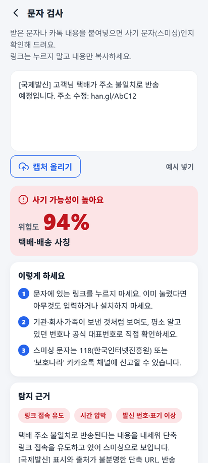
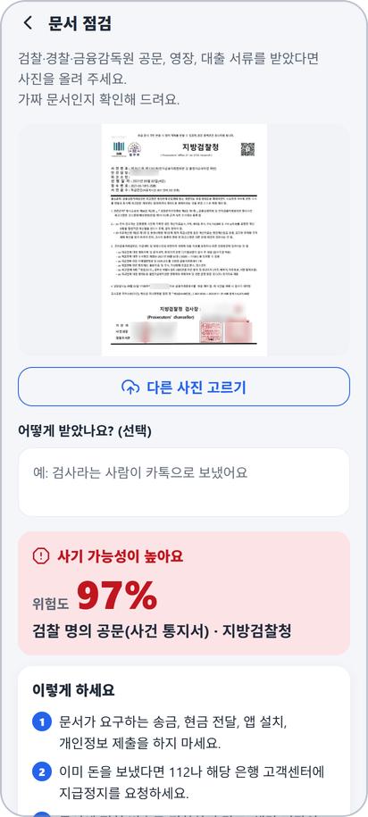

# 보이스피싱 탐지 정확도

[README](../../README.md) · [전화 한 통 따라가기](../one-call.md) · [수사관 곁의 AI 에이전트](../investigator.md) · [전사 모델 정확도](transcription.md) · [학습 기록 원문](../MODEL_TRAINING_LOG.md)

통화·문자·문서에서 보이스피싱을 가려내는 정확도를 어떤 데이터로 만들었고 어떻게 쟀는지 정리한다.
숫자는 모두 [학습 기록](../MODEL_TRAINING_LOG.md)과 저장소 코드에서 가져왔다.
이 페이지에서 **경보**와 **탐지**는 점수가 주의 기준 **0.70 이상**인 경우, **강한 경고**는 **0.85 이상**인 경우다.

## 요약

| 질문 | 평가 데이터 (모두 학습에 쓰지 않음) | 결과 |
| --- | --- | --- |
| 사기 통화를 놓치지 않는가 | 사기 통화 307통, 분류기 단독 | 통화 중 한 번이라도 경보 **100%** |
| 주제가 비슷한 정상 상담에 경보가 뜨는가 | AI Hub 은행·보험·증권·민원 상담 5,041건, 분류기 단독 | 한 번이라도 경보 30.2% → **0.7%** |
| 실제 음성에서는 | 실제 녹음 정상 상담 32통, Whisper 전사 | 경보 4통 → **0통** |
| 분류기와 Claude 추적기를 합치면 | 처음 보는 test 28통 (어려운 정상 상담 14 · 사기 14) | 정상 경고 9 → **4**통, 사기 탐지 **13/14** |
| 문자는 | 학습과 묶음이 다른 3,600건 / 따로 쓴 16건 | F1 **99.22%** (분류기 단독) / **16/16** (융합) |
| 문서 사진은 | 조정에 쓰지 않은 test 23장 | 정확도 **95.7%** (위조 14/15 탐지, 오경보 0/8) |

<sub>화살표는 v2 → v3(현재). test의 정상 상담 14통은 일부러 분류기가 1.00을 준 어려운 통화만 골랐다.</sub>

- **두 경로로 판단한다.** 발화가 들어오면 KLUE-RoBERTa 분류기가 바로 점수를 내고, Claude 상태 추적기가 대화 흐름(사기 단계·유형·사용자가 따르는 정도)을 읽어 위험도를 낸다. 화면 위험도는 `0.3 × 분류기 + 0.7 × 추적기`이고, 추적기가 위기 조성 이상을 확신하면 경고 기준 아래로 내려가지 않는다.
- **정확도는 모델 교체보다 데이터에서 나왔다.** 같은 KoELECTRA라도 v1(1,777통)은 사기 탐지가 49.5%였고, v2 데이터와 설정으로 다시 학습하자 97.1%였다. 같은 v2 데이터에서 KLUE-RoBERTa로 바꾼 차이는 97.1% → 99.7%였다. 사기 쪽은 금감원·경찰청 공식 사례 121건을 근거로 유형을 넓혔고, 정상 쪽은 주제가 같은 정상 통화(KISA 118 상담, 정상 쌍둥이 통화, AI Hub 실제 상담)를 넣었다.
- **실시간 조건으로 쟀다.** 통화 앞 k턴만 들은 점수, 통화 중 한 번이라도 기준을 넘었는지, Whisper가 받아 적은 실제 음성, 조정에 쓰지 않은 test 세트를 본다.
- **확인하지 못한 것도 있다.** 새 유형(지인 사칭·카드 배송 등) 사기의 평가 통화는 생성한 것이고, 실제 사기 녹취로 확인한 유형은 기관 사칭과 대출 사기뿐이다. 자세한 것은 [한계](#한계)에 있다.

## 데이터

`data/`와 `models/` 폴더는 git에서 통째로 뺐다. 저장소에는 데이터를 만드는 코드와 평가 대본·목록만 있다([저장소에 없는 것](#저장소에-없는-것)).

### 통화 데이터

| 데이터 | 건수 | 쓰임 |
| --- | --- | --- |
| 금감원 「그놈 목소리」 녹취 전사 | 기관 사칭 575 · 대출 사기 131 | 사기 통화 (v1부터) |
| 일반 통화 | 711 | 정상 통화 (v1부터) |
| 생성한 정상 금융 통화 | 360 | 금융 용어가 많은 정상 통화 (v1부터) |
| KISA 118 전화상담 합성데이터 | 1,283 | 피싱이 주제지만 정상인 상담 (v2) |
| 공식 사례 기반 생성 통화 | 사기 668 · 정상 363 | 새 유형 보강과 같은 주제의 정상 통화 (v2) |
| AI Hub 금융분야 고객상담 | 대화 20,102 | 어려운 정상 사례 (v3), 오경보 평가 |
| AI Hub 민원(콜센터) 질의-응답 | 대화 74,038 · 녹음 383시간 | 어려운 정상 사례 (v3), 오경보 평가, 실제 음성 평가 |
| AI Hub 금융 합성데이터 | - | 쓰지 않음 |

출처와 이용 조건은 다음과 같다.

- **금감원 녹취 전사, 일반 통화**: [KorCCVi](https://github.com/selfcontrol7/Korean_Voice_Phishing_Detection) 공개 데이터다. 녹취 전사는 금감원 공개 음성을 Naver CLOVA로 받아 적은 것이고, 일반 통화의 원천은 AI Hub 전화망 대화다. 이용 조건은 기록에 없다.
- **생성한 정상 금융 통화**: 고객이 거는 상담 230통, 금융사가 거는 안내 130통. Claude Batch API로 만들었다([`generate_hard_negatives.py`](../../backend/app/generate_hard_negatives.py)).
- **KISA 118**: 공공데이터포털 15156113 · 15150829 · 15150830 · 15150832, 이용허락 제한 없음.
- **공식 사례 기반 생성 통화**: 금감원 「보이스피싱 피해사례」 72건, 「소비자경보」 40건, 경찰청 통합대응단 「피싱 예·경보」 2건, 「피싱 시나리오」 7건, 모두 121건을 근거로 Claude Opus 5.5가 만들었다([사기 쪽을 넓힌 방법](#사기-쪽을-넓힌-방법)). README는 이 121건을 "금감원 피해사례·소비자경보, 경찰청 예·경보"로 묶어 적었고, 이 페이지는 학습 기록의 구분을 따랐다.
- **AI Hub**: 「금융분야 고객상담 데이터」(dataSetSn 71926, Training 18,650 · Validation 1,452), 「민원(콜센터) 질의-응답 데이터」(dataSetSn 98, 금융·보험, 다산콜센터, 질병관리청, 홈쇼핑), 「금융 합성데이터」(통화 내용이 없는 표 데이터라 지웠다). AI Hub 이용 조건상 재배포가 금지다. Training 분할만 학습에 쓰고 Validation 분할은 평가에만 썼다. 민원 녹음은 [전사 모델](transcription.md) 학습에도 썼다.

### 문자 · 문서 데이터

| 데이터 | 건수 | 쓰임 |
| --- | --- | --- |
| 한국어 스미싱 문자 | 17,547 (스미싱 5,649 · 정상 11,898) | 문자 분류기 학습·평가 |
| 따로 쓴 문자 | 16 (스미싱 8 · 정상 8) | 문자 검사 평가 |
| 위조 문서 평가 세트 | 61장 (위조 31 · 정상 15 · 저화질 변형 15) | 문서 점검 평가 (학습은 하지 않음) |

- **스미싱 문자**: Hugging Face `jmjmjm3/kor-smishing-message`의 `smishing.csv` 18,270행을 정리했다. CC BY-NC-SA 4.0(비상업).
- **따로 쓴 문자**: 직접 썼다([`messages.json`](../../backend/eval/messages.json)). 데이터와 문체가 다른 최신 수법과, 사기처럼 보이는 정상 문자를 섞었다.
- **위조 문서**: 경찰청·금감원·서울중앙지검·언론이 공개한 위조 문서와, 법제처 서식·발급 기관 견본이다. 항목별 이용 조건을 확인하지 않아 이미지는 빼고 출처 목록만 둔다([`documents_manifest.json`](../../backend/eval/documents_manifest.json)).

### 평가 전용 대본

| 대본 | 건수 | 쓰임 |
| --- | --- | --- |
| 회귀 평가 대본 | 12 (사기 6 · 정상 6) | 전체 시스템 회귀 평가 |
| 전체 시스템 dev | 14 | 추적기 프롬프트 조정 |
| 전체 시스템 test | 28 | 최종 확인 |

- **회귀 평가 대본**([`scenarios.json`](../../backend/eval/scenarios.json)): 직접 썼다. 사기는 검찰 사칭, 금감원 사칭과 보안 앱, 대출 선상환, 납치 협박, 자녀 사칭, 카드 배송과 원격 지원 앱. 정상은 대출 상담 회신, 은행 이상 거래 확인, 가족 송금 부탁, 택배, 자동차보험 갱신, 경찰서 분실물 회신이다.
- **dev**: 분류기가 1.00을 준 AI Hub 정상 상담, 출처마다 2건.
- **test**: dev와 다른 정상 상담 14건과 v2 평가 분할의 사기 통화 14건(유형마다 2건).

### 저장소에 없는 것

- `data/`(원본·변환·생성 데이터, 평가 결과)와 `models/`(학습된 모델)는 git 제외다. AI Hub 데이터는 재배포가 금지이고, 스미싱 문자 데이터는 비상업 라이선스이며, 문서 이미지는 항목별 이용 조건을 확인하지 않았다. AI Hub 데이터로 학습한 모델도 올리지 않는다. 생성 통화와 공식 사례 수집본도 같은 폴더에 있어 함께 빠져 있다.
- 저장소에 있는 것: 데이터를 만드는 코드(변환 [`convert_aihub_calls.py`](../../backend/app/convert_aihub_calls.py), 생성 [`generate_official_scenarios.py`](../../backend/app/generate_official_scenarios.py), 구성 [`build_dataset_v2.py`](../../backend/app/build_dataset_v2.py) · [`build_dataset_v3.py`](../../backend/app/build_dataset_v3.py) · [`build_sms_dataset.py`](../../backend/app/build_sms_dataset.py)), 평가 대본 12개, 문자 16건, 문서 출처 목록, 모델 정보 [`model_card.json`](../../backend/eval/model_card.json).
- 서비스 중인 분류기 가중치(`model.safetensors`, 423MB, fp32)의 SHA-256은 `0b912ead8857fbfb729249abe3a32595d5bd4566fd403afb56bb12021b876c89`이다.

## 전처리

통화 분류기 학습 데이터에 적용한 처리다. 대부분 모델이 내용 대신 지름길(출처, 말투, 가림 표시, 주제어)을 배우지 않게 하려는 것이다.

| 처리 | 하는 일과 이유 |
| --- | --- |
| 문장부호 정규화<br>`NORMALIZE=1` | 문장부호를 공백으로 바꾸고 공백을 하나로 줄인다. 모델 폴더의 `preprocess.json`에 적어 두고 추론도 같은 처리를 따른다.<br>**이유**: 출처마다 전사 방식(문장부호, 띄어쓰기)이 달라 모델이 내용 대신 "어느 출처의 전사인가"를 단서로 삼는다. |
| 앞부분·중간 구간 증강<br>`PREFIX_AUG=3` | 학습 통화마다 임의 지점까지의 앞부분과 최대 10턴짜리 중간 구간을 번갈아 최대 3개 더 만든다(같은 라벨). 사기 조각은 최소 2턴이다.<br>**이유**: 실시간에서는 앞부분이나 최근 몇 턴만 보고 판단한다. 사기 통화를 1턴으로 자르면 사기 신호가 없는 조각에 사기 라벨이 붙는다. |
| 묶음 해시 분할<br>`SPLIT=hash` | 통화 묶음(group)의 md5 해시를 5로 나눈 나머지가 0이면 평가(20%)로 보낸다. 같은 공식 사례에서 만든 사기·쌍둥이 통화는 같은 묶음이다.<br>**이유**: 같은 사례의 통화가 학습과 평가에 나뉘면 점수가 부풀려진다. 데이터를 더해도 기존 통화가 학습과 평가를 오가지 않는다. |
| 가림 표시 정리 | AI Hub 상담의 'OO은행'은 레코드의 실제 기관명으로 바꾸고 ●·▲·△·'O O O'는 지운다. 지운 뒤 새로 드러나는 가림까지 반복한다(남은 통화 0.2% 미만).<br>**이유**: 기존 데이터에는 ●가 없고 'OO'는 생성한 사기 통화에만 조금 있어, 그대로 두면 "가림 표시 = 정상"을 배운다. |
| 사기 신호가 든 상담 빼기 | 원격 지원·제어, 앱 설치, 피싱·사기, 검찰·경찰·금감원, 안전계좌·보호조치, 명의도용이 나오는 AI Hub 상담 826건을 뺀다.<br>**이유**: 진짜 상담이라도 정상으로 가르치면 모델이 그 신호 자체를 무시한다. 첫 v3 후보가 '카드 배송 + 원격 지원 앱' 사기 대본을 놓쳤다. |
| 어려운 정상 사례 고르기 | v2 모델로 AI Hub Training 16,957건(분류별 최대 400)을 채점해, 한 번이라도 0.5를 넘은 통화를 점수순으로 넣고(출처마다 최대 1,500) 출처마다 700건을 분류별로 고르게 더한다.<br>**이유**: 모델이 실제로 틀리는 정상 상담을 먼저 넣고 말투·주제를 넓힌다. 정상만 지나치게 늘리면 "상담 말투 = 정상"을 배울 수 있어 건수를 제한했다. |
| 기존 정상 2배 반복<br>`OVERSAMPLE` | KISA·쌍둥이·일반 통화·생성 금융 통화의 학습 통화를 2배로 넣는다(2,187통 추가). 반복분은 증강에서 다른 지점으로 잘린다.<br>**이유**: 클래스 가중 손실은 정상 전체의 무게를 고정한다. 정상 3,900통을 더하자 기존 어려운 정상 사례의 몫이 47%에서 19%로 줄고 KISA 오경보가 4.2% → 10.0%로 늘었다. |

### 사기 쪽을 넓힌 방법

v1의 사기 데이터는 금감원 공개 녹취 한 출처, 두 유형(기관 사칭, 대출 사기)뿐이었다. 그래서 두 가지 문제가 생겼다.

- 모르는 유형을 못 잡았다. 납치 협박·지인 사칭·카드 배송 사칭 대본에 0\~6%를 줬다.
- 정상 데이터만 늘리거나 앞부분 증강만 넣으면 오히려 나빠졌다(후보 `koelectra_prefix`, `koelectra_v2a`는 버렸다). 사기가 한 출처뿐이면 모델이 내용이 아니라 그 출처의 전사 말투를 사기로 외운다.

그래서 사기 쪽의 유형과 출처를 함께 넓혔다([`generate_official_scenarios.py`](../../backend/app/generate_official_scenarios.py)).

- **근거**: 본문을 쓸 수 있는 공식 사례 121건(본문 300자 이상, 앞 3,500자 사용). 경찰청 예·경보는 대부분 이미지라 빠졌다. 사례 설명을 그대로 주고 그 내용을 벗어난 새 수법은 지어내지 않게 했다.
- **사례마다 사기 통화 4개**: 끝까지 속는 통화, 의심하며 되묻지만 설득이 이어지는 통화, 요구가 나오기 전 초중반(10\~14턴)에 끊기는 통화, 가족·공식 번호로 확인하겠다는 것을 사기범이 막는 통화.
- **사례마다 정상 쌍둥이 통화 3개**: 같은 주제·기관·용건(카드 배송, 대출 안내, 수사기관 연락, 가족의 돈 부탁)이 정상적으로 일어나는 통화. 다른 계좌 송금·앱 설치·비밀 유지를 요구하지 않고, 공식 번호로 확인하라고 하고, 거절을 받아들인다. 계좌·명의·대출·사건 같은 단어는 자연스럽게 나온다. 모델이 "주제어 = 사기"를 배우지 않게 하려는 것이다.
- **형식**: 음성 인식 결과처럼 구어체·추임새·말 끊김·되묻기, 문장부호는 최소, 10\~28턴. 전화번호·계좌번호는 쓸 수 없는 형식의 예시 숫자만 쓰고 실제 웹 주소나 앱 설치 방법은 쓰지 않는다.
- **드문 유형**: 사례가 적은 유형은 인물 설정(60\~70대와 차분한 사기범, 20\~30대 직장인과 다급한 사기범, 40\~50대 자영업자와 잦은 되묻기)을 바꿔 사기 묶음을 여러 번 만들었다. 납치 4배, 지인 사칭 3배, 스미싱 2배.
- **생성**: Claude Opus 5.5, Batch API, JSON 스키마 구조화 출력. 요청 288건, 입력 약 85만·출력 약 77만 토큰. 4턴 미만 통화는 버렸다.

| 유형 | 근거 사례 | 사기 통화 | 정상 쌍둥이 |
| --- | ---: | ---: | ---: |
| 기관 사칭 | 28 | 112 | 84 |
| 대출 빙자 | 29 | 116 | 87 |
| 카드 배송·택배·스미싱 | 20 | 160 | 60 |
| 가족·지인 사칭 | 7 | 84 | 21 |
| 납치·사고 협박 | 4 | 64 | 12 |
| 기타 (투자·취업 미끼 등) | 33 | 132 | 99 |
| **합계** | **121** | **668** | **363** |

## 통화 분류기 학습

세 버전 모두 같은 스크립트([`train_transformer.py`](../../backend/app/train_transformer.py))로 학습했다. Hugging Face `Trainer`에 클래스 가중 교차 엔트로피(클래스마다 `n / (2 × 그 클래스의 샘플 수)`)를 쓰고, epoch마다 평가해 F1이 가장 좋은 체크포인트를 남긴다. 입력은 화자 구분 없이 발화를 이어 붙인 글이고 256토큰에서 자른다. 학습은 모두 H100 서버에서 했다.

- **v1** (2026-11-06): KoELECTRA `monologg/koelectra-base-v3-discriminator`. 통화 1,777 (사기 706 · 정상 1,071), 층화 80/20 분할(seed 42), 증강 없이 통화 전체 글로 학습. 학습 직후 정확도 99.16%, F1 98.94%.
- **v2** (2026-11-15): KLUE-RoBERTa `klue/roberta-base`. 통화 4,091 (사기 1,374 · 정상 2,717). KISA 118과 공식 사례 기반 생성 통화를 더했다. 묶음 해시 80/20, 앞부분 증강, 문장부호 정규화. 학습 샘플 12,971, 평가 통화 837, 약 95초.
- **v3** (2026-11-15, 현재): KLUE-RoBERTa. 통화 7,992 (사기 1,374 · 정상 6,618). AI Hub 상담 3,901통을 더하고 기존 정상을 2배로 넣었다. 학습 샘플 34,105, 평가 통화 1,640, 약 5.4분. 학습 직후 정확도 99.63%, F1 99.02%.

학습 직후 정확도는 학습 데이터와 같은 종류의 통화를 통화 전체 글로만 본 값이라 실시간 성능을 말해 주지 않는다. v1도 이 값은 99%였다. 그래서 버전은 [평가 방법](#평가-방법)의 실시간 조건 평가로 비교했다.
코드와 모델 폴더 이름(`koelectra_scorer.py`, `models/koelectra`)은 v1 때 이름을 그대로 쓴다. 지금 들어 있는 모델은 KLUE-RoBERTa v3다.

### v1 → v2: 사전학습 모델 비교

v2 데이터와 설정을 고정하고 사전학습 모델 세 개를 비교했다. 평가는 v2 평가 분할 837통(사기 307 · 정상 530)이다.

| 지표 | KoELECTRA | **KLUE-RoBERTa** | KcELECTRA |
| --- | --- | --- | --- |
| 사기, 통화 끝 | 97.1% | **99.7%** | 99.3% |
| 사기, 앞 3턴 | 89.9% | 88.6% | 91.5% |
| 사기, 앞 5턴 | 92.2% | 94.5% | 96.7% |
| 정상, 통화 끝 | 0.4% | 0.9% | 1.1% |
| 정상, 한 번이라도 | 6.4% | 8.1% | 11.1% |
| KISA, 한 번이라도 | 2.9% | 4.2% | 9.2% |
| 사기 점수 출렁임 | 13.7% | **6.5%** | 7.8% |
| 따로 쓴 사기 대본 6종 | 5 | **6** | 6 |
| 따로 쓴 정상 대본 6종 오탐 | 0 | 0 | 0 |

<sub>사기 행은 탐지율, 정상·KISA 행은 경보율, 대본 행은 개수다.</sub>

KLUE-RoBERTa를 골랐다. 통화 끝 탐지율과 따로 쓴 대본 탐지가 가장 좋고 점수 출렁임이 가장 적었다. KcELECTRA는 초반 탐지가 조금 빠르지만 정상 오경보가 더 많았다. 같은 평가에서 v1은 사기 탐지(통화 끝) 49.5%, 정상 통화 중 한 번이라도 경보 31.9%, KISA 상담 59.8%였다([결과](#통화-분류기-단독)). 바꾼 뒤 전체 시스템 회귀 평가는 12/12였다.

### v2 → v3: 실제 상담으로 오경보 줄이기

v2에 남은 문제는 주제가 사기와 같은 정상 통화였다. AI Hub의 실제 콜센터 상담으로 재 보니 생각보다 컸다.

- 분류기 단독: AI Hub 정상 상담 5,041건 중 30.2%가 통화 중 한 번은 주의 기준을 넘었다(은행 69.2%, 증권 55.4%). "스마트폰으로 계좌이체를 하고 싶습니다 / 이용하시는 은행이 어디십니까?" 두 마디에 1.00이 나왔다.
- 실제 녹음 32통 중 금융 상담 4통이 강한 경고(1.00)까지 갔다.
- 분류기 + 추적기: 분류기가 1.00을 준 정상 상담 14건 중 9건에 경고가 떴다. 추적기도 상담원의 본인 확인("주민등록번호 말씀해 주세요")을 '정보 요구' 단계로 보고 0.7\~0.98을 줬다. 추적기가 따라오기 전이나 첫 호출이 실패하면 분류기 점수가 그대로 쓰이므로 둘 다 고쳤다(추적기는 [아래](#추적기-기준-보정-v3)).

후보를 같은 평가셋으로 비교했다.

| 평가 | v2 | v3 | **v3c (적용)** |
| --- | --- | --- | --- |
| 더한 AI Hub 상담 | - | 3,917 | 3,901 (신호 제외, 기존 정상 2배) |
| AI Hub 정상 5,041건, 한 번이라도 경보 | 30.2% | 1.0% | **0.7%** |
| └ 은행 / 증권 / 보험 | 69.2 / 55.4 / 37.5% | 1.4 / 2.8 / 2.1% | **1.4 / 2.1 / 1.0%** |
| 실제 녹음 정상 32통, 경보 | 4통 | 0통 | **0통** |
| v2 평가 분할 정상 530통, 한 번이라도 경보 | 8.1% | 10.9% | **5.1%** |
| └ KISA 상담 | 4.2% | 10.0% | **2.9%** |
| 사기 307통, 앞 3턴 / 5턴 탐지 | 88.6 / 94.5% | 91.5 / 96.1% | 89.3 / 93.5% |
| 사기 307통, 통화 끝 / 한 번이라도 | 99.7 / 99.7% | 100 / 100% | 99.3 / **100%** |
| 사기 점수 출렁임 | 6.5% | 4.2% | 6.8% |
| 따로 쓴 대본 12종 | 12/12 | 11/12 (카드 배송 놓침) | **12/12** |

- **v3**: AI Hub 상담 3,917통을 그대로 더했다. AI Hub 오경보는 1.0%로 줄었지만, KISA 상담 오경보가 4.2% → 10.0%로 늘고 '카드 배송 + 원격 지원 앱' 사기 대본을 놓쳤다. 기존 어려운 정상 사례의 손실 몫이 줄었고, 원격 지원이 나오는 증권사 상담을 정상으로 배운 것으로 보인다.
- **v3b** (표에 없음): 사기 신호가 든 상담을 빼고 1,400통만 더했다. 카드 배송 대본을 다시 잡았지만(12/12) 오경보는 v3c보다 높았다(AI Hub 1.3%, v2 평가 분할 정상 8.1%, KISA 5.9%).
- **v3c**: 신호를 뺀 3,901통에 기존 정상 2배 반복을 더했다. 모든 정상 평가에서 오경보가 가장 낮고, 사기 통화는 모두 통화 중 한 번은 경보를 냈다. 대신 일부 유형의 초반 탐지가 늦어졌다([결과](#유형별-초반-탐지)). 화면 위험도의 70%는 추적기가 맡으므로 경고 시점은 전체 시스템 회귀 평가로 확인했다.

### v3 학습 설정

- **학습 데이터**: `PhishCatch-Data-roberta_v3c.json`, 7,992통 (사기 1,374 · 정상 6,618)
- **분할**: `SPLIT=hash`, 묶음 md5 해시의 5분의 1을 평가로
- **샘플**: 학습 34,105 (사기 4,229 · 정상 29,876), 평가 통화 1,640 (사기 307)
- **증강 · 전처리**: `PREFIX_AUG=3`, `NORMALIZE=1`, `OVERSAMPLE`로 KISA·쌍둥이·일반 통화·생성 금융 통화 2배 (학습 통화 2,187 추가)
- **하이퍼파라미터**: 3 epoch, learning rate 2e-5, warmup 10%, weight decay 0.01, batch 16 (평가 32), max_len 256, seed 42, fp16
- **클래스 가중치**: 정상 0.5708 · 사기 4.0323
- **학습량**: 6,396 step, 325초, 마지막 학습 손실 0.098
- **학습 직후 평가**: 정확도 99.63%, 정밀도 99.02%, 재현율 99.02%, F1 99.02% (v3 평가 분할 1,640통, 통화 전체 글)
- **라이브러리**: transformers 4.57.6, torch 2.13.0+cu130
- **가중치**: `model.safetensors` 423MB (fp32), SHA-256 `0b912ead…1b876c89`. v1·v2와 쓰지 않은 후보(v3, v3b)도 서버에 해시와 함께 보관했다.

## 전체 시스템

실시간 통화에서 화면에 보이는 위험도는 분류기와 Claude 상태 추적기를 합친 값이다. 분류기는 추적기가 따라오기 전 몇 초의 조기 신호를, 추적기는 통화 전체의 의도를 맡는다([`call_analyzer.py`](../../backend/app/services/call_analyzer.py), [`state_tracker.py`](../../backend/app/services/state_tracker.py)).


### 위험도 계산

1. **분류기 점수**: 통화 누적 전체와 최근 10턴 중 높은 확률. 256토큰에서 잘리는 긴 통화의 후반을 놓치지 않게 하려는 것이다.
2. **규칙 보정**: 분류기 점수가 0.70 이상일 때만 본다. 정규식 7묶음(기관 사칭, 범죄 연루, 이체 유도, 대출 사칭, 개인정보·인증 요구, 앱 설치·원격제어, 긴급성·비밀 유지) 중 뚜렷한 사기 조합(예: 기관 사칭 + 범죄 연루)이 있으면 그대로 둔다. 없으면 "비밀번호나 인증번호를 요구하지 않습니다", "비대면 계좌 개설" 같은 안전 안내 문맥에서는 0.42로 내리고, 규칙이 하나도 맞지 않으면서 0.97 미만이면 0.84(강한 경고 바로 아래)로 묶는다.
3. **최고값 유지**: 추적기 위험도가 0.5 이상인 동안에는 그 통화에서 가장 높았던 분류기 점수를 쓴다. 문장이 쪼개져 들어오면 분류기 점수가 한 조각 사이에 0.96 → 0.02처럼 튀어 경고가 켜졌다 꺼지기 때문이다. 추적기가 정상 쪽으로 보면 현재 점수만 쓰므로 정상 통화의 일시적 고점은 남지 않는다.
4. **융합**: `0.3 × 분류기 + 0.7 × 추적기`. 추적기의 첫 상태가 나오기 전에는 분류기 점수만 쓰고, 그 뒤 추적기 호출이 실패하면 마지막 상태를 그대로 쓴다.
5. **단계 하한**: 추적기가 위기 조성(3단계) 이상이고 위험도 0.70 이상이면 최소 0.70, 정보 요구(5단계) 이상이고 0.85 이상이면 최소 0.85. 분류기가 모르는 수법이라도 추적기가 확신하면 경고가 나간다.
6. **경고**: 0.70 이상이면 주의, 0.85 이상이면 강한 경고. 등급이 처음 오를 때 대응 에이전트가 경고 카드를 만든다.

규칙 보정(2)은 실행 경로에만 있다. 아래의 분류기 단독 평가(`eval_prefix`, `eval_external`, `eval_audio`)는 보정 전 모델 점수로 쟀고, 전체 시스템 평가(`eval_loop`)는 1\~6을 모두 거친다.

### Claude 상태 추적기

- **모델**: Claude Haiku 5.5 (`TRACKER_MODEL`), effort low, JSON 스키마를 강제한 구조화 출력. Haiku가 안전 정책으로 거절하면(협박·사칭 문구가 많은 대본) Opus 5.5로 한 번 더 부른다.
- **입력**: 이전 상태(단계·유형·순응도·위험도·요약), 이미 뽑은 단서, 최근 80발화. 새 발화에는 `[신규]`, 이전 발화에는 역할과 수법 태그를 붙인다. 더 앞선 내용은 요약으로만 넘긴다.
- **출력**: 단계(7), 유형(7), 순응도(4), 위험도 0\~1, 다음 예상 단계, 요약(120자 이내), 발화별 역할과 수법 태그(14종), 수사 단서(계좌·전화번호·URL·기관·이름·금액·앱·사건번호).
- **호출 시점**: 새 발화가 8글자 이상 쌓이면 부른다. 한 통화에서 한 번에 하나만 돌고, 도는 동안 새 발화가 오면 끝난 뒤 한 번 더 돈다. 분류기 경로를 기다리게 하지 않는다.
- **단계 규칙**: "지금까지 도달한 가장 높은 단계"라 뒤로 가지 않는다. 모델이 통화를 정상(none)으로 다시 판단한 경우만 받아들인다.
- **입력의 한계**: 음성 인식 오탈자, 여러 조각으로 쪼개진 문장, 화자 구분 없음(내용으로 역할을 추정)을 프롬프트에 적었다.
- **위험도 기준**: 단어가 아니라 의도를 본다. 위험 신호 없이 소속과 용건만 설명하면 금융 주제여도 0.3 이하. 기관을 사칭하며 사건 연루를 통보하면 금전 요구 전이라도 0.6 이상. 근거가 부족한 초반에는 정황이 쌓이는 만큼 올린다.
- **신종 수법**: 수사관이 승인한 수법 카드(최근 8장)를 프롬프트 끝에 붙인다([신종 수법 학습](../investigator.md#신종-수법-학습)).
- **첫 호출**: 스키마를 처음 쓰는 요청은 문법 컴파일 때문에 20초 넘게 걸려, 서버가 뜰 때 추적기와 대응 에이전트 스키마를 한 번씩 미리 호출해 둔다.

### 추적기 기준 보정 (v3)

추적기가 정상 상담을 사기로 보면(위험도 0.9 이상 + 정보 요구·금전 요구 단계) 단계 하한 때문에 분류기 점수와 상관없이 강한 경고가 된다. 그래서 v3 분류기와 함께 프롬프트에 '정상 상담의 본인 확인과 업무 처리' 기준을 넣었다.

- **정상 절차** (이것만 있으면 단계 none, 위험도 0.2 이하): 고객이 먼저 요청한 업무를 처리하려고 상담원이 성함·생년월일·주민등록번호·계좌번호를 묻는 것, 비밀번호·인증번호를 상담원에게 말하지 않고 ARS·본인 앱에 직접 입력하게 하는 것, 본인 계좌 간 이체·공식 가상계좌 납부·환불 안내, 고객이 자기 대출·보험료·대금을 그 기관에 내는 방법 안내.
- **그래도 사기 신호로 보는 것** (하나라도 섞이면): 인증번호·비밀번호를 말로 불러 달라고 함, 상대가 알려준 링크·앱(원격제어 포함) 설치, 본인 명의가 아닌 계좌나 '안전계좌'로 이체, 현금 전달·상품권, 범죄 연루·명의도용·해킹을 이유로 한 긴급 조치, 기존 대출을 다른 계좌로 먼저 갚으라는 요구, 대출·환급을 받으려면 수수료·보증금을 먼저 내라는 요구, 비밀 유지, 다른 번호로 전화하게 유도. 문자 속 번호로 전화한 가짜 고객센터를 놓치지 않으려는 것이다.
- **조정과 확인을 나눴다**: 조정은 dev 14건(분류기가 1.00을 준 정상 상담, 출처마다 2건)으로만 했고, 처음 보는 test 28건으로 마지막에 한 번 확인했다.
- **멈춘 지점**: dev에 남은 오경보 3건은 고객이 자기 소액 대출을 갚으려 입금액을 묻는 통화, 증권 앱 본인 확인(CDD/EDD) 절차 문의, 보험료를 카드번호·계좌 출금 동의로 내는 통화다. 앞뒤 맥락 없이는 사람도 헷갈리는 경우라, 더 맞추면 dev에 과적합되거나 사기 하한 규칙을 약하게 만들어야 해서 멈췄다.

### 통화가 끝난 뒤

실시간 조각 전사는 파일 전체 전사보다 오류가 많다. 그래서 통화가 끝나면 전체 녹음을 다시 전사하고, 추적기가 모든 발화를 처음부터 다시 태깅해 결과 화면·신고 요약·수사 화면을 그 전사로 바꾼다. 녹음 파일 분석도 같은 흐름이다(분류기는 6발화마다 채점해 최고값을 남기고, 추적기는 전체를 한 번에 읽는다). 전사 품질은 [전사 모델 정확도](transcription.md)에, 전사 모델의 학습·평가 스크립트는 [stt_lab](../../stt_lab/README.md)에 있다.

### 탐지에 쓰지 않은 것

금감원·경찰청 사례 121건을 검색 자료로 넣어 "지금 통화와 비슷한 공식 사례"로 위험도를 보태는 실험을 했다(글자 n-gram TF-IDF).

| 색인 | 결과 |
| --- | --- |
| 사례 설명문 | 생성 통화 668건의 원 사례를 1순위로 찾은 비율 37.9%, 3순위 안 57.3%, 유형 일치 65.0% |
| 사례에서 생성한 통화 (같은 사례는 빼고 평가) | 유형 일치 79.9% |

유형 정확도가 80% 수준이고 정상 통화와 사기 통화의 유사도 범위가 겹쳐서(0.14\~0.24 대 0.23\~0.40) 점수에 넣지 않았다. 위험으로 판정된 통화의 신고 요약과 수사 화면에 출처 링크가 달린 "유사 공식 사례"로만 붙인다([`official_cases.py`](../../backend/app/services/official_cases.py)).

## 문자 검사

받은 문자·메신저 본문이나 캡처를 판정한다([`message_analyzer.py`](../../backend/app/services/message_analyzer.py)). 분류기와 Claude 판단을 합친다.

- **분류기**: KLUE-RoBERTa (`klue/roberta-base`). 통화 분류기와 같은 학습 스크립트를 쓴다(문자 한 통 = 발화 1개짜리 통화). 17,547건, H100에서 약 1분.
- **데이터 정리**: 라벨이 정상·스미싱이 아닌 행, 4자 미만, 본문이 똑같은 중복을 빼 723건을 뺐다. 1,500자에서 자른다.
- **분할**: 숫자를 0으로, 링크를 `<url>`로 가린 본문으로 묶음(13,964개)을 만들어 해시 분할했다. 같은 틀에 숫자·링크만 바뀐 스미싱이 많아, 그대로 나누면 같은 틀이 학습과 평가에 섞여 점수가 부풀려진다.
- **쓰지 않은 처리**: 앞부분 증강과 문장부호 정규화. 문자는 짧고 문장부호·링크 모양 자체가 신호다.
- **Claude 판단**: Claude Haiku 5.5 (`AGENT_MODEL`), 구조화 출력으로 위험도, 유형(10), 위험 신호(9), 설명을 낸다. 캡처 이미지면 본문을 먼저 옮겨 적고, 그 글을 분류기에도 넣는다.
- **최종 점수**: `0.4 × 분류기 + 0.6 × Claude`. 한쪽이 없으면 다른 쪽만 쓴다. 0.70 이상이면 위험이다.
- **링크 · 번호**: 정규식으로 뽑아 규칙으로만 점검한다(단축 주소, IP 주소, 사기에 자주 쓰이는 최상위 도메인, http, 기관·회사 이름을 넣은 비공식 주소). 접속하지 않고, 점수에 더하지 않는다.
- **권장 행동**: 고정 문구다. 신고 번호를 LLM이 쓰지 않게 했다.

결과는 [문자 검사 결과](#문자-검사-결과)에 있다.

<details>
<summary>앱 화면 · 문자 검사</summary>
<br>
<p align="center"></p>
</details>

## 문서 점검

문서 사진 한 장을 보고 피싱에 쓰이는 위조 문서의 특징이 있는지 판단한다([`document_analyzer.py`](../../backend/app/services/document_analyzer.py)). 모델을 학습하지 않는다. Claude Opus 5.5 (`REPORT_MODEL`, effort low)가 이미지를 읽고 프롬프트의 판단 기준으로 위험도를 낸다. 진짜 문서와 대조하는 감정이 아니라, 문서가 무엇을 요구하는지와 공문서답지 않은 점을 근거로 삼는다.

### 판단 기준

| 위험도 | 이런 문서 |
| --- | --- |
| 0.85&nbsp;이상 | 송금·현금 전달·자산 이전·앱 설치·개인정보나 인증번호 제출·비밀 유지를 요구하거나, 개인 휴대전화·메신저로 연락하라고 한다. 기관이 쓰지 않는 경로로 온 문서(메신저로 받은 영장·검찰 공문, 사건 조회 사이트 화면의 공문 등) |
| 0.70\~0.85 | 요구 문구는 없어도 사칭 정황이 분명하다. 기관·금융회사 직원 명의인데 대표번호·기관 이메일 대신 개인 휴대전화나 포털 이메일만 있음, 수사기관·금융당국이 개인에게 이메일로 자료 제출이나 첨부 열람을 요구하며 과태료·처벌을 언급, 관공서·군부대 명의로 업체에 물품 구매·대리 구매를 요청(노쇼 사기), 실재하지 않는 부서·직함·문서 종류나 여러 군데의 표기 오류 |
| 0.30\~0.70 | 형식이 조금 어색하지만 사칭 정황이나 요구 문구는 뚜렷하지 않다 |
| 0.30&nbsp;미만 | 사실과 절차(이의신청·납부 방법, 공식 창구)만 알린다. 과태료·세금 고지라도 가상계좌·전자납부번호·공식 납부 경로만 안내하면 여기에 든다 |

- 신호를 찾았으면 그 구간의 점수를 준다. 화질이 낮거나 비스듬히 찍혔거나 개인정보가 가려졌다는 것만으로는 점수를 올리지 않는다.
- 출력은 판독 가능 여부, 문서 종류, 내세운 발급 기관, 위험도, 위험 신호 11종, 근거 문구 1\~4개, 설명이다. 글자를 읽을 수 없으면 위험도 0이다.
- 진위 확인 방법과 연락처(검찰 1301, 경찰 112, 금감원 1332)는 고정 문구다.

### 평가 세트

- **직접 만든 이유**: 사기범이 처음부터 만든 가짜 공문과 진짜 문서를 가르는 공개 데이터셋은 한국어에도 외국어에도 없었다. AI Hub의 '위조' 검색 결과는 얼굴 위조 방지와 필체 모사뿐이고, 공공행정문서 OCR(약 90만 장)은 정상 문서만 있다. 해외 문서 위조 데이터(DocTamper, Find it again!, RTM, T-SROIE, AIForge-Doc 등)는 진짜 문서의 글자 일부를 고친 픽셀 단위 변조라 다른 문제이고, SIDTD와 MIDV-2020은 유럽 모의 신분증이다.
- **위조 31장**: 경찰청 전기통신금융사기 통합대응단, 금감원, 서울중앙지검의 보도자료와 언론 기사 사진. 가짜 검찰·법원·금감원 공문, 구속영장, 검사 공무원증, 대출약정서, 지급정지요청서, 노쇼 사기 공문, 기관 사칭 이메일 등이다. 출처가 붙인 '가짜' 배지와 문구는 잘라냈다.
- **정상 15장**: 법제처 법정 서식(출석요구서, 수사결과 통지서, 영장청구서, 과태료·세금 고지서), 금감원의 실제 공시송달 문서, 국세청·국민건강보험공단·우정사업본부가 공개한 견본, 은행 상품설명서.
- **라벨 확인**: 수집 에이전트와 별도의 검증 에이전트가 출처 페이지를 다시 열어 확인했다. 중복 7장, 판독이 안 되거나 출처가 가린 개인정보가 드러나는 원본 등 10장, 출처에 'AI 학습 및 활용 금지'가 적힌 3장을 뺐다.
- **분할**: sha256 기준으로 dev 23장(프롬프트 조정용)과 test 23장(최종 보고용)으로 나눴다. test는 조정에 쓰지 않았다.
- **화질 편향 확인**: 정상 문서 대부분이 깨끗한 PDF 렌더라, 화질만 보고 위조라고 하는지 확인해야 했다. 정상 문서마다 메신저로 받은 사진처럼 바꾼 변형(축소, 살짝 회전, 흐림, 잡음, JPEG 압축)을 만들어 따로 쟀다.

### 프롬프트 수정은 dev로만

dev에서 놓친 위조 4장 중 3장은 위험 신호를 찾고도 0.55\~0.60을 줬다. 개인 휴대전화와 포털 이메일만 적힌 금융회사 직원 명함, 개인에게 이메일로 자료 제출을 요구하는 금감원 사칭 메일, 업체에 물품 구매를 알리는 구청 명의 공문이었다. 그래서 신호별 점수 구간, "화질만으로 점수를 올리지 않는다" 규칙, 노쇼 사기 신호(`vendor_order`)를 넣었다. test는 수정 전에도 95.7%였고 수정 후에도 판정이 같았다. 정상 문서의 최고 점수는 0.10에서 0.15로 조금 올랐다.

<details>
<summary>앱 화면 · 문서 점검</summary>
<br>
<p align="center"></p>
</details>

## 평가 방법

### 용어

- **경보 · 탐지**: 점수 0.70 이상. 강한 경고는 0.85 이상.
- **분류기 점수**: 런타임과 같이 "누적 전체"와 "최근 10턴" 중 높은 확률. 규칙 보정 전 값이다.
- **앞 k턴**: 통화를 앞에서부터 k턴까지만 들은 시점의 점수 (k = 1, 2, 3, 5, 8, 12, 20).
- **통화 끝**: 마지막 턴 시점의 점수. 40턴이 넘는 통화는 40턴에서 자른다.
- **한 번이라도**: 매 턴 채점해 한 번이라도 기준을 넘었는지. 실시간에서는 경고가 한 번만 떠도 사용자가 보므로 정상 통화 오경보는 이 기준으로 본다.
- **출렁임**: 기준을 넘었다가 다시 아래로 내려간 통화의 비율.
- **전체 시스템 통과**: 사기 대본은 최종 위험도가 주의 이상이고, 유형이 맞고, 기대 단계 이상에 도달해야 한다. 정상 대본은 최종 단계가 none이고 경고가 한 번도 나가지 않아야 한다.
- **첫 경고**: 경고 카드가 처음 나온 시점까지 흘려보낸 발화 수 (두 발화씩 흘려보낸다).

### 평가 스크립트

| 스크립트 | 데이터와 방식 |
| --- | --- |
| [`eval_prefix.py`](../../backend/app/eval_prefix.py)<br>분류기 | 학습과 같은 해시 분할의 평가 통화. 앞 k턴 · 통화 끝 · 한 번이라도 · 출렁임을 유형별로 본다 |
| [`eval_external.py`](../../backend/app/eval_external.py)<br>분류기 | 학습에 쓰지 않은 외부 통화 파일(AI Hub Validation에서 세부 분류마다 최대 200건, 5,041건). 모든 턴 경계에서 채점해 출처·분류별 오경보, 첫 경보 턴, 강한 경고 비율을 본다 |
| [`eval_audio.py`](../../backend/app/eval_audio.py)<br>분류기 | 실제 녹음 32통(민원 데이터 정상 상담). 서비스와 같은 전사 함수(Whisper)로 한 번 받아 적어 저장하고, 모델만 바꿔 같은 방식으로 채점한다 |
| [`eval_loop.py`](../../backend/app/eval_loop.py)<br>전체 시스템 | 회귀 12 / dev 14 / test 28. 대본을 두 발화씩 실제 코드 경로(분류기 → 추적 → 융합 → 대응)로 흘려보낸다. 매번 빈 평가 DB를 쓴다. 보호자 알림은 `N8N_WEBHOOK_URL`을 비워 끈다(대시보드 실행은 자동). Claude API 비용이 든다 |
| [`eval_messages.py`](../../backend/app/eval_messages.py)<br>문자 | 따로 쓴 16건과 평가 묶음에서 뽑은 80건(스미싱 40 · 정상 40, seed 7). 분류기 단독 · Claude 단독 · 융합의 정답 수를 센다 |
| [`eval_documents.py`](../../backend/app/eval_documents.py)<br>문서 | dev 23 / test 23과 저화질 정상 변형. 이미지만 넣고(상황 설명 없음) 원본과 변형을 나눠 기준 0.70과 0.5로 센다 |

### 조정과 평가를 나눈 방법

- 학습과 평가는 묶음 해시로 나눴다. 같은 공식 사례에서 만든 통화, 같은 틀의 문자는 한쪽에만 들어간다.
- AI Hub는 Training 분할만 학습과 어려운 사례 채점에 쓰고, Validation 분할은 평가에만 썼다.
- 분류기 버전 비교는 모두 v2 평가 분할 837통(사기 307 · 정상 530)으로 했다. 묶음 해시라 이 통화들은 v3 학습에도 들어가지 않았다.
- 프롬프트는 dev로만 고치고 test는 마지막에 확인했다. 추적기는 dev 14 / test 28, 문서는 sha256으로 나눈 dev 23 / test 23이다.
- 후보 선택(v2의 사전학습 모델 세 개, v3 후보 세 개)은 같은 평가셋 결과로 했다. 고르는 데 쓰지 않은 별도 확인 세트는 없다.
- 공유 GPU라 `eval_external`은 GPU 메모리 비율을 0.12로 제한하고 입력을 길이순으로 묶어 채점한다. 제한 없이 길이가 계속 바뀌는 배치를 돌리자 PyTorch 캐시가 70GB 넘게 커진 적이 있다.

### 운영 중 회귀 평가

수사관 대시보드에서 회귀 평가를 실행하거나 신종 수법 카드를 승인하면, 같은 `eval_loop`가 별도 프로세스·별도 DB로 돌고 결과가 `eval_runs`에 남는다. 사용자 확인으로 생긴 대본(놓친 사기, 잘못된 경고)도 함께 돌릴 수 있다([품질 점검](../investigator.md#품질-점검)). 통과 기준은 "모든 대본 통과"다. [API 명세](../API_SPEC_V2.md) 8.1의 설계 기준(오경보율 증가 0.01 이하, 재현율 유지)과 다르며, 이 페이지는 코드를 따랐다.

<details>
<summary>다시 재는 명령</summary>

```bash
python -m backend.app.eval_loop                       # 회귀 대본 12개 (Claude API 비용)
SPLIT=hash TRAINING_DATA=data/PhishCatch-Data-v2.json python -m backend.app.eval_prefix   # 앞부분 탐지, v2 평가 분할
EVAL_DATA=data/aihub/finance_consult.json,data/aihub/minwon.json EVAL_SPLIT=valid SAMPLE_PER_CATEGORY=200 \
  python -m backend.app.eval_external                 # AI Hub Validation 오경보
AUDIO_DIR=data/aihub/audio_valid python -m backend.app.eval_audio                       # 실제 녹음(Whisper) 오경보
N8N_WEBHOOK_URL= SCENARIOS=data/aihub/test_scenarios.json EVAL_DB=data/aihub/eval_test.db \
  python -m backend.app.eval_loop                     # 전체 시스템 test 28
python -m backend.app.eval_messages                   # 문자 (Claude API 비용)
SPLIT=test python -m backend.app.eval_documents       # 문서 test (Claude API 비용)
```

데이터는 저장소에 없으므로 위 경로의 파일을 먼저 만들어야 한다. 순서는 [학습 기록](../MODEL_TRAINING_LOG.md)의 "다시 만드는 방법"에 있다.

</details>

## 결과

### 통화 분류기 단독

v2 평가 분할 837통(사기 307 · 정상 530)과 외부 평가 세트다. 규칙 보정 전 모델 점수다. 사기 행은 탐지율(높을수록 좋음), 정상 행은 경보율(낮을수록 좋음)이다.

| 평가 | v1 | v2 | **v3 (현재)** |
| --- | --- | --- | --- |
| 사기 307통, 통화 끝 | 49.5% | 99.7% | **99.3%** |
| 사기 307통, 한 번이라도 | - | 99.7% | **100%** |
| 사기 307통, 앞 3턴 / 5턴 | 46.3 / 48.9% | 88.6 / 94.5% | 89.3 / 93.5% |
| 정상 530통, 한 번이라도 | 31.9% | 8.1% | **5.1%** |
| └ KISA 118 상담 | 59.8% | 4.2% | **2.9%** |
| AI Hub 정상 5,041건, 한 번이라도 | - | 30.2% | **0.7%** |
| └ 은행 / 증권 / 보험 | - | 69.2 / 55.4 / 37.5% | **1.4 / 2.1 / 1.0%** |
| 실제 녹음 정상 32통 (Whisper 전사) | - | 4통 | **0통** |
| 사기 점수 출렁임 | 10.1% | 6.5% | 6.8% |
| 따로 쓴 대본 12종 (사기 6 · 정상 6) | 9/12 | 12/12 | **12/12** |

v1은 따로 쓴 사기 대본 6종 중 3종만 잡았다(정상 6종은 모두 통과).

### 유형별 초반 탐지

사기 통화의 앞 3턴 탐지율이다. v3에서 내려간 유형과 오른 유형이 있다(학습 기록에 적힌 유형만 옮겼다).

| 유형 | v2 | v3 |
| --- | --- | --- |
| 금감원 대출 사기 녹취 | 89.7% | 82.8% |
| 생성한 기관 사칭 | 78.6% | 71.4% |
| 지인 사칭 | 77.1% | 87.5% |
| 기타 | 82.1% | 89.3% |

### 분류기 + 추적기 + 대응 에이전트

| 평가 | v2 + 이전 프롬프트 | **v3 + 수정 프롬프트** |
| --- | --- | --- |
| 회귀 대본 12 (사기 6 · 정상 6) | 12/12, 첫 경고 4·4·6·4·4·6번째 발화 | **12/12**, 첫 경고 4·4·6·4·4·**4**번째 발화 |
| dev 정상 상담 14 (조정에 씀) | 통과 4/14, 경고 9 | 통과 11/14, 경고 3 |
| test 정상 상담 14 | 경고 9 | **경고 4** (통과 10/14) |
| test 사기 14 | 탐지 13/14, 첫 경고 평균 7.1번째 발화 | 탐지 **13/14**, 첫 경고 평균 **6.8**번째 발화 |

- test에서 놓친 사기 1건은 두 마디뿐인 금감원 대출 사기 녹취 조각이다(이전 설정도 놓쳤다). 유형이 다르게 붙은 사기 2건(대출 → 기관, 기타 → 대출)도 경고는 제때 나갔다.
- test에 남은 오경보 4건은 dev와 같은 종류다(자기 대출 이자 납부, 증권 주문·앱 문의, 쇼핑 결제).
- 공개 주소에서 다시 확인했다. 검사 사칭 시연 대본은 경고 팝업 뒤 결과 99%(수사기관 사칭형), 정상 시연 대본은 끝까지 7%였다.

### 실제 녹취로 본 경고 시점

v2로 바꿀 때 금감원 실제 녹취를 실시간 경로로 흘려보낸 시험이다. v3에서 같은 녹취로 다시 잰 기록은 없다.

| 녹음 | v1 | v2 |
| --- | --- | --- |
| 금감원 녹취 · 검찰 사칭 | 주의 21초 · 강한 경고 37초 | 주의 20초 · 강한 경고 29초 |
| 금감원 녹취 · 대출 사기 | 주의 34초 · 강한 경고 43초 | 주의 26초 · 강한 경고 45초 |
| 정상 은행 상담 (합성 음성) | - | 끝까지 1\~7%, 경고 없음 |

### 문자 검사 결과

| 평가 | 분류기 | Claude | 융합 |
| --- | --- | --- | --- |
| 학습과 묶음이 다른 3,600건 | F1 99.22% | - | - |
| 그중 뽑은 80건 (스미싱 40 · 정상 40) | 80/80 | 78/80 | 80/80 |
| 따로 쓴 16건 | 16/16 | 15/16 | 16/16 |

실제 판정은 융합 점수다. 3,600건(스미싱 1,283)에서 분류기 단독은 정확도 99.44%, 정밀도 99.30%, 재현율 99.14%, F1 99.22%였다. 따로 쓴 16건은 데이터와 문체가 다른 최신 수법(과태료, 건강보험 환급, 부고, 자녀 사칭)과 사기처럼 보이지만 정상인 문자(은행의 사칭 주의 안내, 국세청 신고 안내, 카드 승인 알림, 인증번호)를 섞었다.

### 문서 점검 결과

기준 0.70(앱의 '주의' 기준). 퍼센트는 정확도다.

| 평가 | 수정 전 프롬프트 | 수정 후 프롬프트 |
| --- | --- | --- |
| dev 원본 23장 (위조 16 · 정상 7) | 82.6% · 위조 12/16 · 오경보 0/7 | 95.7% · 위조 15/16 · 오경보 0/7 |
| dev 저화질 정상 변형 7장 | 오경보 0/7 | 오경보 0/7 |
| test 원본 23장 (위조 15 · 정상 8) | 95.7% · 위조 14/15 · 오경보 0/8 | **95.7% · 위조 14/15 · 오경보 0/8** |
| test 저화질 정상 변형 8장 | 오경보 0/8 | **오경보 0/8** |

- test는 수정 후 두 번 돌려 판정이 같았다. 위조 탐지 14/15의 95% 신뢰구간은 약 70\~99%, 오경보 0/8은 0\~32%다.
- 수정 전후 모두 놓친 위조 2장은 은행 대출약정서 양식을 그대로 베끼고 요구 문구가 없는 문서(dev), 회사를 상대로 한 감독 업무 요청처럼 쓴 금감원 명의 자료제출 요구서(test)다. 문서만 봐서는 진짜와 구별할 근거가 없다. 사용자가 "어떻게 받았는지"를 함께 적으면 나아질 수 있다(평가에서는 이미지만 넣었다).

## 한계

**데이터**

- 새 유형(지인 사칭, 카드 배송, 기타) 사기는 학습 통화와 평가 통화 모두 Claude가 공식 사례를 근거로 만든 것이다. 학습에 쓰지 않은 사례에서 만든 통화로 평가했지만 실제 통화보다 쉬울 수 있다. 실제 사기 녹취로 확인한 유형은 기관 사칭과 대출 사기뿐이다.
- 납치 협박은 공식 사례가 4건뿐이라 평가 분할에 들어가지 않았다. 따로 쓴 대본 1개로만 확인했다.
- 사기 녹취 전사는 Naver CLOVA로 만든 것(KorCCVi)이라 서비스의 Whisper 전사와 말투가 다르다. 서버에 금감원 음성 327개(약 45시간)가 있어 Whisper 전사로 다시 학습할 수 있지만, 그렇게 학습한 결과는 아직 없다.
- AI Hub 금융 상담 대화는 문장이 다듬어져 있어 실제 통화 전사와 말투가 다르다. 민원 데이터는 2021년 녹음이고 짧은 질의응답이 많다.
- 문자 데이터의 라벨은 제공자가 붙인 것이고 설명 열은 LLM이 쓴 것으로 보여 라벨 오류가 있을 수 있다. 정상 문자는 일상 대화가 많아 정상 기관 안내 문자가 적다. 따로 쓴 16건은 직접 쓴 소수 표본이다.

**평가**

- 실제 음성 평가는 정상 상담 32통뿐이다. 사기 실제 음성은 v2 때 금감원 녹취(검찰 사칭, 대출 사기)를 실시간 경로로 흘려본 것뿐이다.
- 실제 녹음 32통은 AI Hub 민원 데이터의 녹음이다. 전사 모델 작업에서 이 데이터의 녹음 분할과 라벨 분할이 서로 맞지 않는다는 것을 찾았다(검증용 녹음이 학습용 라벨 대화와 짝지어짐). v3 학습에는 학습용 라벨 대화를 넣었으므로, 32통의 대본이 v3 학습 대화와 겹치는지 확인해야 한다. 확인한 기록은 없다.
- 전체 시스템 dev·test의 정상 상담은 일부러 분류기가 1.00을 준 어려운 통화만 골랐다. 정상 상담 전체에서의 전체 시스템 오경보율은 따로 재지 않았다(분류기 단독은 0.7%). test는 28통이라 구간이 넓다.
- 후보 선택에 쓴 평가셋과 보고한 평가셋이 같다. 고르는 데 쓰지 않은 별도 확인 세트는 없다.
- v3는 v2보다 일부 유형의 초반 탐지가 늦다(금감원 대출 사기 녹취 앞 3턴 89.7% → 82.8%).
- 남은 오경보는 고객이 자기 대출·보험료·결제를 처리하는 상담이다. 앞뒤 맥락 없이는 사람도 헷갈리는 경우라 프롬프트를 더 맞추지 않았다.
- 문서 평가는 표본이 작다. 정상 문서는 대부분 빈 서식이라 맞히기 쉬운 편이고(화질 편향은 확인했지만 내용 편향은 남았다), 위조 이미지는 공개 사례라 모델이 학습 중에 봤을 수 있다. 같은 사기 조직이 쓴 검찰 공문 틀 9장이 dev와 test에 나뉘어 있고, 프롬프트에 넣은 신호와 같은 유형이 test에도 1장씩 있어 test가 완전히 독립적인 검증은 아니다.
- Claude 판단(추적기, 문자, 문서)은 같은 입력에도 실행마다 조금 달라질 수 있다. 문서 test는 두 번 돌려 판정이 같았다. 다른 Claude 평가를 반복해 돌린 기록은 없다.

**시스템**

- 실시간 전사에는 화자 구분이 없어 추적기가 내용으로 역할을 추정한다(리턴제로로 통화 중 다시 받아 적기를 켜면 화면에는 약 20초 늦게 화자별로 정리된 글이 뜨지만, 추적기 입력은 그대로 실시간 조각이다). 실시간 조각 전사는 파일 전체 전사보다 오류가 많다([전사 모델 정확도](transcription.md)).
- 추적기의 첫 상태가 나오기 전(통화 초반 몇 초)에는 분류기 점수만으로 판단한다. 그 뒤 추적기 호출이 실패하면 마지막 상태가 그대로 쓰인다.
- `eval_loop`는 매번 빈 평가 DB를 만든다. 그래서 위 전체 시스템 결과에는 승인된 수법 카드가 들어가지 않았고, 카드를 승인할 때 자동으로 도는 회귀 평가에도 그 카드가 들어가지 않는다(코드 기준). 카드가 탐지를 얼마나 바꾸는지 잰 기록은 없다. 2026-11-15 기준 카드 8장이 검토 대기 중이다.
- 문자의 링크는 접속하지 않고 모양만 점검하며, 점수에 더하지 않는다.
- 문서 점검은 진짜 문서와 대조하는 감정이 아니다. 요구 문구 없이 진짜 양식을 그대로 베낀 문서는 놓친다.

**이용 조건**

- AI Hub 데이터는 재배포가 금지이고 문자 데이터는 비상업 라이선스(CC BY-NC-SA 4.0)다. 상용화하려면 데이터를 바꾸거나 허락을 받아야 한다.
- KorCCVi 녹취 전사, 공식 사례 게시물, 문서 이미지의 이용 조건은 항목별로 확인한 기록이 없다.
