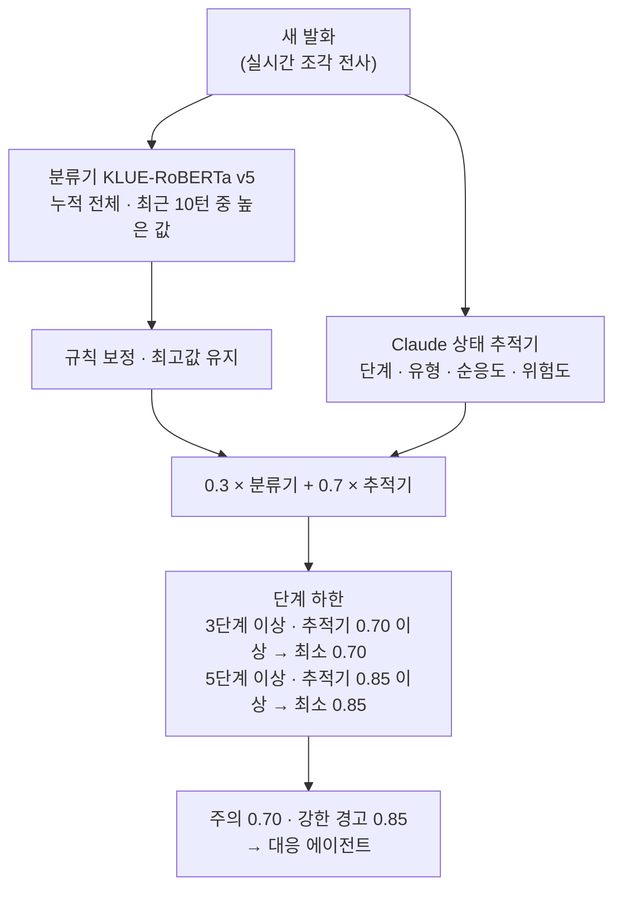

# 보이스피싱 탐지 성능

[README](../../README.md) · [전화 흐름으로 기능 보기](../one-call.md) · [수사관 지원용 능동 AI 에이전트 기능](../investigator.md) · [음성 인식·화자 분리 성능](transcription.md) · [모델 구성](models.md) · [학습 기록](../MODEL_TRAINING_LOG.md)

통화·문자·문서에서 보이스피싱을 가려내는 탐지 모델의 성능, 평가 방법, 학습 데이터, 한계를 정리합니다.

- **통화**: 통화 분류기 v5(KLUE-RoBERTa)의 점수와 Claude 상태 추적기의 판단을 합쳐 위험도를 냅니다. 분류기 단독 사기 탐지율은 99.7%입니다(학습에 쓰지 않은 사기 통화 307통, 통화 끝 0.70 이상). 전체 시스템은 처음 보는 사기 통화 14통 중 13통을 탐지했고, 일부러 고른 어려운 정상 상담 14통 중 4통에 경고를 냈습니다.
- **문자 · 문서**: 문자 분류기는 F1 99.22%(학습과 묶음이 다른 문자 3,600건), 문서 점검은 정확도 95.7%(조정에 쓰지 않은 문서 23장)입니다.
- **주의점**: 분류기만으로는 카드 배송 사칭 시나리오를 놓치고, 일부 유형은 초반 탐지가 이전 모델보다 늦습니다. 실제 사기 녹취로 확인한 유형은 기관 사칭과 대출 사기뿐이며, 전체 시스템 평가는 음성이 아니라 시나리오 글로 했습니다([한계](#한계)).

수치는 [학습 기록](../MODEL_TRAINING_LOG.md)과 평가 스크립트 출력에서 가져왔고, 결과마다 모델 버전·평가 데이터·표본 수·판정 기준을 함께 적습니다. **경보**와 **탐지**는 점수가 주의 기준 **0.70 이상**인 경우, **강한 경고**는 **0.85 이상**인 경우입니다. 그 밖의 용어는 [지표와 용어](#지표와-용어)에 있습니다.

## 현재 모델 성능

2026-11-16부터 앱의 통화 분류기는 **v5**(KLUE-RoBERTa)입니다. v3 학습 데이터에서 비식별 처리로 비어 있던 이름·번호 자리를 가상 정보로 채워 다시 학습한 모델입니다([v3 → v5](#v3--v5-비식별-처리-구간을-가상-정보로-보완)). 화면의 위험도는 분류기 점수와 Claude 상태 추적기의 판단을 합친 값이므로, 분류기 단독 결과와 전체 시스템 결과를 나눠 적습니다([판단 구조](#분류기와-상태-추적기를-함께-쓰는-구조)).

### 통화 분류기 단독

규칙 보정 전 분류기 점수입니다. v3는 2026-11-16까지 쓴 모델이고, 학습 기록의 후보 이름은 v3c입니다.

| 지표 | 평가 데이터 · 표본 | 판정 기준 | v5 (현재) | v3 (이전) |
| --- | --- | --- | ---: | ---: |
| 사기 탐지율 | v2 평가 분할의 사기 통화 307통 (학습에 사용하지 않은 평가 분할) | 통화 끝 0.70 이상 | **99.7%** | 99.3% |
| 사기 탐지율 | 같은 사기 통화 307통 | 통화 중 한 번이라도 0.70 이상 | **100%** | 100% |
| 오경보율 | 같은 평가 분할의 정상 통화 530통 (KISA 118 피해 상담 포함) | 통화 중 한 번이라도 0.70 이상 | 5.5% | 5.1% |
| 오경보율 | AI Hub 금융·민원 상담 Validation 5,041건 (비식별 구간을 지운 글) | 통화 중 한 번이라도 0.70 이상 | 0.9% | 0.7% |
| 오경보율 | **상담 녹음** 1,400건: 대본을 읽어 녹음한 AI Hub 민원 상담, Whisper large-v3 전사 | 통화 중 한 번이라도 0.70 이상 | **1.1%** | 2.0% |
| 경보가 난 통화 | **상담 녹음** 32통: AI Hub 민원 상담(금융보험 24 · 다산콜센터 8), 서비스와 같은 Whisper 전사 | 통화 중 한 번이라도 0.70 이상 | **0통** | 0통 |
| 사기 탐지율 | **공개 사기 녹취** 258건: 금감원이 공개한 사기 전화 녹취, Whisper large-v3 전사 | 통화 끝 0.70 이상 | **99.6%** | 97.7% |
| 시나리오 통과 | 별도로 작성한 평가 시나리오 12개 (사기 6 · 정상 6) | 통화 중 최고 점수 0.70 기준 | 11/12 | 12/12 |

<sub>상담 녹음은 실제 고객 통화가 아니라 상담사·고객 역할로 대본을 읽어 녹음한 공개 데이터입니다. 1,400건 중 19건은 같은 대화의 대본 글이 분류기 학습 데이터에 있습니다. 금감원 녹취 258건 중 212건은 같은 녹취를 다른 엔진(Naver CLOVA)으로 전사한 글이 분류기 학습 데이터에 있습니다. 그래서 258건의 값은 처음 보는 사기 통화의 탐지율이 아니라, 서비스와 같은 Whisper 전사에서도 사기를 잡는지 확인한 값입니다.</sub>

### 전체 시스템

분류기, Claude 상태 추적기(Claude Haiku 5.5), 대응 에이전트를 실제 코드 경로로 돌린 결과입니다. 시나리오 글을 두 발화씩 넣었고, 마이크 입력과 실시간 전사는 거치지 않았습니다.

| 지표 | 평가 데이터 · 표본 | 판정 기준 | v5 (현재) | v3 (이전) |
| --- | --- | --- | ---: | ---: |
| 시나리오 통과 | 회귀 평가 시나리오 12개 (사기 6 · 정상 6, 별도 작성) | [전체 시스템 통과](#지표와-용어) | **12/12** | 12/12 |
| 시나리오 통과 | 처음 보는 test 28통 (정상 14 · 사기 14) | 같은 기준 | 20/28 | 20/28 |
| 사기 탐지 | test 사기 14통 (v2 평가 분할, 유형마다 2통) | 최종 위험도 0.70 이상 | 13/14 | 13/14 |
| 사기 첫 경고 | 위에서 탐지한 13통 | 경고 카드가 처음 나온 발화 순서의 평균 | **6.5번째** | 6.8번째 |
| 정상 상담 경고 | test 정상 상담 14통 (당시 분류기가 경보를 낸 어려운 상담만 고름) | 최종 위험도 0.70 이상 | 4/14 | 4/14 |
| 정상 상담 경고 | dev 정상 상담 14통 (프롬프트 조정용, 분류기가 1.00을 준 상담) | 최종 위험도 0.70 이상 | 4/14 | 3/14 |

<sub>정상 상담 14통은 일부러 어려운 통화만 고른 것이라 4/14를 정상 통화 전체의 오경보율로 볼 수 없습니다. 경고가 난 정상 상담의 내용은 [전체 시스템 버전별 결과](#전체-시스템-버전별-결과)에 있습니다.</sub>

### 문자 · 문서

| 기능 | 평가 데이터 · 표본 | 판정 기준 | 결과 |
| --- | --- | --- | ---: |
| 문자 분류기 단독 (KLUE-RoBERTa) | 학습과 묶음이 다른 문자 3,600건 (스미싱 1,283) | 두 클래스 중 확률이 높은 쪽 | F1 **99.22%** |
| 문자 검사 (분류기 40% + Claude 60%) | 별도로 작성한 문자 16건 (스미싱 8 · 정상 8) | 0.70 이상 | **16/16** |
| 문서 점검 (Claude Opus 5.5 이미지 판독) | 조정에 쓰지 않은 test 23장 (위조 15 · 정상 8) | 0.70 이상 | 정확도 **95.7%**<br><sub>위조 14/15 탐지 · 오경보 0/8</sub> |

### 현재 모델의 주의점

- **카드 배송 사칭 미탐지**: 분류기 단독으로는 별도로 작성한 카드 배송 사칭 시나리오를 놓칩니다(최고 0.02). 전체 시스템에서는 상태 추적기가 잡지만, 첫 경고가 v3의 4번째 발화에서 6번째 발화로 늦어졌습니다.
- **초반 탐지 지연**: 일부 유형은 v5의 앞 3턴 탐지율이 v3보다 낮습니다. 금감원 녹취의 수사기관 사칭은 95.6%에서 92.1%로, 대출 사기는 82.8%에서 75.9%로, 생성한 기관 사칭은 71.4%에서 67.9%로 내려갔습니다([유형별 초반 탐지](#유형별-초반-탐지)).
- **추적기 판단보다 앞서는 첫 경고**: 추적기의 첫 판단이 나오기 전에는 분류기 점수만으로 위험도를 정합니다. 2026-11-18 검찰 사칭 대본 시연(일곱 문장을 글로 입력, 1회 실행)에서 분류기는 기관과 이름·직함을 밝힌 첫 문장에 0.9997을 줬습니다. 그래서 앱은 분석 시작 약 3초 뒤, 추적기의 첫 판단이 오기 전에 전체 화면 경고(강한 경고)를 띄웠습니다. 추적기 판단이 도착하자 위험도는 65%(주의 기준 미만)로 다시 계산됐고, 이후 단계가 진행되면서 72%, 79%, 86%로 올랐습니다([전화 흐름으로 기능 보기](../one-call.md)).
- **이름·직함 소개 편향**: 정상 통화 첫마디에 이름과 직함 소개를 넣으면 80통 중 6통이 첫 3마디에서 경보를 냈습니다(넣기 전 1통, v3는 4통). 이 시험의 입력은 비식별 구간을 지운 글입니다([v3 → v5](#v3--v5-비식별-처리-구간을-가상-정보로-보완)).
- **사용자 응답 기반 평가**: 수사관 대시보드의 모델 품질 탭이 보여 주는 판정 일치율과 미탐지·오경보 수는 사용자 확인 응답으로 계산한 값입니다. 응답한 통화만 들어가므로 이 페이지의 탐지율·오경보율과 섞어 보지 않습니다.

## 평가 조건과 지표

### 지표와 용어

- **탐지율 · 오경보율**: 탐지율은 사기 통화 중 경보를 낸 비율, 오경보율은 정상 통화 중 경보를 낸 비율입니다.
- **분류기 점수**: 런타임과 같이 통화 누적 전체와 최근 10턴 중 높은 확률이며, 규칙 보정 전 값입니다.
- **앞 k턴 · 통화 끝**: 앞 k턴은 통화를 앞에서부터 k턴까지만 들은 시점의 점수(k = 1, 2, 3, 5, 8, 12, 20), 통화 끝은 마지막 턴 시점의 점수입니다. 40턴이 넘는 통화는 40턴에서 자릅니다.
- **한 번이라도**: 매 턴 채점해 한 번이라도 기준을 넘었는지 봅니다. 실시간에서는 경고가 한 번만 떠도 사용자가 보므로, 정상 통화의 오경보율은 이 기준으로 봅니다.
- **경보 기준 이상에서 미만으로 바뀐 통화 비율**: 기준을 넘었다가 다시 아래로 내려간 통화의 비율입니다. 화면 경고가 켜졌다 꺼지는 정도를 봅니다.
- **전체 시스템 통과**: 사기 시나리오는 최종 위험도가 주의 이상이고, 유형이 맞고, 기대 단계 이상에 도달해야 합니다. 정상 시나리오는 최종 단계가 none이고 경고가 한 번도 나가지 않아야 합니다.
- **최종 판정 경고 · 첫 경고**: 최종 판정 경고는 통화가 끝났을 때 위험도가 주의 이상인 경우이며, 전체 시스템의 사기 탐지와 정상 상담 경고 수는 이 기준으로 셉니다. 첫 경고는 경고 카드가 처음 나온 시점까지 흘려보낸 발화 수입니다(두 발화씩 흘려보냅니다).
- **사용자 응답 기반 평가**: 사용자의 확인 응답(결과 화면의 "이 판정이 맞았나요?", 통화 후 확인 답)을 정답으로 보고 계산한 값입니다. 응답한 통화만 들어가므로 이 페이지의 다른 지표와 표본이 다릅니다.

### 평가 데이터

| 평가 데이터 | 건수 | 쓰임 | 학습 데이터와의 관계 |
| --- | --- | --- | --- |
| v2 평가 분할 | 837 (사기 307 · 정상 530) | 분류기 버전 비교 | 묶음 해시로 나눈 평가 분할이라 v2·v3·v5 학습에 들어가지 않음 |
| AI Hub 금융·민원 상담 Validation | 5,041 (세부 분류마다 최대 200) | 정상 상담 오경보율 | Validation 분할은 평가에만 사용 |
| 상담 녹음, Whisper 전사 | 1,400 (금융보험 · 다산콜센터 · 질병관리청 · 홈쇼핑 각 350) | 녹음 전사 오경보율 | 전사본은 학습에 쓰지 않음. 19건은 같은 대화의 대본 글이 학습 데이터에 있음 |
| 상담 녹음, Whisper 전사 | 32 (금융보험 24 · 다산콜센터 8) | 녹음 전사 경보 | 대본이 학습 대화와 겹치는지 확인하지 못함([한계](#한계)) |
| 금감원 공개 사기 녹취, Whisper 전사 | 258 | 녹음 전사 탐지율 | 전사본은 학습에 쓰지 않음. 212건은 같은 녹취의 다른 전사가 학습 데이터에 있음 |
| 회귀 평가 시나리오 | 12 (사기 6 · 정상 6) | 분류기 단독, 전체 시스템 회귀 평가 | 직접 작성([`scenarios.json`](../../backend/eval/scenarios.json)). 사기는 검찰 사칭, 금감원 사칭과 보안 앱, 대출 선상환, 납치 협박, 자녀 사칭, 카드 배송과 원격 지원 앱. 정상은 대출 상담 회신, 은행 이상 거래 확인, 가족 송금 부탁, 택배, 자동차보험 갱신, 경찰서 분실물 회신 |
| 전체 시스템 dev | 14 | 추적기 프롬프트 조정 | 분류기가 1.00을 준 AI Hub Validation 정상 상담을 출처마다 2건씩 고름 |
| 전체 시스템 test | 28 | 최종 확인 | 당시 분류기가 경보를 낸 정상 상담 중 dev와 다른 14건, v2 평가 분할의 사기 통화 14건(유형마다 2건) |

### 조정과 평가를 나눈 방법

- 학습과 평가는 묶음 해시로 나눴습니다. 같은 공식 사례에서 만든 통화, 같은 틀의 문자는 한쪽에만 들어갑니다.
- AI Hub는 Training 분할만 학습과 어려운 사례 채점에 쓰고, Validation 분할은 평가에만 썼습니다.
- 프롬프트는 dev로만 고치고 test는 마지막에 확인했습니다. 추적기는 dev 14 / test 28, 문서는 sha256으로 나눈 dev 23 / test 23입니다.

### 운영 중 회귀 평가

수사관 대시보드에서 회귀 평가를 실행하거나 신종 수법 카드를 승인하면 같은 `eval_loop`가 별도 프로세스·별도 DB로 돌고, 결과는 `eval_runs`에 남습니다. 사용자 확인 응답으로 만든 시나리오(미탐지 의심·오경보 의심 사례)도 함께 돌릴 수 있으며, 그 결과는 사용자 응답 기반 평가입니다([품질 점검](../investigator.md#품질-점검)).

- 통과 기준은 '모든 시나리오 통과'입니다. [API 명세](../API_SPEC_V2.md) 8.1의 설계 기준(오경보율 증가 0.01 이하, 재현율 유지)과 다르며, 이 페이지는 코드를 따릅니다.
- 실행마다 빈 평가 DB를 쓰므로 승인한 수법 카드는 평가 입력에 들어가지 않습니다. 카드를 승인한 뒤 도는 회귀 평가도 카드 없는 기본 구성으로 기존 12개 시나리오를 다시 돌린 결과입니다([한계](#한계)).

## 데이터와 전처리

### 학습·평가 데이터

| 데이터 | 건수 | 쓰임 | 출처 · 이용 조건 |
| --- | --- | --- | --- |
| 금감원 「그놈 목소리」 녹취 전사 | 기관 사칭 575 · 대출 사기 131 | 사기 통화 (v1부터) | [KorCCVi](https://github.com/selfcontrol7/Korean_Voice_Phishing_Detection) 공개 데이터. 금감원 공개 음성을 Naver CLOVA로 전사한 글. 이용 조건은 기록에 없음 |
| 일반 통화 | 711 | 정상 통화 (v1부터) | KorCCVi 공개 데이터. 원천은 AI Hub 전화망 대화. 이용 조건은 기록에 없음 |
| 생성한 정상 금융 통화 | 360 | 금융 용어가 많은 정상 통화 (v1부터) | 고객이 거는 상담 230통 · 금융사가 거는 안내 130통. Claude Batch API로 생성([`generate_hard_negatives.py`](../../backend/app/generate_hard_negatives.py)) |
| KISA 118 전화상담 합성데이터 | 1,283 | 피싱이 주제지만 정상인 상담 (v2부터) | 공공데이터포털 15156113 · 15150829 · 15150830 · 15150832. 이용허락 제한 없음 |
| 공식 사례 기반 생성 통화 | 사기 668 · 정상 비교 통화 363 | 새 유형 보강과 동일한 주제·상황의 정상 비교 통화 (v2부터) | 금감원·경찰청 공식 사례 121건을 근거로 Claude Opus 5.5가 생성([사기 유형과 학습 데이터 확장](#사기-유형과-학습-데이터-확장)) |
| AI Hub 금융분야 고객상담 | 대화 20,102 | 어려운 정상 사례 (v3부터), 오경보 평가 | 「금융분야 고객상담 데이터」(dataSetSn 71926, Training 18,650 · Validation 1,452). 재배포 금지 |
| AI Hub 민원(콜센터) 질의-응답 | 대화 74,038 · 녹음 383시간 | 어려운 정상 사례 (v3부터), 오경보 평가, 녹음 전사 평가, [음성 인식 모델](transcription.md) 학습 | 「민원(콜센터) 질의-응답 데이터」(dataSetSn 98: 금융·보험, 다산콜센터, 질병관리청, 홈쇼핑). 녹음은 상담사·고객 역할로 대본을 읽어 녹음한 것. 재배포 금지 |
| 한국어 스미싱 문자 | 17,547 (스미싱 5,649 · 정상 11,898) | 문자 분류기 학습·평가 | Hugging Face `jmjmjm3/kor-smishing-message`의 `smishing.csv` 18,270행을 정리. CC BY-NC-SA 4.0(비상업) |
| 별도로 작성한 문자 | 16 (스미싱 8 · 정상 8) | 문자 검사 평가 | 직접 작성([`messages.json`](../../backend/eval/messages.json)). 데이터와 문체가 다른 최신 수법과 사기처럼 보이는 정상 문자 |
| 위조 문서 평가 세트 | 61장 (위조 31 · 정상 15 · 저화질 변형 15) | 문서 점검 평가 (학습은 하지 않음) | 경찰청·금감원·서울중앙지검·언론이 공개한 위조 문서와 법제처 서식·발급 기관 견본. 항목별 이용 조건을 확인하지 않아 이미지는 빼고 출처 목록만 둠([`documents_manifest.json`](../../backend/eval/documents_manifest.json)) |

### 위조 문서 평가 세트

- **따로 구성한 이유**: 검토한 공개 데이터셋은 얼굴 위조 방지, 필체 모사, 진짜 문서의 글자 일부를 고친 변조, 모의 신분증을 다루거나 정상 문서만 담고 있어, 사기범이 처음부터 만든 가짜 공문과 진짜 문서를 가르는 평가에 맞지 않았습니다. 검토한 데이터셋, 문서 종류, 라벨 확인·제외 기준은 [학습 기록](../MODEL_TRAINING_LOG.md#공개-데이터-조사)에 있습니다.
- **분할**: sha256 기준으로 dev 23장(프롬프트 조정용)과 test 23장(최종 보고용)으로 나눴고, test는 조정에 쓰지 않았습니다.
- **화질 편향 확인**: 정상 문서 대부분이 깨끗한 PDF 렌더라, 화질만 보고 위조라고 하는지 확인해야 했습니다. 정상 문서마다 메신저로 받은 사진처럼 바꾼 변형(축소, 살짝 회전, 흐림, 잡음, JPEG 압축)을 만들어 따로 쟀습니다.

### 전처리

통화 분류기 학습 데이터에 적용한 처리입니다. 대부분 모델이 대화 내용 대신 출처, 말투, 비식별 표시, 주제어 같은 표면 단서를 배우지 않게 하려는 것입니다.

| 처리 | 하는 일과 이유 |
| --- | --- |
| 문장부호 정규화<br>`NORMALIZE=1` | 문장부호를 공백으로 바꾸고 공백을 하나로 줄입니다. 모델 폴더의 `preprocess.json`에 적어 두어 추론도 같은 처리를 따릅니다.<br>**이유**: 출처마다 전사 방식(문장부호, 띄어쓰기)이 달라, 모델이 내용 대신 "어느 출처의 전사인가"를 단서로 삼습니다. |
| 앞부분·중간 구간 증강<br>`PREFIX_AUG=3` | 학습 통화마다 임의 지점까지의 앞부분과 최대 10턴짜리 중간 구간을 번갈아 최대 3개 더 만듭니다(같은 라벨). 사기 조각은 최소 2턴입니다.<br>**이유**: 실시간에서는 앞부분이나 최근 몇 턴만 보고 판단합니다. 사기 통화를 1턴으로 자르면 사기 신호가 없는 조각에 사기 라벨이 붙습니다. |
| 묶음 해시 분할<br>`SPLIT=hash` | 통화 묶음(group)의 md5 해시를 5로 나눈 나머지가 0이면 평가(20%)로 보냅니다. 같은 공식 사례에서 만든 사기 통화와 정상 비교 통화는 같은 묶음입니다.<br>**이유**: 같은 사례의 통화가 학습과 평가에 나뉘면 점수가 부풀려집니다. 데이터를 더해도 기존 통화가 학습과 평가를 오가지 않습니다. |
| 비식별 표시 정리 | AI Hub 상담의 'OO은행'은 레코드의 실제 기관명으로 바꾸고 ●·▲·△·'O O O'는 지웁니다. 지운 뒤 새로 드러나는 표시까지 반복합니다(남은 통화 0.2% 미만). v5는 지운 자리를 가상 정보로 채웠습니다([v3 → v5](#v3--v5-비식별-처리-구간을-가상-정보로-보완)).<br>**이유**: 기존 데이터에는 ●가 없고 'OO'는 생성한 사기 통화에만 조금 있어, 그대로 두면 "비식별 표시 = 정상"을 배웁니다. |
| 사기 신호가 든 상담 빼기 | 원격 지원·제어, 앱 설치, 피싱·사기, 검찰·경찰·금감원, 안전계좌·보호조치, 명의도용이 나오는 AI Hub 상담 826건을 뺍니다.<br>**이유**: 진짜 상담이라도 정상으로 가르치면 모델이 그 신호 자체를 무시합니다. 첫 v3 후보가 '카드 배송 + 원격 지원 앱' 사기 시나리오를 놓쳤습니다. |
| 어려운 정상 사례 고르기 | v2 모델로 AI Hub Training 16,957건(분류별 최대 400)을 채점해, 한 번이라도 0.5를 넘은 통화를 점수순으로 넣고(출처마다 최대 1,500) 출처마다 700건을 분류별로 고르게 더합니다.<br>**이유**: 모델이 실제로 틀리는 정상 상담을 먼저 넣고 말투·주제를 넓힙니다. 정상만 지나치게 늘리면 "상담 말투 = 정상"을 배울 수 있어 건수를 제한했습니다. |
| 기존 정상 2배 반복<br>`OVERSAMPLE` | KISA·정상 비교 통화·일반 통화·생성 금융 통화의 학습 통화를 2배로 넣습니다(v3 기준 2,187통 추가). 반복분은 증강에서 다른 지점으로 잘립니다.<br>**이유**: 클래스 가중 손실은 정상 전체의 무게를 고정합니다. 정상 3,900통을 더하자 기존 어려운 정상 사례의 몫이 47%에서 19%로 줄고, KISA 상담 오경보율이 4.2%에서 10.0%로 늘었습니다. |

### 사기 유형과 학습 데이터 확장

v1의 사기 데이터는 금감원 공개 녹취 한 출처, 두 유형(기관 사칭, 대출 사기)뿐이었습니다. 그래서 납치 협박·지인 사칭·카드 배송 사칭 시나리오에 0\~6%를 줬습니다. 정상 데이터만 늘리거나 앞부분 증강만 넣으면 오히려 나빠졌습니다. 사기가 한 출처뿐이면 모델이 내용이 아니라 그 출처의 전사 말투를 사기로 외우기 때문입니다([학습 기록](../MODEL_TRAINING_LOG.md#왜-다시-학습했나-v1의-문제)). 그래서 사기 쪽의 유형과 출처를 함께 넓혔습니다([`generate_official_scenarios.py`](../../backend/app/generate_official_scenarios.py)).

- **근거**: 금감원 「보이스피싱 피해사례」 72건, 「소비자경보」 40건, 경찰청 통합대응단 「피싱 예·경보」 2건, 「피싱 시나리오」 7건, 모두 121건입니다. 본문을 쓸 수 있는 사례만 골랐고(본문 300자 이상, 앞 3,500자 사용), 경찰청 예·경보는 대부분 이미지라 빠졌습니다. 사례 설명을 그대로 주고, 그 내용을 벗어난 새 수법은 지어내지 않게 했습니다.
- **사례마다 사기 통화 4개**: 끝까지 속는 통화, 의심하며 되묻지만 설득이 이어지는 통화, 요구가 나오기 전 초중반(10\~14턴)에 끊기는 통화, 가족·공식 번호로 확인하겠다는 것을 사기범이 막는 통화입니다.
- **사례마다 정상 비교 통화 3개**: 같은 주제·기관·용건(카드 배송, 대출 안내, 수사기관 연락, 가족의 돈 부탁)이 정상적으로 일어나는 통화입니다. 다른 계좌 송금·앱 설치·비밀 유지를 요구하지 않고, 공식 번호로 확인하라고 하며, 거절을 받아들입니다. 계좌·명의·대출·사건 같은 단어는 자연스럽게 나옵니다. 모델이 "주제어 = 사기"를 배우지 않게 하려는 것입니다.
- **형식**: 음성 인식 결과처럼 구어체·추임새·말 끊김·되묻기를 넣고 문장부호는 최소로 했으며, 10\~28턴입니다. 전화번호·계좌번호는 쓸 수 없는 형식의 예시 숫자만 쓰고, 실제 웹 주소나 앱 설치 방법은 쓰지 않습니다.
- **드문 유형**: 사례가 적은 유형은 인물 설정(60\~70대와 차분한 사기범, 20\~30대 직장인과 다급한 사기범, 40\~50대 자영업자와 잦은 되묻기)을 바꿔 사기 통화를 여러 번 만들었습니다. 납치 4배, 지인 사칭 3배, 스미싱 2배입니다.
- **생성**: Claude Opus 5.5, Batch API, JSON 스키마 구조화 출력으로 만들었고, 4턴 미만 통화는 버렸습니다. 결과는 사기 통화 668통과 정상 비교 통화 363통입니다. 유형별 건수와 요청 수·토큰 사용량은 [학습 기록](../MODEL_TRAINING_LOG.md#학습-데이터-구성)에 있습니다.

### 저장소에 없는 것

- `data/`(원본·변환·생성 데이터, 평가 결과)와 `models/`(학습된 모델)는 git에서 제외했습니다. AI Hub 데이터는 재배포가 금지이고, 스미싱 문자 데이터는 비상업 라이선스이며, 문서 이미지는 항목별 이용 조건을 확인하지 않았습니다. AI Hub 데이터로 학습한 모델도 올리지 않습니다. 생성 통화와 공식 사례 수집본도 같은 폴더에 있어 함께 빠져 있습니다.
- 저장소에 있는 것은 데이터를 만드는 코드, 평가 시나리오 12개, 문자 16건, 문서 출처 목록, 모델 정보 [`model_card.json`](../../backend/eval/model_card.json)입니다. 코드는 변환 [`convert_aihub_calls.py`](../../backend/app/convert_aihub_calls.py), 생성 [`generate_official_scenarios.py`](../../backend/app/generate_official_scenarios.py), 비식별 구간 채우기 [`mask_fill_batches.py`](../../backend/app/mask_fill_batches.py), 구성 [`build_dataset_v2.py`](../../backend/app/build_dataset_v2.py) · [`build_dataset_v3.py`](../../backend/app/build_dataset_v3.py) · [`build_dataset_v5.py`](../../backend/app/build_dataset_v5.py) · [`build_sms_dataset.py`](../../backend/app/build_sms_dataset.py)입니다. 가중치 해시는 [재현 설정](#재현-설정)에 있습니다.

## 모델 선택 이유

**데이터와 학습 설정 개선이 탐지율 향상에 크게 기여했습니다.** 같은 KoELECTRA라도 v1(1,777통)은 사기 탐지율이 49.5%였고, v2 데이터와 설정으로 다시 학습하자 97.1%가 됐습니다. 같은 v2 데이터에서 사전학습 모델을 KLUE-RoBERTa로 바꾼 차이는 97.1% → 99.7%였습니다. 사기 쪽은 금감원·경찰청 공식 사례 121건을 근거로 유형을 넓혔고, 정상 쪽은 주제가 같은 정상 통화(KISA 118 상담, 정상 비교 통화, AI Hub 상담)를 넣었습니다.

### 통화 분류기: 사전학습 모델 비교

v2 데이터와 설정을 고정하고 사전학습 모델 세 개를 비교했습니다. 평가는 v2 평가 분할 837통(사기 307 · 정상 530)이고 기준은 0.70입니다.

| 지표 | KoELECTRA | **KLUE-RoBERTa** | KcELECTRA |
| --- | --- | --- | --- |
| 사기 탐지율, 통화 끝 | 97.1% | **99.7%** | 99.3% |
| 사기 탐지율, 앞 3턴 | 89.9% | 88.6% | 91.5% |
| 오경보율, 한 번이라도 | 6.4% | 8.1% | 11.1% |
| KISA 상담 오경보율, 한 번이라도 | 2.9% | 4.2% | 9.2% |
| 경보 기준 이상에서 미만으로 바뀐 사기 통화 비율 | 13.7% | **6.5%** | 7.8% |
| 별도로 작성한 사기 시나리오 6개 중 탐지 | 5 | **6** | 6 |

KLUE-RoBERTa를 골랐습니다. 통화 끝 탐지율과 별도로 작성한 시나리오의 탐지가 가장 좋고, 경보 기준 이상에서 미만으로 바뀐 통화 비율이 가장 낮았습니다. KcELECTRA는 초반 탐지가 조금 빠르지만 정상 오경보가 더 많았습니다. 바꾼 뒤 전체 시스템 회귀 평가는 12/12였습니다. 앞 5턴 탐지율, 통화 끝 오경보율, 정상 시나리오 결과와 v1 값을 포함한 전체 표는 [학습 기록의 모델 비교](../MODEL_TRAINING_LOG.md#모델-비교-같은-데이터같은-평가셋)에 있습니다.

### 분류기와 상태 추적기를 함께 쓰는 구조

실시간 통화에서 화면에 보이는 위험도는 분류기와 Claude 상태 추적기를 합친 값입니다. 분류기는 추적기가 따라오기 전 몇 초의 조기 신호를 맡고, 추적기는 사기 단계·유형·사용자의 반응 같은 통화 전체의 의도를 맡습니다([`call_analyzer.py`](../../backend/app/services/call_analyzer.py), [`state_tracker.py`](../../backend/app/services/state_tracker.py)).



#### 위험도 계산

1. **분류기 점수**: 통화 누적 전체와 최근 10턴 중 높은 확률입니다. 256토큰에서 잘리는 긴 통화의 후반을 놓치지 않게 하려는 것입니다.
2. **규칙 보정**: 분류기 점수가 0.70 이상일 때만 봅니다. 정규식 7묶음(기관 사칭, 범죄 연루, 이체 유도, 대출 사칭, 개인정보·인증 요구, 앱 설치·원격제어, 긴급성·비밀 유지) 중 뚜렷한 사기 조합(예: 기관 사칭 + 범죄 연루)이 있으면 그대로 둡니다. 없으면 "비밀번호나 인증번호를 요구하지 않습니다", "비대면 계좌 개설" 같은 안전 안내 문맥에서는 0.42로 내리고, 규칙이 하나도 맞지 않으면서 0.97 미만이면 0.84(강한 경고 바로 아래)로 묶습니다.
3. **최고값 유지**: 추적기 위험도가 0.5 이상인 동안에는 그 통화에서 가장 높았던 분류기 점수를 씁니다. 문장이 쪼개져 들어오면 분류기 점수가 한 조각 사이에 0.96 → 0.02처럼 튀어 경고가 켜졌다 꺼지기 때문입니다. 추적기가 정상 쪽으로 보면 현재 점수만 쓰므로 정상 통화의 일시적 고점은 남지 않습니다.
4. **융합**: `0.3 × 분류기 + 0.7 × 추적기`입니다. 추적기의 첫 상태가 나오기 전에는 분류기 점수만 쓰고, 그 뒤 추적기 호출이 실패하면 마지막 상태를 그대로 씁니다.
5. **단계 하한**: 추적기가 위기 조성(3단계) 이상이고 위험도 0.70 이상이면 최소 0.70, 정보 요구(5단계) 이상이고 0.85 이상이면 최소 0.85입니다. 분류기가 모르는 수법이라도 추적기가 확신하면 경고가 나갑니다.
6. **경고**: 0.70 이상이면 주의, 0.85 이상이면 강한 경고입니다. 등급이 처음 오를 때 대응 에이전트가 경고 카드를 만듭니다.

규칙 보정(2)은 실행 경로에만 있습니다. 분류기 단독 평가(`eval_prefix`, `eval_external`, `eval_audio`)는 보정 전 모델 점수로 쟀고, 전체 시스템 평가(`eval_loop`)는 1\~6을 모두 거칩니다.

통화가 끝나면 전체 녹음을 다시 전사하고, 추적기가 모든 발화를 처음부터 다시 태깅해 결과 화면·신고용 요약·수사 화면을 그 전사로 바꿉니다. 실시간 조각 전사가 파일 전체 전사보다 오류가 많기 때문입니다([음성 인식·화자 분리 성능](transcription.md)). 녹음 파일 분석도 같은 흐름이며, 분류기는 6발화마다 채점해 최고값을 남기고 추적기는 전체를 한 번에 읽습니다.

#### Claude 상태 추적기

Claude Haiku 5.5가 이전 상태와 최근 발화를 읽고 사기 단계·유형·사용자 반응(순응도)·위험도와 수사 단서를 냅니다.

<details>
<summary>추적기 입력·출력과 호출 방식</summary>

- **모델**: Claude Haiku 5.5(`TRACKER_MODEL`), effort low, JSON 스키마를 강제한 구조화 출력입니다. Haiku가 안전 정책으로 거절하면(협박·사칭 문구가 많은 대본) Opus 5.5로 한 번 더 부릅니다.
- **입력**: 이전 상태(단계·유형·순응도·위험도·요약), 이미 뽑은 단서, 최근 80발화입니다. 새 발화에는 `[신규]`, 이전 발화에는 역할과 수법 태그를 붙입니다. 더 앞선 내용은 요약으로만 넘깁니다. 음성 인식 오탈자, 여러 조각으로 쪼개진 문장, 화자 구분 없음(내용으로 역할을 추정)이라는 입력의 한계도 프롬프트에 적었습니다.
- **출력**: 단계(7), 유형(7), 순응도(4), 위험도 0\~1, 다음 예상 단계, 요약(120자 이내), 발화별 역할과 수법 태그(14종), 수사 단서(계좌·전화번호·URL·기관·이름·금액·앱·사건번호)입니다.
- **호출 시점**: 새 발화가 8글자 이상 쌓이면 부릅니다. 한 통화에서 한 번에 하나만 돌고, 도는 동안 새 발화가 오면 끝난 뒤 한 번 더 돕니다. 분류기 경로를 기다리게 하지 않습니다.
- **단계 규칙**: "지금까지 도달한 가장 높은 단계"라 뒤로 가지 않습니다. 모델이 통화를 정상(none)으로 다시 판단한 경우만 받아들입니다.
- **위험도 기준**: 단어가 아니라 의도를 봅니다. 위험 신호 없이 소속과 용건만 설명하면 금융 주제여도 0.3 이하입니다. 기관을 사칭하며 사건 연루를 통보하면 금전 요구 전이라도 0.6 이상입니다. 근거가 부족한 초반에는 정황이 쌓이는 만큼 올립니다.
- **신종 수법**: 수사관이 승인한 수법 카드(최근 8장)를 프롬프트 끝에 붙입니다. 모델을 다시 학습하는 것은 아닙니다([신종 수법 수집·검토·반영](../investigator.md#신종-수법-수집검토반영)).
- **첫 호출**: 스키마를 처음 쓰는 요청은 문법 컴파일 때문에 20초 넘게 걸립니다. 그래서 서버가 뜰 때 추적기와 대응 에이전트 스키마를 한 번씩 미리 호출해 둡니다.

</details>

#### 추적기 기준 보정 (v3)

추적기가 정상 상담을 사기로 보면(위험도 0.9 이상 + 정보 요구·금전 요구 단계) 단계 하한 때문에 분류기 점수와 상관없이 강한 경고가 됩니다. 그래서 v3 분류기와 함께 프롬프트에 '정상 상담의 본인 확인과 업무 처리' 기준을 넣었고, v5도 같은 프롬프트를 씁니다.

- **정상 절차** (이것만 있으면 단계 none, 위험도 0.2 이하): 고객이 먼저 요청한 업무를 처리하려고 상담원이 성함·생년월일·주민등록번호·계좌번호를 묻는 것, 비밀번호·인증번호를 상담원에게 말하지 않고 ARS·본인 앱에 직접 입력하게 하는 것, 본인 계좌 간 이체·공식 가상계좌 납부·환불 안내, 고객이 자기 대출·보험료·대금을 그 기관에 내는 방법 안내입니다.
- **그래도 사기 신호로 보는 것** (하나라도 섞이면): 인증번호·비밀번호를 말로 불러 달라고 함, 상대가 알려준 링크·앱(원격제어 포함) 설치, 본인 명의가 아닌 계좌나 '안전계좌'로 이체, 현금 전달·상품권, 범죄 연루·명의도용·해킹을 이유로 한 긴급 조치, 기존 대출을 다른 계좌로 먼저 갚으라는 요구, 대출·환급을 받으려면 수수료·보증금을 먼저 내라는 요구, 비밀 유지, 다른 번호로 전화하게 유도입니다. 문자 속 번호로 전화한 가짜 고객센터를 놓치지 않으려는 것입니다.
- **조정과 확인**: 조정은 dev 14건으로만 했고, 처음 보는 test 28건으로 마지막에 한 번 확인했습니다. 남은 오경보는 앞뒤 맥락 없이는 사람도 헷갈리는 상담이라 더 맞추지 않았습니다([한계](#한계), [학습 기록](../MODEL_TRAINING_LOG.md#상태-추적기-기준-보정)).

### 공식 사례 검색을 점수에 넣지 않은 이유

금감원·경찰청 사례 121건을 검색 자료로 넣어, 지금 통화와 비슷한 공식 사례로 위험도를 보태는 실험을 했습니다(글자 n-gram TF-IDF). 유형 일치율은 사례 설명문을 색인하면 65.0%, 사례에서 생성한 통화를 색인하면 79.9%였고(같은 사례는 빼고 평가), 정상 통화와 사기 통화의 유사도 범위가 겹쳤습니다(0.14\~0.24 대 0.23\~0.40). 그래서 점수에는 넣지 않고, 위험으로 판정된 통화의 신고용 요약과 수사 화면에 출처 링크가 달린 '유사 공식 사례'로만 붙입니다([`official_cases.py`](../../backend/app/services/official_cases.py), [학습 기록](../MODEL_TRAINING_LOG.md#공식-사례-검색rag을-탐지에-쓰지-않은-이유)).

### 문자 검사

받은 문자·메신저 본문이나 캡처를 판정합니다([`message_analyzer.py`](../../backend/app/services/message_analyzer.py)). 분류기와 Claude 판단을 합치며, 아래 결과처럼 융합 판정이 Claude 단독보다 정답이 많았습니다.

- **분류기**: KLUE-RoBERTa(`klue/roberta-base`)입니다. 통화 분류기와 같은 학습 스크립트로(문자 한 통 = 발화 1개짜리 통화) 17,547건을 H100에서 약 1분 학습했습니다. 문자는 짧고 문장부호·링크 모양 자체가 신호라 앞부분 증강과 문장부호 정규화는 쓰지 않았습니다.
- **데이터 정리와 분할**: 라벨이 정상·스미싱이 아닌 행, 4자 미만, 본문이 똑같은 중복을 합쳐 723건을 빼고, 1,500자에서 자릅니다. 같은 틀에 숫자·링크만 바뀐 스미싱이 많아, 숫자를 0으로, 링크를 `<url>`로 가린 본문으로 묶음(13,964개)을 만들어 해시 분할했습니다. 그대로 나누면 같은 틀이 학습과 평가에 섞여 점수가 부풀려집니다.
- **Claude 판단**: Claude Haiku 5.5(`AGENT_MODEL`)가 구조화 출력으로 위험도, 유형(10), 위험 신호(9), 설명을 냅니다. 캡처 이미지면 본문을 먼저 옮겨 적고, 그 글을 분류기에도 넣습니다.
- **최종 점수**: `0.4 × 분류기 + 0.6 × Claude`입니다. 한쪽이 없으면 다른 쪽만 쓰고, 0.70 이상이면 위험입니다.
- **링크 · 번호**: 정규식으로 뽑아 규칙으로만 점검합니다(단축 주소, IP 주소, 사기에 자주 쓰이는 최상위 도메인, http, 기관·회사 이름을 넣은 비공식 주소). 접속하지 않고, 점수에 더하지 않습니다.
- **권장 행동**: 고정 문구입니다. 신고 번호를 LLM이 쓰지 않게 했습니다.

학습과 묶음이 다른 3,600건(스미싱 1,283)에서 분류기 단독은 F1 99.22%, 정확도 99.44%, 정밀도 99.30%, 재현율 99.14%였습니다. 그중 뽑은 80건(스미싱 40 · 정상 40)은 분류기 80/80, Claude 78/80, 융합 80/80이었고, 별도로 작성한 16건은 분류기 16/16, Claude 15/16, 융합 16/16이었습니다. 실제 판정은 융합 점수로 합니다. 별도로 작성한 16건에는 데이터와 문체가 다른 최신 수법(과태료, 건강보험 환급, 부고, 자녀 사칭)과 사기처럼 보이지만 정상인 문자(은행의 사칭 주의 안내, 국세청 신고 안내, 카드 승인 알림, 인증번호)를 섞었습니다.

### 문서 점검

문서 사진 한 장을 보고 피싱에 쓰이는 위조 문서의 특징이 있는지 판단합니다([`document_analyzer.py`](../../backend/app/services/document_analyzer.py)). 모델을 학습하지 않습니다. Claude Opus 5.5(`REPORT_MODEL`, effort low)가 이미지를 읽고 프롬프트의 판단 기준으로 위험도를 냅니다. 진짜 문서와 대조하는 감정이 아니라, 문서가 무엇을 요구하는지와 공문서답지 않은 점을 근거로 삼습니다.

| 위험도 | 이런 문서 |
| --- | --- |
| 0.85&nbsp;이상 | 송금·현금 전달·자산 이전·앱 설치·개인정보나 인증번호 제출·비밀 유지를 요구하거나, 개인 휴대전화·메신저로 연락하라고 하는 문서. 기관이 쓰지 않는 경로로 온 문서(메신저로 받은 영장·검찰 공문, 사건 조회 사이트 화면의 공문 등) |
| 0.70\~0.85 | 요구 문구는 없어도 사칭 정황이 분명한 문서. 기관·금융회사 직원 명의인데 대표번호·기관 이메일 대신 개인 휴대전화나 포털 이메일만 있음, 수사기관·금융당국이 개인에게 이메일로 자료 제출이나 첨부 열람을 요구하며 과태료·처벌을 언급, 관공서·군부대 명의로 업체에 물품 구매·대리 구매를 요청(노쇼 사기), 실재하지 않는 부서·직함·문서 종류나 여러 군데의 표기 오류 |
| 0.30\~0.70 | 형식이 조금 어색하지만 사칭 정황이나 요구 문구는 뚜렷하지 않은 문서 |
| 0.30&nbsp;미만 | 사실과 절차(이의신청·납부 방법, 공식 창구)만 알리는 문서. 과태료·세금 고지라도 가상계좌·전자납부번호·공식 납부 경로만 안내하면 여기에 듭니다 |

- 신호를 찾았으면 그 구간의 점수를 줍니다. 화질이 낮거나 비스듬히 찍혔거나 개인정보가 가려졌다는 것만으로는 점수를 올리지 않습니다.
- 출력은 판독 가능 여부, 문서 종류, 내세운 발급 기관, 위험도, 위험 신호 11종, 근거 문구 1\~4개, 설명입니다. 글자를 읽을 수 없으면 위험도 0입니다.
- 진위 확인 방법과 연락처(검찰 1301, 경찰 112, 금감원 1332)는 고정 문구입니다.

## 버전별 비교

### 버전 구성

| 버전 | 날짜 | 사전학습 모델 | 학습 통화 | 바꾼 점 | 사용 |
| --- | --- | --- | --- | --- | --- |
| v1 | 2026-11-06 | KoELECTRA (`monologg/koelectra-base-v3-discriminator`) | 1,777 (사기 706 · 정상 1,071) | 금감원 녹취 전사, 일반 통화, 생성한 정상 금융 통화. 층화 80/20 분할, 통화 전체 글로 학습 | v2로 교체 |
| v2 | 2026-11-15 | KLUE-RoBERTa (`klue/roberta-base`) | 4,091 (사기 1,374 · 정상 2,717) | KISA 118, 공식 사례 기반 생성 통화. 묶음 해시 분할, 앞부분 증강, 문장부호 정규화 | v3로 교체 |
| v3 | 2026-11-15 | KLUE-RoBERTa | 7,992 (사기 1,374 · 정상 6,618) | AI Hub 상담 3,901통, 기존 정상 2배 반복. 추적기에 정상 상담 기준 추가 | 2026-11-16까지 |
| v4 | 2026-11-16 | KLUE-RoBERTa | 9,650 (사기 1,632 · 정상 8,018) | Whisper 전사 사기 녹취 258 · 상담 녹음 1,400 추가 | 쓰지 않음 (사기 탐지 하락) |
| v5 | 2026-11-16 | KLUE-RoBERTa | 7,990 (사기 1,374 · 정상 6,616) | v3 데이터의 비식별 구간 42,261곳을 가상 정보로 채움 | **현재** |

학습 직후 정확도(v1 99.16%, v3·v5 99.63%)는 학습 데이터와 같은 종류의 통화를 통화 전체 글로만 본 값이라 실시간 성능을 말해 주지 않습니다. 그래서 버전은 실시간 조건 평가(앞 k턴, 한 번이라도, 녹음 전사, 전체 시스템)로 비교합니다.

### 통화 분류기 버전별 결과

규칙 보정 전 모델 점수이고 기준은 0.70입니다. 사기 행은 탐지율(높을수록 좋음), 정상 행은 오경보율(낮을수록 좋음)입니다.

| 평가 | 표본 | v1 | v2 | v3 | **v5 (현재)** |
| --- | --- | --- | --- | --- | --- |
| 사기 탐지율, 통화 끝 | v2 평가 분할 사기 307통 | 49.5% | 99.7% | 99.3% | **99.7%** |
| 사기 탐지율, 한 번이라도 | 같은 307통 | - | 99.7% | 100% | **100%** |
| 사기 탐지율, 앞 3턴 / 5턴 | 같은 307통 | 46.3 / 48.9% | 88.6 / 94.5% | 89.3 / 93.5% | 88.3 / 93.8% |
| 오경보율, 한 번이라도 | v2 평가 분할 정상 530통 | 31.9% | 8.1% | 5.1% | 5.5% |
| └ KISA 118 상담 | 위 정상 통화 중 | 59.8% | 4.2% | 2.9% | **2.5%** |
| AI Hub 상담 오경보율, 한 번이라도 | Validation 5,041건 | - | 30.2% | 0.7% | 0.9% |
| └ 은행 / 증권 / 보험 | 위 상담 중 | - | 69.2 / 55.4 / 37.5% | 1.4 / 2.1 / 1.0% | 3.0 / 1.6 / 1.4% |
| 상담 녹음 오경보율, 한 번이라도 | Whisper 전사 1,400건 | - | - | 2.0% | **1.1%** |
| 상담 녹음 경보 | Whisper 전사 32통 | - | 4통 | 0통 | **0통** |
| 금감원 사기 녹취 탐지율, 통화 끝 | Whisper 전사 258건 | - | - | 97.7% | **99.6%** |
| 경보 기준 이상에서 미만으로 바뀐 사기 통화 비율 | v2 평가 분할 사기 307통 | 10.1% | 6.5% | 6.8% | **5.2%** |
| 별도로 작성한 평가 시나리오 통과 | 12개 (사기 6 · 정상 6) | 9/12 | 12/12 | 12/12 | 11/12 |

<sub>v5 열의 AI Hub 상담 평가 글은 비식별 구간을 지운 원래 글입니다. 실제 이름·번호가 든 조건의 비교는 [v3 → v5](#v3--v5-비식별-처리-구간을-가상-정보로-보완)에 있습니다. v1은 별도로 작성한 사기 시나리오 6개 중 3개만 잡았습니다(정상 6개는 모두 통과). 녹음 전사 평가와 학습 데이터의 관계는 [평가 데이터](#평가-데이터)에 있습니다.</sub>

### 유형별 초반 탐지

v2 평가 분할의 사기 통화 307통을 유형별로 나눈 앞 3턴 탐지율입니다(분류기 단독, 기준 0.70). 버전마다 내려간 유형과 오른 유형이 있고, 통화 수가 적은 유형은 한두 통으로 값이 크게 바뀝니다.

| 유형 | 통화 수 | v2 | v3 | v5 |
| --- | ---: | ---: | ---: | ---: |
| 금감원 녹취 · 수사기관 사칭 | 114 | 93.9% | 95.6% | 92.1% |
| 금감원 녹취 · 대출 사기 | 29 | 89.7% | 82.8% | 75.9% |
| 생성 · 기관 사칭 | 28 | 78.6% | 71.4% | 67.9% |
| 생성 · 대출 빙자 | 44 | 95.5% | 93.2% | 95.5% |
| 생성 · 카드 배송·택배·스미싱 | 16 | 93.8% | 81.2% | 93.8% |
| 생성 · 가족·지인 사칭 | 48 | 77.1% | 87.5% | 87.5% |
| 생성 · 기타 | 28 | 82.1% | 89.3% | 92.9% |

### v2 → v3: 실제 상담 데이터로 오경보 감소

v2에 남은 문제는 주제가 사기와 같은 정상 통화였습니다. AI Hub 콜센터 상담으로 재 보니 분류기 단독으로 정상 상담 5,041건 중 30.2%가 통화 중 한 번은 주의 기준을 넘었고(은행 69.2%, 증권 55.4%), 상담 녹음 32통 중 금융 상담 4통이 강한 경고까지 갔습니다. 분류기가 1.00을 준 정상 상담 14건을 전체 시스템에 넣으면 9건에 경고가 떴습니다.

v3는 AI Hub Training 분할의 상담 3,901통을 정상으로 더했습니다. 사기 신호가 든 상담은 빼고 기존 정상 데이터는 학습 때 2배로 넣었으며([전처리](#전처리)), 추적기 프롬프트도 함께 고쳤습니다([추적기 기준 보정](#추적기-기준-보정-v3)). 후보 세 개(v3, v3b, v3c)를 같은 평가셋으로 비교해 v3c를 v3로 썼습니다([학습 기록의 후보 비교](../MODEL_TRAINING_LOG.md#후보-비교-같은-평가셋)). 오경보는 위 [버전별 결과](#통화-분류기-버전별-결과)처럼 줄었고, 대신 일부 유형의 초반 탐지가 늦어졌습니다([유형별 초반 탐지](#유형별-초반-탐지)).

<a id="v3--v5-가린-개인정보-자리-채우기"></a>

### v3 → v5: 비식별 처리 구간을 가상 정보로 보완

공개 데이터는 개인정보를 비식별 처리해 배포합니다. v3는 AI Hub 정상 상담의 비식별 기호(●, ★, OO, ㅇㅇ)를 지운 글로 학습해, 정상 상담의 87%에서 이름·번호·주소 자리가 비었습니다. 반대로 사기 쪽에는 사기범이 말한 실제 번호와, 생성 통화의 '000-00-0000' 같은 0 번호가 남았습니다. 앱이 실제로 채점하는 Whisper 전사에는 진짜 이름과 번호가 나옵니다.

v3로 같은 통화를 고쳐 써서 점수를 비교했습니다. 통화 전체 판정은 바뀌지 않았지만, 통화 첫 1\~3마디에서는 **대화 의도보다 이름·번호 표기에 의존하는 편향이 확인됐습니다**(아래 표의 v3 열). 사기 통화 둘째 마디에 피해자가 실제 번호를 말하는 문장을 넣으면 3마디 탐지가 74/80에서 63/80으로 줄었고, 같은 문장을 0으로 쓰면 75/80이었습니다. 정상 통화 첫마디에 '김민지 대리입니다'를 넣으면 80통 중 4통이 0.90을 넘었습니다.

v5는 비식별 구간을 가상 정보로 채워 같은 설정으로 다시 학습했습니다.

- **채우기**: AI Hub 원본에서 비식별 위치를 다시 뽑고([`convert_aihub_calls.py`](../../backend/app/convert_aihub_calls.py)의 `KEEP_MASK=1`), 구간마다 번호를 붙여 Claude가 값을 채우게 했습니다. 42,261곳을 채웠습니다([`mask_fill_batches.py`](../../backend/app/mask_fill_batches.py), [`build_dataset_v5.py`](../../backend/app/build_dataset_v5.py)).
- **채울 모델**: 같은 40통화로 Haiku와 Sonnet을 비교해 정했습니다. 어느 모델인지 모르게 한 판정자가 찾은 오류가 Sonnet 6건, Haiku 27건이라 Sonnet을 썼습니다.
- **채운 값**: 이름·번호·계좌·주소는 지어낸 값입니다. 같은 통화에서 복창한 값은 같게 맞췄고, 숫자는 그 통화의 표기(한글·아라비아 숫자)를 따랐습니다. KISA 데이터에 섞여 있던 docx·PDF 파일 2개는 뺐습니다. 대상 위치 수, 형식 검사, 작업 단위는 [학습 기록](../MODEL_TRAINING_LOG.md)의 v5 항목에 있습니다.

| 평가 (분류기 단독, 기준 0.70) | 표본 | v3 | **v5** |
| --- | --- | --- | --- |
| 상담 녹음 (대본 낭독, Whisper 전사), 한 번이라도 | 1,400건 | 2.0% | **1.1%** |
| 금감원 공개 사기 녹취 (Whisper 전사), 통화 끝 | 258건 | 97.7% | **99.6%** |
| 학습에 사용하지 않은 평가 분할의 정상 통화, 비식별 구간을 채운 글, 한 번이라도 | 1,640통 중 정상 1,333 | 5.5% | **4.1%** |
| 같은 정상 통화, 비식별 구간을 지운 글, 한 번이라도 | 정상 1,333 | **3.6%** | 4.5% |
| 피해자 실제 번호 문장을 넣은 사기 통화, 3마디 탐지 (넣기 전 → 후) | 80통 | 74 → 63 | **72 → 70** |
| 이름+직함 소개를 넣은 정상 통화 (지운 글), 첫 3마디 경보 | 80통 | **4통** | 6통 (넣기 전 1통) |
| 별도로 작성한 평가 시나리오 | 12개 | **12/12** | 11/12 (카드 배송 사칭 미탐지) |

- 실제 이름·번호가 나오는 조건(채운 글, Whisper 전사)에서는 v5가 v3보다 낫습니다.
- 비식별 구간을 지운 글에서는 v5의 오경보가 조금 많습니다. AI Hub Validation 같은 기존 평가 세트가 이런 글인데, 실제 통화 전사에는 이런 글이 나오지 않습니다.
- 카드 배송 사칭 미탐지와 이름+직함 소개 편향은 v5에 남았습니다([현재 모델의 주의점](#현재-모델의-주의점)).

### 전체 시스템 버전별 결과

| 평가 | v2 + 이전 프롬프트 | v3 + 수정 프롬프트 | **v5 + 수정 프롬프트 (현재)** |
| --- | --- | --- | --- |
| 회귀 평가 시나리오 12 (사기 6 · 정상 6) | 12/12, 첫 경고 4·4·6·4·4·6번째 발화 | **12/12**, 첫 경고 4·4·6·4·4·**4**번째 발화 | **12/12**, 첫 경고 4·4·6·4·4·6번째 발화 |
| dev 정상 상담 14 (조정에 씀), 최종 판정 경고 | 9건 (통과 4/14) | **3건** (통과 11/14) | 4건 (통과 10/14) |
| test 정상 상담 14, 최종 판정 경고 | 9건 | **4건** | **4건** |
| test 사기 14, 탐지 · 첫 경고 평균 | 13/14 · 7.1번째 발화 | **13/14** · 6.8번째 발화 | **13/14** · **6.5번째 발화** |

- v5의 회귀 평가에서 첫 경고가 늦어진 1건은 카드 배송 사칭 시나리오입니다. 분류기 단독으로는 놓치고(최고 0.02) 추적기가 6번째 발화에서 잡았습니다.
- test 28통 전체 통과(판정·유형·단계)는 v3와 v5 모두 20/28입니다. 경고가 한 번도 없어야 하는 정상 통과 기준으로 보면 v3 9/14, v5 10/14입니다. v3에서는 질병관리청 상담 1건이 34번째 발화에서 경고 카드를 냈다가 최종 판정은 정상으로 끝났기 때문입니다.
- test에서 놓친 사기 1건은 두 마디뿐인 금감원 대출 사기 녹취 조각입니다(v2·v3도 놓쳤습니다). v5에서 유형이 기대와 다르게 붙은 사기 3건(대출 → 스미싱·택배형, 기타 → 기관 사칭형, 기타 → 대출형)도 경고는 나갔습니다.
- v5에서 최종 판정 경고가 난 test 정상 상담 4건은 AI Hub 금융 상담 3건과 민원 상담 1건입니다. 은행 상담에서 고객이 자기 대출금을 갚으려고 가상계좌를 요청한 통화, 증권 상담에서 HTS 로그인 인증 오류로 상담원이 원격 지원을 연결한 통화와 청약 절차·배정 금액을 문의한 통화, 질병관리청 상담에서 약국이 지원금 청구 프로그램 연동 오류를 문의한 통화입니다. 모두 상담원이 본인 확인(계좌·비밀번호·아이디 등)을 거쳐 고객의 업무를 처리합니다. 금융 상담 3건은 v3에서도 경고가 났고, 질병관리청 상담은 v3에서 통화 중 경고 카드가 한 번 나갔지만 최종 판정은 정상이었습니다.
- v3에서 최종 판정 경고가 났던 홈쇼핑 결제 수단 변경 상담은 v5에서 통과했습니다. dev에서 늘어난 경고 1건은 보건소 직원이 질병관리청 시스템 사용 권한 승인을 요청하는 통화입니다.

### 문서 점검 프롬프트 수정 전후

프롬프트는 dev로만 고쳤고, 기준은 0.70(앱의 '주의' 기준)입니다. dev·test 전체 표는 [학습 기록](../MODEL_TRAINING_LOG.md#2026-11-15--피싱용-위조-문서-점검-학습-없이-평가-세트로-검증)에 있습니다.

- **dev 원본 23장** (위조 16 · 정상 7): 정확도가 82.6%에서 95.7%로, 위조 탐지가 12/16에서 15/16으로 올랐습니다. 오경보는 수정 전후 모두 0/7입니다.
- **test 원본 23장** (위조 15 · 정상 8): 수정 전에도 95.7%(위조 14/15 · 오경보 0/8)였고, 수정 후 두 번 돌려 판정이 같았습니다. 위조 탐지 14/15의 95% 신뢰구간은 약 70\~99%, 오경보 0/8은 0\~32%입니다.
- **저화질 정상 변형** (dev 7장 · test 8장): 오경보는 수정 전후 모두 0/7, 0/8입니다.
- **고친 내용**: dev에서 놓친 위조 4장 중 3장은 위험 신호를 찾고도 0.55\~0.60을 받았습니다. 그래서 신호별 점수 구간, "화질만으로 점수를 올리지 않는다" 규칙, 노쇼 사기 신호(`vendor_order`)를 넣었습니다. 정상 문서의 최고 점수는 0.10에서 0.15로 조금 올랐습니다.
- **수정 전후 모두 놓친 위조 2장**: 은행 대출약정서 양식을 그대로 베끼고 요구 문구가 없는 문서(dev)와, 회사를 상대로 한 감독 업무 요청처럼 쓴 금감원 명의 자료제출 요구서(test)입니다. 문서만 봐서는 진짜와 구별할 근거가 없습니다. 사용자가 "어떻게 받았는지"를 함께 적으면 나아질 수 있습니다(평가에서는 이미지만 넣었습니다).

## 한계

현재 모델의 탐지 약점은 [현재 모델의 주의점](#현재-모델의-주의점)에 따로 정리했습니다.

**데이터**

- 새 유형(지인 사칭, 카드 배송, 기타) 사기는 학습 통화와 평가 통화 모두 Claude가 공식 사례를 근거로 만든 것입니다. 학습에 쓰지 않은 사례에서 만든 통화로 평가했지만 실제 통화보다 쉬울 수 있습니다. 실제 사기 녹취로 확인한 유형은 기관 사칭과 대출 사기뿐입니다.
- 납치 협박은 공식 사례가 4건뿐이라 평가 분할에 들어가지 않았습니다. 별도로 작성한 시나리오 1개로만 확인했습니다.
- 학습에 쓴 사기 녹취 전사는 Naver CLOVA로 만든 것(KorCCVi)이라 서비스의 Whisper 전사와 말투가 다릅니다. Whisper 전사본을 더해 다시 학습한 v4는 사기 탐지가 떨어져 쓰지 않았습니다([학습 기록](../MODEL_TRAINING_LOG.md)).
- AI Hub 금융 상담 대화는 문장이 다듬어져 있어 실제 통화 전사와 말투가 다릅니다. 민원 데이터는 2021년 녹음이고 짧은 질의응답이 많으며, 상담사·고객 역할로 대본을 읽어 녹음해 실제 통화보다 말이 정돈돼 있습니다.
- 문자 데이터의 라벨은 제공자가 붙인 것이고 설명 열은 LLM이 쓴 것으로 보여 라벨 오류가 있을 수 있습니다. 정상 문자는 일상 대화가 많아 정상 기관 안내 문자가 적습니다. 별도로 작성한 16건은 직접 쓴 소수 표본입니다.

**평가**

- 음성으로 잰 분류기 평가는 녹음 파일 전체를 Whisper로 전사한 뒤 채점한 것입니다. 정상은 대본을 읽어 녹음한 AI Hub 상담 1,400건과 32통, 사기는 금감원 공개 녹취 258건입니다. 258건 중 212건은 같은 녹취의 다른 전사가 학습 데이터에 있어, 처음 보는 사기 통화로 잰 탐지율이 아닙니다([평가 데이터](#평가-데이터)).
- 전체 시스템 평가(회귀 12 · dev 14 · test 28)는 시나리오 글을 두 발화씩 실시간 경로에 넣은 것이라 음성과 실시간 조각 전사를 거치지 않습니다. 음성을 실시간 경로로 흘려 경고 시점을 기록한 시험은 v2 때 금감원 녹취 2건(검찰 사칭, 대출 사기)과 합성 음성 정상 상담 1건뿐이고, v3·v5에서 같은 녹취로 다시 잰 기록은 없습니다([학습 기록의 교체 후 확인](../MODEL_TRAINING_LOG.md#교체-후-확인)).
- 상담 녹음 32통은 AI Hub 민원 데이터의 녹음입니다. 음성 인식 작업에서 이 데이터의 녹음 분할과 라벨 분할이 서로 맞지 않는다는 것을 찾았습니다(검증용 녹음이 학습용 라벨 대화와 짝지어짐). v3·v5 학습에는 학습용 라벨 대화를 넣었으므로 32통의 대본이 학습 대화와 겹치는지 확인해야 하지만, 확인한 기록은 없습니다.
- 전체 시스템 dev·test의 정상 상담은 분류기가 경보를 낸 어려운 통화만 골랐습니다. 정상 상담 전체에서의 전체 시스템 오경보율은 따로 재지 않았습니다(분류기 단독은 v3 0.7%, v5 0.9%). test는 28통이라 구간이 넓습니다.
- 남은 전체 시스템 오경보는 상담원이 본인 확인을 거쳐 고객의 대출·계좌·업무를 처리하는 상담입니다. 앞뒤 맥락 없이는 사람도 헷갈리는 경우라 프롬프트를 더 맞추지 않았습니다.
- 후보 선택(사전학습 모델 세 개, v3 후보 세 개, v4·v5 교체 판단)에 쓴 평가셋과 보고한 평가셋이 같습니다. 고르는 데 쓰지 않은 별도 확인 세트는 없습니다.
- 평가 세트의 글도 공개 데이터의 비식별 처리를 따릅니다. AI Hub 정상 상담 Validation은 이름·번호를 지운 글이라, 실제 이름과 번호가 나오는 통화보다 오경보가 적게 잡힐 수 있습니다. v5 비교는 비식별 구간을 채운 글과 Whisper 전사로 따로 쟀지만, 진짜 이름·번호가 든 실제 정상 통화로는 재지 않았습니다.
- 문서 평가는 표본이 작습니다. 정상 문서는 대부분 빈 서식이라 맞히기 쉬운 편이고(화질 편향은 확인했지만 내용 편향은 남았습니다), 위조 이미지는 공개 사례라 모델이 학습 중에 봤을 수 있습니다. 같은 사기 조직이 쓴 검찰 공문 틀 9장이 dev와 test에 나뉘어 있고, 프롬프트에 넣은 신호와 같은 유형이 test에도 1장씩 있어 test가 완전히 독립적인 검증은 아닙니다.
- Claude 판단(추적기, 문자, 문서)은 같은 입력에도 실행마다 조금 달라질 수 있습니다. 문서 test는 두 번 돌려 판정이 같았습니다. 다른 Claude 평가를 반복해 돌린 기록은 없습니다.

**시스템**

- 실시간 전사에는 화자 구분이 없어 추적기가 내용으로 역할을 추정합니다. 리턴제로의 통화 중 전사 보정 및 화자 구분(선택 설정)을 켜면 화면에는 약 23초 늦게 화자별로 정리된 글이 뜨지만, 추적기 입력은 그대로 실시간 조각입니다. 실시간 조각 전사는 파일 전체 전사보다 오류가 많습니다([음성 인식·화자 분리 성능](transcription.md)).
- `eval_loop`는 실행마다 빈 평가 DB를 만듭니다. 그래서 이 페이지의 전체 시스템 결과와 카드를 승인할 때 도는 회귀 평가에는 승인한 수법 카드가 들어가지 않습니다(코드 기준). 카드가 기존 탐지에 주는 영향과 카드의 반영 효과를 잰 기록은 없으며, 이를 재는 평가는 개선 과제로 남아 있습니다.
- 문자의 링크는 접속하지 않고 모양만 점검합니다. 문서 점검은 진짜 문서와 대조하는 감정이 아니어서, 요구 문구 없이 진짜 양식을 그대로 베낀 문서는 놓칩니다.

**이용 조건**

- AI Hub 데이터는 재배포가 금지이고 문자 데이터는 비상업 라이선스(CC BY-NC-SA 4.0)입니다. 상용화하려면 데이터를 바꾸거나 허락을 받아야 합니다. KorCCVi 녹취 전사, 공식 사례 게시물, 문서 이미지의 이용 조건은 항목별로 확인한 기록이 없습니다.

## 재현 방법

### 평가 스크립트

- [`eval_prefix.py`](../../backend/app/eval_prefix.py) (분류기): 학습과 같은 해시 분할의 평가 통화입니다. 앞 k턴 · 통화 끝 · 한 번이라도 · 경보 기준 이상에서 미만으로 바뀐 통화 비율을 유형별로 봅니다.
- [`eval_external.py`](../../backend/app/eval_external.py) (분류기): 학습에 쓰지 않은 외부 통화 파일입니다. AI Hub Validation 5,041건(세부 분류마다 최대 200건)과 Whisper 전사 녹음 1,658건(정상 1,400 · 사기 258)을 모든 턴 경계에서 채점해 출처·분류별 오경보율, 첫 경보 턴, 강한 경고 비율을 봅니다.
- [`eval_audio.py`](../../backend/app/eval_audio.py) (분류기): 상담 녹음 32통(AI Hub 민원 정상 상담)입니다. 서비스와 같은 전사 함수(Whisper)로 한 번 전사해 저장하고, 모델만 바꿔 같은 방식으로 채점합니다.
- [`eval_loop.py`](../../backend/app/eval_loop.py) (전체 시스템): 회귀 12 / dev 14 / test 28입니다. 시나리오를 두 발화씩 실제 코드 경로(분류기 → 추적 → 융합 → 대응)로 흘려보내고, 매번 빈 평가 DB를 씁니다. 평가 중에는 `N8N_WEBHOOK_URL`을 비워 n8n 웹훅(보호자 알림 요청 등)을 보내지 않습니다(대시보드에서 실행하면 자동으로 비웁니다). Claude API 비용이 듭니다.
- [`eval_messages.py`](../../backend/app/eval_messages.py) (문자): 별도로 작성한 16건과 평가 묶음에서 뽑은 80건(스미싱 40 · 정상 40, seed 7)입니다. 분류기 단독 · Claude 단독 · 융합의 정답 수를 셉니다.
- [`eval_documents.py`](../../backend/app/eval_documents.py) (문서): dev 23 / test 23과 저화질 정상 변형입니다. 이미지만 넣고(상황 설명 없음) 원본과 변형을 나눠 기준 0.70과 0.5로 셉니다.

<details>
<summary>평가 재현 명령</summary>

```bash
python -m backend.app.eval_loop                       # 회귀 평가 시나리오 12개 (Claude API 비용)
SPLIT=hash TRAINING_DATA=data/PhishCatch-Data-v2.json python -m backend.app.eval_prefix   # 앞부분 탐지, v2 평가 분할
EVAL_DATA=data/aihub/finance_consult.json,data/aihub/minwon.json EVAL_SPLIT=valid SAMPLE_PER_CATEGORY=200 \
  python -m backend.app.eval_external                 # AI Hub Validation 오경보
EVAL_DATA=data/PhishCatch-Data-whisper_rows.json EVAL_SPLIT=all \
  python -m backend.app.eval_external                 # Whisper 전사 녹음 (정상 1,400 · 사기 258)
AUDIO_DIR=data/aihub/audio_valid python -m backend.app.eval_audio                       # 상담 녹음 32통 (Whisper)
N8N_WEBHOOK_URL= SCENARIOS=data/aihub/test_scenarios.json EVAL_DB=data/aihub/eval_test.db \
  python -m backend.app.eval_loop                     # 전체 시스템 test 28
python -m backend.app.eval_messages                   # 문자 (Claude API 비용)
SPLIT=test python -m backend.app.eval_documents       # 문서 test (Claude API 비용)
```

데이터는 저장소에 없으므로 위 경로의 파일을 먼저 만들어야 합니다. 순서는 [학습 기록](../MODEL_TRAINING_LOG.md)의 "다시 만드는 방법"에 있습니다. Whisper 전사 녹음 파일은 v4 데이터를 만들 때 더한 Whisper 전사 행(사기 258 · 정상 1,400)입니다.

</details>

### 재현 설정

모든 버전을 같은 스크립트([`train_transformer.py`](../../backend/app/train_transformer.py))로 학습했습니다. Hugging Face `Trainer`에 클래스 가중 교차 엔트로피(클래스마다 `n / (2 × 그 클래스의 샘플 수)`)를 쓰고, epoch마다 평가해 F1이 가장 좋은 체크포인트를 남깁니다. 입력은 화자 구분 없이 발화를 이어 붙인 글이고 256토큰에서 자릅니다. 학습은 모두 H100 서버에서 했고, v5는 v3와 같은 설정입니다. v3의 학습량과 클래스 가중치는 [학습 기록의 학습 설정](../MODEL_TRAINING_LOG.md#학습-설정과-가중치-나중에-다시-쓸-때-필요한-정보)에 있습니다.

| 항목 | v5 (현재) |
| --- | --- |
| 사전학습 모델 · 학습 데이터 | `klue/roberta-base`, `PhishCatch-Data-roberta_v5.json` 7,990통 (사기 1,374 · 정상 6,616) |
| 분할 · 샘플 | `SPLIT=hash`, 묶음 md5 해시의 5분의 1을 평가로. 학습 34,089, 평가 통화 1,640 (사기 307) |
| 증강 · 전처리 · 반복 | `PREFIX_AUG=3`, `NORMALIZE=1`, `OVERSAMPLE=normal_kisa118=2,normal_twin=2,normal_phone=2,normal_finance=2,normal_outbound=2` |
| 하이퍼파라미터 | 3 epoch, learning rate 2e-5, warmup 10%, weight decay 0.01, batch 16 (평가 32), max_len 256, seed 42, fp16. 학습 시간 약 6.8분 (H100) |
| 학습 직후 평가 | 정확도 99.63%, 정밀도 99.02%, 재현율 99.02%, F1 99.02% (평가 분할 1,640통, 통화 전체 글) |
| 가중치 SHA-256<br><sub>`model.safetensors`, 423MB, fp32</sub> | v5 `752b308432560bb1782f5f89e82170b856d920426f37b7731ddc989800faff90`<br>v3 (2026-11-16까지 사용) `0b912ead8857fbfb729249abe3a32595d5bd4566fd403afb56bb12021b876c89`<br>v1·v2와 쓰지 않은 후보 모델도 서버에 해시와 함께 보관([학습 기록](../MODEL_TRAINING_LOG.md)) |
| 라이브러리 | transformers 4.57.6, torch 2.13.0+cu130 (v3 학습 때 서버 환경에서 기록) |
| 이름 | 코드와 모델 폴더 이름(`koelectra_scorer.py`, `models/koelectra`)은 v1 때 이름을 그대로 씁니다. 지금 들어 있는 모델은 KLUE-RoBERTa v5입니다 |
