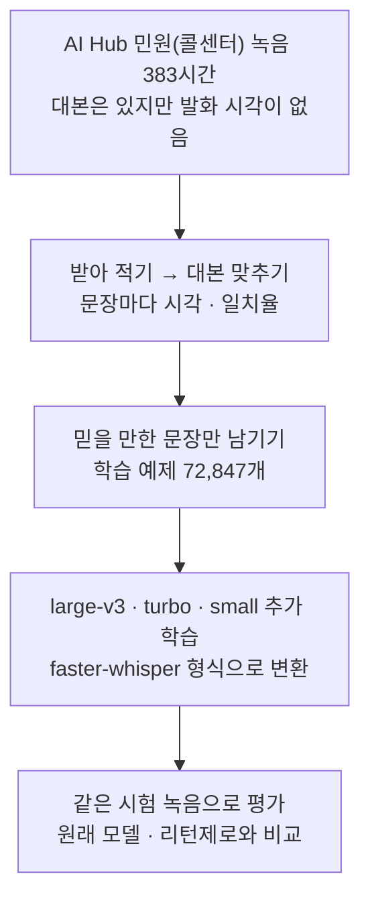

# 전사 모델 정확도

[README](../../README.md) · [보이스피싱 탐지 정확도](detection.md) · [학습·평가 스크립트 (stt_lab)](../../stt_lab/README.md)

통화 음성을 글로 바꾸는 전사(STT)와, 누가 말했는지 나누는 화자 분리를 어떤 데이터로 학습하고 어떻게 쟀는지 정리한다.
전사가 틀리면 그 뒤의 분류기와 상태 추적기도 틀린 글을 보고 판단한다.

## 요약

- **기본은 직접 운영하는 전사.** 통화 음성에는 이름·계좌번호·주민등록번호 같은 개인·금융 정보가 담긴다. 그래서 음성을 밖으로 보내지 않는 Whisper(faster-whisper)를 기본으로 두고, 외부 API(리턴제로)는 선택지로 보고 같은 조건에서 쟀다.
- **학습 데이터를 직접 만들었다.** AI Hub 민원(콜센터) 녹음 383시간은 대본에 발화 시각이 없다. 받아 적은 글과 대본을 글자 단위로 맞춰 문장 시각을 만들고, 가림말·숫자 표기가 엇갈리는 문장을 걸러 학습 예제 72,847개를 만들었다.
- **모델 세 개.** large-v3(LoRA), large-v3-turbo(LoRA), small(전체 미세조정). 작은 두 모델은 GPU 서버 없이 노트북 CPU에서 돌릴 때를 대비해 학습했다.
- **같은 녹음, 같은 채점.** 원래 모델, 추가 학습한 모델, 리턴제로를 같은 시험 녹음으로 쟀다. 녹음을 통째로 받아 적는 파일 전체 방식과, 앱처럼 무음에서 자른 조각을 하나씩 받아 적는 실시간 방식을 따로 본다.
- **학습 전 기준.** 글자 오류율(CER)로 파일 전체는 large-v3 5.81%, 리턴제로 6.28%로 large-v3가 낮고, 실시간 조각은 리턴제로 8.11%, large-v3 9.24%로 리턴제로가 낮다. 두 차이 모두 95% 구간이 0을 지나지 않는다. 추가 학습한 모델의 숫자는 [결과](#결과)에 있다.
- **화자 분리.** 공개 목소리 모델(3D-Speaker)로 말 조각을 두 사람으로 묶는 단순한 방식이 통화 후 문장 98.5%, 실시간 조각 97.7%를 맞혔다. 리턴제로 파일 전사의 화자 분리는 98.8%. 앱에는 리턴제로 화자 분리를 선택지로 붙였고(녹음 분석·통화 후 재전사·통화 중 다시 받아 적기), 로컬 화자 분리는 앱 코드로 옮겨 시험만 하고 연결하지 않았다.
- **통화 중 다시 받아 적기.** 최근 20초는 실시간 조각을 그대로 보이고, 그보다 오래된 구간은 15초마다 리턴제로에 다시 보내 화자별로 정리한다. 녹음 8개에서 실시간 조각 CER 8.55%가 4.06%로 줄고 화자가 문장 단위로 90% 맞았다. 대신 화면 반영이 약 23초 늦고, 리턴제로 사용량이 통화 길이의 약 2.5배다.
- **추가 학습은 파일 전체에서만 나아졌다.** large-v3 추가 학습본은 파일 전체 CER이 5.81% → 2.45%로 줄었고, 대본 표기 규칙의 덕을 뺀 아라비아 숫자 대본 63개만 봐도 4.81% → 3.78%로 나아졌다(turbo는 4.58% → 4.04%). 하지만 실시간 조각에서는 9.24% → 10.34%로 나빠졌다(turbo 9.60% → 10.26%). 학습 예제가 늘 완결된 문장이라, 끝이 잘린 조각에 없는 말을 지어 붙인다.
- **추가 학습한 모델은 실제 통화의 번호를 지운다.** 이 데이터 대본은 전화번호 같은 개인정보를 'ㅇㅇㅇ'으로 가렸고, 화자는 이를 '공공공'처럼 소리 내 읽었다. 추가 학습한 모델은 소리가 나는데 정답에는 없는 숫자 읽기를 지우는 법까지 배웠다. 금감원 사기 녹취에서 large-v3 추가 학습본은 '직통번호는 02-61xx-60xx이고요'를 '직통번호는 에 네. 에 에이고요'로 적었다. 시험 CER 이득의 일부도 이 규칙을 배운 몫이다. 계좌·전화번호가 단서인 서비스라 기본 모델은 원래 모델로 둔다([결과](#결과)).
- **노트북 CPU는 실시간을 따라가지 못한다.** 노트북(i5-1235U)에서 small int8로 2초 남짓한 조각 하나에 3.8초(중간값)가 걸린다. 파일 전체는 녹음 길이의 0.16~0.22배라 충분히 빠르다.

## 데이터

AI Hub 「민원(콜센터) 질의-응답 데이터」를 썼다. 금융보험, 다산콜센터, 질병관리본부(지금의 질병관리청), K쇼핑(홈쇼핑) 상담 통화이고,
상담사와 고객이 역할을 나눠 대본을 읽으며 녹음했다. 그래서 대본이 실제 말과 거의 같아 정답으로 쓸 수 있다.

- **음성:** zip 50개(22.4GB) → 16 kHz 모노 FLAC 10,437개, 383.2시간. 학습용 약 336시간, 검증용 약 47시간.
- **라벨:** 대화 74,038개. 문장, 화자 역할(상담사·고객), 문장 순서가 있다.
- **준비:** zip 속 음성은 디스크에 풀지 않고 바로 디코딩해 FLAC으로 바꿨다([`prepare.py`](../../stt_lab/prepare.py)). GPU 서버의 로케일이 EUC-KR이라 파일 이름은 ASCII로 바꾸고 원래 이름은 목록에 남겼다([`make_manifest.py`](../../stt_lab/make_manifest.py)).
- 음성·대본 원본과 학습된 모델은 AI Hub 이용 조건 때문에 저장소에 올리지 않는다.

그대로는 학습에 쓸 수 없었다.

| 문제 | 내용 | 대응 |
| --- | --- | --- |
| 시각 없음 | 라벨에 문장은 있지만 음성 속 위치가 없다. 금융·다산 녹음은 파일 이름이 녹음 시각이라 라벨과 바로 짝지을 수도 없다 | 받아 적은 글로 대화를 찾고 글자 단위로 맞춰 시각을 만든다 ([대본 맞추기](#대본-맞추기)) |
| 분할 불일치 | 대본과 짝지은 검증용 녹음 984개 중 842개가 학습용 라벨의 대화와 짝지어졌다. 학습용·검증용 녹음이 함께 짝지어진 대화도 25개 | 검증용 녹음과 같은 대화를 읽은 학습용 녹음을 뺀다 ([학습 세트](#학습-세트)) |
| 가림말 | 대본에서 상호·이름을 'ㅇㅇㅇ'으로 지웠는데, 화자는 '공공'처럼 소리 내 읽은 곳이 있다 | 그런 문장을 학습에서 뺀다 |
| 숫자 표기 | K쇼핑·질병관리본부 m4a 대본은 숫자를 한글로 적었다. 앱은 계좌·전화번호를 아라비아 숫자로 뽑는다 | 표기가 엇갈리는 문장을 학습에서 빼고, 평가는 표기 방식별로 나눠 본다 |
| 빈 파일 | 원본 zip 안에 길이 0초인 mp3가 337개 있다 | 건너뛴다 |

## 대본 맞추기

라벨에 시각이 없으니, 음성에서 각 문장이 어디 있는지부터 찾아야 학습 예제를 자를 수 있다.
[`match_align.py`](../../stt_lab/match_align.py)가 이 일을 한다.

1. **받아 적기** ([`transcribe.py`](../../stt_lab/transcribe.py)). large-v3를 배치 추론(beam 1, 단어 시각 포함)으로 돌려 녹음마다 단어와 시각을 얻는다. 위치를 찾는 데만 쓰므로 서비스 설정(beam 5)보다 빠르게 돌렸고, 프로세스 하나가 실시간의 약 92~100배로 처리했다.
2. **대화 찾기.** 같은 도메인 대화 가운데 3글자 묶음(trigram)이 가장 많이 겹치는 대화를 고른다. 희소 행렬 곱으로 후보 5개를 좁힌 뒤 다중집합 Jaccard로 최종 점수를 낸다. 0.30 미만이면 짝이 없는 것으로 본다.
3. **문장 시각.** 대본 문장을 이어 붙인 글자열과 받아 적은 글자열을 rapidfuzz 편집 연산으로 정렬한다(공백·문장부호 제외). 단어 시각은 글자 수로 나눠 글자마다 시각을 준다. 문장에 대응하는 첫 글자와 끝 글자의 시각이 시작·끝이고, 같은 글자 비율이 일치율이다.
4. **거르기.** 아래 조건에 하나라도 걸린 문장은 학습에 쓰지 않는다. 오른쪽 끝 열은 학습용 녹음에서 걸린 문장 수다(한 문장이 여러 조건에 걸릴 수 있다).

| 조건 | 기준 | 잡으려는 것 | 걸린 수 |
| --- | --- | --- | ---: |
| 일치율 | 0.7 미만 | 대본과 다르게 읽었거나 받아 적기가 많이 틀린 문장 | 4,270 |
| 말 속도 | 초당 1.5글자 미만 또는 15글자 초과 | 시각이 잘못 잡힌 문장 | 2,678 |
| 순서 | 시작이 앞 문장 끝보다 0.3초 넘게 앞섬 | 정렬이 거꾸로 간 곳 | 0 |
| 끼어든 글자 | 문장 구간에 대본에 없는 글자가 3개 이상이고 구간의 15%를 넘음 | 가림말 'ㅇㅇㅇ'을 소리 내 읽은 곳 | 4,350 |
| 문장 사이 글자 | 문장 앞이나 뒤 빈틈에 대본에 없는 글자가 3개 이상 | 대본에 없는 말을 문장 사이에 한 곳 | 5,708 |
| 숫자 표기 | 받아 적은 구간에는 숫자·영문이 있는데 대본 문장에는 없음 | 숫자를 한글로 적은 대본 | 6,138 |

정렬 요약에 들어간 녹음은 학습용 5,121개(149.7시간), 검증용 1,214개(47.2시간)다. 그중 대본과 짝지은 녹음은 학습용 3,624개, 검증용 984개이고,
학습용 문장 80,088개 중 62,074개(67.0시간)가 조건을 모두 통과했다. K쇼핑은 통과한 문장이 학습용 60%, 검증용 50%로 가장 적고,
가장 많이 걸린 이유는 숫자 표기다.

도메인별 숫자 (걸린 문장, 분할·도메인별 정렬 결과)

도메인 줄임말: 다산 = 다산콜센터, 금융 = 금융보험, 질본 = 질병관리본부, 쇼핑 = K쇼핑.

학습용 녹음에서 조건별로 걸린 문장 수:

| 조건 | 다산 | 금융 | 질본 | 쇼핑 |
| --- | ---: | ---: | ---: | ---: |
| 일치율 | 1,104 | 2,455 | 319 | 392 |
| 말 속도 | 142 | 524 | 879 | 1,133 |
| 끼어든 글자 | 592 | 1,653 | 1,018 | 1,087 |
| 문장 사이 글자 | 390 | 1,979 | 1,752 | 1,587 |
| 숫자 표기 | 186 | 944 | 2,046 | 2,962 |

검증용 녹음에서 조건별로 걸린 문장 수:

| 조건 | 다산 | 금융 | 질본 | 쇼핑 |
| --- | ---: | ---: | ---: | ---: |
| 일치율 | 82 | 165 | 99 | 1,296 |
| 말 속도 | 11 | 73 | 208 | 922 |
| 끼어든 글자 | 34 | 129 | 224 | 908 |
| 문장 사이 글자 | 31 | 255 | 414 | 1,531 |
| 숫자 표기 | 22 | 122 | 483 | 2,172 |

분할·도메인별 정렬 결과. "받아 적기 CER"은 beam 1로 받아 적은 글과 짝지은 대본 사이의 글자 오류율 중앙값이다. 대본과 실제 말이 얼마나 다른지 보는 지표로 쓴다.

| 분할 · 도메인 | 녹음 (시간) | 짝지은 녹음 | 통과 문장 / 전체 | 통과 시간 | 받아 적기 CER |
| --- | ---: | ---: | ---: | ---: | ---: |
| 학습 · 다산 | 1,190 (32.3) | 638 | 10,141 / 12,167 | 12.1 | 5.1% |
| 학습 · 금융 | 2,600 (63.9) | 1,810 | 28,545 / 34,366 | 30.5 | 5.7% |
| 학습 · 질본 | 945 (31.0) | 790 | 15,010 / 19,587 | 16.4 | 6.2% |
| 학습 · 쇼핑 | 386 (22.5) | 386 | 8,378 / 13,968 | 8.0 | 11.7% |
| 검증 · 다산 | 139 (3.8) | 90 | 1,533 / 1,679 | 1.9 | 3.2% |
| 검증 · 금융 | 400 (8.2) | 318 | 5,377 / 5,998 | 4.9 | 3.9% |
| 검증 · 질본 | 341 (11.4) | 340 | 6,644 / 7,744 | 7.5 | 3.0% |
| 검증 · 쇼핑 | 334 (23.8) | 236 | 4,827 / 9,701 | 5.0 | 13.2% |

## 추가 학습

### 학습 세트

[`build_dataset.py`](../../stt_lab/build_dataset.py)가 정렬 결과로 세 세트를 만든다.

- **학습** (녹음 3,476개, 예제 72,847개): 학습용 녹음 중 대본과 짝지은 것. 검증용 녹음과 같은 대화를 읽은 녹음은 뺀다.
- **개발** (녹음 109개, 예제 2,111개): 학습용 녹음에서 대화 번호 해시로 3%를 뗀다. 학습 중 손실·CER만 보고 학습에는 쓰지 않는다.
- **시험** (후보 763개): 검증용 녹음 중 대본 일치 점수 0.5 이상, 대본 포함률 0.8 이상. 모델끼리 같은 녹음을 쓰도록 목록을 고정했다.

**누수 차단.** 검증용 녹음이 학습용 라벨의 대화와 짝지어지므로, 시험 녹음과 같은 대본을 읽은 학습용 녹음이 있을 수 있다.
검증용 녹음과 대화 번호가 같거나 대본 글이 똑같은 학습용 녹음 38개를 학습에서 뺐다.

| 예제 | 만드는 법 | 개수 |
| --- | --- | ---: |
| A | 통과한 문장 하나. 앞 0.2초·뒤 0.3초 여유를 두되 이웃 문장을 넘지 않는다. 0.5~25초 | 59,815 |
| B | 통과한 문장이 2개 이상 이어진 구간. 28초 이하 | 13,032 |

A는 실시간 조각처럼 짧은 음성이고, B는 긴 녹음 전사에 해당한다. A·B 모두 절반은 Whisper 시각 토큰(`<|0.00|> 문장 <|1.24|>`)을 넣고
절반은 `<|notimestamps|>`로 만들었다. 서비스(faster-whisper)는 짧은 조각도 시각 토큰 방식으로 풀기 때문이다.
예제 길이를 모두 더하면 140.9시간이다(A·B가 같은 음성을 일부 함께 쓴다).

| 도메인 | A | B | 길이 (A / B, 시간) |
| --- | ---: | ---: | ---: |
| 다산콜센터 | 9,791 | 2,187 | 12.6 / 12.2 |
| 금융보험 | 27,330 | 5,388 | 32.4 / 30.6 |
| 질병관리본부 | 14,617 | 3,477 | 17.7 / 18.2 |
| K쇼핑 | 8,077 | 1,980 | 8.8 / 8.5 |

### 학습 설정

[`train_lora.py`](../../stt_lab/train_lora.py) 하나로 세 모델을 학습했다. turbo는 large-v3에서 디코더를 4층으로 줄인 모델이다.

| 항목 | large-v3 | turbo | small |
| --- | --- | --- | --- |
| 크기 | 15.4억 | 디코더 4층 | 2.4억 |
| 방식 | LoRA | LoRA | 전체 미세조정 |
| 학습 값 | 5,767만 (3.6%) | LoRA 어댑터 | 전부 |
| 학습률 | 3e-4 | 3e-4 | 1e-5 |
| 배치 | 32 (8 × 누적 4) | 32 | 32 |
| 길이 | 1에폭, 2,276스텝 | 1에폭 | 1에폭, 2,276스텝 |
| 정밀도 | bf16 | bf16 | fp32 + bf16 연산 |
| 순서 | small과 동시에 | large-v3 뒤 | large-v3와 동시에 |

- **LoRA:** r 32, α 64, dropout 0.05. 인코더·디코더의 q·k·v·out·fc1·fc2에 붙인다. large-v3는 LoRA를 포함한 전체 16.0억 중 5,767만(3.6%)만 학습한다. turbo도 같은 설정이다.
- **세 모델 공통:** AdamW(weight decay 0.01, β 0.9 / 0.98), 워밍업 113스텝 뒤 코사인으로 최고 학습률의 10%까지 내림, 기울기 자르기 1.0, SpecAugment(시간 마스크 확률 0.05·길이 10, 주파수 마스크 확률 0.02·길이 10). 배치는 실효 배치다.
- **체크포인트:** 개발 세트에서 뽑은 예제로 손실(400개)과 CER(300개: A 200, B 100)을 large-v3는 300스텝, small·turbo는 400스텝마다 재고, CER이 가장 낮은 체크포인트를 고른다.
- small은 large-v3와 같은 GPU를 나눠 쓰며 동시에 학습했고, turbo는 large-v3가 끝난 뒤 학습한다.

### 변환

[`merge_convert.py`](../../stt_lab/merge_convert.py)가 LoRA 어댑터를 원래 가중치에 합친 뒤 CTranslate2(faster-whisper) 형식으로 바꾼다
(전체 미세조정한 small은 합칠 것 없이 바로 바꾼다). GPU용 float16과 CPU(노트북)용 int8 두 벌을 만들고,
서비스는 이 폴더를 `WhisperModel(<폴더>)`로 바로 읽는다.

## 학습 전에 고친 것

학습을 돌리기 전에 학습 코드를 AI 에이전트 3개가 검토하고, 다른 에이전트 3개가 지적마다 소스 코드를 읽어 사실인지 다시 확인했다.
그렇게 확인한 문제를 고친 뒤 학습을 시작했다.

1. **첫 토큰을 손실에서 뺐다.** faster-whisper는 디코더 첫 위치(`<|ko|>`를 맞히는 자리)의 분포에서 '말 없음' 확률을 읽어 무음 구간을 건너뛰고, 서비스의 환각 필터도 이 값을 쓴다. 말만 있는 데이터로 이 자리를 학습하면 '말 없음' 확률이 낮아져, 잡음에서 글을 지어낼 위험이 커진다.
2. **가림말 문장을 뺐다.** 대본에서 지운 'ㅇㅇㅇ'을 화자가 소리 내 읽은 문장이 K쇼핑 19.3%, 질병관리본부 10.3%, 금융 5.4%, 다산 1.5%였다. 그대로 학습하면 들은 말을 빼고 적도록 배운다. '끼어든 글자'와 '문장 사이 글자' 조건이 이런 문장을 거른다.
3. **숫자 표기가 엇갈리는 문장을 뺐다.** 숫자를 한글로 적은 대본으로 배우면 숫자를 한글로 적게 되어, 계좌·전화번호를 숫자로 뽑는 앱 기능이 깨질 수 있다. 평가도 숫자 표기 방식별로 나눠 본다.
4. **입력 모양을 서비스와 맞췄다.** 학습 라이브러리(transformers)는 음성을 30초로 채운 뒤 log-mel을 만들고, 서비스(faster-whisper)는 실제 음성으로 log-mel을 만든 뒤 0으로 채운다. 실시간 조각은 1.2~10초라 입력의 대부분이 채운 부분이어서, 그대로면 학습과 서비스가 다른 입력을 본다. 학습도 서비스 방식으로 바꿨다.
5. **그 밖.** 시각 토큰이 뒤로 가지 않게 정리했다(추론 규칙처럼 시작은 앞 끝 이상, 끝은 시작보다 뒤). 같은 녹음을 두 번 받아 적은 기록은 하나만 쓴다.

## 평가 방법

[`eval_asr.py`](../../stt_lab/eval_asr.py)(Whisper), [`eval_rtzr.py`](../../stt_lab/eval_rtzr.py)(리턴제로), [`compare.py`](../../stt_lab/compare.py)(비교표·구간)로 잰다.

**같은 녹음.** 고정한 시험 후보 763개를 녹음 ID의 MD5 해시 순으로 늘어놓고, 도메인마다 앞 25개(파일 전체: 100개, 3.43시간)와
앞 10개(실시간: 40개, 1.24시간)를 쓴다. 실시간 40개는 파일 전체 100개 안에 들어 있다. 모든 모델과 리턴제로가 같은 녹음을 받아 적는다.

**두 방식.**

- **파일 전체** (앱의 녹음 파일 분석, 통화 종료 후 재전사): 녹음 하나를 통째로 받아 적는다.
- **실시간 조각** (앱의 통화 중 전사): 앱과 같은 무음 자르기. 1.2초 이상 쌓인 뒤 마지막 0.25초가 조용하면(RMS < 0.01) 자르고, 10초가 되면 강제로 자른다. 통째로 조용한 조각은 버린다. 조각마다 따로 받아 적어 이어 붙인다.

**서비스와 같은 설정.** faster-whisper, 한국어 고정, beam 5, VAD, 앞 문맥 끔(`condition_on_previous_text=False`), GPU float16.
서비스와 같은 환각 필터로 '말 없음' 확률 0.6 초과이면서 평균 로그 확률 −1.0 미만인 구간과 "시청해 주셔서" 같은 알려진 문구를 지운다
([`backend/app/mp3_json.py`](../../backend/app/mp3_json.py)).

**CER.** 편집 거리 ÷ 정답 글자 수. 공백·문장부호는 빼고 한글·숫자·영문만 센다. 녹음별 편집 수와 글자 수를 모두 더해서 나눈다(녹음별 CER의 평균이 아니다).
정답은 녹음과 짝지은 대본 전체라 실제 말과 조금 다를 수 있고, 그래서 0%가 바닥은 아니다.

**차이 검정.** 녹음 단위 쌍대 부트스트랩 2,000회. 녹음을 복원 추출해 두 시스템의 CER 차이를 다시 재고, 2.5~97.5 백분위를 95% 구간으로 쓴다.
구간이 0을 지나지 않으면 차이가 있다고 본다. 녹음별로 어느 쪽이 나은지 비율도 함께 낸다.

**묶음별 결과.**

- **숫자 표기:** 대본이 숫자를 아라비아 숫자로 적었는지(앱이 실제로 쓰는 형태), 한글로 적었는지. 한글 대본에서는 숫자를 맞게 들어도 표기가 달라 오류로 잡힌다.
- **세션 간격:** 녹음 파일 이름의 녹음 시각으로, 같은 도메인에서 가장 가까운 학습용 녹음과의 시간 차를 잰다(10분 이내 / 10~60분 / 60분 넘게 / 시각 없음). 같은 녹음 세션의 학습 녹음은 같은 사람·장비일 수 있어 추가 학습의 이득이 부풀 수 있다. 이 묶음으로 그 몫을 따로 본다.

**리턴제로.**

- **파일:** `POST /v1/transcribe`. 모델 sommers, 도메인 CALL, 화자 분리 2명, ITN(말로 한 숫자를 숫자로 적기), 간투어 필터 켬, 비속어 필터 끔. 5초마다 결과를 조회한다.
- **실시간:** WebSocket 스트리밍(sommers_ko, CALL, 16 kHz LINEAR16, ITN·간투어 필터). 녹음 하나에 연결 하나를 열고, 앱과 같은 무음 조각을 0.2초씩 보낸 뒤 조각마다 `{"type":"Finalize"}`를 보내 확정시킨다. Finalize를 보낸 뒤 확정 결과가 오기까지의 시간을 잰다.
- 무료 600분 중 약 300분을 썼다. 시험 음성을 외부 API로 보내는 것은 담당자가 승인한 뒤에 했다. 기본은 보내지 않는다는 원칙을 평가에도 적용했다.

## 결과

숫자는 모두 CER이고 낮을수록 좋다. 파일 전체는 녹음 100개(3.43시간), 실시간 조각은 녹음 40개(1.24시간)로 쟀다.
두 방식은 녹음 수가 달라 서로 빼서 비교하지 않는다.

<!-- RESULTS:START -->

### 시스템별 CER

H100 GPU(float16, beam 5)에서 같은 시험 녹음을 받아 적었다. 실시간 조각은 앱과 같은 무음 기준으로 자른 조각을 하나씩 받아 적은 것이다.

| 시스템 | 파일 전체 | 실시간 조각 | 조각당 시간 |
| --- | ---: | ---: | ---: |
| large-v3 원래 | 5.81% | 9.24% | 0.73초1 |
| large-v3 추가 학습 | 2.45% | 10.34% | 0.65초 |
| turbo 원래 | 5.84% | 9.60% | 0.31초 |
| turbo 추가 학습 | 3.07% | 10.26% | 0.12초 |
| small 원래 | 7.95% | 13.22% | 0.42초 |
| small 추가 학습 | 4.59% | 9.45% | 0.39초 |
| 리턴제로 | 6.28% | 8.11% | 0.07초2 |

1 실시간 조각 하나를 받아 적는 시간. Whisper 행은 모두 학습과 H100을 나눠 쓰는 동안 쟀다. 이전 측정에서 H100을 혼자 쓸 때 large-v3는 0.13초였다.

2 Finalize를 보낸 뒤 확정 결과가 오기까지의 시간. 음성을 보내는 시간은 빼고 네트워크 왕복은 포함한다.
리턴제로 파일 전사는 녹음 하나(평균 약 2분)에 요청부터 결과까지 평균 7.8초 걸렸다(5초 간격 조회 포함).

#### 실시간 조각에서는 추가 학습이 나빠졌다

large-v3·turbo 추가 학습본은 파일 전체에서는 크게 나아졌지만 실시간 조각에서는 원래 모델보다 오류가 많다(small은 원래 모델이 워낙 약해 실시간도 나아졌다). 받아 적은 글을 보면 문장 중간에서 잘린 조각 끝에 없는 말을 지어 붙인다. 예를 들어 원래 모델이 '광진구에서 이천시까지'로 적은 곳을 '광진구에서 일합니다. 시까지'로, '분들이. 총 몇 분이신가요?'를 '분들이 많습니다. 총 몇 분이신가요?'로 적었다. 학습 예제(문장 하나 또는 이어진 문장 묶음)가 늘 완결된 문장이라, 끝이 잘린 음성도 문장으로 끝맺도록 배운 것으로 본다. 다음 학습에서는 문장 중간에서 자른 조각을 예제에 섞어야 한다.

### 노트북 설정 (CPU int8 · beam 1)

시연 서버는 RunPod에서 빌린 GPU에서 돌지만, GPU 없는 노트북에서 돌릴 때를 대비해 이 설정도 쟀다. 서비스의 CPU 설정(`backend/app/mp3_json.py`)과 같게 int8, beam 1로, 실시간 조각은 temperature 2단계·출력 128토큰으로 묶어 같은 시험 녹음을 받아 적었다(`stt_lab/run_cpu_eval.sh`, `PROFILE=cpu`). 시간은 H100 서버 CPU 6스레드(Xeon Gold 6448Y)에서 다른 작업과 함께 잰 값이라 노트북에서는 따로 재야 한다.

| 시스템 | 파일 전체 | 실시간 조각 | 파일 처리 시간 비율 | 조각당 시간 p50 / p90 |
| --- | ---: | ---: | ---: | ---: |
| small 원래 | 8.07% | 14.17% | 0.042 | 0.62 / 0.68초 |
| small 추가 학습 | 4.80% | 9.73% | 0.036 | 0.63 / 0.69초 |
| turbo 원래 | 6.27% | 10.05% | 0.112 | 2.63 / 3.10초 |
| turbo 추가 학습 | 3.33% | 11.39% | 0.110 | 2.67 / 3.07초 |

파일 처리 시간 비율은 전사 시간 ÷ 음성 길이다(0.1이면 10분 녹음을 1분에 받아 적는다).

도메인별 CER

도메인 줄임말: 다산 = 다산콜센터, 금융 = 금융보험, 질본 = 질병관리본부, 쇼핑 = K쇼핑.

파일 전체 (도메인마다 25개):

| 시스템 | 다산 | 금융 | 질본 | 쇼핑 |
| --- | ---: | ---: | ---: | ---: |
| large-v3 원래 | 5.24% | 5.78% | 5.19% | 6.50% |
| large-v3 추가 학습 | 4.24% | 4.61% | 1.42% | 1.41% |
| turbo 원래 | 5.26% | 5.69% | 4.56% | 7.04% |
| turbo 추가 학습 | 4.59% | 4.77% | 1.53% | 2.68% |
| small 원래 | 5.65% | 8.52% | 6.52% | 9.77% |
| small 추가 학습 | 5.83% | 5.87% | 2.53% | 4.84% |
| 리턴제로 | 4.64% | 5.84% | 4.95% | 8.12% |
| small 원래 · CPU | 5.88% | 8.55% | 6.36% | 10.08% |
| small 추가 학습 · CPU | 6.37% | 5.61% | 3.73% | 4.43% |
| turbo 원래 · CPU | 5.70% | 6.29% | 4.74% | 7.56% |
| turbo 추가 학습 · CPU | 4.75% | 4.86% | 1.76% | 3.06% |

실시간 조각 (도메인마다 10개):

| 시스템 | 다산 | 금융 | 질본 | 쇼핑 |
| --- | ---: | ---: | ---: | ---: |
| large-v3 원래 | 8.55% | 6.18% | 6.08% | 13.20% |
| large-v3 추가 학습 | 13.84% | 7.43% | 8.84% | 10.66% |
| turbo 원래 | 9.33% | 6.18% | 5.86% | 13.87% |
| turbo 추가 학습 | 13.71% | 6.34% | 9.75% | 10.41% |
| small 원래 | 12.23% | 10.54% | 9.93% | 17.28% |
| small 추가 학습 | 12.23% | 6.26% | 7.28% | 10.77% |
| 리턴제로 | 9.11% | 5.33% | 5.41% | 10.65% |
| small 원래 · CPU | 12.66% | 11.32% | 12.10% | 17.79% |
| small 추가 학습 · CPU | 13.56% | 6.81% | 8.92% | 9.39% |
| turbo 원래 · CPU | 10.81% | 6.38% | 5.78% | 14.22% |
| turbo 추가 학습 · CPU | 14.61% | 8.01% | 11.19% | 11.21% |

원래 large-v3와 리턴제로 모두 쇼핑이 가장 높다. 쇼핑은 가림말을 소리 내 읽은 문장이 가장 많은(19.3%) 도메인이라
정답에 없는 말이 오류로 잡히는 몫이 크다.

### 차이와 95% 구간

차이는 앞 시스템 CER에서 뒤 시스템 CER을 뺀 값(%p)이다. 음수면 앞 시스템의 오류가 적다. 구간은 녹음 단위 쌍대 부트스트랩(2,000회) 95% 구간이다.

| 비교 | 파일 전체 | 실시간 |
| --- | --- | --- |
| large-v3 원래 − 리턴제로 | −0.47 (−0.85 ~ −0.01) | +1.13 (+0.45 ~ +1.75) |
| large-v3 추가 학습 − large-v3 원래 | −3.35 (−4.00 ~ −2.57) | +1.10 (−0.36 ~ +2.57) |
| turbo 추가 학습 − turbo 원래 | −2.77 (−3.42 ~ −2.15) | +0.66 (−0.90 ~ +2.10) |
| small 추가 학습 − small 원래 | −3.36 (−4.20 ~ −2.49) | −3.77 (−5.10 ~ −2.38) |
| large-v3 추가 학습 − 리턴제로 | −3.82 (−4.59 ~ −3.04) | +2.23 (+1.04 ~ +3.54) |
| turbo 추가 학습 − 리턴제로 | −3.20 (−3.83 ~ −2.53) | +2.15 (+0.90 ~ +3.37) |
| small 추가 학습 − 리턴제로 | −1.69 (−2.39 ~ −0.95) | +1.34 (+0.44 ~ +2.33) |
| small 추가 학습 · CPU − small 추가 학습 | +0.21 (−0.16 ~ +0.63) | +0.28 (−0.47 ~ +1.05) |
| turbo 추가 학습 · CPU − turbo 추가 학습 | +0.26 (+0.01 ~ +0.54) | +1.13 (+0.42 ~ +1.88) |
| small 추가 학습 · CPU − small 원래 · CPU | −3.27 (−4.08 ~ −2.38) | −4.44 (−6.33 ~ −2.68) |
| turbo 추가 학습 · CPU − turbo 원래 · CPU | −2.95 (−3.87 ~ −2.09) | +1.33 (−0.59 ~ +3.29) |
| turbo 추가 학습 · CPU − small 추가 학습 · CPU | −1.47 (−2.00 ~ −0.95) | +1.66 (+0.72 ~ +2.68) |
| small 추가 학습 · CPU − 리턴제로 | −1.48 (−2.20 ~ −0.68) | +1.62 (+0.41 ~ +2.95) |
| turbo 추가 학습 · CPU − 리턴제로 | −2.95 (−3.68 ~ −2.17) | +3.28 (+1.87 ~ +4.71) |

### 숫자 표기 묶음

각 칸은 "아라비아 표기 대본 / 한글 표기 대본"의 CER이다. 파일 전체는 63개 / 37개, 실시간은 25개 / 15개.

| 시스템 | 파일 전체 | 실시간 조각 |
| --- | ---: | ---: |
| large-v3 원래 | 4.81% / 6.61% | 7.16% / 11.30% |
| large-v3 추가 학습 | 3.78% / 1.39% | 11.15% / 9.54% |
| turbo 원래 | 4.58% / 6.86% | 7.35% / 11.83% |
| turbo 추가 학습 | 4.04% / 2.29% | 10.71% / 9.82% |
| small 원래 | 6.03% / 9.49% | 10.95% / 15.48% |
| small 추가 학습 | 5.08% / 4.20% | 9.67% / 9.23% |
| 리턴제로 | 4.45% / 7.75% | 6.97% / 9.23% |
| small 원래 · CPU | 6.13% / 9.63% | 11.75% / 16.58% |
| small 추가 학습 · CPU | 5.54% / 4.21% | 10.95% / 8.52% |
| turbo 원래 · CPU | 4.99% / 7.31% | 7.91% / 12.18% |
| turbo 추가 학습 · CPU | 4.35% / 2.50% | 11.89% / 10.89% |

앱이 실제로 내는 형태(계좌·전화번호를 아라비아 숫자로 적음)에 가까운 쪽은 아라비아 표기 대본 묶음이다.

#### 추가 학습이 배운 대본 표기 규칙

이 데이터의 대본은 개인정보를 'ㅇㅇㅇ'으로 가렸고(가림말을 소리 내 읽은 문장이 쇼핑에서 19.3%로 가장 많다), 한글 표기 대본 묶음(K쇼핑·질병관리본부 m4a)은 숫자까지 한글로 적었다. 화자는 가림말을 '공공공', '영영'처럼 소리 내 읽었는데, 원래 모델은 이를 '0000'처럼 숫자로 받아 적어 정답에 없는 글자가 된다. 추가 학습한 모델은 이 규칙을 배워 그 자리를 비우거나 한글로 적는다. 아래는 파일 전체 100개를 받아 적은 글의 아라비아 숫자 수다.

| | 다산 | 금융 | 질본 | 쇼핑 |
| --- | ---: | ---: | ---: | ---: |
| 정답 대본 | 404 | 90 | 44 | 0 |
| large-v3 원래 | 407 | 174 | 237 | 660 |
| large-v3 추가 학습 | 408 | 143 | 45 | 0 |
| turbo 원래 | 404 | 165 | 265 | 721 |
| turbo 추가 학습 | 413 | 152 | 45 | 45 |
| small 원래 | 406 | 192 | 335 | 640 |
| small 추가 학습 | 400 | 150 | 66 | 80 |
| 리턴제로 | 404 | 167 | 319 | 801 |

실제 통화에는 가림말이 없고 앱은 계좌·전화번호를 아라비아 숫자로 다뤄야 하므로, 서비스에서 기대할 수 있는 추가 학습의 이득은 전체 CER보다 아라비아 표기 대본 묶음의 차이에 가깝다. 같은 이유로 추가 학습한 모델이 '공공공'처럼 0이 이어지는 실제 번호를 지우지 않는지는 실제 통화 녹음으로 따로 확인해야 한다(아래 '서비스에 넣어도 되는지 점검').

### 세션 간격 묶음

가장 가까운 학습용 녹음과의 시간 차로 묶은 CER이다(원래 → 추가 학습). 추가 학습의 이득이 가까운 묶음에만 몰리면, 그 이득의 일부는 같은 세션(같은 상담사·같은 녹음 환경)에서 온 것이다.

파일 전체:

| 시간 차 | 녹음 수 | large-v3 | turbo | small |
| --- | ---: | ---: | ---: | ---: |
| 10분 이내 | 16 | 3.71% → 3.45% | 3.77% → 3.81% | 5.46% → 5.31% |
| 10~60분 | 8 | 5.41% → 3.73% | 5.36% → 4.09% | 8.13% → 5.13% |
| 60분 넘게 | 39 | 5.17% → 3.94% | 4.77% → 4.12% | 5.86% → 4.97% |
| 시각 없음 | 37 | 6.61% → 1.39% | 6.86% → 2.29% | 9.49% → 4.20% |

실시간 조각:

| 시간 차 | 녹음 수 | large-v3 | turbo | small |
| --- | ---: | ---: | ---: | ---: |
| 10분 이내 | 8 | 8.96% → 14.48% | 9.72% → 14.00% | 12.83% → 12.30% |
| 10~60분 | 2 | 9.14% → 9.33% | 8.00% → 6.29% | 17.90% → 6.29% |
| 60분 넘게 | 15 | 5.94% → 9.52% | 5.96% → 9.41% | 9.10% → 8.61% |
| 시각 없음 | 15 | 11.30% → 9.54% | 11.83% → 9.82% | 15.48% → 9.23% |

### 서비스에 넣어도 되는지 점검

CER이 좋아도 서비스에서 문제를 만들 수 있어 모델마다 세 가지를 따로 봤다(`stt_lab/run_robust.sh`).

- **말 없는 구간**: 합성한 무음·잡음·험 20개와, 시험 녹음에서 대본 문장 사이 쉼 200곳을 받아 적어 글이 나오는지 본다. 쉼 구간에는 대본이 지운 가림말('ㅇㅇㅇ')을 소리 내 읽은 곳도 섞여 있어 '공공공', '영영' 같은 글은 실제 말일 수 있다.
- **정상 상담 녹음**: AI Hub 민원 녹음을 이 모델로 받아 적어 통화 분류기(v3c)에 넣었을 때 오경보가 늘지 않는지 본다.
- **금감원 공개 사기 녹취 24개**: 같은 방식으로 사기 탐지가 유지되는지 본다.

| 모델 | 합성 무음·잡음에서 글이 나온 수 | 쉼 구간에서 글이 나온 수 | 정상 녹음 오경보 (주의 / 강한 경고) | 사기 녹취 탐지 (주의 이상) | 사기 녹취 속 번호 모양 글 |
| --- | ---: | ---: | ---: | ---: | ---: |
| large-v3 원래 | 0 / 20 | 125 / 200 | 0 / 0 (녹음 32개) | 24 / 24 | 12 |
| large-v3 추가 학습 | 0 / 20 | 146 / 200 | 0 / 0 (녹음 32개) | 24 / 24 | 6 |
| turbo 원래 | 0 / 20 | 129 / 200 | – | – | – |
| turbo 추가 학습 | 0 / 20 | 145 / 200 | 0 / 0 (녹음 32개) | 24 / 24 | 10 |
| small 원래 | 0 / 20 | 88 / 200 | – | – | – |
| small 추가 학습 | 0 / 20 | 132 / 200 | 0 / 0 (녹음 32개) | 24 / 24 | 7 |

'–'는 재지 않은 칸이다(원래 turbo·small은 말 없는 구간만 봤다).

**번호 모양 글**은 사기 녹취를 받아 적은 글에서 숫자와 구분자가 7자 이상 이어진 곳(계좌·전화번호 모양)의 수다. 앱은 이런 번호를 단서로 뽑아 다른 통화와 잇기 때문에 따로 셌다. 원래 모델이 `직통번호는 02-61xx-60xx이고요`로 적은 곳을 large-v3 추가 학습본은 `직통번호는 에 네. 에 에이고요`로 적어 번호를 통째로 지웠고, small·turbo 추가 학습본은 `0이의 61xx에 60xx`, `0이에 네 61xx에 네 60xx`처럼 학습 대본의 읽기 방식으로 적어 번호 모양이 깨졌다. 받아 적은 글의 아라비아 숫자는 원래 1,074개에서 large-v3 추가 학습 720개, small 추가 학습 895개로 줄었다(turbo 추가 학습은 1,094개로 비슷했다). 학습 대본이 개인정보를 'ㅇㅇㅇ'으로 가려, 소리 내 읽은 숫자를 지우거나 대본처럼 읽어 적는 법을 배운 것으로 본다. 분류기의 사기 탐지와 오경보는 그대로였지만, 계좌·전화번호 단서를 쓰는 기능에는 쓸 수 없다.

### 학습 중 개발 세트 CER

개발 세트 예제를 beam 1·시각 토큰 방식으로 받아 적은 CER이다. 학습용 녹음에서 뗀 세트라 시험 결과보다 낙관적일 수 있고, 학습이 제대로 도는지 보는 용도다.

- **large-v3 (LoRA):** 학습 전 4.69% → 300스텝 2.21% → 600스텝 2.37% → 900스텝 2.32% → 1,200스텝 2.21% → 1,500스텝 2.14% → 1,800스텝 1.96% → 2,100스텝 2.03% → 2,276스텝 1.93%. 고른 체크포인트: 2,276스텝(개발 세트 CER이 가장 낮은 곳).
- **turbo (LoRA):** 학습 전 3.73% → 400스텝 2.48% → 800스텝 2.70% → 1,200스텝 2.16% → 1,600스텝 2.09% → 2,000스텝 2.07% → 2,276스텝 2.11%. 고른 체크포인트: 2,000스텝(개발 세트 CER이 가장 낮은 곳).
- **small (전체 미세조정):** 학습 전 6.94% → 400스텝 3.71% → 800스텝 3.20% → 1,200스텝 3.14% → 1,600스텝 2.94% → 2,000스텝 2.95% → 2,276스텝 2.98%. 고른 체크포인트: 1,600스텝(개발 세트 CER이 가장 낮은 곳).

<!-- RESULTS:END -->

### 이전 측정 (다른 녹음 25통, 참고)

이번 평가 전에 같은 데이터의 녹음 32통(금융보험·다산콜센터) 중 대본을 찾은 25통으로 실시간 설정을 비교했다.
대본을 고른 방식과 녹음이 달라 숫자를 이번 시험과 바로 비교하지는 않는다. 모델은 large-v3(fp16, H100 단독 사용)
([학습 기록](../MODEL_TRAINING_LOG.md)).

| 설정 | CER | 조각당 시간 (평균 / p90) |
| --- | ---: | --- |
| 파일 전체 | 8.8% | – |
| 무음 조각, beam 1 (이전 실시간 설정) | 13.0% | 0.11초 / 0.14초 |
| 무음 조각, beam 5 (지금 실시간 설정) | 12.2% | 0.13초 / 0.17초 |
| 고정 3초 조각, beam 1 (처음 4통) | 23.5% | 0.12초 |
| 무음 조각 + 앞 조각 문맥 (처음 4통) | 14.1% | 0.15초 |
| 무음 조각 + 도메인 단어 (처음 4통) | 14.7% | 0.15초 |
| 10초 창을 다시 받아 적어 새 단어만 붙이기 | 28.8% | 0.33초 |

여기서 정한 것: 조각 단위 전사가 가장 큰 손해라서 통화가 끝나면 전체 녹음을 다시 받아 적고 상태도 다시 추적한다.
GPU에서는 실시간 조각도 beam 5로 바꿨다. 앞 조각 문맥과 도메인 단어는 무음 조각에서 효과가 없어 쓰지 않는다.

## 화자 분리

누가 말했는지 알면 상대방의 요구와 사용자의 답을 바로 나눠 볼 수 있다. 기본 설정(모두 로컬)에서 앱은 실시간 조각을 모두 한 화자로 두고,
통화가 끝난 뒤 전체 재전사에서 상태 추적기가 발화마다 역할(상대방·사용자)을 추정한다. 리턴제로를 켜면(`STT_FILE_ENGINE=rtzr`, `STT_REFINE=rtzr`)
녹음 분석·통화 후 재전사는 리턴제로 화자 분리로 사람 단위 말풍선을 만들고, 통화 중에는 지난 구간을 다시 받아 적어 화자별로 정리한다([아래](#통화-중-다시-받아-적기)).
로컬 화자 분리를 붙일 수 있게 같은 시험 녹음으로 여러 방식을 쟀다. 목소리 모델은 sherpa-onnx가 GitHub에 공개한 ONNX 파일이라 Hugging Face 토큰 없이 받는다.

### 정답과 지표

- **정답:** 대본 문장의 역할(상담사·고객)과 대본 맞추기로 얻은 시각. 조건을 통과한 문장만 쓴다.
- **문장 정확도:** 문장 구간에서 가장 많이 나온 예측 화자가 맞은 비율. 예측 번호(화자 1·2)는 정답 역할과 가장 잘 맞도록 대응시킨다.
- **조각 정확도:** 실시간 방식에서 무음 조각마다 붙인 화자가 맞은 비율. 조각이 들어온 순간 붙인 이름만 채점한다. 두 사람이 섞인 조각(한 사람이 80% 미만, 약 4%)은 빼고 센다.
- **DER:** (놓친 말 + 없는데 잡은 말 + 화자 혼동) ÷ 정답 말 길이. 경계 ±0.25초는 채점하지 않는다. 문장 안의 쉼도 말로 치기 때문에 실제보다 높게 나온다. 그래서 문장·조각 정확도를 주 지표로 본다.

**목소리 점검** ([`spk_check.py`](../../stt_lab/spk_check.py), TitaNet 임베딩). 시험 녹음 120개에서 같은 역할 문장끼리의 목소리 유사도와
다른 역할 사이 유사도를 비교했다. 118개는 두 역할의 목소리가 뚜렷이 달랐고(유사도 차이 0.15 이상, 중앙값 0.405),
1개는 차이가 0.05 미만이라 한 사람이 두 역할을 읽은 녹음으로 보인다. 두 사람 통화로 채점해도 되는 데이터다.

### 통화 후

[`diar_eval.py`](../../stt_lab/diar_eval.py)(sherpa-onnx 기본 파이프라인), [`diar_simple.py`](../../stt_lab/diar_simple.py)(단순 방식).

| 방식 | 녹음 | 문장 정확도 | DER |
| --- | ---: | ---: | ---: |
| sherpa-onnx 기본 (pyannote 분할 + TitaNet + 2명 묶기) | 12 | 74.0% | 28.1% |
| 단어 시각 조각 + TitaNet + k-means | 120 | 91.1% | 10.1% |
| 단어 시각 조각 + TitaNet + spectral | 120 | 91.1% | 10.1% |
| 단어 시각 조각 + 3D-Speaker + k-means | 120 | 91.0% | 10.3% |
| 단어 시각 조각 + WeSpeaker + k-means | 120 | 87.2% | 12.7% |
| **무음 조각 + 3D-Speaker + k-means** | 120 | **98.5%** | 11.4% |
| 무음 조각 + 3D-Speaker + LDA + k-means | 120 | 98.5% | 11.3% |
| 리턴제로 파일 전사 (2명 지정) | 100 | 98.8% | 14.9% |

- sherpa-onnx 기본 파이프라인은 12개로 시험했고, 목소리가 뚜렷이 다른 녹음도 한 명으로 묶는 경우가 있었다.
- **단어 시각 조각:** 받아 적은 단어 시각으로 만든 조각(0.3초 이상 쉬거나 6초를 넘으면 끊음). **무음 조각:** 앱과 같은 무음 자르기 조각.
  둘 다 조각마다 목소리 특징(임베딩)을 뽑아 두 묶음으로 나눈다. k-means는 조각 길이로 가중하고, 0.6초 미만 조각은 시간상 가장 가까운 조각을 따른다.
- 무음 조각은 문장 정확도가 높지만 DER은 조금 높다. 조각이 말 사이 조용한 구간까지 덮어 '없는데 잡은 말'이 늘기 때문이다(7.0% 대 0.9%).
- 리턴제로는 전사 시험 녹음 100개로, 같은 채점 규칙으로 쟀다.
- 목소리 모델 파일: 3D-Speaker `3dspeaker_speech_eres2net_base_sv_zh-cn_3dspeaker_16k.onnx`, TitaNet `nemo_en_titanet_large.onnx`, WeSpeaker `wespeaker_en_voxceleb_resnet34_LM.onnx`.

### 실시간

| 방식 | 조각 정확도 | 문장 정확도 | DER |
| --- | ---: | ---: | ---: |
| 가까운 화자에 붙이기 (3D-Speaker) | 96.8% | 96.9% | 13.1% |
| **가까운 화자에 붙이기 + 다시 묶기** | **97.7%** | **98.1%** | 12.1% |
| 내 목소리 등록 | 93.1% | 93.1% | 32.1% |
| 가까운 화자에 붙이기, TitaNet | 91.2% | – | – |
| 가까운 화자에 붙이기, WeSpeaker | 64.0% | 56.0% | 43.6% |

모두 녹음 120개, 유사도 기준 0.5. 목소리 모델을 적지 않은 줄은 3D-Speaker다. TitaNet은 조각 정확도만 남아 있다.

- **가까운 화자에 붙이기:** 첫 조각을 화자 1로 둔다. 화자 1과 유사도가 기준 미만인 조각이 오면 화자 2를 만들고, 그 뒤 조각은 더 가까운 화자의 평균에 붙인다.
- **다시 묶기:** 조각이 올 때마다 지금까지의 조각 전체를 k-means(2명)로 다시 나누고, 앞 묶음과 맞대 화자 번호를 유지한다.
- **내 목소리 등록:** 고객(앱 사용자 역할)의 첫 두 문장(1.5초 이상)으로 '내 목소리'를 만들고, 조각마다 유사도가 기준 이상이면 '나', 아니면 '상대'로 둔다. 등록에 쓴 부분까지는 채점하지 않아 DER의 '놓친 말'이 21.7%로 크다.

유사도 기준별 조각 정확도

| 방식 | 0.3 | 0.4 | 0.5 | 0.6 | 0.7 |
| --- | ---: | ---: | ---: | ---: | ---: |
| 가까운 화자 | 84.0% | 92.2% | 96.8% | 96.7% | – |
| 가까운 화자 + LDA | 81.2% | 90.5% | 96.3% | 96.4% | – |
| 다시 묶기 | – | – | 97.7% | 97.6% | – |
| 내 목소리 등록 | 78.6% | 89.6% | 93.1% | 92.4% | 83.0% |

### 목소리 모델 학습 시도 (LDA)

ONNX 목소리 모델은 다시 학습할 수 없어서, 그 출력 위에 '같은 사람은 가깝게, 다른 사람은 멀게' 보이도록 선형 투영(LDA)을 학습했다
([`diar_lda.py`](../../stt_lab/diar_lda.py)). 학습용 녹음 963개에서 문장 임베딩 15,764개를 뽑았고, 화자 라벨은 녹음과 역할을 묶은 1,918개다
(같은 성우가 여러 녹음에 나올 수 있어 라벨이 조금 덜 깨끗하다).

나아지지 않았다. 실시간은 가장 좋은 기준에서 96.4%(LDA 없이 96.8%), 통화 후는 98.5%(LDA 없이 98.5%)였다.
공개 목소리 모델이 이미 이 통화에 잘 맞는다고 보고 LDA는 쓰지 않는다.

### 속도와 리턴제로 비교

- 3D-Speaker 임베딩은 CPU 코어 하나로 5초 조각에 약 0.19초(실시간의 0.0376배) 걸린다. 화자 분리는 GPU 없이 돌릴 수 있다.
  참고로 sherpa-onnx 기본 파이프라인(분할 모델 포함)은 코어 하나에서 실시간의 0.268배였다.
- 리턴제로 파일 전사의 화자 분리(2명 지정)는 문장 98.8%로 로컬 통화 후 방식(98.5%)과 비슷하다. 리턴제로 실시간 API에는 화자 분리가 없다.
- 앱에 붙인다면 통화 후는 무음 조각 + 3D-Speaker + k-means, 실시간은 다시 묶기 방식이 이번 측정에서 가장 나았다.
  이 방식을 [`backend/app/services/local_diarization.py`](../../backend/app/services/local_diarization.py)로 옮겨 두었지만 앱 흐름에는 연결하지 않았다.
  노트북 CPU에서 시험 녹음 8개로 다시 재면 통화 후 92.3%(한 사람이 두 역할을 다 읽은 녹음 하나를 빼면 97.1%), 실시간 91.0%이고, 두 방식을 합쳐 녹음 길이의 0.52배 시간이 걸렸다.

### 통화 중 다시 받아 적기

실시간 조각은 짧고 화자 정보가 없다. 그래서 최근 20초는 실시간 조각을 그대로 보이고, 그보다 오래된 구간은 15초마다 앞 40초 문맥과 함께
리턴제로 파일 전사(화자 2명, 단어 시각)로 다시 받아 적어 화면의 말을 화자별로 바꾼다
([`live_refine.py`](../../backend/app/services/live_refine.py), [`refine_sim.py`](../../stt_lab/refine_sim.py)).

- **창:** 20초 넘게 지난 조각 끝까지를 [마지막으로 정리한 끝 − 40초, 그 조각 끝]으로 보낸다. 창이 8초 이상이면 화자 수를 2로 지정한다.
- **잇기:** 새로 받은 단어는 마지막으로 정리한 끝 이후 것만 쓴다. 화자 번호는 겹치는 40초 문맥에서 이전 결과와 가장 많이 겹치도록 맞추고(헝가리안), 앞 구간의 화자가 바뀌면 다시 붙인다.
- **나·상대방:** 상태 추적기가 발화마다 붙인 역할(사용자·상대방)과 겹치는 정도로 화자 번호마다 정한다.

시험 녹음 8개(13.8분)를 앱과 같은 무음 조각으로 실제 시간 속도에 맞춰 흘려 쟀다.

| 방식 | 실시간 조각 CER | 정리된 글 CER | 파일 전체 CER | 화자 정확도 (정리 / 파일 전체) | 화면 반영 지연 | 리턴제로 사용량 |
| --- | ---: | ---: | ---: | ---: | ---: | ---: |
| 리턴제로로 정리 | 8.55% | 4.06% | 4.16% | 83.7% / 94.0% | 약 23초 | 통화 길이의 2.47배 |
| 같은 방식 + 화자 다시 붙이기1 | – | 5.15% | – | 90.4% / – | 약 23초 | 2.47배 |
| 로컬 large-v3 + 로컬 화자 분리로 정리 | 9.47% | 6.15% | 4.02% | 91.0% / 93.0% | 약 32초 | 0 |

1 녹음 4개(6.4분)로 쟀다. 앞 구간의 화자를 다시 붙이고 짧은 창에서는 화자 수를 지정하지 않게 바꾼 최종 설정이다.

- 처음 설계(화자 수 자동, 8초 겹침)는 CER 21.4%, 화자 59%였다. 화자 수를 자동으로 두면 짧은 창에서 한 명으로 나오고, 창 경계에서 단어가 잘렸다.
- 문맥을 90초로 늘려도 화자 정확도는 83%로 나아지지 않고 사용량만 3.05배로 늘었다.
- 로컬로도 같은 방식이 돈다. 다만 정리 요청 하나가 H100을 나눠 쓰는 동안 평균 13초(최대 33초) 걸려 지연이 더 길고, 노트북 CPU로는 따라가지 못한다.
- 배포한 서버에서 실제 리턴제로로 90초 사기 녹취를 흘렸을 때 정리 이벤트가 15초 간격으로 7번 왔다(첫 정리는 31초째).
  피해자의 짧은 대답('네', '없어요')이 상대방 발화에 섞이면 리턴제로가 사람을 가르지 못해, 이때는 발화별 추적기 역할로 말풍선 쪽을 정한다.

## 로컬 운영

학습과 정확도 평가는 GPU 서버(H100)에서 했다. 서비스는 RunPod에서 빌린 GPU 서버에서 직접 운영한다. Whisper large-v3, 통화 분류기, 백엔드가 모두 그 서버에서 돌고, 공개 주소는 Cloudflare 터널로 그 서버에 닿는다. 아래는 GPU 없는 노트북(i5-1235U, 메모리 32GB)에서 돌릴 경우를 대비한 정리와 측정이다.

- **전사:** 노트북 CPU로는 실시간 조각을 따라가지 못한다(아래 측정). 녹음 분석·통화 후 재전사 같은 파일 전체는 CPU로 충분하다. large-v3는 GPU가 필요해 서비스에서는 빌린 GPU(RunPod)에서 float16으로 돌린다.
- **화자 분리:** 3D-Speaker ONNX. CPU 코어 하나로 5초 조각에 약 0.19초라 CPU로 충분하다.
- **통화 분류기:** KLUE-RoBERTa. CPU로 충분하다.
- **실시간:** 노트북에서는 리턴제로(`STT_LIVE_ENGINE=rtzr`, 통화 중 다시 받아 적기 `STT_REFINE=rtzr`)를 고르거나, 조각을 길게 모아 받아 적는 수밖에 없다. 리턴제로를 고르면 음성이 외부로 나간다.

노트북(i5-1235U, 논리 코어 12개)에서 서비스 전사 경로(`mp3_json.transcribe_audio`)로 int8 모델의 시간을 쟀다([`cpu_latency_local.py`](../../stt_lab/cpu_latency_local.py)).

| 측정 | small 추가 학습 | turbo 추가 학습 |
| --- | ---: | ---: |
| 실시간 조각 하나 | 중간값 3.84초 · 상위 10% 5.61초 · 최대 7.50초 녹음 4개 158조각, 조각 평균 2.1초 | 중간값 17.49초 · 최대 24.76초 녹음 1개 19조각, 조각 평균 2.6초 |
| 같은 측정을 스레드 4개 / 10개로 (녹음 1개) | 중간값 4.23초 / 3.72초 | – |
| 파일 전체 | 125초 녹음에 20.1초 (0.16배) | 51초 녹음에 37.6초 (0.74배) |

Whisper는 조각이 짧아도 30초 창을 통째로 계산하므로, 조각마다 받아 적는 실시간 방식은 조각 길이와 상관없이 한 번에 small 약 4초, turbo 약 17초가 든다.
스레드를 늘려도 거의 줄지 않는다. 노트북에서 로컬로 받아 적는다면 small로 파일 전체(녹음 분석·통화 후 재전사)만 하는 것이 현실적이다.

설정과 남은 일:

- 백엔드는 `WHISPER_DEVICE=auto`일 때 CUDA가 없으면 CPU로 돈다. CPU 기본값은 small·int8·beam 1이다. 노트북에서 beam 5로 파일 전체를 다시 받아 적으면 통화 길이만큼 걸려 beam 1로 두었다.
- CPU의 실시간 조각은 다시 디코딩하는 횟수를 한 번으로 줄이고(temperature 0.0, 0.4) 출력을 128토큰으로 묶어, 잡음 조각 하나가 뒤 조각을 밀어내지 않게 했다.
- 추가 학습본을 쓰려면 `WHISPER_MODEL`에 변환한 폴더 경로(CPU는 int8 폴더)를 준다.
- 노트북 설정(int8·beam 1)의 정확도는 [결과](#노트북-설정-cpu-int8--beam-1)에, 시간은 위 표에 있다.
- 리턴제로는 백엔드에 선택 엔진으로 붙였다: `STT_LIVE_ENGINE`, `STT_FILE_ENGINE`(local | rtzr), `STT_REFINE`(off | rtzr). 기본은 모두 로컬·꺼짐이고, 키가 없거나 리턴제로가 실패하면 로컬 Whisper로 돌아간다. 시연 서버는 통화 중 다시 받아 적기와 녹음 분석·통화 후 재전사에 리턴제로를 켜 두고, 실시간 조각은 서버의 Whisper로 받아 적는다.

## 한계

- **대본을 읽고 녹음한 통화다.** 실제 통화보다 말이 정돈돼 있다. 실제 보이스피싱 통화 음성으로는 재지 않았다.
- **시험 세트가 AI Hub 한 출처뿐이다.** 같은 데이터에서 학습하고 시험했으므로, 다른 녹음 환경(다른 마이크·통화 앱·말투)에서의 이득은 따로 확인해야 한다.
- **세션이 겹칠 수 있다.** 같은 대화를 읽은 학습용 녹음은 뺐지만, 같은 녹음 세션(같은 사람·장비)까지 막지는 못했다. 세션 간격 묶음으로 그 영향을 따로 본다.
- **정답 대본에 가림말이 지워져 있다.** 화자가 소리 내 읽은 상호·이름은 정답에 없어, 맞게 받아 적어도 오류로 잡힌다. 시험 녹음은 이 문장을 거르지 않아 모든 시스템의 CER이 그만큼 높다(K쇼핑이 특히 크다).
- **시험 녹음은 대본과 잘 맞는 녹음만 골랐다**(일치 점수 0.5 이상, 포함률 0.8 이상). 대본에서 많이 벗어나게 말한 녹음은 빠져 있다.
- **시험 규모가 작다.** 파일 전체 100개(3.43시간), 실시간 40개(1.24시간)이고 도메인별로는 25개·10개라 도메인 숫자는 흔들림이 크다.
- **지연은 공유 GPU에서 쟀다.** large-v3 조각당 0.73초는 학습과 GPU를 나눠 쓰던 때의 값이다(혼자 쓸 때 0.13초). 노트북 CPU의 지연은 녹음 4개로만 쟀다.
- **추가 학습은 이 데이터의 대본 규칙을 배운다.** 가림말(소리 내 읽은 'ㅇㅇㅇ')을 지우고, 일부 도메인에서는 숫자를 대본처럼 읽어 적는다. 실제 통화에서는 전화번호가 지워지거나(large-v3) 모양이 깨졌다(small, turbo). 다음 학습에서는 가림말 자리에 소리가 있는 문장을 정렬 단계에서 더 엄격하게 거르고(지금은 문장 안에 대본에 없는 글자가 2글자 또는 문장 길이의 15%까지 있어도 통과한다), 숫자를 한글로 적은 대본과 문장 중간에서 끝나는 조각 예제를 따로 다뤄야 한다.
- **리턴제로는 위 설정 하나로만 쟀다.** 키워드 강조 같은 다른 설정은 재지 않았다.
- **화자 분리는 두 사람 통화만 다룬다.** 세 사람 이상이나 말이 겹치는 구간은 재지 않았다.
