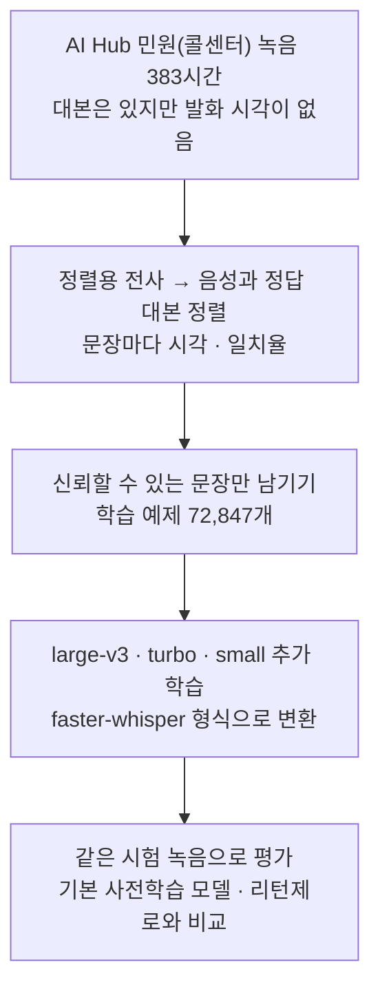

# 음성 인식·화자 분리 성능

[README](../../README.md) · [전화 흐름으로 기능 보기](../one-call.md) · [수사관 지원용 능동 AI 에이전트 기능](../investigator.md) · [보이스피싱 탐지 성능](detection.md) · [학습·평가 스크립트 (stt_lab)](../../stt_lab/README.md)

통화 음성을 텍스트로 변환하는 과정을 **전사**(음성 인식, STT)라고 합니다. 전사가 틀리면 그 뒤의 분류기와 상태 추적기도 틀린 텍스트를 보고 판단합니다.
이 페이지는 전사와 화자 분리(누가 말했는지 나누기)의 현재 구성, 자체 운영 Whisper와 외부 API인 리턴제로(RTZR)를 같은 시험 녹음으로 비교한 결과, 추가 학습한 모델을 기본으로 쓰지 않는 이유를 정리합니다.

## 현재 구성

| 작업 | 현재 담당 | 적용 상태 |
| --- | --- | --- |
| 실시간 전사 통화 중 무음 기준으로 자른 조각 | Whisper large-v3 기본 사전학습 모델(faster-whisper) · 자체 운영 GPU 서버 | 사용 중 |
| 통화 후 재전사 · 녹음 파일 분석 | 기본 설정: 자체 서버의 Whisper large-v3 시연 서버: 리턴제로 파일 전사 | 사용 중 엔진은 `STT_FILE_ENGINE`으로 선택 |
| 통화 중 전사 보정 및 화자 구분 | 기본 설정: 꺼짐 시연 서버: 리턴제로 파일 전사 | 선택 설정 `STT_REFINE` |
| 화자 분리 | 시연 서버: 리턴제로 파일 전사의 화자 분리(2명 지정) 기본 설정: 없음. 상태 추적기가 발화 내용으로 역할(상대방·사용자)을 추정 | 선택 설정 |
| 로컬 화자 분리 3D-Speaker 목소리 모델 | 앱 코드(`local_diarization.py`)로 옮겨 시험만 함 | 실험 완료 · 미연결 |
| 추가 학습한 Whisper 3종 large-v3 · turbo · small | 보관만 함 | 실험 완료 · 기본 모델로 쓰지 않음 |

실시간 음성 인식은 자체 운영 GPU 서버에서 처리하며, 리턴제로 기능을 활성화하면 해당 음성이 외부 API로 전송됩니다. 설정은 다음과 같이 나뉩니다.

- **기본 설정** (코드 기본값 `STT_LIVE_ENGINE=local`, `STT_FILE_ENGINE=local`, `STT_REFINE=off`): 모든 전사를 자체 서버의 Whisper가 처리합니다. 통화 음성에는 이름·계좌번호 같은 개인·금융 정보가 담기므로 기본값을 이렇게 두었습니다.
- **시연 서버** (`STT_FILE_ENGINE=rtzr`, `STT_REFINE=rtzr`): 통화 후 재전사·녹음 파일 분석과 통화 중 전사 보정에 쓰는 음성을 리턴제로 API로 보냅니다. 실시간 조각은 서버의 Whisper로 전사합니다. 리턴제로 실시간 스트리밍(`STT_LIVE_ENGINE=rtzr`)도 붙여 두었지만 쓰지 않습니다.
- 리턴제로 키가 없거나 호출이 실패하면 그 요청은 자체 서버의 Whisper로 전사합니다. 통화 중 전사 보정은 로컬 대안이 없어, 키가 없으면 꺼지고 호출이 연달아 실패하면 그 통화의 보정을 멈춥니다. 이때 화면에는 실시간 조각만 나옵니다.

실시간 조각 전사는 파일 전체 전사보다 오류가 많습니다. 그래서 통화가 끝나면 녹음 전체를 다시 전사하고 상태를 처음부터 다시 추적해, 결과 화면·신고용 요약·수사 화면에 그 전사를 씁니다.

## 주요 비교 결과

**기본 사전학습 모델**은 공개된 Whisper 가중치를 그대로 쓴 모델이고, **추가 학습 모델**은 AI Hub 콜센터 음성으로 더 학습한 모델입니다. 표에서는 각각 '사전학습', '추가 학습'으로 줄여 씁니다. 숫자는 문자 오류율(CER)이고 낮을수록 좋습니다.

| 시스템 | 파일 전체 | 실시간 조각 |
| --- | ---: | ---: |
| **large-v3 기본 사전학습** 자체 운영 · 실시간 전사와 기본 설정의 파일 전사에 사용 | 5.81% | 9.24% |
| large-v3 추가 학습 콜센터 음성 · LoRA · 기본 모델로 쓰지 않음 | 2.45% | 10.34% |
| 리턴제로 외부 API · 시연 서버의 파일 전사와 통화 중 보정에 사용 | 6.28% | 8.11% |

AI Hub 민원(콜센터) 검증용 녹음. 파일 전체는 녹음 100개(3.43시간)를 통째로 전사했고, 실시간 조각은 녹음 40개(1.24시간)를 앱과 같은 무음 기준으로 잘라 조각마다 전사했습니다. 두 방식은 녹음 수가 달라 서로 빼서 비교하지 않습니다. turbo·small을 포함한 전체 표는 [결과](#결과)에 있습니다.

- **전사:** 파일 전체에서는 large-v3(5.81%)가 리턴제로(6.28%)보다 낮고, 실시간 조각에서는 리턴제로(8.11%)가 large-v3(9.24%)보다 낮습니다. 두 차이 모두 녹음 단위 부트스트랩 95% 구간이 0을 지나지 않습니다. 시연 서버가 파일 전사에 리턴제로를 쓰는 이유는 CER이 아니라 화자 분리입니다.
- **화자 분리:** 리턴제로 파일 전사의 화자 분리(2명 지정)는 시험 녹음 100개에서 문장 단위로 98.8%를 맞혔습니다. 시연 서버의 통화 후 재전사·녹음 파일 분석이 이 방식입니다.
- **통화 중 전사 보정:** 녹음 8개(13.8분)에서 CER은 실시간 조각 8.55%에서 보정 후 4.06%로 감소했습니다. 화자 재배정 최종 설정은 그중 녹음 4개(6.4분)를 따로 잰 결과 화자 정확도 90.4%였습니다. 대신 화면 반영이 약 23초 늦고, 리턴제로 사용량이 통화 길이의 약 2.5배입니다.
- **로컬 화자 분리:** 3D-Speaker 목소리 모델로 실험만 했고 앱에는 연결하지 않았습니다. 실험 수치는 [화자 분리](#화자-분리)에 있으며 앱의 성능이 아닙니다.

## 추가 학습 모델을 기본으로 쓰지 않는 이유

같은 콜센터 음성으로 large-v3·turbo(LoRA)와 small(전체 미세조정)을 추가 학습했습니다. 파일 전체 CER은 세 모델 모두 크게 낮아졌지만, 서비스의 기본 모델은 기본 사전학습 large-v3로 둡니다.

1. **실시간 조각에서는 오류가 늘었습니다.** large-v3는 9.24% → 10.34%, turbo는 9.60% → 10.26%였습니다. 학습 예제가 늘 완결된 문장이라, 끝이 잘린 조각에 없는 말을 덧붙였습니다. small은 기본 사전학습 모델이 워낙 약해 13.22% → 9.45%로 나아졌습니다.
2. **파일 전체 개선 폭의 일부는 대본 표기 규칙을 익힌 결과입니다.** large-v3는 5.81% → 2.45%였지만, 앱이 실제로 내는 형태에 가까운 아라비아 숫자 대본 63개만 보면 4.81% → 3.78%였습니다(turbo 4.58% → 4.04%).
3. **실제 통화의 전화번호를 지우거나 형식을 깨뜨렸습니다.** 학습 대본은 전화번호 같은 개인정보를 개인정보 마스킹 표기('ㅇㅇㅇ')로 가렸지만, 녹음에서는 화자가 그 자리를 '공공공'처럼 소리 내 읽었습니다. 추가 학습 모델은 소리는 나는데 정답에는 없는 숫자 읽기를 지우는 규칙까지 익혔습니다.

| 금감원 공개 사기 녹취의 같은 구간 | 전사 결과 |
| --- | --- |
| large-v3 기본 사전학습 | `직통번호는 02-61xx-60xx이고요` |
| large-v3 추가 학습 | `직통번호는 에 네. 에 에이고요` |

계좌·전화번호를 단서로 다른 통화와 연결하는 서비스라 번호를 잃는 모델은 쓸 수 없습니다. 추가 학습 모델은 보관만 하고, 다음 학습에서 고칠 점은 [한계](#한계)에 정리했습니다.

## 데이터

추가 학습과 평가는 다음 순서로 진행했습니다.

AI Hub 「민원(콜센터) 질의-응답 데이터」를 썼습니다. 금융보험, 다산콜센터, 질병관리본부(현 질병관리청), K쇼핑(홈쇼핑) 상담 통화이고,
상담사와 고객이 역할을 나눠 대본을 읽으며 녹음했습니다. 그래서 대본이 실제 말과 거의 같아 정답으로 쓸 수 있습니다.

- **음성:** zip 50개(22.4GB) → 16 kHz 모노 FLAC 10,437개, 383.2시간. 학습용 약 336시간, 검증용 약 47시간.
- **라벨:** 대화 74,038개. 문장, 화자 역할(상담사·고객), 문장 순서가 있습니다.
- **준비:** [`prepare.py`](../../stt_lab/prepare.py)가 zip 속 음성을 FLAC으로 바꾸고 녹음 목록을 만듭니다. 파일 이름 처리 같은 준비 과정은 [stt_lab의 데이터 준비와 운영 기록](../../stt_lab/README.md#데이터-준비와-운영-기록)에 있습니다.
- 음성·대본 원본과 학습된 모델은 AI Hub 이용 조건 때문에 저장소에 올리지 않습니다.

그대로는 학습에 쓸 수 없었습니다.

| 문제 | 내용 | 대응 |
| --- | --- | --- |
| 시각 없음 | 라벨에 문장은 있지만 음성 속 위치가 없음. 금융·다산 녹음은 파일 이름이 녹음 시각이라 라벨과 바로 짝지을 수도 없음 | 전사 결과로 대화를 찾고 글자 단위로 맞춰 시각을 만듦 ([음성과 정답 대본 정렬](#음성과-정답-대본-정렬)) |
| 분할 불일치 | 대본과 짝지은 검증용 녹음 984개 중 842개가 학습용 라벨의 대화와 짝지어짐. 학습용·검증용 녹음이 함께 짝지어진 대화도 25개 | 검증용 녹음과 같은 대화를 읽은 학습용 녹음을 제외 ([학습 세트](#학습-세트)) |
| 개인정보 마스킹 표기 | 대본에서 상호·이름을 'ㅇㅇㅇ'으로 지웠는데, 화자가 '공공'처럼 소리 내 읽은 곳이 있음 | 그런 문장을 학습에서 제외 |
| 숫자 표기 | K쇼핑·질병관리본부 m4a 대본은 숫자를 한글로 적음. 앱은 계좌·전화번호를 아라비아 숫자로 추출함 | 표기가 엇갈리는 문장을 학습에서 제외하고, 평가는 표기 방식별로 나눠 봄 |
| 빈 파일 | 원본 zip 안에 길이 0초인 mp3 337개 | 건너뜀 |

## 음성과 정답 대본 정렬

라벨에 시각이 없으므로, 음성에서 각 문장이 어디 있는지부터 찾아야 학습 예제를 자를 수 있습니다.
[`match_align.py`](../../stt_lab/match_align.py)가 이 일을 합니다.

1. **정렬용 전사** ([`transcribe.py`](../../stt_lab/transcribe.py)). large-v3를 배치 추론(beam 1, 단어 시각 포함)으로 돌려 녹음마다 단어와 시각을 얻습니다. 위치를 찾는 데만 쓰므로 서비스 설정(beam 5)보다 빠르게 돌렸고, 프로세스 하나가 실시간의 약 92~100배 속도로 처리했습니다.
2. **대화 찾기.** 같은 도메인 대화 가운데 3글자 묶음(trigram)이 가장 많이 겹치는 대화를 고릅니다. 희소 행렬 곱으로 후보 5개를 좁힌 뒤 다중집합 Jaccard로 최종 점수를 냅니다. 0.30 미만이면 짝이 없는 것으로 봅니다.
3. **문장 시각.** 대본 문장을 이어 붙인 글자열과 전사 결과의 글자열을 rapidfuzz 편집 연산으로 정렬합니다(공백·문장부호 제외). 단어 시각은 글자 수로 나눠 글자마다 시각을 줍니다. 문장에 대응하는 첫 글자와 끝 글자의 시각이 시작·끝이고, 같은 글자 비율이 일치율입니다.
4. **거르기.** 아래 조건에 하나라도 걸린 문장은 학습에 쓰지 않습니다. 오른쪽 끝 열은 학습용 녹음에서 걸린 문장 수입니다(한 문장이 여러 조건에 걸릴 수 있습니다).

| 조건 | 기준 | 잡으려는 것 | 걸린 수 |
| --- | --- | --- | ---: |
| 일치율 | 0.7 미만 | 대본과 다르게 읽었거나 전사 오류가 많은 문장 | 4,270 |
| 말 속도 | 초당 1.5글자 미만 또는 15글자 초과 | 시각이 잘못 잡힌 문장 | 2,678 |
| 순서 | 시작이 앞 문장 끝보다 0.3초 넘게 앞섬 | 정렬이 거꾸로 간 곳 | 0 |
| 끼어든 글자 | 문장 구간에 대본에 없는 글자가 3개 이상이고 구간의 15%를 넘음 | 마스킹 표기 'ㅇㅇㅇ'을 소리 내 읽은 곳 | 4,350 |
| 문장 사이 글자 | 문장 앞이나 뒤 빈틈에 대본에 없는 글자가 3개 이상 | 대본에 없는 말을 문장 사이에 한 곳 | 5,708 |
| 숫자 표기 | 전사 구간에는 숫자·영문이 있는데 대본 문장에는 없음 | 숫자를 한글로 적은 대본 | 6,138 |

정렬 요약에 들어간 녹음은 학습용 5,121개(149.7시간), 검증용 1,214개(47.2시간)입니다. 그중 대본과 짝지은 녹음은 학습용 3,624개, 검증용 984개이고,
학습용 문장 80,088개 중 62,074개(67.0시간)가 조건을 모두 통과했습니다. K쇼핑은 통과한 문장이 학습용 60%, 검증용 50%로 가장 적고,
가장 많이 걸린 이유는 숫자 표기입니다.

도메인별 숫자 (걸린 문장, 분할·도메인별 정렬 결과)

도메인 줄임말: 다산 = 다산콜센터, 금융 = 금융보험, 질본 = 질병관리본부, 쇼핑 = K쇼핑.

학습용 녹음에서 조건별로 걸린 문장 수:

| 조건 | 다산 | 금융 | 질본 | 쇼핑 |
| --- | ---: | ---: | ---: | ---: |
| 일치율 | 1,104 | 2,455 | 319 | 392 |
| 말 속도 | 142 | 524 | 879 | 1,133 |
| 끼어든 글자 | 592 | 1,653 | 1,018 | 1,087 |
| 문장 사이 글자 | 390 | 1,979 | 1,752 | 1,587 |
| 숫자 표기 | 186 | 944 | 2,046 | 2,962 |

검증용 녹음에서 조건별로 걸린 문장 수:

| 조건 | 다산 | 금융 | 질본 | 쇼핑 |
| --- | ---: | ---: | ---: | ---: |
| 일치율 | 82 | 165 | 99 | 1,296 |
| 말 속도 | 11 | 73 | 208 | 922 |
| 끼어든 글자 | 34 | 129 | 224 | 908 |
| 문장 사이 글자 | 31 | 255 | 414 | 1,531 |
| 숫자 표기 | 22 | 122 | 483 | 2,172 |

분할·도메인별 정렬 결과입니다. "정렬용 전사 CER"은 beam 1로 전사한 결과와 짝지은 대본 사이의 문자 오류율 중앙값입니다. 대본과 실제 말이 얼마나 다른지 보는 지표로 씁니다.

| 분할 · 도메인 | 녹음 (시간) | 짝지은 녹음 | 통과 문장 / 전체 | 통과 시간 | 정렬용 전사 CER |
| --- | ---: | ---: | ---: | ---: | ---: |
| 학습 · 다산 | 1,190 (32.3) | 638 | 10,141 / 12,167 | 12.1 | 5.1% |
| 학습 · 금융 | 2,600 (63.9) | 1,810 | 28,545 / 34,366 | 30.5 | 5.7% |
| 학습 · 질본 | 945 (31.0) | 790 | 15,010 / 19,587 | 16.4 | 6.2% |
| 학습 · 쇼핑 | 386 (22.5) | 386 | 8,378 / 13,968 | 8.0 | 11.7% |
| 검증 · 다산 | 139 (3.8) | 90 | 1,533 / 1,679 | 1.9 | 3.2% |
| 검증 · 금융 | 400 (8.2) | 318 | 5,377 / 5,998 | 4.9 | 3.9% |
| 검증 · 질본 | 341 (11.4) | 340 | 6,644 / 7,744 | 7.5 | 3.0% |
| 검증 · 쇼핑 | 334 (23.8) | 236 | 4,827 / 9,701 | 5.0 | 13.2% |

## 추가 학습

### 학습 세트

[`build_dataset.py`](../../stt_lab/build_dataset.py)가 정렬 결과로 세 세트를 만듭니다.

- **학습** (녹음 3,476개, 예제 72,847개): 학습용 녹음 중 대본과 짝지은 것. 검증용 녹음과 같은 대화를 읽은 녹음은 뺍니다.
- **개발** (녹음 109개, 예제 2,111개): 학습용 녹음에서 대화 번호 해시로 3%를 뗍니다. 학습 중 손실·CER만 보고 학습에는 쓰지 않습니다.
- **시험** (후보 763개): 검증용 녹음 중 대본 일치 점수 0.5 이상, 대본 포함률 0.8 이상. 모델끼리 같은 녹음을 쓰도록 목록을 고정했습니다.

**누수 차단.** 검증용 녹음이 학습용 라벨의 대화와 짝지어지므로, 시험 녹음과 같은 대본을 읽은 학습용 녹음이 있을 수 있습니다.
검증용 녹음과 대화 번호가 같거나 대본 텍스트가 똑같은 학습용 녹음 38개를 학습에서 뺐습니다.

| 예제 | 만드는 법 | 개수 |
| --- | --- | ---: |
| A | 통과한 문장 하나. 앞 0.2초·뒤 0.3초 여유를 두되 이웃 문장을 넘지 않음. 0.5~25초 | 59,815 |
| B | 통과한 문장이 2개 이상 이어진 구간. 28초 이하 | 13,032 |

A는 실시간 조각처럼 짧은 음성이고, B는 긴 녹음 전사에 해당합니다. A·B 모두 절반은 Whisper 시각 토큰(`<|0.00|> 문장 <|1.24|>`)을 넣고
절반은 `<|notimestamps|>`로 만들었습니다. 서비스(faster-whisper)는 짧은 조각도 시각 토큰 방식으로 디코딩하기 때문입니다.
예제 길이를 모두 더하면 140.9시간입니다(A·B가 같은 음성을 일부 함께 씁니다).

도메인별 학습 예제 수

| 도메인 | A | B | 길이 (A / B, 시간) |
| --- | ---: | ---: | ---: |
| 다산콜센터 | 9,791 | 2,187 | 12.6 / 12.2 |
| 금융보험 | 27,330 | 5,388 | 32.4 / 30.6 |
| 질병관리본부 | 14,617 | 3,477 | 17.7 / 18.2 |
| K쇼핑 | 8,077 | 1,980 | 8.8 / 8.5 |

### 학습 설정

[`train_lora.py`](../../stt_lab/train_lora.py) 하나로 세 모델을 학습했습니다. turbo는 large-v3에서 디코더를 4층으로 줄인 모델입니다.

| 항목 | large-v3 | turbo | small |
| --- | --- | --- | --- |
| 크기 | 15.4억 | 디코더 4층 | 2.4억 |
| 방식 | LoRA | LoRA | 전체 미세조정 |
| 학습 값 | 5,767만 (3.6%) | LoRA 어댑터 | 전부 |
| 학습률 | 3e-4 | 3e-4 | 1e-5 |
| 배치 | 32 (8 × 누적 4) | 32 | 32 |
| 길이 | 1에폭, 2,276스텝 | 1에폭 | 1에폭, 2,276스텝 |
| 정밀도 | bf16 | bf16 | fp32 + bf16 연산 |
| 순서 | small과 동시에 | large-v3 뒤 | large-v3와 동시에 |

- **LoRA:** r 32, α 64, dropout 0.05. 인코더·디코더의 q·k·v·out·fc1·fc2에 붙입니다. large-v3는 LoRA를 포함한 전체 16.0억 중 5,767만(3.6%)만 학습합니다. turbo도 같은 설정입니다.
- **세 모델 공통:** AdamW(weight decay 0.01, β 0.9 / 0.98), 워밍업 113스텝 뒤 코사인으로 최고 학습률의 10%까지 내림, 기울기 자르기 1.0, SpecAugment(시간 마스크 확률 0.05·길이 10, 주파수 마스크 확률 0.02·길이 10). 배치는 실효 배치입니다.
- **체크포인트:** 개발 세트에서 뽑은 예제로 손실(400개)과 CER(300개: A 200, B 100)을 large-v3는 300스텝, small·turbo는 400스텝마다 재고, CER이 가장 낮은 체크포인트를 고릅니다. 스텝별 값은 [부록](#부록)에 있습니다.
- small은 large-v3와 같은 GPU를 나눠 쓰며 동시에 학습했고, turbo는 large-v3가 끝난 뒤 학습했습니다.

### 변환

[`merge_convert.py`](../../stt_lab/merge_convert.py)가 LoRA 어댑터를 사전학습 가중치에 합친 뒤 CTranslate2(faster-whisper) 형식으로 바꿉니다
(전체 미세조정한 small은 합칠 것 없이 바로 바꿉니다). GPU용 float16과 CPU(노트북)용 int8 두 벌을 만들고,
서비스는 이 폴더를 `WhisperModel(<폴더>)`로 바로 읽습니다.

### 학습 전 수정 사항

학습을 시작하기 전에 학습 코드를 점검해 아래 문제를 고쳤습니다.

1. **첫 토큰을 손실에서 뺐습니다.** faster-whisper는 디코더 첫 위치(`<|ko|>`를 맞히는 자리)의 분포에서 '말 없음' 확률을 읽어 무음 구간을 건너뛰고, 서비스의 환각 필터도 이 값을 씁니다. 말만 있는 데이터로 이 자리를 학습하면 '말 없음' 확률이 낮아져, 잡음에서 텍스트를 지어낼 위험이 커집니다.
2. **마스킹 표기를 소리 내 읽은 문장을 뺐습니다.** 대본에서 지운 'ㅇㅇㅇ'을 화자가 소리 내 읽은 문장이 K쇼핑 19.3%, 질병관리본부 10.3%, 금융 5.4%, 다산 1.5%였습니다. 그대로 학습하면 들은 말을 빼고 적도록 배웁니다. '끼어든 글자'와 '문장 사이 글자' 조건이 이런 문장을 거릅니다.
3. **숫자 표기가 엇갈리는 문장을 뺐습니다.** 숫자를 한글로 적은 대본으로 배우면 숫자를 한글로 적게 되어, 계좌·전화번호를 숫자로 추출하는 앱 기능이 깨질 수 있습니다. 평가도 숫자 표기 방식별로 나눠 봅니다.
4. **입력 형태를 서비스와 맞췄습니다.** 학습 라이브러리(transformers)는 음성을 30초로 채운 뒤 log-mel을 만들고, 서비스(faster-whisper)는 실제 음성으로 log-mel을 만든 뒤 0으로 채웁니다. 실시간 조각은 1.2~10초라 입력의 대부분이 채운 부분이어서, 그대로면 학습과 서비스가 다른 입력을 봅니다. 학습도 서비스 방식으로 바꿨습니다.
5. **그 밖.** 시각 토큰이 뒤로 가지 않게 정리했습니다(추론 규칙처럼 시작은 앞 끝 이상, 끝은 시작보다 뒤). 같은 녹음을 두 번 전사한 기록은 하나만 씁니다.

## 평가 방법

[`eval_asr.py`](../../stt_lab/eval_asr.py)(Whisper), [`eval_rtzr.py`](../../stt_lab/eval_rtzr.py)(리턴제로), [`compare.py`](../../stt_lab/compare.py)(비교표·구간)로 잽니다.

**같은 녹음.** 고정한 시험 후보 763개를 녹음 ID의 MD5 해시 순으로 늘어놓고, 도메인마다 앞 25개(파일 전체: 100개, 3.43시간)와
앞 10개(실시간: 40개, 1.24시간)를 씁니다. 실시간 40개는 파일 전체 100개 안에 들어 있습니다. 모든 모델과 리턴제로가 같은 녹음을 전사합니다.

**두 방식.**

- **파일 전체** (앱의 녹음 파일 분석, 통화 후 재전사): 녹음 하나를 통째로 전사합니다.
- **실시간 조각** (앱의 실시간 전사): 앱과 같은 무음 자르기를 씁니다. 1.2초 이상 쌓인 뒤 마지막 0.25초가 조용하면(RMS < 0.01) 자르고, 10초가 되면 강제로 자릅니다. 통째로 조용한 조각은 버립니다. 조각마다 따로 전사해 이어 붙입니다.

**서비스와 같은 설정.** faster-whisper, 한국어 고정, beam 5, VAD, 앞 문맥 끔(`condition_on_previous_text=False`), GPU float16.
서비스와 같은 환각 필터로 '말 없음' 확률 0.6 초과이면서 평균 로그 확률 −1.0 미만인 구간과 "시청해 주셔서" 같은 알려진 문구를 지웁니다
([`backend/app/mp3_json.py`](../../backend/app/mp3_json.py)).

**CER.** 편집 거리 ÷ 정답 글자 수. 공백·문장부호는 빼고 한글·숫자·영문만 셉니다. 녹음별 편집 수와 글자 수를 모두 더해서 나눕니다(녹음별 CER의 평균이 아닙니다).
정답은 녹음과 짝지은 대본 전체라 실제 말과 조금 다를 수 있고, 그래서 정확히 전사해도 0%가 나오지 않을 수 있습니다.

**차이 검정.** 녹음 단위 쌍대 부트스트랩 2,000회. 녹음을 복원 추출해 두 시스템의 CER 차이를 다시 재고, 2.5~97.5 백분위를 95% 구간으로 씁니다.
구간이 0을 지나지 않으면 차이가 있다고 봅니다. 녹음별로 어느 쪽이 나은지 비율도 함께 냅니다.

**묶음별 결과.**

- **숫자 표기:** 대본이 숫자를 아라비아 숫자로 적었는지(앱이 실제로 쓰는 형태), 한글로 적었는지 나눠 봅니다. 한글 대본에서는 숫자를 맞게 들어도 표기가 달라 오류로 잡힙니다.
- **세션 간격:** 녹음 파일 이름의 녹음 시각으로, 같은 도메인에서 가장 가까운 학습용 녹음과의 시간 차를 잽니다(10분 이내 / 10~60분 / 60분 넘게 / 시각 없음). 같은 녹음 세션의 학습 녹음은 같은 사람·장비일 수 있어 추가 학습의 이득이 부풀 수 있습니다. 이 묶음으로 그 몫을 따로 봅니다.

**리턴제로.**

- **파일:** `POST /v1/transcribe`. 모델 sommers, 도메인 CALL, 화자 분리 2명, ITN(말로 한 숫자를 숫자로 적기), 간투어 필터 켬, 비속어 필터 끔. 5초마다 결과를 조회합니다.
- **실시간:** WebSocket 스트리밍(sommers_ko, CALL, 16 kHz LINEAR16, ITN·간투어 필터). 녹음 하나에 연결 하나를 열고, 앱과 같은 무음 조각을 0.2초씩 보낸 뒤 조각마다 `{"type":"Finalize"}`를 보내 확정시킵니다. Finalize를 보낸 뒤 확정 결과가 오기까지의 시간을 잽니다.
- 사용량과 외부 전송 승인 기록은 [stt_lab의 데이터 준비와 운영 기록](../../stt_lab/README.md#데이터-준비와-운영-기록)에 있습니다.

## 결과

숫자는 모두 CER이고 낮을수록 좋습니다. 파일 전체는 녹음 100개(3.43시간), 실시간 조각은 녹음 40개(1.24시간)로 쟀습니다.
두 방식은 녹음 수가 달라 서로 빼서 비교하지 않습니다.

<!-- RESULTS:START -->

### 시스템별 CER

H100 GPU(float16, beam 5)에서 같은 시험 녹음을 전사했습니다. 실시간 조각은 앱과 같은 무음 기준으로 자른 조각을 하나씩 전사한 것입니다.

| 시스템 | 파일 전체 | 실시간 조각 | 조각당 시간 |
| --- | ---: | ---: | ---: |
| large-v3 사전학습 | 5.81% | 9.24% | 0.73초1 |
| large-v3 추가 학습 | 2.45% | 10.34% | 0.65초 |
| turbo 사전학습 | 5.84% | 9.60% | 0.31초 |
| turbo 추가 학습 | 3.07% | 10.26% | 0.12초 |
| small 사전학습 | 7.95% | 13.22% | 0.42초 |
| small 추가 학습 | 4.59% | 9.45% | 0.39초 |
| 리턴제로 | 6.28% | 8.11% | 0.07초2 |

1 실시간 조각 하나를 전사하는 시간입니다. Whisper 행은 모두 학습과 H100을 나눠 쓰는 동안 쟀습니다. 이전 측정에서 H100을 혼자 쓸 때 large-v3는 0.13초였습니다.

2 Finalize를 보낸 뒤 확정 결과가 오기까지의 시간입니다. 음성을 보내는 시간은 빼고 네트워크 왕복은 포함합니다.
리턴제로 파일 전사는 녹음 하나(평균 약 2분)에 요청부터 결과까지 평균 7.8초 걸렸습니다(5초 간격 조회 포함).

#### 실시간 조각에서 추가 학습 모델의 오류 증가

large-v3·turbo 추가 학습 모델은 파일 전체에서는 크게 나아졌지만 실시간 조각에서는 기본 사전학습 모델보다 오류가 많습니다(small은 기본 사전학습 모델이 워낙 약해 실시간도 나아졌습니다). 전사 결과를 보면 문장 중간에서 잘린 조각 끝에 없는 말을 지어 붙입니다. 예를 들어 기본 사전학습 모델이 '광진구에서 이천시까지'로 적은 곳을 '광진구에서 일합니다. 시까지'로, '분들이. 총 몇 분이신가요?'를 '분들이 많습니다. 총 몇 분이신가요?'로 적었습니다. 학습 예제(문장 하나 또는 이어진 문장 묶음)가 늘 완결된 문장이라, 끝이 잘린 음성도 문장으로 끝맺도록 배운 것으로 봅니다. 다음 학습에서는 문장 중간에서 자른 조각을 예제에 섞어야 합니다.

### 노트북 설정 (CPU int8 · beam 1)

시연 서버는 자체 운영 GPU 서버에서 돌지만, GPU 없는 노트북에서 돌릴 때를 대비해 이 설정도 쟀습니다. 서비스의 CPU 설정(`backend/app/mp3_json.py`)과 같게 int8, beam 1로, 실시간 조각은 temperature 2단계·출력 128토큰으로 묶어 같은 시험 녹음을 전사했습니다(`stt_lab/run_cpu_eval.sh`, `PROFILE=cpu`). 시간은 H100 서버 CPU 6스레드(Xeon Gold 6448Y)에서 다른 작업과 함께 잰 값이라 노트북에서는 따로 재야 합니다.

| 시스템 | 파일 전체 | 실시간 조각 | 파일 처리 시간 비율 | 조각당 시간 p50 / p90 |
| --- | ---: | ---: | ---: | ---: |
| small 사전학습 | 8.07% | 14.17% | 0.042 | 0.62 / 0.68초 |
| small 추가 학습 | 4.80% | 9.73% | 0.036 | 0.63 / 0.69초 |
| turbo 사전학습 | 6.27% | 10.05% | 0.112 | 2.63 / 3.10초 |
| turbo 추가 학습 | 3.33% | 11.39% | 0.110 | 2.67 / 3.07초 |

파일 처리 시간 비율은 전사 시간 ÷ 음성 길이입니다(0.1이면 10분 녹음을 1분에 전사합니다).

도메인별 CER

도메인 줄임말: 다산 = 다산콜센터, 금융 = 금융보험, 질본 = 질병관리본부, 쇼핑 = K쇼핑.

파일 전체 (도메인마다 25개):

| 시스템 | 다산 | 금융 | 질본 | 쇼핑 |
| --- | ---: | ---: | ---: | ---: |
| large-v3 사전학습 | 5.24% | 5.78% | 5.19% | 6.50% |
| large-v3 추가 학습 | 4.24% | 4.61% | 1.42% | 1.41% |
| turbo 사전학습 | 5.26% | 5.69% | 4.56% | 7.04% |
| turbo 추가 학습 | 4.59% | 4.77% | 1.53% | 2.68% |
| small 사전학습 | 5.65% | 8.52% | 6.52% | 9.77% |
| small 추가 학습 | 5.83% | 5.87% | 2.53% | 4.84% |
| 리턴제로 | 4.64% | 5.84% | 4.95% | 8.12% |
| small 사전학습 · CPU | 5.88% | 8.55% | 6.36% | 10.08% |
| small 추가 학습 · CPU | 6.37% | 5.61% | 3.73% | 4.43% |
| turbo 사전학습 · CPU | 5.70% | 6.29% | 4.74% | 7.56% |
| turbo 추가 학습 · CPU | 4.75% | 4.86% | 1.76% | 3.06% |

실시간 조각 (도메인마다 10개):

| 시스템 | 다산 | 금융 | 질본 | 쇼핑 |
| --- | ---: | ---: | ---: | ---: |
| large-v3 사전학습 | 8.55% | 6.18% | 6.08% | 13.20% |
| large-v3 추가 학습 | 13.84% | 7.43% | 8.84% | 10.66% |
| turbo 사전학습 | 9.33% | 6.18% | 5.86% | 13.87% |
| turbo 추가 학습 | 13.71% | 6.34% | 9.75% | 10.41% |
| small 사전학습 | 12.23% | 10.54% | 9.93% | 17.28% |
| small 추가 학습 | 12.23% | 6.26% | 7.28% | 10.77% |
| 리턴제로 | 9.11% | 5.33% | 5.41% | 10.65% |
| small 사전학습 · CPU | 12.66% | 11.32% | 12.10% | 17.79% |
| small 추가 학습 · CPU | 13.56% | 6.81% | 8.92% | 9.39% |
| turbo 사전학습 · CPU | 10.81% | 6.38% | 5.78% | 14.22% |
| turbo 추가 학습 · CPU | 14.61% | 8.01% | 11.19% | 11.21% |

기본 사전학습 large-v3와 리턴제로 모두 쇼핑이 가장 높습니다. 쇼핑은 마스킹 표기를 소리 내 읽은 문장이 가장 많은(19.3%) 도메인이라
정답에 없는 말이 오류로 잡히는 몫이 큽니다.

### 차이와 95% 구간

차이는 앞 시스템 CER에서 뒤 시스템 CER을 뺀 값(%p)입니다. 음수면 앞 시스템의 오류가 적습니다. 구간은 녹음 단위 쌍대 부트스트랩(2,000회) 95% 구간입니다.

| 비교 | 파일 전체 | 실시간 |
| --- | --- | --- |
| large-v3 사전학습 − 리턴제로 | −0.47 (−0.85 ~ −0.01) | +1.13 (+0.45 ~ +1.75) |
| large-v3 추가 학습 − large-v3 사전학습 | −3.35 (−4.00 ~ −2.57) | +1.10 (−0.36 ~ +2.57) |
| turbo 추가 학습 − turbo 사전학습 | −2.77 (−3.42 ~ −2.15) | +0.66 (−0.90 ~ +2.10) |
| small 추가 학습 − small 사전학습 | −3.36 (−4.20 ~ −2.49) | −3.77 (−5.10 ~ −2.38) |
| large-v3 추가 학습 − 리턴제로 | −3.82 (−4.59 ~ −3.04) | +2.23 (+1.04 ~ +3.54) |
| turbo 추가 학습 − 리턴제로 | −3.20 (−3.83 ~ −2.53) | +2.15 (+0.90 ~ +3.37) |
| small 추가 학습 − 리턴제로 | −1.69 (−2.39 ~ −0.95) | +1.34 (+0.44 ~ +2.33) |
| small 추가 학습 · CPU − small 추가 학습 | +0.21 (−0.16 ~ +0.63) | +0.28 (−0.47 ~ +1.05) |
| turbo 추가 학습 · CPU − turbo 추가 학습 | +0.26 (+0.01 ~ +0.54) | +1.13 (+0.42 ~ +1.88) |
| small 추가 학습 · CPU − small 사전학습 · CPU | −3.27 (−4.08 ~ −2.38) | −4.44 (−6.33 ~ −2.68) |
| turbo 추가 학습 · CPU − turbo 사전학습 · CPU | −2.95 (−3.87 ~ −2.09) | +1.33 (−0.59 ~ +3.29) |
| turbo 추가 학습 · CPU − small 추가 학습 · CPU | −1.47 (−2.00 ~ −0.95) | +1.66 (+0.72 ~ +2.68) |
| small 추가 학습 · CPU − 리턴제로 | −1.48 (−2.20 ~ −0.68) | +1.62 (+0.41 ~ +2.95) |
| turbo 추가 학습 · CPU − 리턴제로 | −2.95 (−3.68 ~ −2.17) | +3.28 (+1.87 ~ +4.71) |

### 숫자 표기별 CER

각 칸은 "아라비아 표기 대본 / 한글 표기 대본"의 CER입니다. 파일 전체는 63개 / 37개, 실시간은 25개 / 15개입니다.

| 시스템 | 파일 전체 | 실시간 조각 |
| --- | ---: | ---: |
| large-v3 사전학습 | 4.81% / 6.61% | 7.16% / 11.30% |
| large-v3 추가 학습 | 3.78% / 1.39% | 11.15% / 9.54% |
| turbo 사전학습 | 4.58% / 6.86% | 7.35% / 11.83% |
| turbo 추가 학습 | 4.04% / 2.29% | 10.71% / 9.82% |
| small 사전학습 | 6.03% / 9.49% | 10.95% / 15.48% |
| small 추가 학습 | 5.08% / 4.20% | 9.67% / 9.23% |
| 리턴제로 | 4.45% / 7.75% | 6.97% / 9.23% |
| small 사전학습 · CPU | 6.13% / 9.63% | 11.75% / 16.58% |
| small 추가 학습 · CPU | 5.54% / 4.21% | 10.95% / 8.52% |
| turbo 사전학습 · CPU | 4.99% / 7.31% | 7.91% / 12.18% |
| turbo 추가 학습 · CPU | 4.35% / 2.50% | 11.89% / 10.89% |

앱이 실제로 내는 형태(계좌·전화번호를 아라비아 숫자로 적음)에 가까운 쪽은 아라비아 표기 대본 묶음입니다.

#### 추가 학습 모델이 익힌 대본 표기 규칙

이 데이터의 대본은 개인정보를 개인정보 마스킹 표기('ㅇㅇㅇ')로 가렸고(마스킹 표기를 소리 내 읽은 문장이 쇼핑에서 19.3%로 가장 많습니다), 한글 표기 대본 묶음(K쇼핑·질병관리본부 m4a)은 숫자까지 한글로 적었습니다. 화자는 마스킹 표기를 '공공공', '영영'처럼 소리 내 읽었는데, 기본 사전학습 모델은 이를 '0000'처럼 숫자로 전사해 정답에 없는 글자가 됩니다. 추가 학습 모델은 이 규칙을 배워 그 자리를 비우거나 한글로 적습니다. 아래는 파일 전체 100개의 전사 결과에 나온 아라비아 숫자 수입니다.

| | 다산 | 금융 | 질본 | 쇼핑 |
| --- | ---: | ---: | ---: | ---: |
| 정답 대본 | 404 | 90 | 44 | 0 |
| large-v3 사전학습 | 407 | 174 | 237 | 660 |
| large-v3 추가 학습 | 408 | 143 | 45 | 0 |
| turbo 사전학습 | 404 | 165 | 265 | 721 |
| turbo 추가 학습 | 413 | 152 | 45 | 45 |
| small 사전학습 | 406 | 192 | 335 | 640 |
| small 추가 학습 | 400 | 150 | 66 | 80 |
| 리턴제로 | 404 | 167 | 319 | 801 |

실제 통화에는 마스킹 표기가 없고 앱은 계좌·전화번호를 아라비아 숫자로 다뤄야 하므로, 서비스에서 기대할 수 있는 추가 학습의 이득은 전체 CER보다 아라비아 표기 대본 묶음의 차이에 가깝습니다. 같은 이유로 추가 학습 모델이 '공공공'처럼 0이 이어지는 실제 번호를 지우지 않는지는 실제 통화 녹음으로 따로 확인했습니다([서비스 적용 적합성 평가](#서비스-적용-적합성-평가)).

### 녹음 세션 간격별 CER

가장 가까운 학습용 녹음과의 시간 차로 묶은 CER입니다(사전학습 → 추가 학습). 추가 학습의 이득이 가까운 묶음에만 몰리면, 그 이득의 일부는 같은 세션(같은 상담사·같은 녹음 환경)에서 온 것입니다.

파일 전체:

| 시간 차 | 녹음 수 | large-v3 | turbo | small |
| --- | ---: | ---: | ---: | ---: |
| 10분 이내 | 16 | 3.71% → 3.45% | 3.77% → 3.81% | 5.46% → 5.31% |
| 10~60분 | 8 | 5.41% → 3.73% | 5.36% → 4.09% | 8.13% → 5.13% |
| 60분 넘게 | 39 | 5.17% → 3.94% | 4.77% → 4.12% | 5.86% → 4.97% |
| 시각 없음 | 37 | 6.61% → 1.39% | 6.86% → 2.29% | 9.49% → 4.20% |

실시간 조각:

| 시간 차 | 녹음 수 | large-v3 | turbo | small |
| --- | ---: | ---: | ---: | ---: |
| 10분 이내 | 8 | 8.96% → 14.48% | 9.72% → 14.00% | 12.83% → 12.30% |
| 10~60분 | 2 | 9.14% → 9.33% | 8.00% → 6.29% | 17.90% → 6.29% |
| 60분 넘게 | 15 | 5.94% → 9.52% | 5.96% → 9.41% | 9.10% → 8.61% |
| 시각 없음 | 15 | 11.30% → 9.54% | 11.83% → 9.82% | 15.48% → 9.23% |

### 서비스 적용 적합성 평가

CER이 좋아도 서비스에서 문제를 만들 수 있어 모델마다 세 가지를 따로 봤습니다(`stt_lab/run_robust.sh`).

- **무음·비음성 구간:** 합성한 무음·잡음·험 20개와, 시험 녹음에서 대본 문장 사이 쉼 200곳을 전사해 텍스트가 나오는지 봅니다. 쉼 구간에는 대본이 지운 마스킹 표기('ㅇㅇㅇ')를 소리 내 읽은 곳도 섞여 있어 '공공공', '영영' 같은 텍스트는 실제 말일 수 있습니다.
- **정상 상담 녹음:** AI Hub 민원 녹음을 이 모델로 전사해 당시 서비스 분류기(v3c)에 넣었을 때 오경보가 늘지 않는지 봅니다.
- **금감원 공개 사기 녹취 24개:** 같은 방식으로 사기 탐지가 유지되는지 봅니다.

| 모델 | 합성 무음·잡음에서 텍스트가 나온 수 | 쉼 구간에서 텍스트가 나온 수 | 정상 녹음 오경보 (주의 / 강한 경고) | 사기 녹취 탐지 (주의 이상) | 사기 녹취 속 전화번호·계좌번호 형식 문자열 |
| --- | ---: | ---: | ---: | ---: | ---: |
| large-v3 사전학습 | 0 / 20 | 125 / 200 | 0 / 0 (녹음 32개) | 24 / 24 | 12 |
| large-v3 추가 학습 | 0 / 20 | 146 / 200 | 0 / 0 (녹음 32개) | 24 / 24 | 6 |
| turbo 사전학습 | 0 / 20 | 129 / 200 | – | – | – |
| turbo 추가 학습 | 0 / 20 | 145 / 200 | 0 / 0 (녹음 32개) | 24 / 24 | 10 |
| small 사전학습 | 0 / 20 | 88 / 200 | – | – | – |
| small 추가 학습 | 0 / 20 | 132 / 200 | 0 / 0 (녹음 32개) | 24 / 24 | 7 |

'–'는 재지 않은 칸입니다(사전학습 turbo·small은 무음·비음성 구간만 봤습니다). 이 점검은 분류기 v3c를 쓰던 때 했습니다. 현재 분류기 v5로 Whisper 전사를 채점한 결과는 [보이스피싱 탐지 성능](detection.md)에 있습니다.

**전화번호·계좌번호 형식의 문자열**은 사기 녹취 전사 결과에서 숫자와 구분자가 7자 이상 이어진 곳의 수입니다. 앱은 이런 번호를 단서로 추출해 다른 통화와 연결하기 때문에 따로 셌습니다. large-v3 추가 학습 모델은 번호를 통째로 지웠고([예시](#추가-학습-모델을-기본으로-쓰지-않는-이유)), small·turbo 추가 학습 모델은 학습 대본의 읽기 방식으로 적어 번호 형식이 깨졌습니다. 전사 결과의 아라비아 숫자는 기본 사전학습 모델 1,074개에서 large-v3 추가 학습 720개, small 추가 학습 895개로 줄었습니다(turbo 추가 학습은 1,094개로 비슷했습니다). 학습 대본이 개인정보를 'ㅇㅇㅇ'으로 가려, 소리 내 읽은 숫자를 지우거나 대본처럼 읽어 적는 법을 배운 것으로 봅니다. 분류기의 사기 탐지와 오경보는 그대로였지만, 계좌·전화번호 단서를 쓰는 기능에는 쓸 수 없습니다.

small·turbo 추가 학습 모델의 같은 구간 전사

기본 사전학습 모델이 `직통번호는 02-61xx-60xx이고요`로 적은 구간을 small·turbo 추가 학습 모델은 `0이의 61xx에 60xx`, `0이에 네 61xx에 네 60xx`처럼 학습 대본의 읽기 방식으로 적었습니다.

<!-- RESULTS:END -->

## 화자 분리

누가 말했는지 알면 상대방의 요구와 사용자의 답을 바로 나눠 볼 수 있습니다. 현재 앱의 화자 분리는 설정에 따라 다릅니다.

- **기본 설정(모두 로컬):** 화자 분리가 없습니다. 실시간 조각은 모두 한 화자로 두고, 통화 후 재전사에서 상태 추적기가 발화마다 역할(상대방·사용자)을 추정합니다.
- **리턴제로를 켠 설정(시연 서버, `STT_FILE_ENGINE=rtzr`, `STT_REFINE=rtzr`):** 녹음 파일 분석·통화 후 재전사는 리턴제로 화자 분리로 사람 단위 말풍선을 만들고, 통화 중에는 지난 구간을 다시 전사해 화자별로 정리합니다([통화 중 전사 보정 및 화자 구분](#통화-중-전사-보정-및-화자-구분)).

> **아래 로컬 화자 분리 수치는 앱에 연결하지 않은 실험 결과입니다.** 로컬 화자 분리를 붙일 수 있는지 보려고 같은 시험 녹음으로 여러 방식을 쟀고, 가장 나은 방식을 앱 코드로 옮겨 시험만 했습니다. 현재 앱(시연 서버)의 화자 분리에 해당하는 수치는 리턴제로 파일 전사(문장 98.8%)와 통화 중 전사 보정(화자 90.4%, 녹음 4개)입니다.

목소리 모델은 sherpa-onnx가 GitHub에 공개한 ONNX 파일이라 Hugging Face 토큰 없이 받습니다.

### 정답과 지표

- **정답:** 대본 문장의 역할(상담사·고객)과 음성·대본 정렬로 얻은 시각. 조건을 통과한 문장만 씁니다.
- **문장 정확도:** 문장 구간에서 가장 많이 나온 예측 화자가 맞은 비율. 예측 번호(화자 1·2)는 정답 역할과 가장 잘 맞도록 대응시킵니다.
- **조각 정확도:** 실시간 방식에서 무음 조각마다 붙인 화자가 맞은 비율. 조각이 들어온 순간 붙인 이름만 채점합니다. 두 사람이 섞인 조각(한 사람이 80% 미만, 약 4%)은 빼고 셉니다.
- **DER:** (놓친 말 + 없는데 잡은 말 + 화자 혼동) ÷ 정답 말 길이. 경계 ±0.25초는 채점하지 않습니다. 문장 안의 쉼도 말로 치기 때문에 실제보다 높게 나옵니다. 그래서 문장·조각 정확도를 주 지표로 봅니다.

**목소리 점검** ([`spk_check.py`](../../stt_lab/spk_check.py), TitaNet 임베딩). 시험 녹음 120개에서 같은 역할 문장끼리의 목소리 유사도와
다른 역할 사이 유사도를 비교했습니다. 118개는 두 역할의 목소리가 뚜렷이 달랐고(유사도 차이 0.15 이상, 중앙값 0.405),
1개는 차이가 0.05 미만이라 한 사람이 두 역할을 읽은 녹음으로 보입니다. 두 사람 통화로 채점해도 되는 데이터입니다.

### 통화 후 화자 분리 실험

[`diar_eval.py`](../../stt_lab/diar_eval.py)(sherpa-onnx 기본 파이프라인), [`diar_simple.py`](../../stt_lab/diar_simple.py)(단순 방식).

| 방식 | 녹음 | 문장 정확도 | DER |
| --- | ---: | ---: | ---: |
| sherpa-onnx 기본 (pyannote 분할 + TitaNet + 2명 묶기) | 12 | 74.0% | 28.1% |
| 단어 시각 조각 + TitaNet + k-means | 120 | 91.1% | 10.1% |
| 단어 시각 조각 + TitaNet + spectral | 120 | 91.1% | 10.1% |
| 단어 시각 조각 + 3D-Speaker + k-means | 120 | 91.0% | 10.3% |
| 단어 시각 조각 + WeSpeaker + k-means | 120 | 87.2% | 12.7% |
| **무음 조각 + 3D-Speaker + k-means** | 120 | **98.5%** | 11.4% |
| 리턴제로 파일 전사 (2명 지정, 시연 서버에서 사용) | 100 | 98.8% | 14.9% |

- sherpa-onnx 기본 파이프라인은 12개로 시험했고, 목소리가 뚜렷이 다른 녹음도 한 명으로 묶는 경우가 있었습니다.
- **단어 시각 조각:** 전사 결과의 단어 시각으로 만든 조각(0.3초 이상 쉬거나 6초를 넘으면 끊음). **무음 조각:** 앱과 같은 무음 자르기 조각.
  둘 다 조각마다 목소리 특징(임베딩)을 뽑아 두 묶음으로 나눕니다. k-means는 조각 길이로 가중하고, 0.6초 미만 조각은 시간상 가장 가까운 조각을 따릅니다.
- 무음 조각은 문장 정확도가 높지만 DER은 조금 높습니다. 조각이 말 사이 조용한 구간까지 덮어 '없는데 잡은 말'이 늘기 때문입니다(7.0% 대 0.9%).
- 리턴제로는 전사 시험 녹음 100개로, 같은 채점 규칙으로 쟀습니다.
- 목소리 모델 파일: 3D-Speaker `3dspeaker_speech_eres2net_base_sv_zh-cn_3dspeaker_16k.onnx`, TitaNet `nemo_en_titanet_large.onnx`, WeSpeaker `wespeaker_en_voxceleb_resnet34_LM.onnx`.

### 실시간 화자 분리 실험

| 방식 | 목소리 모델 | 조각 정확도 | 문장 정확도 | DER |
| --- | --- | ---: | ---: | ---: |
| 음성 특징이 유사한 화자 그룹에 배정 | 3D-Speaker | 96.8% | 96.9% | 13.1% |
| **음성 특징이 유사한 화자 그룹에 배정 + 화자 그룹 재분류** | 3D-Speaker | **97.7%** | **98.1%** | 12.1% |
| 내 목소리 등록 | 3D-Speaker | 93.1% | 93.1% | 32.1% |
| 음성 특징이 유사한 화자 그룹에 배정 | TitaNet | 91.2% | – | – |
| 음성 특징이 유사한 화자 그룹에 배정 | WeSpeaker | 64.0% | 56.0% | 43.6% |

모두 녹음 120개, 유사도 기준 0.5입니다. TitaNet은 조각 정확도만 남아 있습니다.

- **음성 특징이 유사한 화자 그룹에 배정:** 첫 조각을 화자 1로 둡니다. 화자 1과 유사도가 기준 미만인 조각이 오면 화자 2를 만들고, 그 뒤 조각은 음성 특징이 더 가까운 화자 그룹의 평균에 붙입니다.
- **화자 그룹 재분류:** 조각이 올 때마다 지금까지의 조각 전체를 k-means(2명)로 다시 나누고, 앞 묶음과 비교해 화자 번호를 유지합니다.
- **내 목소리 등록:** 고객(앱 사용자 역할)의 첫 두 문장(1.5초 이상)으로 '내 목소리'를 만들고, 조각마다 유사도가 기준 이상이면 '나', 아니면 '상대'로 둡니다. 등록에 쓴 부분까지는 채점하지 않아 DER의 '놓친 말'이 21.7%로 큽니다.

유사도 기준별 조각 정확도

| 방식 | 0.3 | 0.4 | 0.5 | 0.6 | 0.7 |
| --- | ---: | ---: | ---: | ---: | ---: |
| 음성 특징이 유사한 화자 그룹에 배정 | 84.0% | 92.2% | 96.8% | 96.7% | – |
| 같은 방식 + LDA | 81.2% | 90.5% | 96.3% | 96.4% | – |
| 화자 그룹 재분류 | – | – | 97.7% | 97.6% | – |
| 내 목소리 등록 | 78.6% | 89.6% | 93.1% | 92.4% | 83.0% |

목소리 모델 학습 시도 (LDA, 채택하지 않음)

ONNX 목소리 모델은 다시 학습할 수 없어서, 그 출력 위에 '같은 사람은 가깝게, 다른 사람은 멀게' 보이도록 선형 투영(LDA)을 학습했습니다
([`diar_lda.py`](../../stt_lab/diar_lda.py)). 학습용 녹음 963개에서 문장 임베딩 15,764개를 뽑았고, 화자 라벨은 녹음과 역할을 묶은 1,918개입니다
(같은 성우가 여러 녹음에 나올 수 있어 라벨이 조금 덜 깨끗합니다).

나아지지 않았습니다. 실시간은 가장 좋은 기준에서 96.4%(LDA 없이 96.8%), 통화 후(무음 조각 + 3D-Speaker + LDA + k-means)는 문장 98.5%·DER 11.3%(LDA 없이 98.5%·11.4%)였습니다.
공개 목소리 모델이 이미 이 통화에 잘 맞는다고 보고 LDA는 쓰지 않습니다.

### 처리 속도와 리턴제로 비교

- 3D-Speaker 임베딩은 CPU 코어 하나로 5초 조각에 약 0.19초(실시간의 0.0376배) 걸립니다. 화자 분리는 GPU 없이 돌릴 수 있습니다.
  참고로 sherpa-onnx 기본 파이프라인(분할 모델 포함)은 코어 하나에서 실시간의 0.268배였습니다.
- 리턴제로 파일 전사의 화자 분리(2명 지정)는 문장 98.8%로 로컬 통화 후 방식(98.5%)과 비슷합니다. 리턴제로 실시간 API에는 화자 분리가 없습니다.
- 이번 측정에서 가장 나은 방식은 통화 후가 무음 조각 + 3D-Speaker + k-means, 실시간이 화자 그룹 재분류였습니다.
  이 방식을 [`backend/app/services/local_diarization.py`](../../backend/app/services/local_diarization.py)로 옮겨 두었지만 앱 흐름에는 연결하지 않았습니다.
  노트북 CPU에서 시험 녹음 8개로 다시 재면 통화 후 92.3%(한 사람이 두 역할을 다 읽은 녹음 하나를 빼면 97.1%), 실시간 91.0%이고, 두 방식을 합쳐 녹음 길이의 0.52배 시간이 걸렸습니다.

### 통화 중 전사 보정 및 화자 구분

실시간 조각은 짧고 화자 정보가 없습니다. 그래서 최근 20초는 실시간 조각을 그대로 보여 주고, 그보다 오래된 구간은 15초마다 앞 40초 문맥과 함께
리턴제로 파일 전사(화자 2명, 단어 시각)로 다시 전사해 화면의 텍스트를 화자별로 바꿉니다
([`live_refine.py`](../../backend/app/services/live_refine.py), [`refine_sim.py`](../../stt_lab/refine_sim.py)).
보정한 전사는 화면 표시에 쓰고, 통화 중 분류기와 상태 추적기는 실시간 조각 전사를 그대로 읽습니다. 기본 설정에서는 꺼져 있고 시연 서버에서 켭니다(`STT_REFINE=rtzr`).

- **창:** 20초 넘게 지난 조각 끝까지를 [마지막으로 정리한 끝 − 40초, 그 조각 끝]으로 보냅니다. 창이 8초 이상이면 화자 수를 2로 지정합니다.
- **잇기:** 새로 받은 단어는 마지막으로 정리한 끝 이후 것만 씁니다. 화자 번호는 겹치는 40초 문맥에서 이전 결과와 가장 많이 겹치도록 맞추고(헝가리안), 앞 구간의 화자가 바뀌면 다시 매깁니다(화자 재배정).
- **나·상대방:** 상태 추적기가 발화마다 붙인 역할(사용자·상대방)과 겹치는 정도로 화자 번호마다 정합니다.

시험 녹음 8개(13.8분)를 앱과 같은 무음 조각으로 실제 시간 속도에 맞춰 흘려 쟀습니다. 화자 재배정을 더한 최종 설정은 그중 녹음 4개(6.4분)로 따로 쟀습니다.

| 방식 | 녹음 | 실시간 조각 CER | 보정된 전사 CER | 파일 전체 CER | 화자 정확도 (보정 / 파일 전체) | 화면 반영 지연 | 리턴제로 사용량 |
| --- | ---: | ---: | ---: | ---: | ---: | ---: | ---: |
| 리턴제로로 보정 | 8개 | 8.55% | 4.06% | 4.16% | 83.7% / 94.0% | 약 23초 | 통화 길이의 2.47배 |
| 같은 방식 + 화자 재배정 (최종 설정)1 | 4개 | – | 5.15% | – | 90.4% / – | 약 23초 | 2.47배 |
| 로컬 large-v3 + 로컬 화자 분리로 보정 (실험, 앱 미연결) | 8개 | 9.47% | 6.15% | 4.02% | 91.0% / 93.0% | 약 32초 | 0 |

1 위 녹음 8개 중 4개(6.4분)로 쟀습니다. 앞 구간의 화자를 다시 매기고 짧은 창에서는 화자 수를 지정하지 않게 바꾼 최종 설정입니다.

녹음 8개에서 CER은 8.55%에서 4.06%로 감소했습니다. 화자 재배정 최종 설정의 화자 정확도 90.4%는 그중 녹음 4개를 따로 잰 값이라, 8개 평가의 83.7%와 바로 비교하지 않습니다.

- 처음 설계(화자 수 자동, 8초 겹침)는 CER 21.4%, 화자 59%였습니다. 화자 수를 자동으로 두면 짧은 창에서 한 명으로 나오고, 창 경계에서 단어가 잘렸습니다.
- 문맥을 90초로 늘려도 화자 정확도는 83%로 나아지지 않고 사용량만 3.05배로 늘었습니다.
- 로컬로도 같은 방식이 돕니다. 다만 보정 요청 하나가 H100을 나눠 쓰는 동안 평균 13초(최대 33초) 걸려 지연이 더 깁니다. 노트북 CPU에서는 Whisper 전사부터 실시간 처리에 필요한 속도를 충족하지 못했습니다([운영 환경과 노트북 CPU 측정](#운영-환경과-노트북-cpu-측정)).
- 배포한 서버에서 실제 리턴제로로 90초 사기 녹취를 흘렸을 때 보정 이벤트가 15초 간격으로 7번 왔습니다(첫 보정은 31초째).
  피해자의 짧은 대답('네', '없어요')이 상대방 발화에 섞이면 리턴제로가 사람을 가르지 못해, 이때는 발화별 추적기 역할로 말풍선 쪽을 정합니다.

## 운영 환경과 노트북 CPU 측정

학습과 성능 평가는 GPU 서버(H100)에서 했습니다. 서비스는 RunPod에서 빌린 GPU 서버에서 직접 운영합니다. Whisper large-v3, 통화 분류기, 백엔드가 모두 그 서버에서 돌고, 공개 주소는 Cloudflare 터널로 그 서버에 연결됩니다. 아래는 GPU 없는 노트북(i5-1235U, 메모리 32GB)에서 돌릴 경우를 대비한 정리와 측정입니다.

- **전사:** 측정한 노트북 환경에서는 실시간 처리에 필요한 속도를 충족하지 못했습니다(아래 측정). 녹음 파일 분석·통화 후 재전사 같은 파일 전체 전사는 CPU로 충분합니다. large-v3는 GPU가 필요해 서비스에서는 빌린 GPU 서버(RunPod)에서 float16으로 돌립니다.
- **화자 분리:** 3D-Speaker ONNX. CPU 코어 하나로 5초 조각에 약 0.19초라 CPU로 충분합니다(앱에는 연결하지 않았습니다).
- **통화 분류기:** KLUE-RoBERTa. CPU로 충분합니다.
- **실시간:** 노트북에서는 리턴제로(`STT_LIVE_ENGINE=rtzr`, 통화 중 전사 보정 `STT_REFINE=rtzr`)를 고르거나, 조각을 길게 모아 전사하는 수밖에 없습니다. 리턴제로를 켜면 해당 음성이 리턴제로 API로 전송됩니다.

노트북(i5-1235U, 논리 코어 12개)에서 서비스 전사 경로(`mp3_json.transcribe_audio`)로 int8 모델의 시간을 쟀습니다([`cpu_latency_local.py`](../../stt_lab/cpu_latency_local.py)).

| 측정 | small 추가 학습 | turbo 추가 학습 |
| --- | ---: | ---: |
| 실시간 조각 하나 | 중간값 3.84초 · 상위 10% 5.61초 · 최대 7.50초 녹음 4개 158조각, 조각 평균 2.1초 | 중간값 17.49초 · 최대 24.76초 녹음 1개 19조각, 조각 평균 2.6초 |
| 파일 전체 | 125초 녹음에 20.1초 (0.16배) | 51초 녹음에 37.6초 (0.74배) |

Whisper는 조각이 짧아도 30초 창을 통째로 계산하므로, 조각마다 전사하는 실시간 방식은 조각 길이와 상관없이 한 번에 small 약 4초, turbo 약 17초가 듭니다.
노트북에서 로컬로 전사한다면 small로 파일 전체(녹음 분석·통화 후 재전사)만 하는 것이 현실적입니다.

CPU 스레드 수 비교

같은 측정을 small 추가 학습 모델, 녹음 1개로 스레드 수만 바꿔 쟀습니다. 스레드를 늘려도 거의 줄지 않습니다.

| 스레드 | 실시간 조각 하나 (중간값) |
| --- | ---: |
| 4개 | 4.23초 |
| 10개 | 3.72초 |

설정과 남은 일:

- 백엔드는 `WHISPER_DEVICE=auto`일 때 CUDA가 없으면 CPU로 돕니다. CPU 기본값은 small·int8·beam 1입니다. 노트북에서 beam 5로 파일 전체를 다시 전사하면 통화 길이만큼 걸려 beam 1로 두었습니다.
- CPU의 실시간 조각은 다시 디코딩하는 횟수를 한 번으로 줄이고(temperature 0.0, 0.4) 출력을 128토큰으로 묶어, 잡음 조각 하나가 뒤 조각을 밀어내지 않게 했습니다.
- 추가 학습 모델을 쓰려면 `WHISPER_MODEL`에 변환한 폴더 경로(CPU는 int8 폴더)를 줍니다.
- 노트북 설정(int8·beam 1)의 CER은 [결과](#노트북-설정-cpu-int8--beam-1)에, 시간은 위 표에 있습니다.
- 리턴제로는 백엔드에 선택 엔진으로 붙였습니다: `STT_LIVE_ENGINE`, `STT_FILE_ENGINE`(local | rtzr), `STT_REFINE`(off | rtzr). 기본값과 시연 서버 설정은 [현재 구성](#현재-구성)에 있습니다.

## 한계

### 데이터 대표성

- **대본을 읽고 녹음한 통화입니다.** 실제 통화보다 말이 정돈돼 있습니다. 실제 보이스피싱 통화 음성으로는 CER을 재지 않았습니다(금감원 공개 사기 녹취는 정답 대본 없이 번호 형식 문자열과 탐지 유지 여부만 봤습니다).
- **시험 세트가 AI Hub 한 출처뿐입니다.** 같은 데이터에서 학습하고 시험했으므로, 다른 녹음 환경(다른 마이크·통화 앱·말투)에서의 성능은 따로 확인해야 합니다.
- **시험 녹음은 대본과 잘 맞는 녹음만 골랐습니다**(일치 점수 0.5 이상, 포함률 0.8 이상). 대본에서 많이 벗어나게 말한 녹음은 빠져 있습니다.
- **시험 규모가 작습니다.** 파일 전체 100개(3.43시간), 실시간 40개(1.24시간)이고 도메인별로는 25개·10개라 도메인별 수치는 변동이 큽니다. 통화 중 전사 보정은 녹음 8개(최종 설정은 그중 4개)로 쟀습니다.
- **리턴제로는 위 설정 하나로만 쟀습니다.** 키워드 강조 같은 다른 설정은 재지 않았습니다.
- **화자 분리는 두 사람 통화만 다룹니다.** 세 사람 이상이나 말이 겹치는 구간은 재지 않았습니다.

### 학습·평가 분리

- **녹음 세션이 겹칠 수 있습니다.** 같은 대화를 읽은 학습용 녹음은 뺐지만, 같은 녹음 세션(같은 사람·장비)까지 막지는 못했습니다. 녹음 세션 간격별 CER로 그 영향을 따로 봅니다.
- **학습과 시험이 같은 대본 규칙을 공유합니다.** 정답 대본에서 개인정보 마스킹 표기가 지워져 있어, 화자가 소리 내 읽은 상호·이름은 맞게 전사해도 오류로 잡힙니다. 시험 녹음은 이 문장을 거르지 않아 모든 시스템의 CER이 그만큼 높고(K쇼핑이 특히 큽니다), 이 규칙을 익힌 추가 학습 모델의 파일 전체 개선 폭은 실제보다 커 보입니다.
- **개발 세트 CER은 체크포인트 선택에만 썼습니다.** 학습용 녹음에서 뗀 세트라 시험 결과보다 낙관적일 수 있습니다.

### 숫자 인식

- **추가 학습 모델은 이 데이터의 대본 규칙을 배웁니다.** 마스킹 표기를 소리 내 읽은 부분을 지우고, 일부 도메인에서는 숫자를 대본처럼 읽어 적습니다. 실제 통화에서는 전화번호가 지워지거나(large-v3) 형식이 깨졌습니다(small, turbo).
- **한글 표기 대본에서는 숫자를 맞게 들어도 표기가 달라 오류로 잡힙니다.** 앱이 쓰는 형태에 가까운 결과는 아라비아 표기 대본 묶음으로 봐야 합니다.
- **다음 학습에서 고칠 점.** 마스킹 표기 자리에 소리가 있는 문장을 정렬 단계에서 더 엄격하게 거르고(지금은 문장 안에 대본에 없는 글자가 2글자 또는 문장 길이의 15%까지 있어도 통과합니다), 숫자를 한글로 적은 대본을 따로 다뤄야 합니다. 실시간 조각의 오류를 줄이려면 문장 중간에서 끝나는 조각 예제도 섞어야 합니다.

### 지연·운영 환경

- **지연은 공유 GPU에서 쟀습니다.** large-v3 조각당 0.73초는 학습과 GPU를 나눠 쓰던 때의 값입니다(혼자 쓸 때 0.13초). 노트북 CPU의 지연은 small은 녹음 4개, turbo는 녹음 1개로만 쟀습니다.
- **측정한 노트북 환경에서는 실시간 처리에 필요한 속도를 충족하지 못했습니다.** small int8도 2초 남짓한 조각 하나에 중간값 3.84초가 걸렸습니다.
- **통화 중 전사 보정은 늦고 외부 API를 씁니다.** 화면 반영이 약 23초 늦고, 리턴제로 사용량이 통화 길이의 약 2.5배입니다. 보정한 전사는 화면 표시에만 쓰여 통화 중 탐지에는 반영되지 않습니다. 리턴제로를 켜면 해당 음성이 외부 API로 전송됩니다.
- **로컬 화자 분리는 앱에 연결하지 않았습니다.** 기본 설정에는 화자 분리가 없어 상대방·사용자 구분을 상태 추적기가 발화 내용으로 추정합니다.

## 부록

학습 중 개발 세트 CER

개발 세트 예제를 beam 1·시각 토큰 방식으로 전사한 CER입니다. 학습용 녹음에서 뗀 세트라 시험 결과보다 낙관적일 수 있고, 학습이 제대로 진행되는지 보는 용도입니다.

- **large-v3 (LoRA):** 학습 전 4.69% → 300스텝 2.21% → 600스텝 2.37% → 900스텝 2.32% → 1,200스텝 2.21% → 1,500스텝 2.14% → 1,800스텝 1.96% → 2,100스텝 2.03% → 2,276스텝 1.93%. 고른 체크포인트: 2,276스텝(개발 세트 CER이 가장 낮은 곳).
- **turbo (LoRA):** 학습 전 3.73% → 400스텝 2.48% → 800스텝 2.70% → 1,200스텝 2.16% → 1,600스텝 2.09% → 2,000스텝 2.07% → 2,276스텝 2.11%. 고른 체크포인트: 2,000스텝(개발 세트 CER이 가장 낮은 곳).
- **small (전체 미세조정):** 학습 전 6.94% → 400스텝 3.71% → 800스텝 3.20% → 1,200스텝 3.14% → 1,600스텝 2.94% → 2,000스텝 2.95% → 2,276스텝 2.98%. 고른 체크포인트: 1,600스텝(개발 세트 CER이 가장 낮은 곳).

이전 측정 (다른 녹음 25통, 참고)

이번 평가 전에 같은 데이터의 녹음 32통(금융보험·다산콜센터) 중 대본을 찾은 25통으로 실시간 설정을 비교했습니다.
대본을 고른 방식과 녹음이 달라 숫자를 이번 시험과 바로 비교하지는 않습니다. 모델은 large-v3(fp16, H100 단독 사용)입니다
([학습 기록](../MODEL_TRAINING_LOG.md)).

| 설정 | CER | 조각당 시간 (평균 / p90) |
| --- | ---: | --- |
| 파일 전체 | 8.8% | – |
| 무음 조각, beam 1 (이전 실시간 설정) | 13.0% | 0.11초 / 0.14초 |
| 무음 조각, beam 5 (지금 실시간 설정) | 12.2% | 0.13초 / 0.17초 |
| 고정 3초 조각, beam 1 (처음 4통) | 23.5% | 0.12초 |
| 무음 조각 + 앞 조각 문맥 (처음 4통) | 14.1% | 0.15초 |
| 무음 조각 + 도메인 단어 (처음 4통) | 14.7% | 0.15초 |
| 10초 창을 다시 전사해 새 단어만 붙이기 | 28.8% | 0.33초 |

이 측정으로 정한 것: 조각 단위 전사의 손해가 가장 커서, 통화가 끝나면 전체 녹음을 다시 전사하고 상태도 다시 추적합니다.
GPU에서는 실시간 조각도 beam 5로 바꿨습니다. 앞 조각 문맥과 도메인 단어는 무음 조각에서 효과가 없어 쓰지 않습니다.

